# Modern SEO 101 — Course Outline

| Field | Value |
|---|---|
| Slug | `modern-seo` |
| Version | 0.1 (see Changelog) |
| Status | draft |
| Last reviewed | 2026-11-03 |
| Author(s) | Napoleon Arouldas, GrandAppStudio |
| Language | English (plain, ~grade 8–10 reading level) |
| Licence | CC BY-SA 4.0 |
| Tagline | SEO, AEO, GEO and Content Automation |

**Source:** the original topic list from neps.in LearnPress course 2521 (9 modules, 39 lesson titles, no content). It has been restructured here: the parts already taught in Web Development 101 (M07) and WordPress 101 (M05, M07) are not taught again but are linked as remediation, outdated topics are updated (see the Changelog), and the old "Module 9: Capstone" is now the final capstone.

---

## 1. Promise (required)
After this course you can earn search traffic **and** AI citations for your own site, client or demo, from a technical audit to a measured 90-day growth sprint, without paid SEO tools, coding skills or tricks that risk a penalty.

**Problem it solves:** search changed. Google now shows AI Overviews and AI Mode, and ChatGPT, Perplexity, Gemini and Copilot answer questions directly. Most SEO courses still teach 2019 tactics or chase AI hype. Learners don't know what still works, what's new, and how to produce good content at scale without being penalised by Google's spam rules.

**What makes this course different:**
- **SEO, AEO and GEO as one system.** You do the classic SEO work first: content gets crawled and indexed, then ranked. Answer engines and AI assistants then take passages from pages that are already discoverable, clear and trustworthy. Each module shows where the old rule still applies and where the new one adds something.
- **A free path for everything and a no-code-first approach to automation.** Search Console, Bing Webmaster Tools, Keyword Planner, Ahrefs Webmaster Tools, Looker Studio, Make/n8n and free AI tiers. Python is an optional "go further" track in Google Colab.
- **Honest about evidence.** Every claim is labelled as either from the engine's own documentation or from observation and studies. AI-visibility tactics are tested on the learner's own site before anyone calls them a success.

## 2. Who it's for (required)
**Ideal for (three entry points, one course):**
- **Creators and small-business owners** with a site (WordPress, hand-coded or a builder) who want traffic they don't pay for. Graduates of WordPress 101 or Web Development 101 start here.
- **Digital marketers and content managers** who own a blog or content programme and need to plan, produce and report on it.
- **Working SEOs and freelancers** who know the basics and want AEO, GEO and automation. The diagnostic quiz lets them skip M01–M03 and go straight to the new material.

**Not for:**
- Enterprise technical SEO (log-file analysis at scale, JavaScript rendering frameworks, faceted navigation for million-page sites).
- Paid search and ads management (the course touches Keyword Planner only as a free data source).
- Anyone looking for quick ranking tricks, mass AI content or link schemes. The course teaches what Google's spam policies forbid so you can avoid it.

### Learner personas

| Persona | Background | Goal | Biggest worry | Time available |
|---|---|---|---|---|
| **Meera, home-baking creator (Kochi)** | WordPress 101 graduate, recipe blog with 40 posts, Instagram audience | Search traffic that doesn't depend on Instagram | "AI answers will take all my clicks" | 3 h/week |
| **Daniel, content marketer (Nairobi, B2B SaaS)** | Writes and edits; knows GA4 basics; no SEO training | A content plan his manager will approve, and proof it worked | Reporting numbers he can't explain | 4 h/week |
| **Ana, freelance SEO (São Paulo)** | 3 years of classic SEO for local clients | Sell AEO/GEO and automation services honestly | Selling AI-visibility tactics that don't work | 3 h/week, skips M01–M03 |
| **Rahul, café owner (Pune)** | Small Wix/WordPress site, no marketing team | Show up when people search or ask AI for "best coffee near me" | Wasting money on agencies and tools | 2 h/week |

## 3. Prerequisites (required)
- **Knowledge:** you can edit and publish a page on your site (any platform) and read basic HTML (headings, links, `<title>`). Web Development 101 Module 2 or WordPress 101 Modules 1–2 cover this.
- **A project site (choose one path before Lesson 1, see §12):** (A) your own live site, (B) the course's free demo site, deployed to GitHub Pages from a template, or (C) a client or friend's live site with written permission to access their Search Console.
- **Accounts:** a Google account (Search Console, Looker Studio, Sheets, Colab); a Microsoft account (Bing Webmaster Tools); free accounts on at least two AI assistants (e.g. ChatGPT, Gemini, Perplexity, Copilot).
- **Hardware / internet:** a laptop or desktop with a modern browser. Mobile works for reading, not for the exercises.
- **Not required:** coding, paid SEO tools, a Google Ads budget, or a big site. Small sites with little traffic are fine: the course teaches what to measure at low volume.

## 4. Level (required)
**Beginner-to-intermediate entry → confident practitioner exit.** Lessons are tagged with three levels, as in Web Development 101:
- **L1 Foundation** (M01–M02): how search and AI engines work; keyword and intent research.
- **L2 Practitioner** (M03–M06): content strategy, AEO, GEO, AI-assisted production.
- **L3 Advanced** (M07–M08): automation pipelines and measurement.

## 5. Learning outcomes (required)
By the end of the course a learner can:
1. **Diagnose** whether a page can be crawled, indexed and shown in search results, using Search Console and Bing Webmaster Tools, and fix the most common blockers.
2. **Build** a keyword and intent map that assigns each topic cluster to one page, using free data sources.
3. **Plan and produce** a people-first content cluster (pillar + supporting articles) with AI assistance, a human editing and fact-check gate, and internal links.
4. **Structure** pages so search features and AI assistants can lift, quote and cite them (answer-first passages, valid structured data, a clear entity identity).
5. **Automate** a research-to-publish workflow with no-code tools (optional Python), with a human approval step and respect for terms of service.
6. **Measure** search and AI visibility against a baseline in a dashboard, and decide what to refresh, merge or retire.

## 6. Format & duration (required)
| Item | Value |
|---|---|
| Format | Self-paced written lessons + exercises, project-based capstones (design guide §1 default) |
| Total learner time | ~45–50 hours (lessons + exercises + capstones + a 90-day measuring window that runs in the background) |
| Modules | 8 (+ final capstone) |
| Lessons | ~36 · 15–25 min reading each |
| Exercise time per lesson | 20–45 min |
| Suggested pace | 2 lessons/week, ~3–4 h/week → about 18–20 weeks. The final capstone's 90-day sprint starts in M06 and overlaps M07–M08 |
| Time to first win | Lesson 1.1: in under 30 minutes, check how Google and one AI assistant currently see your site (URL Inspection + one prompt) and record a baseline |
| Output formats | Markdown source → neps.in LearnPress (web); PDF/slides later if needed |

## 7. Tools & costs (required)
| Tool | Used for | Free option | Paid option (optional) | First used |
|---|---|---|---|---|
| Google Search Console | Indexing, queries, pages, sitemaps | Free | — | M01 |
| Bing Webmaster Tools | Indexing in Bing (which also feeds Copilot and some other assistants), keyword research, IndexNow | Free | — | M01 |
| PageSpeed Insights, Rich Results Test, Schema Markup Validator | Technical and structured-data checks | Free | — | M01, M04 |
| Google Keyword Planner | Search volume ranges | Free with a Google Ads account (no ads need to run) | Exact volumes with active spend | M02 |
| Google Trends, autocomplete, People Also Ask | Demand and question research | Free | — | M02 |
| Ahrefs Webmaster Tools | Site audit and backlinks for **sites you verify** | Free | Ahrefs / Semrush subscriptions | M01, M02 |
| Google Sheets | Keyword maps, calendars, clustering, logs | Free | — | M02 |
| AI assistants (ChatGPT, Gemini, Claude, Perplexity, Copilot) | Research help, drafting, AI-visibility testing | Free tiers | Paid plans | M02, M05, M06 |
| Make or n8n | No-code automation pipelines | Make free plan; n8n self-hosted (free) or cloud trial | Paid tiers | M07 |
| LLM API | Automated briefs and drafts in pipelines | Gemini API free tier (rate-limited; check current terms) | Paid usage (usually a few cents per brief) | M07 |
| Google Colab (optional Python track) | Embedding-based clustering, Search Console API scripts | Free | Colab Pro | M02, M07 |
| Looker Studio + GA4 | Dashboards; AI-assistant referrals | Free | — | M08 |
| Publishing | WordPress REST API (application passwords) or a static site via GitHub | Free | — | M07 |

**Minimum cost to complete the course:** ₹0 / $0. The paid options are only mentioned as alternatives, and no capstone needs them. Free-tier limits change often and are re-checked in each lesson (see §17).

## 8. Non-negotiables
Each is **taught** once, **reinforced** later and **assessed** in a capstone rubric.

| # | Non-negotiable | Why it can't be skipped | Taught | Reinforced | Assessed |
|---|---|---|---|---|---|
| 1 | **Indexable before optimised** (crawlable, not blocked by robots.txt or `noindex`, canonical correct, in the sitemap) | A page that isn't indexed can't rank or be cited, whatever its content | M01 | M04, M07 | Cap 1, Final |
| 2 | **Verified Search Console and Bing Webmaster Tools, with a recorded baseline** | Without data you can't diagnose problems or prove improvement | M01 | M08 | Cap 1, Cap 8 |
| 3 | **Read the results page before you write** (one primary intent per page) | Content that mismatches intent doesn't rank, however good it is | M02 | M03, M06 | Cap 2, Cap 6 |
| 4 | **One page per topic cluster** (no cannibalisation) | Two pages competing for the same queries weaken both | M02 | M03, M06, M08 | Cap 2, Cap 8 |
| 5 | **People-first content with real experience** (E-E-A-T signals, named authors) | Google's ranking systems and quality raters reward it; AI assistants cite trusted sources | M03 | M06 | Cap 3, Cap 6 |
| 6 | **Stay inside the search engines' spam policies** (no scaled content abuse, site reputation abuse, expired-domain abuse or link schemes) | Manual actions and algorithmic demotions can wipe out a site | M01 | M06, M07 | Cap 6, Final |
| 7 | **Answer-first, self-contained passages** | Search features and AI assistants lift passages, not whole pages | M04 | M05, M06 | Cap 4 |
| 8 | **Structured data that matches visible content and validates** | Mismatched or invalid markup is ignored or can lead to a manual action | M04 | M05 | Cap 4, Cap 5 |
| 9 | **A consistent entity identity** (name, logo, `sameAs` profiles, author bios) | Engines and AI assistants must know who you are before they trust or cite you | M05 | M08 | Cap 5 |
| 10 | **A human edits and fact-checks every AI-assisted page** | AI makes up facts, sources and quotes; your name is on the page | M06 | M07 | Cap 6, Cap 7 |
| 11 | **Automate within the rules** (follow terms of service and robots.txt, no scraping of Google results, keep API keys secret, respect rate limits, keep a human approval step) | Bans, leaked keys and runaway publishing are expensive | M07 | M08 | Cap 7 |
| 12 | **Measure against a baseline and don't overclaim** (annotate changes, compare like with like, note when you can't prove a cause) | Bad reporting leads to bad decisions and lost client trust | M08 (baseline started in M01) | Final | Cap 8, Final |

## 9. Scope
**Nice-to-have (stretch goals / light coverage):**
- Local SEO and Google Business Profile (one GEO lesson section for local businesses like Rahul's; not a full module).
- International SEO beyond hreflang basics (linked to Web Development 101 M08.L04).
- Digital PR and link earning (covered as "brand mentions" in M05; no link building campaigns).
- Video and image search (one section in M04).
- Python track: embeddings clustering, Search Console API scripts, a simple LLM pipeline in Colab.

**Deliberately out of scope (and where to learn it instead):**
- HTML, page speed, Core Web Vitals, accessibility basics, sitemaps and `robots.txt` syntax → **Web Development 101 M07** (linked as remediation, summarised in M01.L03).
- WordPress SEO plugin setup, Search Console verification on WordPress → **WordPress 101 M05**.
- Analytics and tag setup (GA4, GTM, consent) → **Web Development 101 M06**.
- Paid search, social ads, enterprise technical SEO, JavaScript-framework rendering.

## 10. Learning path

```mermaid
flowchart LR
  %% alt: Learning path: diagnostic quiz, then M01 foundations to M08 measurement, with the 90-day sprint running from M06 into the final capstone.
  D[Diagnostic quiz<br/>choose project path]:::pink --> M1[M01 Search & AI<br/>foundations]:::cream
  M1 --> M2[M02 Keywords<br/>& intent]:::cream
  M2 --> M3[M03 Content strategy<br/>& authority]:::sky
  M3 --> M4[M04 AEO]:::sky
  M4 --> M5[M05 GEO]:::sky
  M5 --> M6[M06 AI-assisted<br/>production]:::sky
  M6 --> M7[M07 Automation<br/>stack]:::blue
  M7 --> M8[M08 Measurement<br/>& refresh]:::blue
  M6 -. 90-day sprint starts .-> C[Final capstone<br/>90-day growth sprint]:::pink
  M8 --> C

  classDef cream fill:#FFF9D2,color:#000000,stroke:#111844
  classDef sky   fill:#BFDDF0,color:#1F150C,stroke:#111844
  classDef blue  fill:#8CC0EB,color:#111844,stroke:#111844
  classDef pink  fill:#F9B2D7,color:#000000,stroke:#111844
```

**In words:** take the diagnostic quiz and choose a project path, then work through M01–M08 in order. Publishing the content cluster in M06 starts a 90-day measuring window. It runs in the background while you do M07 and M08 and ends in the final capstone report.

**Quiz → remediation:** same as Web Development 101. Pass mark 70%. Fail twice → the lesson's "Remediate to" link (an earlier lesson in this course, or a lesson in Web Development 101 or WordPress 101), then a 3-question check quiz.

## 11. Diagnostic (placement) quiz
16 questions (2 per module), written after M04 is drafted, saved as `modern-seo/diagnostic-quiz.md`. At least one question per block is scenario or spot-the-error.

| Module | Questions | Skip rule |
|---|---|---|
| M01 Search & AI foundations | 2 | 2/2 → skip the lessons, **do Capstone 1** (it creates your baseline) |
| M02 Keywords & intent | 2 | 2/2 → skip the lessons, do Capstone 2 |
| M03 Content strategy | 2 | 2/2 → skim the cheat sheet, do Capstone 3 |
| M04–M08 | 2 each | No skip. A score of 2/2 means "skim the lessons you already know and take their quizzes". Every capstone adds a required part of the final sprint |

**Routes:** creators new to SEO take everything. Practitioners like Ana usually skip M01–M02 and skim M03. Every learner does every capstone, because each one produces something the final capstone needs.

## 12. Running example
**Course demo (shown in every lesson):** *Nila Coffee*, the coffee roaster from Web Development 101, now grows from a launch page into a **brew-guide content hub** (pour-over, cold brew, filter coffee, buying guides) with prices in ₹ and $ and readers in several countries. Each lesson shows the step on Nila Coffee first, with screenshots and numbers clearly marked as illustrative.

**Learner project (built in the capstones): choose one path in Lesson 1.1**, and keep it all course:
- **A. Your own site:** a blog, creator site or business site you control (WordPress, hand-coded, builder).
- **B. The demo site:** a ready-made small niche site (template repo to be produced with M01; deploy free on GitHub Pages with your own Search Console). For learners with no site of their own.
- **C. A client or friend's site:** a real local business or creator who gives written permission and Search Console access (Ana's and Rahul's route).

Every path produces the same deliverables: baseline audit (M01) → keyword map (M02) → 3-month content plan (M03) → answer-first pages (M04) → AI visibility baseline and fixes (M05) → a published cluster (M06) → an automated pipeline (M07) → a dashboard and refresh plan (M08) → a 90-day growth sprint report (final capstone). Low traffic is expected and fine. The rubric grades method and evidence, not traffic numbers.

## 13. Modules (required)
Lessons are planned in detail later by `/plan-module`. The topics below are the source of truth for that.

Every lesson follows `course-framework.md` and includes a **when to use / when not to** note with its trade-off, a troubleshooting table, and a **Use AI for this** section showing an example prompt, where the AI gets it wrong and how to check it.

### M01 — Search & AI Foundations (L1)
- **Goal:** know exactly how search engines and AI assistants find, understand and show your pages, and whether yours can be found today.
- **Topics:**
  - How search works in 2026: crawl → render → index → rank → serve; how AI features (AI Overviews, AI Mode) and AI assistants retrieve and cite pages (query fan-out, retrieval from a search index). ⚠️ freshness
  - Anatomy of today's results page: blue links, rich results, People Also Ask, AI Overviews, local pack, video. Where clicks go, and what the evidence says about AI features and click-through.
  - Search Console and Bing Webmaster Tools: verify, submit a sitemap, URL Inspection, Pages (indexing) report, Performance basics; record a baseline.
  - Technical health check, not a re-teach: indexability, `robots.txt` vs `noindex`, canonicals, sitemaps, Core Web Vitals and mobile, with links to Web Development 101 M07 and WordPress 101 M05/M07 for the how-to.
  - What not to do: Google's spam policies (scaled content abuse, site reputation abuse, expired-domain abuse, link spam) and the difference between a manual action and an algorithmic drop.
- **Non-negotiables taught:** #1, #2, #6
- **Module capstone (artifact):** Baseline & technical audit: Search Console + Bing verified, a baseline sheet (indexed pages, top queries, clicks, impressions, one AI-assistant check), and a prioritised fix list. Includes a break-it lab: diagnose a planted `noindex` / wrong canonical on a test page.
- **Cheat sheet:** "Can it be found?": the indexing checklist, plus the Search Console reports that answer each question.
- **Common failure points:** verifying the wrong property type (Domain vs URL prefix); confusing "Discovered – currently not indexed" with an error; blocking a page in robots.txt and expecting `noindex` to work; reading a 3-day drop as a penalty.

### M02 — Keyword & Intent Research (L1)
- **Goal:** find what your audience actually searches for and asks AI assistants, and map each topic to one page.
- **Topics:**
  - Search intent (informational, navigational, commercial, transactional) and reading the results page to confirm it.
  - Free keyword data: Search Console queries, Keyword Planner ranges, Bing keyword research, Google Trends, autocomplete, People Also Ask, Ahrefs Webmaster Tools.
  - Conversational and AI-era research: long questions, comparison prompts, "best X for Y"; using AI to brainstorm, with the limits shown (made-up search volumes).
  - Clustering keywords by shared results (SERP overlap, done by hand in Sheets); optional Python: embeddings in Colab.
  - Competitor and content-gap analysis with free tools.
- **Non-negotiables taught:** #3, #4
- **Module capstone (artifact):** A keyword map: clusters → target page (existing or new) → intent → priority → notes. At least 5 clusters, with cannibalisation checked.
- **Cheat sheet:** Intent types with their results-page signals; free data sources and what each is good for; the clustering method.
- **Common failure points:** chasing volume over intent; trusting AI-invented search volumes; one page per keyword instead of per cluster; ignoring queries the site already gets impressions for.

### M03 — Content Strategy & Topical Authority (L2)
- **Goal:** turn the keyword map into a site structure and a realistic 3-month plan that builds trust.
- **Topics:**
  - Pillar pages, cluster content and an internal-linking plan (hub-and-spoke, descriptive anchor text).
  - Topical authority in practice: covering a topic thoroughly vs publishing thin pages on everything.
  - E-E-A-T and "helpful, reliable, people-first content" (Google's guidance and quality-rater concepts): first-hand experience, author pages, sources, about and contact pages.
  - Prioritising: impact × effort, refresh vs new, content calendar and workflow.
- **Non-negotiables taught:** #5 (+ #3, #4 reinforced)
- **Module capstone (artifact):** A 3-month content plan: hub diagram, calendar (refreshes and new pages), the internal-link plan and an author/E-E-A-T checklist for the site.
- **Cheat sheet:** The people-first content checklist; hub-and-spoke linking rules; prioritisation matrix.
- **Common failure points:** treating E-E-A-T as a ranking score; orphan pages; calendars too ambitious to keep; "authority" pages with no first-hand experience.

### M04 — AEO: Answer Engine Optimization (L2)
- **Goal:** structure pages so search features and answer engines can lift a clear, correct answer from them.
- **Topics:**
  - How answers are chosen: featured snippets, People Also Ask, AI Overviews, voice assistants. What the engines document vs what is observed.
  - Answer-first writing: question headings, a 40–60-word direct answer, then depth; lists, tables and steps that can be extracted.
  - Structured data that still earns features (Article, Organization, Breadcrumb, Product/Review, Video, Recipe, LocalBusiness); FAQ and HowTo rich results are restricted or gone (⚠️ verify current status); markup must match visible content.
  - Images and video for answer features (alt text, captions, key moments).
  - Measuring answer visibility: Search Console search appearance and query filters; manual checks of the results page.
- **Non-negotiables taught:** #7, #8 (+ #1 reinforced)
- **Module capstone (artifact):** Rewrite 3 pages answer-first with valid structured data. Before/after screenshots, Rich Results Test output and a 4-week check list.
- **Cheat sheet:** Answer-first page pattern; which schema types still earn rich results; validation steps.
- **Common failure points:** adding FAQ markup for rich results that no longer show; answers buried under long intros; markup that doesn't match the visible text.

### M05 — GEO: Generative Engine Optimization (L2–L3)
- **Goal:** make your brand and pages easy for AI assistants to recognise, trust and cite, and test whether they do.
- **Topics:**
  - How AI assistants find and cite sources: training data vs live retrieval, search-index partners, query fan-out, why already-indexed pages win. What the research (e.g. the 2024 "GEO" paper) does and doesn't show. ⚠️ freshness
  - Entity clarity: Organization/Person markup, `sameAs`, consistent names and bios across profiles, Wikidata/knowledge-panel basics, local business details.
  - Citable content: original data, clear claims with sources, quotable definitions and statistics, brand mentions and digital PR.
  - AI crawler access: `robots.txt` user agents (Googlebot vs Google-Extended, OAI-SearchBot vs GPTBot, PerplexityBot, ClaudeBot, Bingbot); what blocking each one does; `llms.txt` as an unadopted proposal (⚠️ verify).
  - Testing AI visibility: a repeatable prompt panel across assistants, logged in Sheets; why results vary and how to sample fairly.
- **Non-negotiables taught:** #9 (+ #7, #8 reinforced)
- **Module capstone (artifact):** AI visibility baseline and one improvement: a 20-prompt panel across 2+ assistants (mentions, citations, accuracy), entity fixes made, one citable asset published, and the panel re-run after 4 weeks.
- **Cheat sheet:** AI crawler user agents and what each controls; the entity checklist; the prompt-panel method.
- **Common failure points:** blocking the crawler that feeds AI search while meaning to block training; buying "GEO" tools that report one random sample; changing many things at once and claiming the win.

### M06 — Content Production with AI (L2)
- **Goal:** produce a high-quality content cluster faster with AI, without breaking spam policies or publishing errors.
- **Topics:**
  - Content briefs: intent, audience, angle, questions to answer, sources, first-hand experience to include, internal links.
  - AI-assisted drafting with human editing: where AI helps (outline, first draft, rewrites) and where it fails (facts, sources, experience, voice); a fact-check and edit pass; disclosure.
  - On-page and internal linking: titles, headings, descriptions, anchor text, linking the new cluster into the hub.
  - Quality gates: thin and duplicate content, cannibalisation, scaled content abuse; a publish checklist.
- **Non-negotiables taught:** #10 (+ #3, #5, #6, #7 reinforced)
- **Module capstone (artifact):** Publish a cluster: 1 pillar + 3 supporting pages (or refreshes) from briefs, each with an edit/fact-check log, internal links and the publish checklist. **Starts the 90-day sprint clock.**
- **Cheat sheet:** Brief template; the AI edit and fact-check pass; the pre-publish quality gate.
- **Common failure points:** publishing AI drafts with invented statistics or quotes; same-y pages that compete with each other; no first-hand detail; forgetting internal links back to the pillar.

### M07 — Automation Stack: No-Code First, Python Optional (L3)
- **Goal:** automate the repetitive parts of research, briefing, publishing and tracking, safely and within the rules.
- **Topics:**
  - Getting your data out: Search Console exports, the Search Console API via Sheets or Looker Studio connectors; optional Python (Colab) for the API.
  - Automated clustering and briefs: Sheets + an LLM step in Make or n8n (optional Python embeddings). Results-page data from compliant sources (Search Console, APIs with clear terms), **not** by scraping Google.
  - LLM drafting pipeline with a human approval gate: brief → draft → review queue → approved.
  - Scheduled publishing to WordPress (REST API + application passwords) or a static site (GitHub); drafts only by default.
  - Position and change tracking from Search Console data, with alerts.
- **Non-negotiables taught:** #11 (+ #6, #10 reinforced)
- **Module capstone (artifact):** An end-to-end pipeline: new cluster keyword → brief → AI draft → human approval → scheduled draft on the site → tracking row, with a data map, secrets stored safely, and a break-it lab (expired key / malformed row) handled without publishing anything.
- **Cheat sheet:** The pipeline diagram; where each secret lives; the approval-gate rules; API quotas and rate limits.
- **Common failure points:** publishing straight to live without review; API keys in shared Sheets; hitting quotas; scraping results pages against the terms of service.

### M08 — Measurement, Reporting & Refresh (L3)
- **Goal:** prove what worked, spot what's decaying, and decide what to do next.
- **Topics:**
  - KPIs for SEO, AEO and GEO: impressions, clicks, CTR, position, indexed pages, conversions; mentions and citations; what you can't measure yet. ⚠️ freshness
  - A Looker Studio dashboard from Search Console + GA4, with annotations for changes.
  - Tracking AI referrals and citations: a GA4 channel group for AI assistants (referrers such as chatgpt.com, perplexity.ai, gemini.google.com, copilot.microsoft.com), plus the prompt-panel log from M05; where Search Console and Bing report AI features (⚠️ verify).
  - Content decay: detecting it (period comparisons, query loss), and choosing refresh, merge, redirect or retire.
  - Reporting honestly to a manager or client: baselines, seasonality, small numbers, cause vs correlation.
- **Non-negotiables taught:** #12 (+ #2, #4 reinforced)
- **Module capstone (artifact):** A live dashboard + a decay report for the project site with three refresh decisions, and a one-page stakeholder report.
- **Cheat sheet:** KPI definitions; the AI-referral regex/channel group; the decay decision tree.
- **Common failure points:** comparing different date ranges or seasons; reporting averages that hide one page's loss; claiming an AI-citation win from one sample.

### Final capstone — 90-Day Growth Sprint
Run the full system on your project site (path A, B or C): baseline (M01) → keyword map and plan (M02–M03) → answer-first and entity work (M04–M05) → a published cluster (M06) → the automated pipeline running (M07) → 90 days of measuring → a growth report and next-quarter plan (M08). Even small numbers count; the rubric grades method, evidence and honesty.

## 14. Assessment & completion (required)
- **Per lesson:** exercise + 5–8 question quiz (about 40% recall, 40% scenario, 20% spot-the-error; 1–2 spaced-review questions from earlier lessons). Pass mark 70%.
- **Per module:** capstone with a 4-level rubric (Beginning / Developing / Proficient / Exemplary) and a break-it-and-fix-it lab.
- **Final capstone:** the 90-Day Growth Sprint report. The rubric covers every non-negotiable: technical and indexing health (#1, #2) · research and mapping (#3, #4) · content quality and policy (#5, #6, #10) · answer and entity structure (#7, #8, #9) · automation safety (#11) · measurement and honest reporting (#12).
- **Completion means:** every module capstone + the final capstone at **Proficient** or above.
- **Proof of skill:** a public case study (with the client's permission on path C) and the neps.in course certificate.

## 15. Accessibility & inclusion
- Plain international English; jargon defined on first use and in `glossary.md`.
- Every Mermaid diagram has a `%% alt:` line and an "In words" paragraph; every image prompt has alt text.
- Examples from India, Kenya, Brazil, the EU and the US; prices in ₹ and $; names from many cultures.
- Lessons work from text alone; screenshots are illustrative, never the only way to follow a step.
- Accessible content is taught as part of SEO (alt text, headings, transcripts), not as an extra.

## 16. Support, community & feedback
- **Questions and errata:** GitHub issues on the course repo; course Q&A on neps.in.
- **Feedback loop:** a 3-question survey after each module capstone (clarity, difficulty, time taken) plus one open question.
- **Peer review:** capstones are peer-reviewed against the shared rubric; optional AI feedback against the rubric, labelled as such.
- **How feedback is used:** reviewed at each maintenance cycle and recorded in the Changelog.

## 17. Freshness & maintenance
| Item | Value |
|---|---|
| Volatility | **High** (AI search features, crawler policies, free-tier limits and structured-data support change within months) |
| Review cadence | M04, M05, M08 every 3 months; M01, M06, M07 every 6 months; M02–M03 yearly; immediately after a Google core or spam update announcement that affects a lesson |
| Sources to watch | Google Search Central blog and documentation updates, Google Search Status Dashboard, Bing Webmaster blog, OpenAI / Perplexity / Anthropic crawler docs, schema.org releases, Make/n8n/LLM API pricing pages |
| Version-stamped items | Every lesson carries a "Verified against <tool/doc> on <date>" line |

> ⚠️ **Freshness flag:** must be re-verified before each lesson is written. AI Overviews and AI Mode behaviour, availability and reporting in Search Console; FAQ/HowTo rich-result status (FAQ reportedly ended for all sites in May 2026, from SEO news only); AI crawler user-agent names and what each controls; whether any engine uses `llms.txt`; Bing/Copilot AI reporting; free-tier limits (Make, n8n Cloud, LLM APIs, Keyword Planner); studies on AI features and click-through rates.

## 18. Glossary & resources
- `glossary.md` in this folder (built up lesson by lesson).
- Cheat sheets: `cheatsheets/mNN-<slug>.md`, one per module, inlined into each capstone on neps.in.
- **Primary sources:** Google Search Central (SEO Starter Guide, "How Search works", spam policies, "Creating helpful, reliable, people-first content", "AI features and your website", structured data gallery, robots.txt and common crawlers docs); Google Search Quality Rater Guidelines; Bing Webmaster Guidelines; schema.org; OpenAI, Perplexity and Anthropic crawler documentation; Aggarwal et al., "GEO: Generative Engine Optimization" (KDD 2024); Looker Studio and GA4 help.

## 19. What next
- Run the system every quarter on your site, or sell it as a service (path C learners).
- Go deeper: local SEO and Google Business Profile, international SEO, digital PR, the Python track at a larger scale.
- Catalogue: **Web Development 101** (if you skipped it, M06–M08 for tracking and automation) and **WordPress 101** (M05 for SEO on WordPress).

## 20. Licence & attribution
- Licence: CC BY-SA 4.0 (others may reuse and adapt with credit, sharing under the same terms).
- Third-party material: quoted guidelines and studies are cited with links; screenshots of tools are illustrative.
- Credit line: "© 2026 GrandAppStudio — Modern SEO 101".

## 21. Changelog
| Version | Date | Change |
|---|---|---|
| 0.1 | 2026-11-03 | Course named **Modern SEO 101** (tagline: SEO, AEO, GEO and Content Automation). Outline drafted from the neps.in course 2521 topic list. 9 modules → 8 + final capstone. Technical how-to moved out to Web Dev 101 M07 / WordPress 101 M05 (remediation links). "FAQ and HowTo schema" replaced by "structured data that still earns features" (FAQ/HowTo flagged). "Ahrefs / Semrush APIs" replaced by free data sources (paid as optional). "Auto-generated briefs from SERP scraping" replaced by compliant data sources. Python made an optional track. Three audiences served by levels + diagnostic skip rules; three project paths (own site / demo site / client site). |
