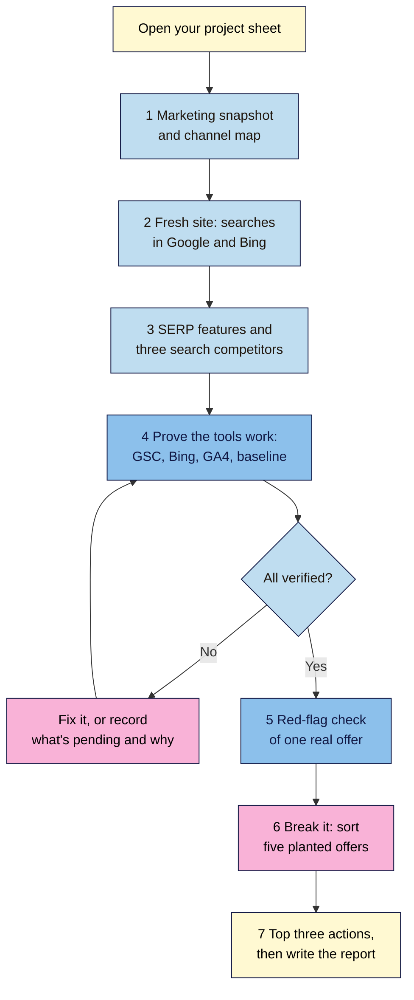

# M01 Capstone — Marketing & Search Snapshot
> By the end of this capstone you'll have a short **Marketing & Search Snapshot** of your project site: who it's for, how people find it, what Google and Bing show, who you're really up against, proof that your tools work, and the three things to do next.

**Time:** ~60–90 min · **Level:** L1 Foundation (beginner) · **Prereqs:** M01.L01–M01.L08
**Non-negotiables assessed:** #1 Stay white hat · #2 Measurement before changes
**Verified against:** the sources in M01.L01–L08; Google's spam policies and "Do you need an SEO?" pages rechecked on 2026-11-04

## The brief
Imagine the owner of your project site has asked: "Where do we stand in search, what are the risks, and what should we do first?" They aren't technical, and they don't want a lecture. They want a short report with proof behind every claim.

Write that report. Most of the evidence is already in your **SEO 101 project** sheet, so this capstone pulls it together, fills the gaps and checks it. On path C, share it with the owner only after you've checked it against the rubric.

## How it works


**In words:** start with your marketing snapshot and channel map. Run fresh searches, then review the results page and your search competitors. Prove your tools work, and don't move on until they do or until you've recorded what's pending and why. Check one real SEO offer, sort the five planted offers, choose your top three actions and write the report.

## Tasks

### 1. Marketing snapshot and channel map (L01, L02)
From your **Snapshot** and **Channels** tabs, write:
- Who the site is for, what it offers, and its one main conversion.
- The channels that bring people today, what each one brings, and which one you depend on most.
- Where SEO fits: which journey stage it could serve best, and why.

### 2. What search engines show today (L03, L04)
1. Run `site:yourdomain.com` again in Google and in Bing, and note today's date.
2. Compare the numbers with baseline row 1. Remember that a `site:` count is a sample, not an exact figure.
3. Name one important page you expected to see. If it's missing, use your **Trace** tab to say which stage may be stopping it: discover, crawl, render, index or serve.

### 3. The results page and your search competitors (L05)
From your **SERPs** tab:
- Choose your site's main topic and one main search.
- List the SERP features on the first page, from top to bottom, with the date and device.
- Name three search competitors, with the page type for each.
- State what kind of page this results page rewards, and one feature you could realistically aim for.

### 4. Prove your tools work (L08)
Collect this evidence, cropping or blurring personal details:

| Check | Evidence |
|---|---|
| Search Console verified | Property name and type (Domain, or URL-prefix with the reason) |
| Sitemap | Address and status |
| Bing Webmaster Tools | Site listed |
| GA4 | Realtime showing your test visit |
| GA4 installed once | View Source check: one tag or one install method |
| Search Console linked to GA4 | The link listed in **Search Console Links** |
| Privacy | Where the site discloses its use of Analytics |
| Baseline | Rows 1 and 2, dated |

> 🖼️ **Image prompt:** A spreadsheet Baseline tab (1200×400) with two dated rows: a `site:` search check and a tools set-up check. Highlight the date column with a 3px #F9B2D7 outline; blur any personal details.
> **Alt text:** A spreadsheet baseline with two dated rows recording site: results and completed tool set-up.

If something is still waiting, such as DNS or a site owner's reply, write down what's pending, since when, and what you've done about it.

### 5. Red-flag check of one real offer (L06)
Use the offer from your **Rules** tab, or find a new one. Don't reply to it or buy anything. Quote the exact words behind each red flag, give your verdict (**avoid**, **ask questions** or **worth a call**), and add one question you'd ask.

### 6. Break it and fix it: five planted offers
These five offers are made up. For each one, write the label (white, grey or black), the policy that applies, and what you'd tell the site owner in one sentence.

| Offer | The pitch |
|---|---|
| **A** | "For ₹8,000 a month we'll place 40 guest posts on other sites, with your main keyword as the link text. No labels on the links." |
| **B** | "Our AI will build 1,000 pages in a weekend, one for each suburb, with the same text and only the place name changed." |
| **C** | "We'll rewrite your 12 service pages around what customers really ask, and we'll share every change with you." |
| **D** | "We'll buy an expired domain in your industry and redirect it to your site, so you inherit its links." |
| **E** | "We'll publish your product reviews in the coupons section of a well-known news site, so they rank on its reputation." |

Only then check your work against the answers near the end of this page.

### 7. Top three actions (L07)
From your **Ranking** tab, list your top three improvements in priority order, with the signal each one supports, its SEO type and why it comes first. Label any idea you can't support from Google's documentation as unproven.

## Deliverable: Marketing & Search Snapshot
Two pages at most (Google Doc, PDF or Markdown), plus your evidence.

```markdown
# Marketing & Search Snapshot — <site> (<URL>)
Date: YYYY-MM-DD · Path: A / B / C · Prepared by: …

## 1. The site in plain words
Audience … · offer … · main conversion …
Channels today … · biggest dependency … · where SEO fits …

## 2. What search engines show
Google site: … (row 1: …) · Bing site: … (row 1: …)
Missing page … · stage that may be stopping it …

## 3. The results page
Main search … · checked on (date, device) …
Features, top to bottom: …
Search competitors: 1) … (page type) 2) … 3) …
This page rewards … · realistic feature to aim for … because …

## 4. Tools and baseline
Search Console: … · sitemap: … · Bing: … · GA4 Realtime: … · link: … · privacy: …
Pending: …

## 5. SEO offer check
Offer: "…" · red flags: … · verdict: … · my question: …

## 6. Five planted offers
A: label … · policy … · advice …
B: …
C: …
D: …
E: …

## 7. What to do next
1) … (signal, SEO type, why first)
2) …
3) …

## 8. Summary for the owner
Three sentences, no jargon: where the site stands, the biggest risk, and the first step.
```

## Rubric
Score each criterion. **Good** or better on all four completes the module.

| Criterion | Excellent (4) | Good (3) | Needs work (2) | Missing (1) |
|---|---|---|---|---|
| **Accuracy** | Every term, feature name, SEO type and policy is correct, including all five planted offers; the `site:` count is treated as a sample | Correct overall; one small slip, with at least four offers right | Several errors, such as ads called organic results or a named violation called grey | Sections missing, or mostly wrong |
| **Evidence** | Every tool check and result has dated proof, with the offer quoted exactly and personal details hidden | Nearly all claims have proof; one item is thin | Claims made without proof, or AI output copied without checking | Little or no evidence |
| **Clear explanation** | A non-technical owner could read it and act on it; the summary uses no jargon | Clear, with a few unexplained terms | Hard to follow, or reads as notes | No summary |
| **Judgement** | Priorities follow the order indexed → relevant → helpful → usable → linked, are realistic for this site, and label unproven ideas; pending items are honest | Sensible priorities with reasons; one is weakly argued | Chases myths, tool scores or every feature; reasons are missing | No priorities |

## Self-check before you submit
- [ ] Every date is real, and the searches were run again for this report.
- [ ] GA4 is installed once, and I've seen my own visit in Realtime.
- [ ] The DNS verification record is still in place.
- [ ] I've compared any AI-written text with the source myself.
- [ ] Nothing personal or private is visible, and on path C I have written permission.
- [ ] I haven't replied to or paid for any SEO offer.

## Check your answers (task 6)
| Offer | Label | Policy | Why |
|---|---|---|---|
| **A** | Black | Link spam | Google's examples include "links with optimized anchor text in articles, guest posts, or press releases distributed on other sites" |
| **B** | Black | Doorway abuse; scaled content abuse | Near-identical pages for places, made in bulk, add little value "no matter how it's created" |
| **C** | White | None | It helps people, and the provider is open about the work. That's what Google tells you to ask for |
| **D** | Grey | Closest: expired domain abuse | Not a named example as pitched, but its main purpose is moving rankings. Treat it as a stop: ask why, and don't buy it |
| **E** | Black | Site reputation policy | Third-party content placed on a site mainly to use that site's ranking signals |

If you marked D black, that's fine as long as you gave the reason. The label matters less than the decision: you wouldn't buy any of A, B, D or E.

## Running project checkpoint
Before Module 2, make sure your **SEO 101 project** sheet has:
- [ ] **Snapshot** and **Channels** complete, and your path (A, B or C) chosen
- [ ] **Baseline** rows 1 and 2, dated
- [ ] **Trace**, **SERPs**, **Rules** and **Ranking** tabs complete

In Module 2 you'll learn the HTML and CSS that search engines read.

## Module 1 cheat sheet
One-page summary of everything in this module: `seo-101/cheatsheets/m01-marketing-seo-foundations.md`.
