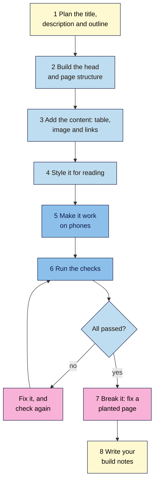

# M02 Capstone — SEO-Ready Article Page
> By the end of this capstone you'll have hand-coded one complete, checked article page on your project site's topic, and you'll be able to prove that it's clean, readable and ready for phones.

**Time:** ~90–120 min · **Level:** L1 Foundation (beginner) · **Prereqs:** M02.L01–M02.L10
**Non-negotiable assessed:** #3 Clean, meaningful HTML
**Verified against:** the sources in M02.L03–L10. The break-it page's CSS passed the W3C CSS Validator on 2026-11-06, and its problems and fixes were confirmed by a scripted check of the HTML. The W3C Nu HTML Checker was rate-limiting requests, so **the break-it page's HTML hasn't been through it yet**, and this page doesn't say what the checker reports. Layouts weren't run in a live browser for this draft.

## The brief
Imagine the owner of your project site asks: "Can you write one good guide for our site, built properly, so we never have to fix it later?" They don't read code. They want a page that people can read on a phone, that search engines can make sense of, and proof that you checked it.

Build that page by hand. You've already done every step on the Nila Coffee cold brew guide, so `article.html` and `style.css` are your reference. This time, write about a topic from your own project site. Use your own words, and don't copy the cold brew guide's text.

- **Path A (your own site):** pick a topic your audience really asks about.
- **Path B (Blogger practice site):** pick a topic for your practice blog.
- **Path C (client site):** pick a topic for the client, but keep the page on your computer. Don't publish anything, and share it only after you've checked it against the rubric.

All paths build the page in your `seo-101-html` folder. You don't need to publish it. Module 5 covers publishing with WordPress.

## How it works


**In words:** plan your title, description and outline first. Build the head and structure, then add your content, including a table, an image and links. Style it for reading and make it work on phones. Run the checks, and keep fixing and checking until they pass. Then fix a planted page, and write short build notes.

## Tasks

### 1. Plan before you code (L03, L04)
On paper or in a document, write:
- The one question your page answers, and who's asking it.
- A `<title>` that's unique, clear and concise.
- A meta description: a short, honest summary.
- One H1, and an outline of at least three H2s, with at least one H3.

Your content should be 300–600 words, with real detail from your own knowledge or the business. If AI helps you draft, check every fact yourself, and rewrite it in your own voice.

### 2. Build the head and structure (L03, L06, L10)
Create `capstone.html` and `capstone.css` in your `seo-101-html` folder.

| Part | Must have |
|---|---|
| Top of the page | `<!DOCTYPE html>`, `<html lang="…">` with your page's language |
| `<head>` | `<meta charset="utf-8">`, the viewport tag, your `<title>`, your meta description, and a `<link>` to `capstone.css` |
| Layout | `<header>`, a labelled `<nav>`, `<main>` with an `<article>`, and a `<footer>` |
| Sections | `<section>` only where a part has its own heading |

### 3. Add the content (L04, L05, L07)

| Element | Must have |
|---|---|
| Headings | One H1, levels in order, chosen by structure and not by size |
| Lists | At least one, with `<ol>` if the order matters |
| Data table | `<caption>`, `<th scope="col">`, and `<th scope="row">` where rows have headers |
| Image | A real `` with useful `alt` text, `width` and `height`, and a descriptive file name. Use your own photo, or one you have the right to use |
| Internal link | At least one, with clear anchor text. Link to `article.html` or another page in your folder |
| External link | At least one to a good source, with clear anchor text |
| Quotation or embed | Optional. Add one only if it helps, with a visible credit for a quotation and a `title` for an `<iframe>` |

> 🖼️ **Image prompt:** A browser window (1280×800) showing a finished, simply styled article page with a heading, a photo, a data table and a footer. Highlight the data table with a 3px #F9B2D7 outline; blur any personal details.
> **Alt text:** A finished article page in a browser, showing its heading, photo, footer and highlighted data table.

### 4. Style it for reading (L08, L09)
In `capstone.css`, use mainly element and class selectors, with no inline styles and no `!important`.
- A font list that ends with a generic family, sizes in `rem`, and a `line-height` of at least 1.5.
- Text contrast of at least 4.5:1. Measure your body text and your link colour, and note the ratios.
- Padding and margin that give the page room, and a `max-width` on the text.
- No text hidden from people. If you use an accordion, keep its text in the HTML.

### 5. Make it work on phones (L10)
- Add `img { max-width: 100%; height: auto; }`, and a scroll wrapper for the table if it needs one.
- Add one `min-width` media query that improves the layout on wide screens.
- In device mode at 320px wide, check that only your table may scroll sideways.
- Check that the same content appears on phone and desktop.

### 6. Run the checks
Collect this evidence, and keep it with your page:

| Check | How | Evidence |
|---|---|---|
| HTML | W3C Nu HTML Checker, at `https://validator.w3.org/nu/#textarea` | No errors. Explain any warning you've left |
| CSS | W3C CSS Validator, at `https://jigsaw.w3.org/css-validator/` | No errors |
| Headings | Your Console line from Lesson 2.4 | The outline, in order |
| Contrast | WebAIM's Contrast Checker or the DevTools **Color Picker** | Ratios for body text and links |
| Phone | Device mode at 320px | A screenshot, with a note on sideways scrolling |
| Content | Your Console line from Lesson 2.10, on phone and desktop | Both sets of counts |

A clean validator result isn't the finish line. **A validator checks rules, not quality**, so read your page as a visitor would too.

### 7. Break it and fix it: the planted page
This page has **nine problems**, and **two things that look wrong but aren't**. First, list what you can find by reading it. Then run it through the checkers, and record which problems they report and which ones they don't. Then fix it.

```html
<!DOCTYPE html>
<html lang="en">
  <head>
    <meta charset="utf-8">
    <title>Home</title>
    <style>
      body { font-family: Georgia, serif; line-height: 1.6; color: #222222; max-width: 40rem; margin: 0 auto; padding: 0 1rem; }
      img { max-width: 100%; height: auto; }
      .tags { color: #ffffff; }
      @media (max-width: 600px) {
        .method { display: none; }
      }
    </style>
  </head>
  <body>
    <main>
      <article>
        <h1>Iced Coffee at Home</h1>
        
        <h1>Why make it yourself?</h1>
        <p>It costs less than a café, and you choose how strong it is.</p>
        
        <h2>What you need</h2>
        <ul>
          <li>Strong coffee, cooled</li>
          <li>Plenty of ice</li>
        </ul>
        <h4>A note on ice</h4>
        <p>Freeze some of the coffee in a tray, so that melting ice won't water it down.</p>
        <section class="method">
          <h2>How to make it</h2>
          <ol>
            <li>Fill a tall glass with ice.</li>
            <li>Pour in the coffee.</li>
          </ol>
        </section>
        <details>
          <summary>Can I add milk?</summary>
          <p>Yes. Add it last, so that you can judge the strength.</p>
        </details>
        <p>To learn about brew strength, <a href="article.html">click here</a>.</p>
        <p class="tags">iced coffee cold coffee best iced coffee iced coffee recipe</p>
      </article>
    </main>
  </body>
</html>
```

Only then check your work against the answers near the end of this page.

### 8. Write your build notes
Use the template below. Keep it to one page.

## Deliverable: SEO-ready article page
Your `capstone.html`, `capstone.css` and image, your fixed planted page, and these notes:

```markdown
# Build notes — <page title>
Date: YYYY-MM-DD · Path: A / B / C · Prepared by: …

## 1. The page
Question it answers … · audience … · words …
Title: … · Meta description: …

## 2. Outline
H1 … · H2 … · H3 …

## 3. Checks
HTML checker: errors … · warnings left, and why …
CSS validator: errors …
Contrast: body text … · links …
At 320px: sideways scrolling? …
Phone vs desktop counts: …

## 4. One decision I made
What I chose, what I didn't, and why (for example, a table or a list, an embed or a link).

## 5. Break-it lab
Problems the checkers reported: …
Problems only I could find: …
What I left alone, and why: …

## 6. For the owner
Two or three plain sentences on what this page does, with no jargon.
```

## Rubric
Score each criterion. **Good** or better on all five completes the module.

| Criterion | Excellent (4) | Good (3) | Needs work (2) | Missing (1) |
|---|---|---|---|---|
| **Head and structure** | Every required element is present, the title and description are specific, and the landmarks and outline are logical | All required elements are present, with one weak title, description or heading | A required element is missing, or levels are skipped | Little real structure |
| **Content and links** | Useful, original content; a correct table; alt text that fits its context; clear anchor text | Useful content, with one small slip in the table, alt text or a link | Thin or copied content, or vague links such as "click here" | No table, image or links |
| **Readability and phones** | Contrast measured and passing, comfortable text, works at 320px, and the same content on phone and desktop | Passes these checks, with one small layout problem | Fails contrast, scrolls sideways, or loses content on phones | No CSS, or no viewport tag |
| **Evidence** | Every check has dated proof, and any warning that remains is explained | Nearly every check has proof | Claims made without proof, or AI output copied without checking | Little or no evidence |
| **Judgement** | All nine problems are fixed, both traps are left alone, and the notes separate what checkers find from what people find | At least seven are fixed, and at least one trap is left alone | Fixes only what the checkers report | Lab not attempted |

## Self-check before you submit
- [ ] I've read the page out loud, as a visitor would.
- [ ] There's one H1, and no heading level is skipped.
- [ ] Every image has suitable `alt` text, and I have the right to use it.
- [ ] Every link makes sense on its own.
- [ ] There's nothing hidden just for search engines.
- [ ] I've tested at 320px and on a real phone, if I have one.
- [ ] I've compared any AI-written text with its source myself.
- [ ] On path C, nothing has been published, and I have permission to share it.

## Check your answers (task 7)

| # | Problem | Fix | Why |
|---|---|---|---|
| 1 | `<title>Home</title>` | A specific title, such as "Iced Coffee at Home: A Quick Guide \| Nila Coffee" | A good title is unique to the page, clear and concise (L03) |
| 2 | No meta description | Add a short, honest summary | Google "sometimes uses" it for the snippet (L03) |
| 3 | No viewport tag | Add it to the `<head>` | Phones show a shrunken page (L10) |
| 4 | Empty `alt` on the main photo | Describe it, such as `alt="A tall glass of iced coffee"` | It carries content, so it isn't decoration (L05) |
| 5 | Two H1s | Change "Why make it yourself?" to `<h2>` | This course uses one H1. It's about a clear outline, not a penalty: Google doesn't say two H1s hurt rankings (L04) |
| 6 | Skipped level: H2 to H4 | Change "A note on ice" to `<h3>` | Levels go down one at a time (L04) |
| 7 | "click here" | Link words such as "how to choose your brew strength" | Anchor text should make sense on its own (L05) |
| 8 | White keywords | Delete the `.tags` paragraph and rule | Hidden text abuse (L09) |
| 9 | `.method` hidden on phones | Delete the media query | Phone visitors lose the main steps, and Google uses the mobile version (L10) |

**Leave alone:**
- The divider's `alt=""`. It's decoration, so an empty `alt` is right (L05).
- The `<details>` block. It's an accordion, and its text is in the HTML (L09).

Your notes should show that the checkers can't judge most of these. They can't tell you whether a title is useful, whether a photo needs a description, or why text is hidden.

## Running project checkpoint
Before Module 3, make sure your **SEO 101 project** sheet has these tabs complete:
- [ ] **Site facts**, **SEO access** and **Head check**
- [ ] **Heading check**, **Link & image check** and **Landmark map**
- [ ] **Embed check**, **Style check**, **Readability check** and **Mobile check**

In Module 3, you'll find the words your audience really uses, and decide which page should answer each one.

## Module 2 cheat sheet
One-page summary of everything in this module: `seo-101/cheatsheets/m02-html-css-for-seo.md`.
