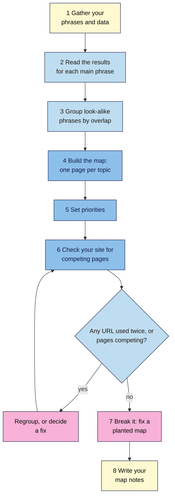

# M03 Capstone — Keyword Map
> By the end of this capstone you'll have a keyword map for at least 15 topics on your project site, with each topic matched to one intent and one page, and proof that no two of your pages are doing the same job.

**Time:** ~2–3 hours · **Level:** L1 Foundation (beginner) · **Prereqs:** M03.L01–M03.L05
**Non-negotiables assessed:** #4 Read the results page before you write (one primary intent per page) · #5 One page per topic (no keyword cannibalisation)
**Verified against:** the sources in M03.L01–L05, all checked between 2026-11-06 and 2026-11-08. The break-it lab's figures are invented for practice, and nothing here was tested in a live Search Console property.

## The brief
Imagine the owner of your project site asks: "We keep writing posts, but we don't know which ones matter, and some seem to fight each other. Can you tell us what to write, in what order, and what to do with what we already have?"

Answer with a keyword map. It's one table that says, for every topic your audience searches for, what they want, which page answers it, and how soon to work on it. You've built every part of it in Lessons 3.1 to 3.5. Now complete it for your whole site.

- **Path A (your own site):** map your existing pages and the new ones you'd add.
- **Path B (Blogger practice site):** most topics will be **New**. That's fine: the map is your writing plan for Modules 5 and 7.
- **Path C (client site):** map the client's site, but don't change any page. Share the map only with the client, and only after you've checked it against the rubric.

## How it works


**In words:** gather the phrases and data you already have, and read the results page for each main phrase. Group look-alike phrases by how many results they share, then build the map with one page per topic. Set priorities, and check your site for pages already competing. If a URL is used twice or two pages compete, regroup or decide a fix, then check again. Finish by fixing a planted map and writing short notes.

## Tasks

### 1. Gather your phrases and data (L02, L03)
Open your **SEO 101 project** sheet. You'll draw on the **Keyword ideas**, **Keyword data** and **Targets** tabs.
- You need enough phrases for at least **15 topics**. Most topics have two to five phrases, so aim for about 40 confirmed phrases. If you're short, go back to Lesson 3.2 and expand more seeds.
- Use only phrases marked **Confirmed**. Leave AI suggestions you couldn't find in a real source out of the map.
- Every number you keep needs its source, place and date. If a figure can't be traced, delete it.

### 2. Read the results for each main phrase (L01)
For each likely topic, pick the clearest phrase, and search it in a private window. In your **Intent check** tab, record the date, the top page types, the formats and the SERP features, then choose **one primary intent**.

This is non-negotiable #4. Don't decide intent from the words alone: "french press" looks like a guide topic, but its results may be mostly shops.

### 3. Group look-alike phrases (L05)
In your **Overlap** tab, compare the top ten results for each pair of phrases that look as if they ask the same thing.
- Three or more shared results suggests one topic *(industry rule of thumb)*. Then check that the intent matches.
- Fewer shared results usually means separate topics, even if the words are similar.
- Compare at least **five pairs**, and keep the URLs as evidence.

### 4. Build the map (L05)
In your **Keyword map** tab, add one row per topic, with at least **15 topics**:

| Topic | Main phrase | Other phrases | Intent | Page type | URL | Existing or new | Priority | Used twice? |
|---|---|---|---|---|---|---|---|---|

- Use dropdowns for **Intent**, **Page type**, **Existing or new** and **Priority**.
- Give each topic one URL. For a new page, write the URL you'd give it.
- Keep `=COUNTIF(F:F, F2)>1` in **Used twice?**. Every row must show **FALSE**.
- Include at least one topic of each intent your site can serve. A shop needs transactional topics as well as guides.

> 🖼️ **Image prompt:** A Google Sheets tab called Keyword map (1400×700) with 15 rows of coffee topics, dropdown columns for intent, page type and priority, and a final column of FALSE values. Highlight the Used twice? column with a 3px #F9B2D7 outline; blur any personal details.
> **Alt text:** A finished keyword map with 15 topics, with the column checking for duplicate URLs highlighted.

### 5. Set priorities (L04)
Bring each topic's decision across from your **Targets** tab, or score new topics on Value, Chance and Effort.
- Choose about **three quick wins** and **one or two stretch targets** to start with. Mark the rest **Later**.
- For each quick win, write one line on who ranks and why you think your page can compete.
- Date the map. Results change, so it's a plan, not a promise.

### 6. Check your site for competing pages (L05)
For each topic with an existing page, run `site:yourdomain.com` plus the topic, and check Search Console's **Performance > Search results**: filter by the main phrase, then open the **Pages** tab.
- If two of your pages are shown for the same phrase with the same intent, record **Merge into [URL]** in a **Notes** column.
- If they're shown but serve different intents, record **Keep both** and the link you'd add between them.
- If there's not enough data, record **Watch**.
- **Don't change your site yet.** Module 6 covers redirects and Module 7 covers merging content.

On a new site with little data, say so in your notes, and rely on the `site:` check.

### 7. Break it and fix it: the planted map
Below is a draft keyword map for Nila Coffee, with Search Console and overlap notes. All figures are invented for practice.

It has **five problems** and **two things that look wrong but aren't**. Find them first by reading, then fix the map and write one line for each fix that says why it was needed.

**Draft map**

| # | Topic | Main phrase | Intent | Page type | URL | Existing or new | Priority |
|---|---|---|---|---|---|---|---|
| 1 | French press ratio | french press ratio | Informational | Guide | /french-press-ratio | Existing | Quick win |
| 2 | French press coffee amount | how much coffee for a french press | Informational | Guide | /how-much-coffee-french-press | Existing | Quick win |
| 3 | French press (buy) | french press | Transactional | Product page | /shop/french-press | Existing | Stretch |
| 4 | Using a french press | how to use a french press | Informational | Guide | /how-to-use-french-press | Existing | Quick win |
| 5 | Cold brew ratio | cold brew ratio | Transactional | Product page | /shop/cold-brew-concentrate | Existing | Quick win |
| 6 | Cold brew guide | how to make cold brew | Informational | Guide | /cold-brew | Existing | Stretch |
| 7 | Cold brew concentrate (buy) | buy cold brew concentrate | Transactional | Product page | /cold-brew | Existing | Later |
| 8 | Coffee | coffee | Informational | Guide | /coffee | New | Quick win |
| 9 | Cold brew India | cold brew india | Transactional | Category page | /cold-brew-india | New | Later |
| 10 | Cold brew in India | cold brew in india | Transactional | Category page | /cold-brew-in-india | New | Later |
| 11 | India cold brew | india cold brew | Transactional | Category page | /india-cold-brew | New | Later |

**Search Console, last 3 months** (Performance > Search results, filtered by query, Pages tab)

| Query | Page | Clicks | Impressions | Average position |
|---|---|---|---|---|
| french press ratio | /french-press-ratio | 22 | 410 | 14 |
| french press ratio | /how-much-coffee-french-press | 9 | 380 | 16 |
| french press | /shop/french-press | 31 | 900 | 9 |
| french press | /how-to-use-french-press | 18 | 650 | 12 |

**Overlap notes** (top ten results compared on the same day)
- "french press ratio" and "how much coffee for a french press" share **6** results.
- "french press ratio" and "french press" share **1** result.

Only then check your work against the answers near the end of this page.

### 8. Write your map notes
Use the template below. Keep it to one page.

## Deliverable: keyword map
Your **Intent check**, **Overlap** and **Keyword map** tabs, your fixed planted map, and these notes:

```markdown
# Keyword map notes — <site name>
Date: YYYY-MM-DD · Path: A / B / C · Prepared by: …

## 1. The map
Topics … · existing pages … · new pages … · every "Used twice?" is FALSE: yes / no
Intents covered: informational … · navigational … · commercial … · transactional …

## 2. Evidence
Results pages read (dated): … · pairs compared in Overlap: …
Phrases left out because they couldn't be confirmed: …

## 3. First targets
Quick wins: 1) … because … 2) … 3) …
Stretch: … because …

## 4. Competing pages on my site
Pairs found … · decision for each (Merge into / Keep both / Watch) and why …
Not enough data for: …

## 5. One decision I made
Two phrases I grouped (or kept apart), the overlap count, and why.

## 6. Break-it lab
Each fix, and why it was needed: 1) … 2) … (all five)
What I left alone, and why: …

## 7. For the owner
Two or three plain sentences on what to write first and what to do with existing pages, with no jargon.
```

## Rubric
Score each criterion. **Good** or better on all five completes the module. The map must be your own work on your own site: a copied map doesn't pass.

| Criterion | Excellent (4) | Good (3) | Needs work (2) | Missing (1) |
|---|---|---|---|---|
| **Intent from the results page** (#4) | Every topic's intent comes from a dated results-page check, and each page type fits what ranks | One or two topics judged from words alone | Several intents guessed, or page types that don't fit the results | No intent recorded |
| **One page per topic** (#5) | At least 15 topics, each with one URL, no URL used twice, and every grouping decision backed by overlap or intent | 15 topics, with one weak grouping | URLs used twice, or one page per word-order variant | Fewer than 10 topics, or no URLs |
| **Evidence and honesty** | Every phrase is confirmed, every number has a source and date, and gaps are stated | One untraced figure or missing date | Several untraced numbers, or AI phrases kept as confirmed | No sources |
| **Realistic priorities** | A mix of about three quick wins and one or two stretch targets, each with a reason based on who ranks | Priorities set, with thin reasons | Big, broad phrases marked as quick wins | No priorities |
| **Competing pages and the lab** | Site checked with `site:` and Search Console, each pair has a sound decision, all five lab problems fixed and both traps left alone with reasons | Site checked, and at least four lab problems fixed with one trap left alone | Overlap treated as always bad, or `noindex` used as a fix | Not attempted |

## Self-check before you submit
- [ ] I read the results page for every main phrase, and dated it.
- [ ] Every topic has one intent and one URL.
- [ ] No row shows **TRUE** in **Used twice?**.
- [ ] I grouped phrases by shared results, not shared words.
- [ ] I didn't make a separate page for each spelling or word order.
- [ ] Every phrase in the map is confirmed, and every number has a source and date.
- [ ] My quick wins are phrases where the results look beatable.
- [ ] I checked my site for competing pages, and didn't change anything yet.
- [ ] I didn't use `noindex` as a fix for competing pages.
- [ ] On path C, nothing has been changed, and I have permission to share the map.

## Check your answers (task 7)

| # | Problem | Fix | Why |
|---|---|---|---|
| 1 | Rows 1 and 2 are one topic on two pages | Merge row 2 into row 1, add its phrase to **Other phrases**, and plan to redirect `/how-much-coffee-french-press` to `/french-press-ratio` | They share 6 results and the same intent, and Search Console shows both for the same phrase. `/french-press-ratio` is stronger, with 22 clicks against 9 (L05) |
| 2 | Row 5 has the wrong intent and page type | Change it to **Informational**, **Guide**, and give it its own page, or add it to the cold brew guide if its results overlap | "cold brew ratio" asks how to make it, so a product page doesn't fit (L01) |
| 3 | `/cold-brew` is used twice, in rows 6 and 7 | Give the concentrate its product page, such as `/shop/cold-brew-concentrate` | One page can't serve learning and buying at once, and **Used twice?** would show TRUE (L05) |
| 4 | "coffee" marked as a quick win | Drop it, or mark it **Later** | It's a huge, broad phrase with big brands and unclear intent, so a small site can't win it soon (L04) |
| 5 | Rows 9 to 11 are one topic in three word orders | Keep one row and one page, with the other wordings as **Other phrases** | Separate near-identical pages lean towards doorway abuse (L05) |

**Leave alone:**
- **Rows 3 and 4 both appear for "french press".** One is for buying and one is for learning, so keep both and link the guide to the product page (L05).
- **Rows 1 and 3 share the words "french press".** They share only 1 result, so they're separate topics. Grouping them by words would be a mistake (L05).

Your notes should show that the numbers alone don't decide. You needed the intent of each page, and whether both pages were really shown, to tell a real problem from a harmless overlap.

## Running project checkpoint
Before Module 4, make sure your **SEO 101 project** sheet has these tabs complete:
- [ ] **Intent check**, **Keyword ideas** and **Keyword data**
- [ ] **Targets**, **Overlap** and **Keyword map**

In Module 4, you'll take one topic from your map and make its page as clear as possible: its title, headings, words, images and links.

## Module 3 cheat sheet
One-page summary of everything in this module: `seo-101/cheatsheets/m03-keyword-research.md`.
