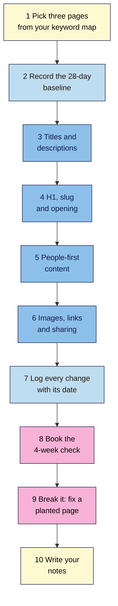

# M04 Capstone — Optimise Three Pages
> By the end of this capstone you'll have optimised three pages from your keyword map, with a before-and-after record of every change and a dated check booked in Search Console to see whether it worked.

**Time:** ~3 hours, plus a 10-minute check in 4 weeks · **Level:** L1 Foundation (beginner) · **Prereqs:** M04.L01–M04.L06 · **Remediate to:** the lesson named in each task
**Non-negotiables assessed:** #6 Every indexable page has a unique, descriptive title and people-first content · **Reinforced:** #3 Clean, meaningful HTML · #4 Read the results page before you write
**Verified against:** the sources in M04.L01–L06, all checked on 2026-11-09, and Search Console Help "Performance report" and "URL Inspection tool". Search Console labels come from its help pages and weren't tested live. The break-it lab's page and figures are invented for practice.

## The brief
Imagine the owner of your project site says: "We know which topics matter now. Can you make our pages actually good at them, and show us whether it made a difference?"

Answer with three optimised pages and a record of what you changed. You've practised each part in Lessons 4.1 to 4.6. Now apply all of it to three pages, and set up the check that tells you, in four weeks, whether it worked.

- **Path A (your own site):** make the changes on your live pages.
- **Path B (Blogger practice site):** make the changes on three posts. If your blog has little Search Console data, record that, and book the check anyway.
- **Path C (client site):** write every change as a recommendation, and change nothing yourself. Book the check for after the client makes the changes.

## How it works


**In words:** choose three pages from your keyword map, and record how each one performed in the 28 days before you touch it. Then work through each page in the order of the module: title and description, H1, slug and opening, people-first content, then images, internal links and sharing. Log every change with its date, and book a check four weeks later. Finish by fixing a planted page, and write short notes.

## Tasks

### 1. Pick three pages (M03 capstone)
From your **Keyword map**, choose three existing pages:
- at least one **quick win**,
- at least one page whose intent differs from the others (for example, one guide and one product or service page),
- no two pages for the same topic.

Re-read the results page for each main phrase in a private window, and date it. If the intent has changed since Module 3, update the map first. Non-negotiable #4 still applies.

### 2. Record the baseline (L01)
Add a tab called **Optimise log**. For each page, in Search Console open **Performance > Search results**, set the **Date range** to the last 28 days, add a **Page** filter for the page's URL, and copy:

| Page | Date range | Clicks | Impressions | CTR | Average position | Top 3 queries |
|---|---|---|---|---|---|---|

- Note the date you copied it.
- If a page has fewer than about 100 impressions in the 28 days, write "low data". A change in four weeks may then be noise *(course rule of thumb)*.
- Google's Starter Guide says "you likely want to wait a few weeks to assess whether your work had beneficial effects in Google Search results." That's why the check comes later.

### 3. Titles and descriptions (L01)
For each page, write a new title and meta description using your **Titles** tab.
- The title is unique on your site, leads with the main topic, and reads naturally.
- The description is a pitch: what the page gives, in one or two sentences.
- Check your site for duplicate titles with `site:yourdomain.com "exact title"` and, on WordPress, your SEO plugin's overview.

### 4. H1, slug and opening (L02)
- The H1 matches the title's promise, and there's one H1 for readers.
- The headings form a clear outline, in order.
- The opening answers the main question in the first few lines.
- **Don't change a slug** unless it's truly misleading. If you do, set a 301 redirect from the old URL and update internal links (Lesson 4.2).

### 5. People-first content (L03)
Run your **People-first check** on each page.
- Fix anything that reads as repeated keywords. Use natural variants and synonyms.
- Add what's missing: a step, a real example, a photo of your own, a clear "who this is for".
- Add or check the byline and a "last updated" date where it helps readers.

### 6. Images, links and sharing (L04–L06)
- **Images:** run your **Image check**. Write one-sentence alt text, resize anything more than about twice its shown width, and don't lazy-load the first image.
- **Internal links:** give each page at least **two** contextual links from related pages, with descriptive anchor text, and make sure each page links on to the next useful page.
- **Shop pages:** if one of your pages is a product or category page, apply the **Shop & share check**.
- **Sharing:** check each page's preview in a sharing debugger, or by sending it to yourself, and fix the image and title if needed.

### 7. Log every change
In the **Optimise log** tab, record each page's before and after:

| Page | Element | Before | After | Lesson | Date changed |
|---|---|---|---|---|---|
| /french-press-ratio | Title | French Press | French Press Ratio: How Much Coffee per Cup | 4.1 | 2026-11-10 |

Log at least: title, description, H1, opening, images, internal links in, and internal links out. Write "no change" where you left something as it was, with the reason.

> 🖼️ **Image prompt:** A Google Sheets tab called Optimise log (1400×700) with rows for three coffee pages, columns Page, Element, Before, After, Lesson and Date changed, and a baseline table above it. Highlight the Date changed column with a 3px #F9B2D7 outline; blur any personal details.
> **Alt text:** An optimise log with before-and-after rows for three pages, with the date-changed column highlighted.

### 8. Book the 4-week check
- In your calendar, book a 10-minute check for **28 days after the last change**.
- On that day, repeat task 2 for the 28 days *after* the change, and copy the same five figures. Search Console's date filter also has a compare option for two ranges side by side (labels not tested live). Use the same length of time before and after.
- Write one line per page: what changed, by how much, and whether something else could explain it (a season, a news story, a site-wide change, a Google update).
- **Don't change the pages again** until the check is done, or you won't know which change did what.

### 9. Break it and fix it: the planted page
Below is the draft of Nila Coffee's new **Cold Brew Ratio** guide, with notes from three checks. All details are invented for practice.

It has **five problems** and **two things that look wrong but aren't**. Find them first by reading, then write one line for each fix that says why it was needed.

**Page source (shortened)** — `https://nilacoffee.example/cold-brew-ratio/`
```html
<head>
  <title>Cold Brew | Nila Coffee</title>
  <meta name="description" content="Nila Coffee: fresh coffee from Chikmagalur, roasted to order.">
  <meta property="og:title" content="Cold brew ratio: how much coffee per litre">
</head>
<body>
  
  <h1>Cold brew ratio: how much coffee per litre</h1>
  <p>Looking for the best cold brew ratio? Our cold brew ratio guide gives you the cold brew
     ratio you need, because the right cold brew ratio makes the best cold brew.</p>
  <p>Use 1 part coffee to 8 parts water, and steep it for 12 hours in the fridge.</p>
  
  <h2>What you need</h2>
  …
</body>
```

**Notes from the checks**
- **Find in page** on the existing `/cold-brew/` guide: its title is also `Cold Brew | Nila Coffee`.
- **Sitemap vs Links report:** `/cold-brew-ratio/` is in the sitemap, but not in **Links > Internal links**. Searching the source of the home page, the menu, `/cold-brew/` and the cold brew category for `cold-brew-ratio` finds nothing.
- **URL Inspection** (**Test live URL**, then **View tested page**): the page can be indexed, and the rendered HTML shows the title and H1 above. No referring page is listed.
- **Category page:** "Cold Brew" page 2, at `/shop/cold-brew/page/2/`, has the same title as page 1.
- **DevTools:** the top photo is rendered at 800 × 600 and weighs 4.6 MB.

Only then check your work against the answers near the end of this page.

### 10. Write your notes
Use the template below. Keep it to one page.

## Deliverable: three optimised pages
Your **Optimise log** tab with the baseline and before-and-after rows, a calendar booking for the 4-week check, your planted-page fixes, and these notes:

```markdown
# Optimise notes — <site name>
Date: YYYY-MM-DD · Path: A / B / C · Prepared by: …

## 1. The pages
1) URL … · topic … · intent (results checked YYYY-MM-DD) …
2) …
3) …

## 2. Baseline (28 days to YYYY-MM-DD)
Page · clicks · impressions · CTR · average position · low data? …

## 3. What I changed, and why
For each page: title, description, H1, opening, content, images, links in, links out, sharing.
One reason per change, with the lesson it comes from.

## 4. What I left alone, and why
…

## 5. The check
Booked for YYYY-MM-DD (28 days after the last change on YYYY-MM-DD).
What I'll compare, and what else could explain a change: …

## 6. Break-it lab
Each fix, and why it was needed: 1) … 2) … (all five)
What I left alone, and why: …

## 7. For the owner
Two or three plain sentences on what you changed and when you'll know if it worked, with no jargon.
```

## Rubric
Score each criterion. **Good** or better on all five completes the module. The changes must be your own work on your own pages: copied pages don't pass.

| Criterion | Excellent (4) | Good (3) | Needs work (2) | Missing (1) |
|---|---|---|---|---|
| **Titles and descriptions** (#6) | All three titles are unique on the site, lead with the topic and read naturally; each description is a clear pitch; a duplicate check is recorded | Titles unique and clear, one weak description | A title duplicated elsewhere on the site, or stuffed with keywords | Titles unchanged with no reason |
| **Intent match** (#4) | Each page's intent rechecked on a dated results page; H1, opening and page type fit it | Intent rechecked, one opening that answers slowly | Intent assumed from the words, or a page type that doesn't fit | Not checked |
| **People-first content** (#6) | People-first check done for each page; repetition removed; real examples, evidence or first-hand detail added | Check done, with small improvements | Keyword repetition left in, or text padded for length | No content changes and no check |
| **Images and links** (#3) | Every informative image has useful alt text and a sensible size; each page has at least two contextual internal links in, with descriptive anchors, and links on | Alt text and links done, one image left oversized | Generic anchors, stuffed alt text, or a page still with no internal links | Not attempted |
| **Evidence and the booked check** | Dated 28-day baseline for each page, every change logged with its date, a check booked 28 days after the last change, and all five lab problems fixed with both traps left alone | Baseline and log complete, check booked, four lab problems fixed | Baseline missing for a page, changes undated, or the check not booked | No baseline or log |

## Self-check before you submit
- [ ] I rechecked the results page for each main phrase, and dated it.
- [ ] Each page's title is unique on my site, and I checked for duplicates.
- [ ] Each H1 matches its title's promise, and each opening answers the main question quickly.
- [ ] I didn't change a slug without a 301 redirect and updated links.
- [ ] I removed repeated keywords rather than adding more.
- [ ] Every informative image has one-sentence alt text, and the first image isn't lazy-loaded.
- [ ] Each page has at least two contextual internal links pointing to it.
- [ ] Every change is logged with its date, and I have a 28-day baseline for each page.
- [ ] My 4-week check is in my calendar, and I won't change these pages again before it.
- [ ] On path C, nothing has been changed, and every change is written as a recommendation.

## Check your answers (task 9)

| # | Problem | Fix | Why |
|---|---|---|---|
| 1 | The title duplicates the `/cold-brew/` guide's title, and doesn't say what this page is about | Write a unique title, such as `Cold Brew Ratio: How Much Coffee per Litre \| Nila Coffee` | Every indexable page needs a unique, descriptive title (non-negotiable #6). Repeated titles make it "impossible for users to distinguish between two pages", and are one of the issues that lead Google to rewrite title links (L01) |
| 2 | The meta description is the site's boilerplate, not about this page | Write a pitch for this page: "Use 1 part coffee to 8 parts water and steep for 12 hours. Here's how to adjust it for a stronger or lighter cold brew." | A description should summarise this page. Boilerplate gives searchers no reason to click (L01) |
| 3 | The first paragraph repeats "cold brew ratio" five times and delays the answer | Delete it, and open with the answer: "Use 1 part coffee to 8 parts water…" | Repeating a phrase so often that it sounds unnatural is keyword stuffing, and the opening should answer first (L02, L03) |
| 4 | The top image: camera file name, 4032 pixels wide for an 800-pixel slot, 4.6 MB, lazy-loaded, with stuffed alt text | Rename it (for example `cold-brew-jar-ratio.jpg`), resize to about 1,600 pixels wide, use WebP if you can, remove `loading="lazy"`, and write alt such as "Coffee grounds and water in a 1-litre jar, ready to steep" | Alt text should describe what the image adds, and the first image shouldn't be lazy-loaded (L04) |
| 5 | No page on the site links to it | Link to it from `/cold-brew/` ("see our **cold brew ratio guide**") and from the cold brew concentrate product page | "Every page you care about should have a link from at least one other page on your site." The sitemap alone isn't enough (L05) |

**Leave alone:**
- **The divider image has `alt=""`.** It's decorative, so an empty alt is right (L04).
- **Category page 2 has the same title as page 1.** Google says "You can use the same titles and descriptions for all pages in the sequence" (L01, L06). Non-negotiable #6 is about different pages, not pages in one paginated list.

The `og:title` without the brand isn't a problem either: Meta suggests leaving branding out. Your notes should show that each check found something different. View Source and find in page found the title and stuffing problems, the sitemap and links check found the orphan, and URL Inspection confirmed what Google actually sees.

## Running project checkpoint
Before Module 5, make sure your **SEO 101 project** sheet has these tabs complete:
- [ ] **Titles**, **Page outline** and **People-first check**
- [ ] **Image check**, **Internal links** and **Shop & share check**
- [ ] **Optimise log**, with a baseline, dated changes and a booked 4-week check

In Module 5, you'll publish new content in WordPress and use its blocks and settings to get these details right from the start.

## Module 4 cheat sheet
One-page summary of everything in this module: `seo-101/cheatsheets/m04-on-page-seo.md`.
