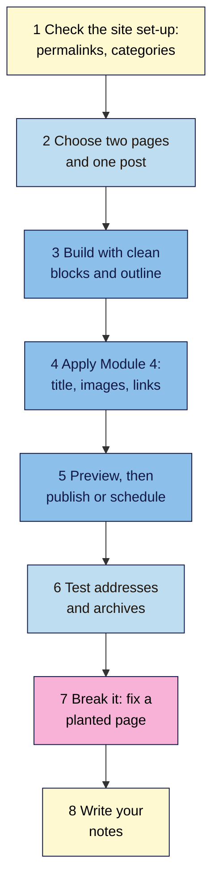

# M05 Capstone — Publish Two Pages and a Post
> By the end of this capstone you'll have published two pages and one post from your keyword map in WordPress, each with clean structure, a readable address and the Module 4 details done, plus a fixed version of a badly built page.

**Time:** ~2.5–3 hours · **Level:** L1 Foundation (beginner) · **Prereqs:** M05.L01–M05.L05 · **Remediate to:** the lesson named in each task
**Non-negotiables reinforced:** #3 Clean, meaningful HTML · #6 Every indexable page has a unique, descriptive title and people-first content
**Verified against:** the sources in M05.L01–L05, all checked on 2026-11-09. WordPress screens weren't tested live. The break-it lab's page and figures are invented for practice.

## The brief
Imagine the owner of your project site says: "We know what to write and how to make each page good. Now we need it actually built in WordPress, properly, so we're not fixing it again next month."

Answer with three published pieces of content: two pages and one post, chosen from your keyword map. Each one should pass the Module 4 checklist and the Module 5 structure checks before it goes live. You'll also fix a page that someone built badly.

- **Path A (your own site):** publish on your live WordPress site, or build on a Local copy first and publish when you're happy.
- **Path B (practice site):** publish on your Local, Playground or hosted practice site. Local and Playground aren't public, which is fine here.
- **Path C (client site):** build everything on your own practice site, and give the client the finished pages as a proposal. Change nothing on their site.
- **Shopify or Wix:** build on a WordPress practice site, and write a short note on how each step maps to your platform (Lesson 5.5).

## How it works


**In words:** check that your site's permalinks and categories are set up. Choose two pages and one post from your keyword map. Build each one with the right blocks and a clean outline, then add the Module 4 details: title, description, images and links. Preview each one, then publish or schedule it. Test the addresses and archives. Finish by fixing a planted page, and write short notes.

## Tasks

### 1. Check the site set-up (L01, L02)
In your **WordPress setup** tab, confirm:
- **Settings → Permalinks** is **Post name**. On a live site with posts, record the current setting instead, and don't change it.
- **Uncategorized** has been renamed, and you have four to seven categories (WordPress 101 Module 2, Lesson 3).
- Your **Archive check** decisions from Lesson 5.2 are done, or planned.
- You have a backup from Lesson 5.1 (ZIP or export file).

### 2. Choose two pages and one post (L02, M03 capstone)
From your **Keyword map**, choose:
- **Two pages:** permanent topics, such as a service, an About page, or a "Start here" guide. If both already exist, rebuild one and improve the other.
- **One post:** a guide or article, ideally a quick win.

For each, confirm the **Post or page** choice from Lesson 5.2, and recheck its results page in a private window. Date it.

### 3. Build with clean blocks (L03, L04)
For each piece:
- The title is the H1. Use H2s for sections and H3s under them. No H1 in the content, and no headings chosen for their size.
- Lists are List blocks, data is a Table block with a **Header section** and caption, and layouts use **Columns**, not tables.
- Check **Document Overview > Outline** until it shows no messages.
- If your site uses a page builder, build one of the three with it, and check its headings in View Source, since the Outline may not see them (Lesson 5.4).

### 4. Apply Module 4 (M04.L01–L06)
For each piece, use your Module 4 tabs:
- A unique title and a description that pitches the page (**Titles**).
- An answer-first opening and a short, readable slug, set **before** publishing (**Page outline**).
- People-first content with no repeated keywords (**People-first check**).
- Images with alt text or **Mark as decorative**, a sensible **Resolution**, and the first image not lazy-loaded (**Image check**).
- At least two internal links **in** from related pages, and at least one link **out** to the next useful page, with descriptive anchors (**Internal links**).
- The post in one category, with no more than three tags, each used by at least three posts or none at all.
- A share preview with a real image (**Shop & share check**).

> 🖼️ **Image prompt:** The WordPress block editor (1280×800) with a finished "Wholesale for Cafés" page, Document Overview open on the Outline tab showing the title and four H2 headings with no warnings. Highlight the clean Outline with a 3px #F9B2D7 outline; blur any personal details.
> **Alt text:** A finished WordPress page with a clean heading outline highlighted in the Document Overview.

### 5. Preview, then publish or schedule (L05)
- **Save draft**, then **Preview in new tab** on desktop and mobile.
- Publish one piece now, and **Schedule** another for the next day. Check that it went live.
- After publishing, make one real improvement to one piece, click **Save**, and check that **Revisions** shows it.

### 6. Test addresses and archives (L02, L05)
- Visit each address, and check the status is **200** in DevTools **Network**.
- View the source of each, and confirm one `<h1>`, the right `<h2>`s, your `alt` text and your description.
- Open your post's category archive, and check the post is listed.
- Open `/wp-sitemap.xml`, and check all three pieces are listed.
- If you changed any slug after publishing, visit the old address and record what happened.

Record everything in a new tab called **Publish check**:

| Piece | Type | Address | Status | One H1? | Outline clean? | Alt text? | Links in / out | In sitemap? | Published or scheduled | Date |
|---|---|---|---|---|---|---|---|---|---|---|

### 7. Break it and fix it: the planted page
Below is Nila Coffee's draft **Wholesale for Cafés** content, built quickly by a temporary helper, with notes from four checks. All details are invented for practice.

It has **five problems** and **two things that look wrong but aren't**. Find them first by reading, then write one line for each fix that says why it was needed.

**How it was published:** as a **post**, in the category **Uncategorized**, dated 14 March 2024, at `https://nilacoffee.example/wholesale/`.

**Page source (shortened)**
```html
<h1 class="wp-block-post-title">Wholesale for Cafés</h1>
<p class="has-x-large-font-size">Fresh beans, roasted weekly</p>

<h1 class="wp-block-heading">Partner with Nila</h1>
<p><strong>Why Nila?</strong></p>
<p>We roast to order in Chikmagalur and deliver within 3 days…</p>
<h5 class="wp-block-heading">Minimum order 5 kg</h5>
<h2 class="wp-block-heading">How it works</h2>
<h3 class="wp-block-heading">1. Tell us your volumes</h3>
<h2 class="wp-block-heading">Prices</h2>
<h5 class="wp-block-heading">Minimum order 5 kg</h5>
```

**Notes from the checks**
- **Document Overview > Outline:** Title · H1 "Partner with Nila" **(Your theme may already use a H1 for the post title)** · H5 **(Incorrect heading level)** · H2 "How it works" · H3 · H2 "Prices" · H5 **(Incorrect heading level)**. "Why Nila?" doesn't appear.
- **DevTools Network:** 6.4 MB transferred; the largest file is `IMG_7781.jpg` at 4.9 MB, shown at 1200 pixels wide. **Resolution** is set to **Full Size**.
- **Posts list:** the post is in **Uncategorized**, and sits on page 3 of the blog, below newer brew guides.
- **Settings → Permalinks:** **Post name**.

Only then check your work against the answers near the end of this page.

### 8. Write your notes
Use the template below. Keep it to one page.

## Deliverable: two pages and a post
Your three published pieces, a **Publish check** tab, your fixed planted page, and these notes:

```markdown
# Publish notes — <site name>
Date: YYYY-MM-DD · Path: A / B / C · Platform: WordPress (and …) · Prepared by: …

## 1. Set-up
Permalinks … · categories … · archive decisions … · backup saved on …

## 2. The three pieces
1) Page · URL … · topic … · intent (results checked YYYY-MM-DD) …
2) Page · …
3) Post · category … · tags …

## 3. Structure
For each: headings (H2s, H3s), Outline messages fixed, lists and tables used, builder or blocks.

## 4. Module 4 details
For each: title, description, opening, images (alt, resolution), links in and out, share preview.

## 5. Publishing
Published on … · scheduled for … (went live: yes / no) · revision made and checked …

## 6. Tests
Status codes, one H1, sitemap, category archive, any old address tested and what happened.

## 7. Break-it lab
Each fix, and why it was needed: 1) … 2) … (all five)
What I left alone, and why: …

## 8. For the owner
Two or three plain sentences on what's now live and how to keep new pages this clean, with no jargon.
```

## Rubric
Score each criterion. **Good** or better on all five completes the module. The pages must be your own work: copied pages don't pass.

| Criterion | Excellent (4) | Good (3) | Needs work (2) | Missing (1) |
|---|---|---|---|---|
| **Structure and headings** (#3) | All three have one H1 (the title), H2s and H3s in order, real lists and tables, and a clean Outline; builder headings checked in View Source | One small Outline message left | Fake headings, an H1 in the content, or headings chosen by size | Structure not checked |
| **Permalinks and URL safety** | Post name set before publishing (or the live setting recorded and left alone); slugs set before publishing; any changed address tested and recorded | Slugs fine, one address not tested | A slug or permalink changed after publishing without a redirect | Not checked |
| **Posts, pages and archives** | Each piece is the right type; the post has one real category and sensible tags; archive decisions recorded | Right types, tags slightly loose | A permanent page published as a post, or the post left in Uncategorized | Not considered |
| **Module 4 applied** (#6) | Unique titles and pitched descriptions, answer-first openings, alt text and sensible image sizes, two links in and one out for each, a real share image | One detail missing on one piece | Several details missing, or a duplicated title | Not applied |
| **Evidence and the lab** | **Publish check** tab complete with status codes and sitemap checks, a schedule and a revision tested, all five lab problems fixed and both traps left alone with reasons | Tab complete, four lab problems fixed | Tab incomplete, or fewer than three lab problems fixed | No evidence |

## Self-check before you submit
- [ ] Permalinks are **Post name**, or I recorded the live setting and didn't change it.
- [ ] Each piece is the right type: permanent topics are pages, articles are posts.
- [ ] Each piece has one H1, and its Outline shows no messages.
- [ ] Lists are List blocks, and tables hold data with a header section.
- [ ] Each title is unique, and each description pitches the page.
- [ ] Every informative image has alt text and a sensible resolution.
- [ ] Each piece has at least two internal links in and one out.
- [ ] I previewed each piece on mobile before publishing.
- [ ] Each address returns 200, and all three are in the sitemap.
- [ ] I didn't change any slug after publishing without testing the old address.
- [ ] On path C, nothing has been changed on the client's site.

## Check your answers (task 7)

| # | Problem | Fix | Why |
|---|---|---|---|
| 1 | A permanent service published as a dated post, in **Uncategorized** | Recreate it as a page at the same address: first change the post's slug (for example to `/wholesale-old/`), publish the page at `/wholesale/`, check it, then delete the post. Link the page from the menu | Services are pages, and the post slides down the blog with a 2024 date (L02). Keeping the same address means no redirect is needed (L05) |
| 2 | A second H1, "Partner with Nila", in the content | Change it to an H2 | The title is already the H1, and the Outline flags it (L03, non-negotiable #3) |
| 3 | "Why Nila?" is a bold paragraph, so it isn't in the outline | Make it an H2 Heading block | A fake heading can't be found by screen readers or the Outline (L03) |
| 4 | "Minimum order 5 kg" is an H5, used twice as small print | Make it a Paragraph block with a small font size, and keep it once, under **Prices** | Headings chosen for size break the outline: both show **(Incorrect heading level)** (L03, L04) |
| 5 | The hero image is a 4,032-pixel, 4.9 MB camera file at **Full Size**, with an empty alt, though it shows the roastery | Set **Resolution** to **Large** (or upload a resized copy, about twice the shown width), rename it before uploading, and add alt text such as "Nila's roaster in Chikmagalur with a fresh batch of beans" | Oversized images make the page heavy, and the photo adds information, so it needs alt text (M04.L04, L04) |

**Leave alone:**
- **"Fresh beans, roasted weekly" is a large paragraph, not a heading.** It's a slogan, not a section title, so styling a paragraph is exactly right (L04).
- **An H2 follows an H3.** Going back up a level isn't a problem, and the Outline doesn't flag it (L03).

The **Post name** permalink is fine too. Your notes should show that the Outline found the heading problems, DevTools found the image weight, and only the posts list showed the wrong content type. No single check finds everything.

## Running project checkpoint
Before Module 6, make sure your **SEO 101 project** sheet has these tabs complete:
- [ ] **WordPress setup** and **Archive check**
- [ ] **Outline check**, **Builder check** and **URL change test**
- [ ] **Publish check**, with three published pieces

In Module 6, you'll check whether Google can actually reach and index these pages: status codes, `robots.txt`, `noindex`, canonicals, sitemaps and redirects.

## Module 5 cheat sheet
One-page summary of everything in this module: `seo-101/cheatsheets/m05-wordpress-content.md`.
