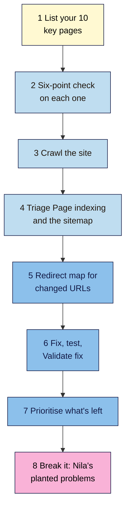

# M06 Capstone — Crawl and Indexing Audit
> By the end of this capstone you'll have audited your project site's crawling and indexing, fixed what you can, written a redirect map for any changed URLs, and found five planted problems on Nila's site from evidence alone.

**Time:** ~3 hours · **Level:** L2 Practitioner · **Prereqs:** M06.L01–M06.L06 · **Remediate to:** the lesson named in each task
**Non-negotiables assessed:** #7 Indexable before optimised · #8 Redirect every changed or removed URL
**Verified against:** the sources in M06.L01–L06, all checked on 2026-11-09. Search Console, Bing and Screaming Frog screens weren't tested live. The break-it lab's site, URLs and tool output are invented for practice.

## The brief
Imagine the owner of your project site says: "We've written good pages. But are they actually in Google? And did anything break when we changed things?"

Answer with an **indexing audit**: check that every important page can be indexed, find what's stopping the rest, fix what you can, and give the owner a short, prioritised list for anything you can't fix yourself.

- **Path A (your own site):** audit and fix your live site.
- **Path B (practice site):** audit your Blogger site (Search Console data) and your WordPress practice site (crawl and code checks). Fix on both.
- **Path C (client site):** audit read-only, with permission to crawl. Write the fixes as recommendations; change nothing yourself.
- **Shopify or Wix:** run the same checks; use the platform notes in Lessons 5.5 and 6.5 for redirects and robots settings.

## How it works


**In words:** list your ten most important pages, and run the six-point indexability check on each. Crawl the whole site, then triage the Page indexing report and your sitemap. Build a redirect map for any URLs that changed or were removed. Fix what you can, test each fix and start validation. Prioritise what's left by impact and effort. Finally, find the planted problems on Nila's site.

## Tasks

### 1. List your 10 key pages (M03 capstone, M05 capstone)
From your **Keyword map** and **Publish check** tabs, list the ten pages that matter most: the home page, main service or category pages, and your best posts. Add a tab called **Indexing audit** with one row per page.

### 2. Run the six-point check on each (L01–L04)
For each key page, record:

| Page | Status (one hop?) | Crawl allowed? | No stray `noindex`? | Canonical correct? | In sitemap? | Linked internally? | URL Inspection: indexed? | Pass? |
|---|---|---|---|---|---|---|---|---|

Use DevTools **Network** and **Headers**, View Source, `/robots.txt`, your sitemap and URL Inspection. Any **No** is a finding.

### 3. Crawl the site (L06)
Run a Screaming Frog crawl (free, up to 500 URLs). Record the counts in your **Crawl findings** tab for: 4xx, 5xx, 3xx linked internally, **Blocked by Robots.txt**, **Redirect Chain**, **Noindex**, **Non-Indexable Canonical**, and the number of URLs deeper than three clicks. Export the filters that have results.

### 4. Triage Page indexing and the sitemap (L04, L06)
- Mark every **Why pages aren't indexed** reason as intended or fix, and note the **Source**.
- Switch to **All submitted pages**: list any sitemap URL that isn't indexed, and decide whether to fix it or remove it from the sitemap.
- Check the Sitemaps report status, and that only one sitemap system is in use.
- Check three `lastmod` dates against real changes.

### 5. Build a redirect map (L05)
In your **Redirect map** tab, list every URL that has changed or been removed since you started the course (from Lessons 4.2 and 5.5, and anything the crawl or report found). For each: the new URL, the type (301, or 404/410), the reason, and the tested result. Every 301 must be one hop to a 200. No row may go to the home page unless the old page really was about the whole site.

### 6. Fix, test and validate (L01–L06)
- Fix every finding you can (paths A and B). On path C, write each fix as a recommendation.
- Test each fix: DevTools for status and hops, View Source for tags, and URL Inspection's **Test live URL**.
- Click **Validate fix** once for each fixed Page indexing reason, and log the date.
- Update internal links that point to redirected URLs.

> 🖼️ **Image prompt:** A Google Sheets tab named "Indexing audit" (1280×700) with ten page rows and columns for each of the six checks, most cells marked Yes and two marked No in pink. Highlight the two No cells with a 3px #F9B2D7 outline; blur any personal details.
> **Alt text:** A spreadsheet indexing audit with two failed checks highlighted among ten key pages.

### 7. Prioritise what's left
For anything not fixed, score **Impact** (High: a key page can't be indexed; Medium: wasted crawling, a chain, a duplicate; Low: tidiness) and **Effort** (Low, Medium, High). Order the list: high impact and low effort first.

### 8. Break it and fix it: the planted problems
Below is evidence from five checks on Nila Coffee's site, made after a rushed redesign. All details are invented for practice.

It has **five problems** and **two things that look wrong but aren't**. Find them from the evidence first, then write one line for each fix that says why.

**A. `https://nilacoffee.example/robots.txt`**
```text
User-agent: *
Disallow: /wp-admin/
Allow: /wp-admin/admin-ajax.php
Disallow: /wholesale/

Sitemap: https://nilacoffee.example/wp-sitemap.xml
```

**B. Response headers and source notes (DevTools)**
| URL | Status | Notes |
|---|---|---|
| `/cold-brew-guide/` | 200 | Response header `x-robots-tag: noindex` · no robots meta tag in the source |
| `/wholesale/` | 200 | `<meta name="robots" content="noindex">` in the source |
| `/brew-kit/` | 200 | `<link rel="canonical" href="http://nilacoffee.example/brew-kit">` |
| `/?s=decaf` | 200 | `<meta name="robots" content="noindex, follow">` |
| `/events/2024-tasting/` | 404 | Theme's "Sorry, this page doesn't exist" page |
| `/shop/hand-grinder/` | 200 | Product discontinued; page shows only "Out of stock. This product is no longer available." and a footer |

**C. DevTools Network, Preserve log, visiting `http://nilacoffee.example/2024/05/cold-brew`**
```text
301  http://nilacoffee.example/2024/05/cold-brew
301  https://nilacoffee.example/2024/05/cold-brew
301  https://nilacoffee.example/2024/05/cold-brew/
200  https://nilacoffee.example/cold-brew-guide/
```

**D. URL Inspection notes**
- `/wholesale/`: **Crawl allowed?** No · **Indexing allowed?** Yes · Page indexing: **Indexed, though blocked by robots.txt**.
- `/cold-brew-guide/`: **Indexing allowed?** No: 'noindex' detected in 'X-Robots-Tag' http header.
- `/shop/hand-grinder/`: Page indexing: **Soft 404**.

**E. Owner's note:** "The cold brew guide is our best page. Wholesale should be hidden from Google but not from cafés we send the link to. We stopped stocking the hand grinder; the new burr grinder at `/shop/burr-grinder/` replaces it. The 2024 tasting was a one-off."

Only then check your answers near the end of this page.

## Deliverable: an indexing audit
Your **Indexing audit**, **Crawl findings**, **Redirect map** and **Sitemap audit** tabs, your fixes (or recommendations), and this one-page report:

```markdown
# Indexing audit — <site name>
Date: YYYY-MM-DD · Path: A / B / C · Tools: DevTools, Screaming Frog vNN, Search Console, Bing · Prepared by: …

## 1. Summary for the owner
Two or three plain sentences: how many key pages are indexable and indexed, the biggest problem found, and what's been fixed.

## 2. Key pages (six-point check)
10 pages · N pass all six · failures: …

## 3. Crawl
URLs crawled … · 4xx … · 5xx … · internal links to redirects … · chains … · noindex … · non-indexable canonicals … · deeper than 3 clicks …

## 4. Page indexing and sitemap
Indexed … · not indexed … · reasons intended: … · reasons to fix: … · submitted but not indexed: … · sitemap status …

## 5. Redirect map
N URLs mapped · all single-hop: yes / no · none to the home page: yes / no

## 6. Fixes made and validation
Each fix, how it was tested, and the Validate fix date.

## 7. Still to do (prioritised)
| Issue | Impact | Effort | Owner | Due |

## 8. Break-it lab
Each problem, the fix, and why: 1) … 2) … (all five)
What I left alone, and why: …
```

## Rubric
Score each criterion. **Good** or better on all five completes the module.

| Criterion | Excellent (4) | Good (3) | Needs work (2) | Missing (1) |
|---|---|---|---|---|
| **Indexability checks** (#7) | All ten key pages checked on all six points with evidence; every failure explained and fixed or recommended | One check missing on one page | Checks done without evidence, or failures not followed up | Not done |
| **Redirects** (#8) | Every changed or removed URL mapped; every 301 tested as one hop to a 200; no home-page dumping; internal links updated | One chain or untested row | Several chains, or removed pages sent to the home page | No map |
| **Crawl control, canonicals and sitemap** | robots.txt, `noindex` and canonicals all agree with what the owner wants; sitemap lists only indexable canonical URLs with honest dates | One small mismatch | Blocked-and-noindexed pages, or a sitemap full of non-indexable URLs | Not checked |
| **Evidence and validation** | Crawl exported, every Page indexing reason triaged with the source noted, fixes tested with **Test live URL**, Validate fix dated | Triage complete, one fix not retested | Partial triage, no testing | No evidence |
| **Prioritisation and the lab** | Clear impact × effort list; all five lab problems fixed and both traps left alone with reasons | Four lab problems fixed | Fewer than three lab problems fixed, or no priorities | Missing |

## Self-check before you submit
- [ ] All ten key pages have a row with six checks and a URL Inspection result.
- [ ] Every Page indexing reason is marked intended or fix.
- [ ] No key page is blocked by robots.txt or has a stray `noindex`, in the source or the headers.
- [ ] No page is both blocked and `noindex`ed.
- [ ] Canonicals are absolute, `https`, and point to indexable pages.
- [ ] The sitemap lists only 200, indexable, canonical URLs.
- [ ] Every changed URL redirects in one hop to a 200; none go to the home page by default.
- [ ] Internal links point to final URLs, not redirects.
- [ ] Each fix was tested, and Validate fix was clicked once with the date logged.
- [ ] On path C, nothing has been changed on the client's site.

## Check your answers (task 8)

| # | Problem | Fix | Why |
|---|---|---|---|
| 1 | The best page, `/cold-brew-guide/`, sends `x-robots-tag: noindex` in its headers | Remove the header (often a server rule or plugin setting left from the redesign), then **Test live URL** and request indexing | A stray `noindex` on a key page; it's only in the header, so View Source alone misses it (L02, #7) |
| 2 | `/wholesale/` is blocked in robots.txt *and* has `noindex`, so it's **Indexed, though blocked by robots.txt** | Remove `Disallow: /wholesale/`, keep the `noindex` | Google must crawl the page to see the `noindex` (L02) |
| 3 | A three-hop chain to the cold brew guide | Redirect `http://nilacoffee.example/2024/05/cold-brew` and each step straight to `https://nilacoffee.example/cold-brew-guide/`, then update any internal links | Non-negotiable #8: one hop (L05) |
| 4 | `/brew-kit/` has a relative-looking, `http`, no-trailing-slash canonical that redirects | Change it to `https://nilacoffee.example/brew-kit/` (self-referencing, absolute, `https`) | A canonical should point to an indexable, 200 page (L03) |
| 5 | `/shop/hand-grinder/` is a soft 404 | 301 it to `/shop/burr-grinder/`, the stated replacement | Google: "If your page has moved or has a clear replacement on your site, return a 301" (L01) |

**Leave alone:**
- **`/?s=decaf` has `noindex, follow`.** WordPress adds this to internal search results on purpose (L01, L02).
- **`/events/2024-tasting/` returns 404.** It was a one-off with no replacement; a real 404 is right, and Google says these are "not necessarily a problem" (L01).

Your notes should show that View Source alone missed problem 1, that URL Inspection's **Crawl allowed? No / Indexing allowed? Yes** pair gave away problem 2, and that only DevTools with **Preserve log** showed the chain in problem 3. No single tool finds everything.

## Running project checkpoint
Before Module 7, make sure your **SEO 101 project** sheet has these tabs complete:
- [ ] **Status check**, **Crawl control** and **Canonical check**
- [ ] **Sitemap audit** and **Redirect map**
- [ ] **Crawl findings** and **Indexing audit**, with fixes dated

In Module 7, you'll plan and write new content with briefs. Every new page will need to pass this module's six-point check before it counts.

## Module 6 cheat sheet
One-page summary of everything in this module: `seo-101/cheatsheets/m06-technical-seo.md`.
