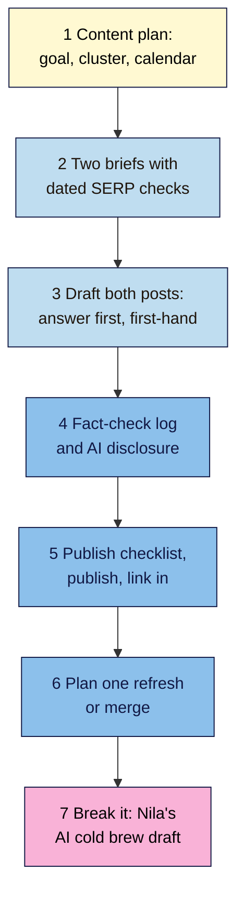

# M07 Capstone — 3-Month Content Plan and Two Published Posts
> By the end of this capstone you'll have a 3-month content plan built around one topic cluster, two posts published from briefs, each with a fact-check log and a passed publish checklist, and you'll have found seven planted problems in an AI draft of Nila's cold brew guide.

**Time:** ~5–6 hours (spread over two weeks) · **Level:** L2 Practitioner · **Prereqs:** M07.L01–M07.L06 · **Remediate to:** the lesson named in each task
**Non-negotiables assessed:** #9 Every post starts from a brief and passes the publish checklist · #10 A human edits and fact-checks every AI-assisted page (+ #4, #5, #6 reinforced)
**Verified against:** the sources in M07.L01–L06, all checked on 2026-11-09. The break-it lab's draft, people, organisations, figures and URLs are invented for practice; any resemblance to real ones is accidental.

## The brief
Imagine the owner of your project site says: "We want the blog to bring in customers, not just exist. Can you plan the next three months, write the first two posts, and make sure nothing we publish is wrong?"

Answer with a **content plan** and **two published posts**: one cluster, a calendar you can keep, two briefs, two posts written for people with first-hand detail, a fact-check log for each, and a publish checklist that both posts pass.

- **Path A (your own site):** plan for your site and publish both posts on it.
- **Path B (practice site):** plan for the site in your Snapshot, and publish on your Blogger site or WordPress practice site. A local or Playground site can't be seen by Google, so run the indexing checks in DevTools and View Source only.
- **Path C (client site):** plan with the client, get each brief signed off, and publish only with their written OK. If they say no, deliver the posts as ready-to-publish drafts with a passed checklist for everything except section 6.

## How it works


**In words:** finish your content plan: a goal, one topic cluster with planned links, and a 3-month calendar. Write briefs for two cluster posts, each with a dated results-page check. Draft both posts with the answer first and real first-hand detail. Fact-check every claim and decide on an AI disclosure. Run the publish checklist, publish, and link each post in from older pages. Add one refresh or merge from your content audit to the calendar. Finally, find the planted problems in Nila's AI draft.

## Tasks

### 1. Finish the content plan (L01)
Complete your **Content plan** tab:
- **Goal, reader and how you'll know** (three lines), tied to your **Snapshot**.
- **One topic cluster:** a pillar and 4–6 cluster posts, each with its own main phrase, intent and URL from your **Keyword map**, with **Used twice?** FALSE for all of them.
- **Link plan:** for every post, at least two planned links in and two out (pillar ↔ posts, sideways links, posts → money page).
- **12-week calendar** sized to your real hours, with a 4-week check after each publish date.

### 2. Write two briefs (L02)
Pick two cluster posts from the calendar. For each, in your **Briefs** tab:
- a **dated SERP check** (intent, page types, format, features);
- a full brief: phrase, intent and format, reader and need, **angle ("Only we can…")**, outline with the answer first, questions, primary sources, links in and out, call to action, scope as a range, AI use, owner and dates.
At least one of the two must be a different format from the other (for example, a how-to and an explainer).

### 3. Draft both posts (L03)
- Answer first; descriptive headings; sentences over 25 words split; paragraphs of 5 sentences or fewer.
- At least two pieces of **first-hand evidence** per post (your number, photo, result or observation).
- Every borrowed fact names its primary source in the sentence and is marked **[check]**.
- Record the writing pass (words before and after, sentences split, paragraphs cut) under each brief.

### 4. Fact-check and disclose (L04)
- In your **Fact-check log**, list every checkable claim in both posts, including titles, meta descriptions and alt text. Each row needs a source URL, the supporting sentence, the date checked and a verdict (Keep, Fix, Cut).
- If you used AI for anything, log what it did. Decide whether each post needs a "How we made this" note, and write it if so.
- The byline on both posts is a real person with a true bio.

> 🖼️ **Image prompt:** A Google Sheets tab named "Fact-check log" (1280×700) with about twelve rows across two posts, columns for claim, type, source URL, supporting sentence, checked on and verdict, with most rows marked Keep, two marked Fix and one marked Cut. Highlight the Cut row with a 3px #F9B2D7 outline; blur any personal details.
> **Alt text:** A fact-check log covering two posts, with one claim marked Cut highlighted among Keep and Fix rows.

### 5. Publish with the checklist (L05)
- Run all 24 checks in your **Publish log** for each post. Fix every Fail before publishing.
- Publish (paths A and B), then add links in from at least two older pages per post.
- Run the after-publishing checks: status 200, no `noindex`, self-referencing canonical, in the sitemap, visible date matching any `datePublished`, and (public sites) URL Inspection **Test live URL**.
- Mark both posts as published in your calendar, and book their 4-week checks.

### 6. Plan one refresh or merge (L06)
From your **Content audit** tab, pick one older post marked Refresh or Merge, and put it in your calendar with a week and a one-line plan. (If your site has no older posts, write "none yet" and the date of your first audit.)

### 7. Break it and fix it: Nila's AI draft
A new freelancer sent Nila the draft below for the cluster post "how to make cold brew at home". They used an AI assistant and didn't check it. All details are invented for practice.

It has **seven problems** and **two things that look wrong but aren't**. Use the evidence (A–E) to find them, then write one line for each fix that says why.

**The draft (top of the post):**

> **Title:** Top 10 Cold Brew Makers to Buy in 2026 | Nila Coffee
> **By Dr. Maya Brew, PhD Coffee Science** *(round headshot photo)* · **Updated today**
>
> As an AI language model, I can't taste coffee, but in today's fast-paced world, cold brew has become a beloved ritual for coffee lovers everywhere. Let's dive into everything you need to know.
>
> 73% of coffee drinkers now prefer cold brew to hot coffee (National Coffee Institute, 2025). As champion barista Rhea Castellano puts it: "Cold brew is just patience in a jar."
>
> **The 10 best cold brew makers** — 1. FrostPress Pro … 2. ChillJar XL … *(10 product blurbs, none sold by Nila)*
>
> **How to make cold brew** — Mix coarse coffee with water, steep for **2 hours at room temperature**, then strain. Research shows this keeps acidity low ([study](https://coffeeresearch.example/cold-brew-acidity-2024)).
>
> **How long does cold brew last?** — Cold brew concentrate keeps for up to 10 days in a sealed jar in the fridge. After that, it starts to taste flat.
>
> *Editor's note at the bottom:* "Draft is about 700 words. Too short? Competitors are around 2,000."

**A. SERP check for "how to make cold brew at home" (private window, 2026-11-09):** 8 of the top 10 are recipes or step-by-step guides with a ratio near the top; 1 video; 1 forum thread. No product lists. People also ask: "How long does cold brew last?", "What is the ratio for cold brew?"

**B. Exact-phrase searches:** `"National Coffee Institute"` → no organisation's own website; only a few pages repeating the same 73% line with no source. `"Cold brew is just patience in a jar"` → no results. `"Rhea Castellano" barista` → no results for a barista of that name.

**C. Link check:** `https://coffeeresearch.example/cold-brew-acidity-2024` → **404 Not Found**.

**D. Nila's recipe card (from her roastery tests):** "1 part coarse coffee to 8 parts cold water. Steep 12–18 hours in the fridge. Strain twice. Keeps about 10 days sealed in the fridge."

**E. Image check:** a reverse-image search of the headshot finds it on an AI image site's gallery. Nila's team has no one called Maya Brew; the guide will be written up by her head roaster, Arun.

Only then check your answers near the end of this page.

## Deliverable: a content plan and two posts
Your **Content plan**, **Briefs**, **Fact-check log**, **Publish log** and **Content audit** tabs, two live posts (or ready-to-publish drafts on path C), and this one-page summary:

```markdown
# Content plan and posts — <site name>
Date: YYYY-MM-DD · Path: A / B / C · Prepared by: …

## 1. Goal, reader and success measure
Three lines.

## 2. Cluster
Pillar: … · Cluster posts: … (each with phrase, intent, URL) · link plan: every post ≥2 in, ≥2 out: yes / no

## 3. Calendar (12 weeks)
Pace: … · hours per week: … · posts: … · refreshes: … · 4-week checks booked: yes / no

## 4. Post 1 — <title> (<URL>)
Brief: phrase, intent, format, angle · First-hand evidence: … · Fact-check: N claims (Keep N, Fix N, Cut N) · AI use and disclosure: … · Checklist: 24/24 · Indexing checks: pass / fail

## 5. Post 2 — <title> (<URL>)
(same as post 1)

## 6. Next refresh or merge
<URL> · Refresh / Merge into … · week …

## 7. Break-it lab
Each problem, the fix, and why: 1) … 2) … (all seven)
What I left alone, and why: …
```

## Rubric
Score each criterion. **Good** or better on all five completes the module.

| Criterion | Excellent (4) | Good (3) | Needs work (2) | Missing (1) |
|---|---|---|---|---|
| **Strategy and cluster** (#5) | Goal tied to the Snapshot; one small cluster with a phrase, intent and unique URL per post; every post has ≥2 links in and out planned; calendar fits real hours with 4-week checks | One post's links or one calendar week unrealistic | Overlapping posts, a long-tail "pillar", or a calendar far beyond the hours available | No plan |
| **Briefs and intent** (#4) | Both briefs complete with dated SERP checks; formats match the results; angles name something only this site has; scope from the outline | One field thin, or one angle generic | A format that doesn't match the results, or a word count as the target | No briefs |
| **Writing quality** (#6) | Answer first; plain language; ≥2 pieces of first-hand evidence per post; sources named and linked to primary sources; no filler | One post thin on first-hand detail | Buried answers, filler, or "studies show" without sources | Not written |
| **Fact-check and AI use** (#10) | Every claim, title, meta and alt in both posts logged with source, sentence, date and verdict; AI use logged; disclosure decision justified; real bylines | One claim or one metadata line not logged | Partial logs, or AI text published unchecked | No log |
| **Publish checklist and lab** (#9) | Both posts pass all 24 checks with fixes noted; linked in from older pages; indexing checks passed; all seven lab problems fixed and both traps left alone with reasons | Five or six lab problems fixed, or one check skipped | Several checks skipped, or fewer than four lab problems fixed | Missing |

## Self-check before you submit
- [ ] The cluster has one pillar and 4–6 posts, each with a unique URL and **Used twice?** FALSE.
- [ ] Both briefs have a dated SERP check and an "Only we can…" angle.
- [ ] Both posts answer the main question in the first few lines.
- [ ] Each post has at least two pieces of first-hand evidence.
- [ ] Every fact, title, meta description and alt text is in the **Fact-check log** with a verdict.
- [ ] No statistic, quote or link went live without a source you opened yourself.
- [ ] Both bylines are real people with true bios; any AI use is logged, and disclosed where reasonably expected.
- [ ] Both posts pass all 24 publish checks, including two links in from older pages.
- [ ] Both posts return 200, have no `noindex`, a self-referencing canonical, and appear in the sitemap.
- [ ] On path C, nothing was published without the client's written OK.

## Check your answers (task 7)

| # | Problem | Evidence | Fix | Why |
|---|---|---|---|---|
| 1 | **Wrong intent:** a "Top 10 cold brew makers" list for a how-to search | A: recipes and guides, no product lists | Retitle as a how-to ("How to Make Cold Brew at Home: Our Café Ratio \| Nila Coffee"), restructure as steps with the ratio first, and drop the ten product blurbs | Match the results page; one primary intent per page (L02, #4) |
| 2 | **Invented statistic:** "73% … (National Coffee Institute, 2025)" | B: no organisation found; only copies of the same line | Cut it. Use a real, primary source only if one exists | No primary source means cut (L04, #10) |
| 3 | **Fake quote:** "Rhea Castellano" | B: no results for the quote or the person | Cut it, or quote a real person Nila has asked | AI quotes "may look authoritative … but are not grounded in fact" (L04) |
| 4 | **Wrong facts:** 2 hours at room temperature | D: 12–18 hours in the fridge, 1:8, strain twice | Replace with Nila's tested recipe, first, as the answer | First-hand facts beat the AI's guess; answer first (L03, L04) |
| 5 | **Dead source link** | C: 404 | Remove the link and the claim it supports, or find the real study and cite it by name | Open every link; no working source means no claim (L04) |
| 6 | **AI leftovers and filler:** "As an AI language model…", "in today's fast-paced world", "Let's dive in" | The draft itself | Delete the opening; start with the ratio | The rater guidelines list "As an AI language model" as a sign of unedited AI text; filler "can artificially inflate content" (L03, L04) |
| 7 | **Fake byline and date:** "Dr. Maya Brew, PhD" with an AI headshot, and "Updated today" on a new post | E: AI image gallery; no such person | Byline: Arun, head roaster, with a true bio; label the date "Published [date]" on first publish | "Fabricating creator profiles … is a form of deception"; label dates honestly (L04, L05) |

**Leave alone:**
- **The question heading "How long does cold brew last?"** It mirrors a People also ask question, it's answered in the first sentence, and the answer matches Nila's recipe card (D). Question headings are fine when answered straight away (L03).
- **The 700-word length.** Once the product list is gone and the steps are in, the post may well do its job in 700–900 words. Google has no preferred word count, and padding to 2,000 adds filler (L02, L03).

Your notes should show that the results page (A) gave away problem 1, that exact-phrase searches (B) exposed problems 2 and 3, that only clicking the link (C) found problem 5, and that Nila's own notes (D) were the only reliable source for problem 4. The AI draft read smoothly; none of these problems was visible from the text alone.

## Running project checkpoint
Before Module 8, make sure your **SEO 101 project** sheet has these tabs complete:
- [ ] **Content plan** (goal, cluster, link plan, 12-week calendar)
- [ ] **Briefs** (two briefs with SERP checks and writing-pass rows)
- [ ] **Fact-check log** and **Publish log** for both posts
- [ ] **Content audit** with at least one decision carried out

In Module 8, you'll measure what these posts do: Search Console and GA4 reports for the cluster, key events for sign-ups, and a monthly report. Your 4-week checks will use those reports.

## Module 7 cheat sheet
One-page summary of everything in this module: `seo-101/cheatsheets/m07-content-ai.md`.
