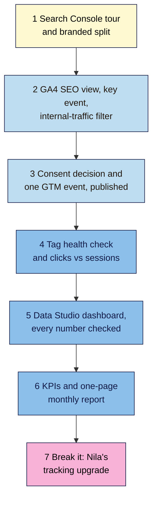

# M08 Capstone — SEO Dashboard and Monthly Report
> By the end of this capstone you'll have measurement you can trust on your project site (one GA4 tag, a key event, your own visits filtered out), a one-page Data Studio dashboard checked against its sources, and an honest monthly SEO report. You'll also have found seven planted tracking and reporting faults on Nila's site after a "tracking upgrade".

**Time:** ~4–5 hours (spread over a week, so the filter and new events have time to collect data) · **Level:** L2 Practitioner · **Prereqs:** M08.L01–M08.L06 · **Remediate to:** the lesson named in each task
**Non-negotiables assessed:** #2 Measurement before changes (in depth: Search Console verified, GA4 recording with key events, GSC linked to GA4, a baseline, changes dated)
**Verified against:** the sources in M08.L01–L06, all checked on 2026-11-09. The break-it lab's IDs, numbers and screens are invented for practice; any resemblance to real accounts is accidental.

## The brief
Imagine the owner of your project site says: "I keep hearing 'SEO is working', but I can't see it. Can you make sure our numbers are right, and give me one page a month that tells me what's happening?"

Answer with **measurement you can trust** and a **monthly report**: a tidy tracking set-up, a dashboard that matches its sources, and a one-page report with KPIs, causes, caveats and next steps.

- **Path A (your own site):** do every task on your site.
- **Path B (practice site):** do every task on your practice site's Search Console and GA4. Numbers will be tiny; say so in the report's caveats. If GTM isn't practical on Blogger, build the event in a container without publishing and note why.
- **Path C (client site):** do tasks 1, 4, 5 and 6 with the access you have. For tasks 2 and 3 (they change the client's settings), get written OK first, or deliver them as a recommendation list.

## How it works


**In words:** tour every Search Console report and split branded from non-branded clicks. Set up GA4 for SEO with a key event and an internal-traffic filter. Decide how you handle consent, and publish one GTM event. Run the tag health check and compare clicks with sessions. Build the Data Studio dashboard and check every number. Choose KPIs and write the first monthly report. Finally, find the planted faults on Nila's site.

## Tasks

### 1. Search Console, properly (L01)
Complete your **GSC tour** tab:
- every report with **Status today**, **Worry if…** and **Check how often**;
- a branded vs non-branded split (Google's filter or your regex), with the growth target named;
- an annotation for your first M07 publish date;
- Links (top linking sites and top internally linked pages, marked "sample") and Crawl stats **Host status**.

### 2. GA4 for SEO (L02)
Complete your **GA4 SEO view** tab:
- Organic Search sessions and `google / organic` sessions, with dates;
- top five organic landing pages with key events;
- at least one key event that measures the business goal, starred (or listed for task 3);
- an internal-traffic filter: **Testing**, checked in Explore with "Test data filter name", then **Active**, with dates.

### 3. Consent and one GTM event (L03)
Complete your **Tracking setup** tab:
- your consent decision (visitors from the EEA, UK or Switzerland? banner? basic or advanced?), with a link to your local guidance;
- your **one** GA4 install method, written down;
- one event (for example `sign_up`) built in GTM, previewed (fires once), seen in DebugView, published as a **named version**, and marked as a key event.

### 4. Tag health and a fair comparison (L04)
Complete your **Tag health** tab:
- 4 weeks of Search Console clicks vs GA4 `google / organic` sessions, weekly, with the gap and its likely reasons;
- a dated tag health check on three page types (home, a post, a product or service page): View Source count, Measurement ID match, Tag Assistant, DevTools (one page view per load), GTM Versions published;
- any fix made, annotated in both GA4 and Search Console.

> 🖼️ **Image prompt:** A Google Sheets tab named "Tag health" (1280×700) with a 4-week table of Search Console clicks, GA4 sessions and gap %, and below it a checklist of five tag checks for three page types, all ✅ except one ❌ with a note "duplicate tag removed 2026-11-12". Highlight the ❌ row with a 3px #F9B2D7 outline; blur any personal details.
> **Alt text:** A Tag health tab with four weeks of clicks versus sessions and a tag checklist, with one fixed failure highlighted.

### 5. The dashboard (L05)
Build a one-page Data Studio dashboard:
- header with title, date range control and a freshness note;
- scorecards for Clicks, Impressions, CTR (Search Console, URL Impression, Web) and Sessions, Key events (GA4, `google / organic`), each compared with last year (or the previous period);
- a weekly clicks chart with the comparison line, a GA4 landing page table, and a **Changes log** table;
- a **Dashboard checks** tab: every scorecard checked against its source tool, with any difference explained;
- shared view-only.

### 6. KPIs and the monthly report (L06)
- A **KPIs** tab with 3–5 KPIs tied to your Lesson 1.1 goal (no average position).
- Winners and losers: top three pages up and down by clicks difference (year over year, or previous period matching weekdays), each with a reason from the Changes log or "unknown".
- A one-page **Monthly report**: headline, KPI table, winners and losers, dated changes, at least two caveats, three next actions with owners and dates.

### 7. Break it and fix it: Nila's tracking upgrade
Last month, a helpful friend "upgraded" Nila's tracking: they added Google Tag Manager, built a sign-up event, set up an internal-traffic filter, and wrote her first monthly report. Nila's numbers now look strange. All IDs and figures are invented for practice.

There are **seven faults** and **two things that look wrong but aren't**. Use the evidence (A–G) to find them, then write one line for each fix that says why.

**A. View Source (home page), lines containing Google tags:**
```html
<!-- Google tag (gtag.js) added by Site Kit -->
<script async src="https://www.googletagmanager.com/gtag/js?id=G-NL7Q2XK9WP"></script>
<!-- Google Tag Manager -->
<script>(function(w,d,s,l,i){ /* … */ })(window,document,'script','dataLayer','GTM-K4N8L2Q');</script>
```

**B. GTM, Versions tab:**
| Version | Name | Published |
|---|---|---|
| 3 | "GA4 + sign_up event" | 2026-10-02 |
| — | Workspace changes: "Subscribe button click (purchase intent)" | — *(not published; last opened in Preview 2026-10-20)* |

Version 3 contains: a **Google Analytics** tag for `G-NL7Q2XK9WP` (Initialization – All Initialization Events), and a **GA4 Event** tag `sign_up` with Measurement ID `G-NL7Q2XK9PW`.

**C. GA4 Admin → Data streams → Web stream details:** Measurement ID `G-NL7Q2XK9WP`.

**D. DevTools, Network, filter `collect`, one load of the home page then one newsletter sign-up** *(request details are observed practice)*:
| Request | `tid` | `en` | Status |
|---|---|---|---|
| analytics.google.com/g/collect | G-NL7Q2XK9WP | page_view | 204 |
| analytics.google.com/g/collect | G-NL7Q2XK9WP | page_view | 204 |
| analytics.google.com/g/collect | G-NL7Q2XK9PW | sign_up | 204 |

**E. GA4 Admin:**
- **Data filters:** "Internal Traffic" — state **Testing** — created 2026-09-28.
- **Data display → Events** (last 28 days): `page_view`, `session_start`, `first_visit`, `user_engagement`, `scroll`, `click`, `view_item`, `add_to_cart`. No `purchase`. Key events column: none starred.

**F. Search Console:**
- Clicks vs GA4 `google / organic` sessions, by week, before the upgrade: gap 31%, 29%, 33%, 30%. After: −42%, −39%, −45%, −40% (GA4 now higher).
- Crawl stats (Nila's site has 180 pages): 214 requests returned 404 last month, all for old product URLs removed in 2025 and not linked anywhere on the site. Host status: green.

**G. The friend's draft monthly report (top of page):**
> **Headline:** Great month! Average position improved from 21.3 to 17.8, and organic sessions are up 74%.
> **KPIs:** Search Console clicks (last 28 days): 1,120 · GA4 organic sessions (last calendar month): 1,950 · Key events: 0
> **Caveats:** none.

Only then check your answers near the end of this page.

## Deliverable: measurement and a monthly report
Your **GSC tour**, **GA4 SEO view**, **Tracking setup**, **Tag health**, **Changes log**, **Dashboard checks**, **KPIs** and **Monthly report** tabs, the shared dashboard link, and this one-page summary:

```markdown
# Measurement and monthly report — <site name>
Date: YYYY-MM-DD · Path: A / B / C · Prepared by: …

## 1. Search Console
Weekly checks: … · Branded vs non-branded clicks: … / … · Host status: … · Annotation added: yes / no

## 2. GA4
Organic sessions (dates): … · Key event(s): … · Internal-traffic filter: Testing YYYY-MM-DD → Active YYYY-MM-DD

## 3. Tracking set-up
Consent: … · GA4 installed via: … (one method) · GTM container: GTM-… · Event: … · Version: "…" published YYYY-MM-DD

## 4. Tag health
Clicks vs sessions gap (4 weeks): …% · steady / jumped · Checks on 3 page types: all pass / fixed: …

## 5. Dashboard
Link (view-only): … · Numbers checked: N of N match or explained

## 6. Monthly report
KPIs: … · Headline: "…" · Top caveat: …

## 7. Break-it lab
Each fault, the fix, and why: 1) … 2) … (all seven)
What I left alone, and why: …
```

## Rubric
Score each criterion. **Good** or better on all five completes the module.

| Criterion | Excellent (4) | Good (3) | Needs work (2) | Missing (1) |
|---|---|---|---|---|
| **Measurement set-up** (#2) | One GA4 install method, ID matches on three page types; internal-traffic filter tested then active; consent decision recorded; one GTM event published as a named version; every change dated in the Changes log and annotated | One page type unchecked, or one change undated | Duplicate or unverified tags, or a filter activated untested | Not done |
| **Search Console use** | Every report toured with "worry if" and cadence; branded split with growth target; Links read as a sample; Host status checked | One report or the branded split thin | Only Performance used, or Links/Crawl stats over-read | Not done |
| **GA4 and key events** | Organic channel and `google / organic` landing pages recorded; key events tied to the business goal and working; 4-week clicks vs sessions with the gap explained | Key event set up but not yet recording | No key event, or sessions from all channels used as "SEO" | Not done |
| **Dashboard accuracy** | One page, same dates and filters for both sources, comparisons, freshness note, changes log; every number checked against its source; view-only sharing | One number unchecked | Mismatched filters or tables; numbers don't match and aren't explained | No dashboard |
| **Honest reporting and lab** | 3–5 goal-linked KPIs (no average position); fair comparisons; reasons or "unknown"; ≥2 caveats; dated next actions; all seven lab faults fixed and both traps left alone with reasons | Five or six lab faults fixed, or one caveat missing | Vanity headline, month-on-month for seasonal data, or fewer than four lab faults fixed | Missing |

## Self-check before you submit
- [ ] View Source on three page types shows one GA4 install method and the right `G-` ID.
- [ ] DevTools shows one `page_view` per page load.
- [ ] The latest GTM version is published, named, and in the Changes log.
- [ ] The internal-traffic filter is **Active**, after being checked in **Testing**.
- [ ] At least one key event measures the business goal and has recorded data.
- [ ] Search Console and GA4 comparisons use the same dates and filters, weekly or monthly.
- [ ] Every dashboard scorecard is checked against its source tool.
- [ ] The report has no average-position headline, at least two caveats and three dated next actions.
- [ ] Every change has an annotation (GA4 and Search Console) and a Changes log row.
- [ ] On path C, nothing in the client's accounts was changed without their written OK.

## Check your answers (task 7)

| # | Fault | Evidence | Fix | Why |
|---|---|---|---|---|
| 1 | **GA4 installed twice:** Site Kit's tag and GTM's Google Analytics tag, same ID | A, B (version 3), D: two `page_view` requests per load; F: sessions jumped above clicks after the upgrade | Keep one: switch off GA4 in Site Kit (GTM now needs to load it for the event), or remove GA4 from GTM. Annotate the date | Two installs count every page view twice *(observed practice)*; Google: "no need to deploy additional code using gtag.js on your site if Tag Manager is already in use" (L03, L04) |
| 2 | **Wrong Measurement ID in the `sign_up` tag:** `…9PW` instead of `…9WP` | B, C, D: `sign_up` sent to `G-NL7Q2XK9PW` with status 204 | Correct the ID in the event tag, preview, publish a new named version | "Typos in the Measurement ID are one of the most common and easy-to-make setup mistakes"; 204 means received, not "right property" (L04) |
| 3 | **GTM change never published:** the Subscribe click event exists only in the workspace | B: no date in the Published column | Preview it, then **Submit → Publish and Create Version** with a name | Preview "is not visible to your regular website visitors"; only published versions reach them (L03) |
| 4 | **Internal-traffic filter stuck in Testing** for six weeks | E | Check "Test data filter name" in Explore, then set it to **Active**; log the date | Testing only labels the data; it doesn't remove it. Active is permanent and not retroactive, so the six weeks stay mixed (L02) |
| 5 | **No `purchase` event, so no key events** | E: no `purchase`; G: key events 0 | Turn on the shop's GA4 purchase tracking (or build it on the order-confirmed page in GTM), check it in DebugView, make sure it's a key event | Key events measure "actions that are important to the success of your business"; without one, SEO can't be tied to subscriptions (L02) |
| 6 | **Mismatched date ranges** in the report | G: "last 28 days" vs "last calendar month" | Use the same dates (and filters) for both tools | Google: "pick the same filter for both data sources"; a fair comparison needs the same period (L04, L05) |
| 7 | **Vanity headline, no caveats:** average position, and a "74% rise" caused by the double count | G; F | Lead with non-branded clicks and organic key events, year over year; add caveats (the double count until the fix date, data delay, consent) | Position is "a complex metric that can be misleading"; the sessions rise is fault 1, not SEO (L06) |

**Leave alone:**
- **The steady ~30% gap before the upgrade** (F). Google lists normal reasons (consent, blockers, bots, time zones, PDFs), and the trend was steady. Only the jump after the upgrade signalled a fault (L04).
- **The 214 old-URL 404s in Crawl stats** (F). The site has under a thousand pages, so Google says you "should not need to use this report or worry about this level of crawling detail"; the URLs were removed on purpose and aren't linked anywhere, and Host status is green (L01, Lesson 6.6).

Your notes should show that the jump in the gap (F) was the first clue, that View Source (A) and GTM Versions (B) explained it, that only comparing IDs character by character (B, C, D) found fault 2, and that GA4 Admin (E) held faults 4 and 5. None of these faults was visible from the dashboard alone.

## Running project checkpoint
Before Module 9, make sure your **SEO 101 project** sheet has these tabs complete:
- [ ] **GSC tour**, **GA4 SEO view**, **Tracking setup** and **Tag health**
- [ ] **Changes log** (every change since Module 7, dated)
- [ ] **Dashboard checks**, with the dashboard shared view-only
- [ ] **KPIs** and your first **Monthly report**

In Module 9, you'll start earning links. Your dashboard and monthly report will show whether that work brings visitors and results, and your Changes log will date every outreach win.

## Module 8 cheat sheet
One-page summary of everything in this module: `seo-101/cheatsheets/m08-analytics-reporting.md`.
