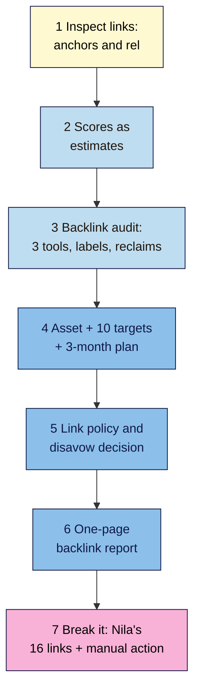

# M09 Capstone — Backlink Report and 3-Month Outreach Plan
> By the end of this capstone you'll have a backlink report for your project site (three tools compared, every linking site labelled, reclaims listed), a 3-month outreach plan built around one linkable asset and 10 realistic targets, and a clear link policy. You'll also sort Nila Coffee's 16-row backlink list and plan the fix for an inherited manual action.

**Time:** ~4–5 hours (spread over a week) · **Level:** L2 Practitioner · **Prereqs:** M09.L01–M09.L05 · **Remediate to:** the lesson named in each task
**Non-negotiables assessed:** #11 Earn links, never buy them (+ #1 Stay white hat, reinforced)
**Verified against:** the sources in M09.L01–L05, all checked on 2026-11-09. The break-it lab's sites, prices and numbers are invented for practice; any resemblance to real ones is accidental.

## The brief
Imagine the owner of your project site says: "Someone told me we need more backlinks. Who links to us now, is anything dodgy, and how do we get good links without paying for rubbish?"

Answer with a **backlink report** and an **outreach plan**: what you have, what (if anything) needs fixing, and a realistic, honest plan for the next three months.

- **Path A (your own site):** do every task, and send your first outreach emails when the asset is ready.
- **Path B (practice site):** do every task as planning. Use task 7's list for the audit practice if your site has no links. Don't send outreach for a practice site.
- **Path C (client site):** do every task with the access you have; get the client's sign-off on the asset, targets, emails and link policy before anything is sent in their name.

## How it works


**In words:** inspect a handful of links to and from your site. Compare authority scores as tool estimates only. Audit your backlinks with three free tools, label every linking site and list reclaims. Plan one linkable asset, 10 targets and a 3-month outreach calendar. Write a link policy and record your disavow decision. Summarise it all in a one-page report. Finally, sort Nila's list and plan the fix for her inherited manual action.

## Tasks

### 1. Read your links (L01)
Complete your **Links 101** tab: three links to your site and two from it, each inspected live (anchor text, `rel`), plus your anchor text mix in four groups (brand, descriptive, generic, exact-match). Fix any paid or affiliate link on your site without `sponsored`.

### 2. Scores as estimates (L02)
Complete your **Authority scores** tab: your site and three competitors in two tools, with a "can tell / can't tell" sentence for each and a one-line answer for "How do we get our DA up?"

### 3. Backlink audit (L03)
Complete your **Backlink audit** tab:
- Search Console Top linking sites and Latest links exports, plus Bing Backlinks and Ahrefs Free, with each tool's total and one line on why they differ;
- every linking site (or the top 20) checked live and labelled **Fine**, **Ignore** or **Risky**, with an action;
- a reclaim list: good links pointing at 404s (with the redirect or update you'll make) and unlinked mentions.

### 4. Asset, targets and a 3-month plan (L04)
In your **Outreach** tab:
- a linkable asset brief ("only we have this", and what it needs before outreach);
- **10 realistic targets**, each with a specific page, why their readers would care, a contact route and a method (asset, relationship, local, PR, guest, broken link, mention);
- a **3-month calendar**: asset ready by week …, outreach in small batches (for example, 3–4 a fortnight), at most one follow-up each, a monthly check of Search Console's Latest links, and reclaims done in month 1;
- two email drafts checked against the honesty checklist.

> 🖼️ **Image prompt:** A Google Sheets tab named "Outreach" (1280×720) with a short asset brief at the top, a 10-row target table (site, page, why their readers care, contact, method, status) and a 12-week calendar strip below with outreach batches every second week. Highlight the "why their readers care" column with a 3px #F9B2D7 outline; blur any personal details.
> **Alt text:** An outreach plan sheet with an asset brief, 10 targets and a 12-week calendar, with the reader-benefit column highlighted.

### 5. Link policy and disavow decision (L05)
In your **Link schemes** tab:
- a short **link policy**: what you'll accept (sponsorships marked `sponsored`, genuine partners), what you'll decline (bought links, swaps, widget or footer deals), and who decides;
- your **Manual actions** report status (Path A/C) and a one-line **disavow decision** using Step 0 ("No: no manual action and nothing arranged" is the usual answer).

### 6. The one-page backlink report
Summarise tasks 1–5 using the deliverable template below. Lead with the answer to the owner's question in one sentence.

### 7. Break it and fix it: Nila's backlinks
Nila's previous agency left her this list, and Search Console now shows a manual action. All sites and figures are invented for practice.

**Part 1: sort the 16 links into Fine, Ignore or Risky, with one line of reasoning each.**

| # | Link to nilacoffee.example |
|---|---|
| 1 | A Bengaluru food blogger reviews her single-origin beans and links to the product page; Nila didn't ask or pay |
| 2 | The same blogger's earlier post: Nila sent free beans, and the post links with no `rel` and no disclosure |
| 3 | A city newspaper article on her new tasting room links to the home page |
| 4 | 60 `.xyz` scraper sites copying her blog posts, with her links still inside |
| 5 | A "guaranteed DA 50+" guest post bought for ₹4,000, anchor "best coffee beans online India" |
| 6 | A national roasters' association member directory lists Nila with a link |
| 7 | 300 "free SEO directory" submissions done by a gig seller for ₹999 |
| 8 | A café that stocks Nila's beans links to her on its "Our suppliers" page |
| 9 | A "partners" page swapping links with 40 unrelated sites |
| 10 | A Reddit thread where a customer recommends Nila (`rel="ugc nofollow"`) |
| 11 | Forum signatures on 50 forums with the anchor "best filter coffee Chennai", posted by the agency |
| 12 | A coffee festival she sponsored shows her logo with `rel="sponsored"` |
| 13 | A free "coffee calculator" widget the agency gave away, with a hidden keyword link to the shop |
| 14 | An old link from a blog that no longer exists (the page returns 404) |
| 15 | 12 thin "coffee blogs" on the same server, all built by the agency, all linking to her |
| 16 | A tool flags a home cook's Blogspot recipe page linking to Nila as "toxic" |

**Part 2: the manual action.** Search Console shows **"Unnatural links to your site"**, applied site-wide. Using your labels, write the fix plan: which links to deal with, in what order, what goes in a disavow file (if anything), which property type you need, and three sentences for the reconsideration request.

Only then check your answers near the end of this page.

## Deliverable: a backlink report and outreach plan
Your **Links 101**, **Authority scores**, **Backlink audit**, **Outreach** and **Link schemes** tabs, and this one-page summary:

```markdown
# Backlink report and outreach plan — <site name>
Date: YYYY-MM-DD · Path: A / B / C · Prepared by: …

## 1. The short answer
One sentence: who links to us, is anything risky, and what we'll do.

## 2. Links today
Linking sites: GSC … · Bing … · Ahrefs Free … (why they differ: …)
Fine … · Ignore … · Risky … · Anchor mix: brand …% / descriptive …% / generic …% / exact-match …%
Manual actions: none / … · Disavow decision: … (Step 0 reason)

## 3. Reclaims (month 1)
<URL> → 301 to … / ask to update · unlinked mentions: …

## 4. Linkable asset
<title, URL> · only we have: … · ready by: …

## 5. 10 targets and the 3-month plan
Targets (site, why their readers care, method): … · Batches: … · Follow-up rule: once at most · Check: Latest links monthly

## 6. Link policy
Accept: … · Decline: … · Decides: …

## 7. Break-it lab
Part 1: each link, label and why (1–16)
Part 2: fix plan, disavow contents, property type, request text
```

## Rubric
Score each criterion. **Good** or better on all five completes the module.

| Criterion | Excellent (4) | Good (3) | Needs work (2) | Missing (1) |
|---|---|---|---|---|
| **Link understanding** | Links inspected live with correct anchor and `rel` readings; anchor mix grouped; scores described as tool estimates compared within one tool | One reading wrong or one score compared across tools | `nofollow` called worthless, or scores treated as Google's | Not done |
| **Audit accuracy** | Three tools compared and differences explained; every linking site checked live and labelled by "arranged to move rankings?"; reclaims listed with fixes | A few sites unchecked | Ugly-but-unasked links labelled risky; tool totals treated as truth | No audit |
| **Ethical earning** (#11) | A genuinely useful asset; 10 relevant targets with reader benefits; methods from the menu; no paid or swapped links | One or two weak targets | Generic targets or "Dear Webmaster" lists; links offered for goods | Plan to buy links |
| **Outreach quality** | Two emails pass every honesty check (who, where, why it helps, easy no, honest subject, no anchor requests); one follow-up rule; small batches | One check missed | Templates, flattery, keyword anchor requests or repeated chasing | No emails |
| **Spam and disavow judgement** (#1) | Link policy clear; Step 0 applied correctly; all 16 lab links labelled right; manual action plan removes first, disavows only the rest, names a URL-prefix property and a request that explains, describes and documents | 14–15 labels right, or one plan step missing | Disavow on tool scores, or fewer than 12 labels right | Missing |

## Self-check before you submit
- [ ] Every paid or affiliate link on your site has `rel="sponsored"`.
- [ ] No authority score is reported as a result or compared across tools.
- [ ] Every Risky label means someone arranged the link, not that the site looks bad.
- [ ] Every reclaim has a specific fix (redirect or a one-time ask).
- [ ] The asset is genuinely useful, and ready before outreach starts.
- [ ] All 10 targets are real sites your audience reads, each with a reason.
- [ ] Both emails pass the honesty checklist; follow-ups are once at most.
- [ ] The link policy declines bought links, swaps, widget and footer deals.
- [ ] Your disavow decision follows Step 0, and nothing was uploaded unless there's a manual action or a likely one.
- [ ] On path C, nothing was sent or changed without the client's written OK.

## Check your answers (task 7)

**Part 1**

| # | Label | Why |
|---|---|---|
| 1 | **Fine** | An editorial link given freely; links that "happen naturally over time" (L01) |
| 2 | **Risky** | "Sending someone a product in exchange for them writing about it and including a link"; fix with `rel="sponsored"` and a disclosure (L05) |
| 3 | **Fine** | Earned local press; Google's Links help suggests checking "are you mentioned in food blogs or review sites?" (L03) |
| 4 | **Ignore** | Unasked scraper spam; "Google typically will ignore the links" (L03) |
| 5 | **Risky** | Buying links plus "optimized anchor text in … guest posts"; DA isn't Google's (L02, L05) |
| 6 | **Fine** | A relevant industry directory, not a "Low-quality directory" (L04, L05) |
| 7 | **Risky** | "Low-quality directory or bookmark site links" and "automated programs or services" (L05) |
| 8 | **Fine** | A real business relationship, no swap required (L04) |
| 9 | **Risky** | "Excessive link exchanges" or "partner pages exclusively for the sake of cross-linking" (L05) |
| 10 | **Fine** | Normal user content; `ugc nofollow` is expected and still sends visitors (L01) |
| 11 | **Risky** | "Forum comments with optimized links in the post or signature" (L05) |
| 12 | **Fine** | A paid sponsorship correctly "qualified with … rel="sponsored"" (L05) |
| 13 | **Risky** | "Keyword-rich, hidden, or low-quality links embedded in widgets" (L05) |
| 14 | **Ignore** (or reclaim) | Not harmful; the report "includes links that Google has found over time" that "may have since been removed" (L03) |
| 15 | **Risky** | A PBN: "Creating low-value content primarily for the purposes of manipulating linking and ranking signals" (L05) |
| 16 | **Ignore** | A tool's label; disavowing on third-party metrics is "a terrible idea" (Mueller, L02) |

**Part 2: the manual action plan**
1. **Export** links (Top linking sites and Latest links) and confirm the Risky rows: 2, 5, 7, 9, 11, 13, 15 (L03, L05).
2. **Fix what Nila controls first:** remove the partners page (9) and the widget's hidden link (13, ship an update with a visible `nofollow` credit or none); ask the blogger to add `sponsored` (2).
3. **Request removals** from the guest post site (5), directories (7), forums (11, delete the signatures where she has accounts) and the agency's network (15). Log dates and replies.
4. **Disavow only what's left** after a good-faith effort, using `domain:` lines for whole sites (for example, the 12 network domains) and `#` comments recording the removal attempts. Leave Fine and Ignore rows out: "Make sure that you don't disavow organic links".
5. **Use a URL-prefix property**: "The disavow links tool does not support Domain properties."
6. **Request review** once every listed issue is fixed. For example: "In 2025 our previous agency bought guest posts, directory and forum links and built a 12-site network pointing to us. We removed the partners page and the widget link, asked 46 sites to remove links (31 removed; log attached), and disavowed the 17 domains that didn't respond. We have a written link policy and no longer use that agency." That explains, describes and documents.

Your notes should show that the question "did someone arrange this link to move rankings?" sorted every row, that tool labels (16) and ugly spam (4) changed nothing, and that disavowing came last, after fixing and asking.

## Running project checkpoint
Before Module 10, make sure your **SEO 101 project** sheet has these tabs complete:
- [ ] **Links 101** and **Authority scores**
- [ ] **Backlink audit** with labels and a reclaim list
- [ ] **Outreach** with the asset, 10 targets and a 3-month calendar
- [ ] **Link schemes** with your link policy and disavow decision

In Module 10, you'll study competitors: their keywords, content and links. Your audit and Bing's competitor backlinks will show where they earn links that you could earn too.

## Module 9 cheat sheet
One-page summary of everything in this module: `seo-101/cheatsheets/m09-off-page-links.md`.
