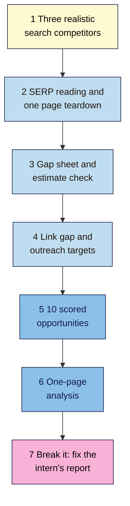

# M10 Capstone — Competitor Analysis and 10 Opportunities
> By the end of this capstone you'll have a competitor analysis of three realistic search competitors, with a page teardown, a gap sheet, a link gap and 10 scored, evidence-backed opportunities for your project site. You'll also correct an intern's competitor "report" for Nila Coffee that contains 11 wrong conclusions.

**Time:** ~4–5 hours (spread over a week) · **Level:** L2 Practitioner · **Prereqs:** M10.L01–M10.L05 · **Remediate to:** the lesson named in each task
**Non-negotiables reinforced:** #4 (people-first, original content: learn, don't copy) and #11 (earn links, never buy them)
**Verified against:** the sources in M10.L01–L05, all checked on 2026-11-09. The break-it lab's sites and numbers are invented for practice; any resemblance to real ones is accidental.

## The brief
Imagine the owner of your project site says: "Who are we really up against on Google, what are they doing better, and what should we do about it in the next three months, without copying anyone or buying anything?"

Answer with a **competitor analysis**: three realistic search competitors, what you learned from them, and a scored list of 10 opportunities, each backed by evidence you can show.

- **Path A (your own site):** do every task with your own Search Console data.
- **Path B (practice site):** do every task; use your Keyword map for "your topics", and say where evidence is thin.
- **Path C (client site):** do every task with the client's access, and use hedged wording in everything they see.

## How it works


**In words:** choose three realistic search competitors from results you checked by hand. Read the results pages and tear down one competitor page against yours. Find your content gaps, and check one traffic estimate against your real data. Find the links they earned that you could earn too. Score 10 opportunities with evidence and dates, write a one-page analysis, then correct the intern's report.

## Tasks

### 1. Three realistic search competitors (L01)
Complete your **Competitors** tab: 5 searches across your topic clusters, the top 5 results each (with city, device and date), every site labelled business / search-only / giant, a recurrence count, a "not studying" line for giants, and **3 chosen competitors** with a reason each.

### 2. Read the results and tear down one page (L02)
Complete your **Page teardown** tab: results-page notes for one important search (types, formats, features), a theirs-vs-mine table (title, headings, depth, first-hand evidence, Rich Results Test, PSI **lab vs lab**, Wayback history), and **three "be more useful" changes**, each ticked as not copied.

### 3. Gap sheet and estimate check (L03)
Complete your **Gap sheet**: your topics (from Search Console) and your competitors' (from `site:`, menus and free tools), each marked missing / weak / strength with **Fits us?**, evidence and a dated source. Include one **estimate reality check**: a free tool's traffic estimate for your own site against your real Search Console clicks.

### 4. Link gap (L04)
Complete your **Link gap** tab: your planned queries, the linking domains for 3 competitors minus yours, sorted by intersect count, the top rows labelled **Earnable / Not for us / Scheme** after opening each page, and 3–5 Earnable targets copied into your **Outreach** tab (M09).

### 5. 10 scored opportunities (L05)
In your **Opportunities** tab, score every opportunity with **Value / Chance / Effort** (1–3, added), with evidence and a source and date. Choose a **top 10** that mixes quick wins and at least one stretch target, and draws on the teardown, gaps and links. Write each as a hedged finding with a next action. Add one **"we won't do this"** item with its reason.

> 🖼️ **Image prompt:** A one-page competitor analysis document (1240×1754, A4 portrait) with a short answer at the top, a 3-row competitor table, a 10-row opportunities table with V, C, E and Total columns, and a "We won't do this" box at the bottom. Highlight the "We won't do this" box with a 3px #F9B2D7 outline; blur any personal details.
> **Alt text:** A one-page competitor analysis with three competitors, ten scored opportunities and a highlighted "We won't do this" box.

### 6. The one-page competitor analysis
Summarise tasks 1–5 using the deliverable template below. Lead with the answer to the owner's question in one sentence.

### 7. Break it and fix it: the intern's report
Nila's intern wrote this "competitor analysis". Every numbered line contains at least one wrong conclusion. For each, write **what's wrong**, **which lesson**, and **a corrected version**. All names and figures are invented for practice.

> **Nila Coffee — competitor analysis (draft, by an intern)**
> 1. "Our main competitor for 'how to make cold brew' is BigRoaster India, the biggest coffee brand in the country."
> 2. "Reddit's r/IndianCoffee ranks #2 for 'best coffee beans india', so we should build a forum like theirs."
> 3. "RivalRoaster gets 48,213 visits a month (Ahrefs), so their blog strategy clearly works."
> 4. "ChatGPT says RivalRoaster's DA is 54 and that they get 30% of their traffic from Instagram."
> 5. "Opportunity #1: copy RivalRoaster's French press guide, run it through a paraphraser, and add our product links."
> 6. "`site:rivalroaster.example` shows 312 results, so they have exactly 312 pages."
> 7. "Use `cache:rivalroaster.example` to see their old homepage, and `related:` to find more competitors."
> 8. "RivalRoaster has better Core Web Vitals: their PSI field data is 'Good' and our lab score is only 62."
> 9. "I crawled their whole site with Screaming Frog set to 'Ignore robots.txt' to get every page."
> 10. "Priority list: 1) outrank Amazon for 'coffee'; 2) …"
> 11. "Moz says RivalRoaster has 1,200 backlinks but Ahrefs says 3,400, so one of the tools is broken."

Only then check your answers near the end of this page.

## Deliverable: a competitor analysis
Your **Competitors**, **Page teardown**, **Gap sheet**, **Link gap** and **Opportunities** tabs, and this one-page summary:

```markdown
# Competitor analysis — <site name>
Date: YYYY-MM-DD · Path: A / B / C · Prepared by: …

## 1. The short answer
One sentence: who we're really up against, and the three things we'll do first.

## 2. Our three search competitors
| Competitor | Type (business / search-only) | Why we study them | Seen on searches |
Not studying (giants): …

## 3. What the winning pages do (teardown)
Search: … · Their page vs ours: … · Three changes (not copied): …

## 4. Gaps
Missing (fits us): … · Weak: … · Strengths to defend: …
Estimate check: <tool> estimated … for us; Search Console showed … (…%)

## 5. Links we could earn
<site> — why their readers care — how we'll earn it (×3–5)

## 6. Top 10 opportunities
| # | Opportunity | Evidence (source, date) | V | C | E | Total | Next action |
We won't do this: … because …

## 7. Break-it lab
1–11: what's wrong · lesson · corrected version
```

## Rubric
Score each criterion. **Good** or better on all five completes the module.

| Criterion | Excellent (4) | Good (3) | Needs work (2) | Missing (1) |
|---|---|---|---|---|
| **Competitor choice** | Results checked by hand across 5 searches with city/device/date; business vs search-only labelled right; giants excluded; 3 picks with clear reasons | One mislabel or a missing date | Business rivals chosen without checking results, or a giant picked | Not done |
| **SERP and page reading** | Results page read for types, formats, features; teardown covers all elements; lab vs lab; Wayback and Rich Results Test used correctly | One element missing | Lab compared with field, or no results-page notes | No teardown |
| **Gap analysis** | Real data for your side; competitor topics from `site:` and free tools with dates; missing/weak/strength right; fit checked; estimate reality check done | One step thin | Estimates stated as facts, or every gap kept regardless of fit | No gap sheet |
| **Honest use of data** | Every number has a tool and date; estimates hedged; `site:` called a sample; tool counts compared within one tool; no AI-supplied metrics | One unhedged number | Several numbers stated as facts, or AI numbers used | Numbers made up |
| **Prioritisation and ethics** (#4, #11) | 10 opportunities scored with evidence; a sensible mix; hedged findings; a reasoned "won't do"; nothing copied, no schemes; robots.txt respected; all 11 lab errors fixed | 9–10 lab errors fixed, or one weak score | Copying or a link scheme in the plan, or fewer than 8 lab errors fixed | Missing |

## Self-check before you submit
- [ ] Every competitor was checked in real results, with city, device and date.
- [ ] No giant is among your three.
- [ ] Speed comparisons are lab vs lab (or field vs field).
- [ ] None of your "be more useful" changes copies their words, photos or structure line by line.
- [ ] Every competitor number names its tool and says "estimate", with a date.
- [ ] `site:` results are described as roughly, never exactly.
- [ ] Every Earnable link was checked on the live page; no schemes are in your Outreach tab.
- [ ] All 10 opportunities have evidence and a source date.
- [ ] Your list includes a "we won't do this" item.
- [ ] No AI tool supplied a number that isn't in your own sheets.

## Check your answers (task 7)

| # | What's wrong | Lesson | Corrected version |
|---|---|---|---|
| 1 | A business competitor isn't the search competitor here; the results for this search show food blogs and videos | 10.1 | "For 'how to make cold brew', our search competitors are two food blogs and a YouTube channel (checked Bengaluru, mobile, 2026-11-09). BigRoaster is a business competitor that doesn't rank here." |
| 2 | Comparing a forum with a shop: the forum ranks for discussion intent Nila can't serve as a shop | 10.2, 3.1 | "Results for this search favour discussions and reviews. We could write an honest buying guide, but Chance is low; we'll score it, not copy the format." |
| 3 | An estimate stated as fact, with false precision; and a conclusion it can't support | 10.3 | "Ahrefs estimates roughly 50k organic visits a month (estimate, 2026-11-09). Estimates for small sites can be off by half or more." |
| 4 | AI-invented metrics: AI "can hallucinate and present inaccurate information as factual"; DA is Moz's metric | 10.5, 9.2 | Delete both. "Moz shows DA 54 (Moz's own score, 2026-11-09). We have no reliable data on their social traffic." |
| 5 | Scraping: "Copying content from other sites, modify it only slightly (for example, by substituting synonyms …)"; copyright risk too | 10.2 | "Rewrite our French press guide as numbered steps with our own photos and a ratio table from our roastery tests." |
| 6 | `site:` is a sample: "The list of URLs returned is not always exhaustive." | 10.1 | "`site:` shows roughly 300 results (a sample, not a count)." |
| 7 | `cache:` and `related:` are retired | 10.1, 10.2 | "Use the Wayback Machine for old versions, and results checked by hand (or a free competitive research tool) for more competitors." |
| 8 | Lab compared with field; small sites often have no field data | 10.2 | "Lab vs lab: theirs 71, ours 62 (PSI, 2026-11-09). Neither page has field data." |
| 9 | Ignoring robots.txt is "down to the responsibility of the user": an ethics breach on someone else's site | 10.2 | "Respect robots.txt, crawl only a small section (or skip it), and check their terms." |
| 10 | An unrealistic target: a giant's broad search (Chance 1, low Value) | 10.1, 3.4, 10.5 | Move it to "We won't do this: 'coffee' (giant, Chance 1)." |
| 11 | Different tools, different indexes: neither is broken | 10.4, 9.3 | "Compare linking sites within one tool. In Moz, RivalRoaster has ~1,200 backlinks from … referring domains (2026-11-09)." |

Your notes should show that every fix follows the same few rules: check results by hand, label estimates and date them, never copy, compare like with like, and leave giants and schemes out of the plan.

## Running project checkpoint
Before Module 11, make sure your **SEO 101 project** sheet has these tabs complete:
- [ ] **Competitors** with 3 chosen search competitors
- [ ] **Page teardown** with three not-copied changes
- [ ] **Gap sheet** with an estimate reality check
- [ ] **Link gap**, with Earnable targets added to **Outreach**
- [ ] **Opportunities** with a scored top 10 and a "won't do"

In Module 11, you'll focus on local search: Google Business Profile, reviews and local pages. Your local search from task 1 (and its local pack) is your starting point.

## Module 10 cheat sheet
One-page summary of everything in this module: `seo-101/cheatsheets/m10-competitor-analysis.md`.
