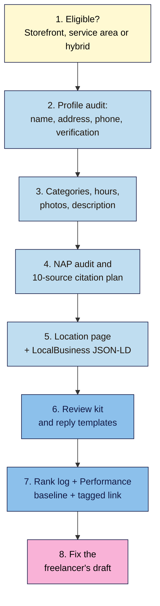

# M11 Capstone — Business Profile Audit with Citation and Review Plans
> By the end of this capstone you'll have a full local SEO audit of one business: eligibility and type, a checked Business Profile, a fair review plan, a NAP audit with a 10-source citation plan, one location page with matching markup, and an honest local rank log. You'll also fix a freelancer's draft profile for Nila Coffee that breaks 14 rules.

**Time:** ~4–5 hours (spread over two weeks, so you can see a month's data start) · **Level:** L2 Practitioner · **Prereqs:** M11.L01–M11.L05 · **Remediate to:** the lesson named in each task
**Non-negotiables reinforced:** #12 (one consistent identity everywhere), plus honest reviews and no ranking promises
**Verified against:** the sources in M11.L01–L05, all checked on 2026-11-09. The break-it lab's business details are invented for practice; any resemblance to real ones is accidental.

## The brief
Imagine the owner says: "People can't find us on Maps, the details online are a mess, and a freelancer has offered to 'fix our Google' for ₹15,000. What should we actually do, without breaking any rules?"

Answer with a **local SEO audit**: whether the business qualifies and what type it is, a profile that follows Google's guidelines, a fair way to get reviews, one identity everywhere, and a way to measure what changes.

- **Path A (your own business):** do every task live, one change at a time.
- **Path B (practice):** audit Nila Coffee's tasting room in Indiranagar, using the made-up details in each lesson.
- **Path C (client business):** do every task with the client's consent; they stay the primary owner, and they approve every change.
- **Not eligible?** (for example, Amara's online-only clients): do tasks 1, 4 (website and social profiles only), 6 and 7, and write why a Business Profile isn't the route.

## How it works


**In words:** check that the business qualifies, and whether it's a storefront, a service-area business or a hybrid. Audit the profile's name, address, phone and verification. Then check categories, hours, photos and the description. Audit the name, address and phone across 10 or more sources and plan the fixes. Build one location page with matching markup. Set up a fair review kit. Start an honest rank log and a Performance baseline. Finally, fix the freelancer's draft.

## Tasks

### 1. Eligibility and type (L01)
In your **Local** tab, record: in-person contact during stated hours? Where (your address, theirs, both)? Permanent signage? State the type (storefront, service-area or hybrid) with Google's rule quoted. **Expected:** Nila's tasting room = storefront; her nationwide online shop doesn't make it a service-area business.

### 2. Profile basics (L02)
In your **Profile audit** tab, check the name (real-world, no keywords), address (real, staffed, not a virtual office), phone (under the business's control), website, verification status and users (owner is the business; helpers are managers). **Expected:** each item marked ✅ or ❌ with the rule and the fix.

### 3. Profile details (L03)
Check categories ("IS a", most specific primary), description (≤750 characters, no URLs or offers), hours and the next three festival or holiday hours, attributes and photos (real, including the exterior). Plan edits one at a time; category and address changes can trigger re-verification. **Expected:** a dated change plan.

### 4. One identity everywhere (L05)
In your **NAP audit** tab, write the master NAP+W, then compare 10+ sources: website footer and contact page, Bing Places, Apple Business, 3–4 directories your customers use, and social profiles. Order the fixes: your site first. **Expected:** a 10-source citation plan with each mismatch, its fix and a date.

### 5. Location page and markup (L05)
Outline one useful location page (address, hours, map, directions from a landmark, photos, parking). Write LocalBusiness JSON-LD with the most specific type and values copied from the master row; no `aggregateRating` for your own reviews. Point the profile's website link here, with the UTM tag from L03. **Expected:** the outline, the JSON-LD and the tagged link. (Module 12 validates the markup.)

### 6. Review kit (L04)
In your **Review kit** tab: the review link or QR plan, one neutral script for every customer, where you'll ask (counter, receipt, email), five reply templates, and replies to your three most recent reviews (or the practice ones). **Expected:** no rewards, no gating, no staff targets, no scripts asking for words.

### 7. Measure honestly (L01, L03)
Log 3–5 local searches from 4–6 places, each with device, signed-in status and the location line from the bottom of the results page. Path A/C: record last month's Performance report figures and the top search terms. **Expected:** a dated baseline you can repeat next month, and no ranking promises.

### 8. Break it and fix it: the freelancer's draft
A freelancer prepared this draft profile and plan for Nila Coffee. Every numbered line breaks at least one rule. For each, write **what's wrong**, **which lesson**, and **a corrected version**. All details are invented for practice.

> **Nila Coffee — "Google fix" plan (draft, by a freelancer)**
> 1. Name: "Nila Coffee – Best Coffee Roasters Bengaluru | Call 98XXXXXXXX"
> 2. Address: "a co-working desk in Koramangala, as it's more central". (The tasting room is in Indiranagar.)
> 3. Phone: our call-centre number on the profile; the owner's mobile in the website footer; the old landline stays on Justdial.
> 4. Categories: Café (primary), Wi-Fi spot, Parking, Bakery, Coffee machine supplier.
> 5. Description: "Best coffee in Bengaluru!!! 20% OFF this week – order at nilacoffee.example/shop"
> 6. Menu link: our Swiggy page.
> 7. Hours: "Open 24 hours" so we show up at night.
> 8. Photos: 20 latte-art images from a stock photo site.
> 9. Reviews: "A free 100 g pack for every 5-star review. Send the link only to customers who rate us 9–10 on WhatsApp."
> 10. Staff: "Each barista must get 10 reviews a month that mention their name."
> 11. Reply to a 1-star review: "This customer (98XXXXXXXX) is lying. We have the CCTV."
> 12. Website: 20 pages, "Coffee roasters in Mysuru", "Coffee roasters in Hubli"… with the city name swapped, plus a footer listing 20 cities.
> 13. Homepage markup: `aggregateRating` 4.9 copied from Google, and `telephone` "98XXXXXXXX" with no country code.
> 14. Website link on the profile: `nilacoffee.business.site`. Guarantee: "#1 on Maps across Bengaluru in 30 days."

Only then check your answers near the end of this page.

## Deliverable: a local SEO audit
Your **Local**, **Profile audit**, **Review kit** and **NAP audit** tabs, and this one-page summary:

```markdown
# Local SEO audit — <business name> (<date>)

## 1. The short answer
<2–3 sentences: eligible or not, the type, the 3 biggest fixes>

## 2. Eligibility and type
<type + the rule quoted>

## 3. Profile fixes (in order, one at a time)
| # | Field | Now | Fix | Re-verification risk? | Date |

## 4. One identity: NAP+W master and citation plan
<master row> · <10 sources: match? fix? date>

## 5. Location page and markup
<page outline> · <JSON-LD> · <tagged website link>

## 6. Reviews
<the ask> · <where> · <reply templates>

## 7. Baseline
<rank log summary with places and dates> · <Performance figures, Path A/C>

## 8. Break-it lab
1–14: what's wrong · lesson · corrected version
```

## Rubric
Score each criterion. **Good** or better on all five completes the module.

| Criterion | Excellent (4) | Good (3) | Needs work (2) | Missing (1) |
|---|---|---|---|---|
| **Eligibility and setup** | Type right with the rule quoted; real name, real staffed address, business-controlled phone; owner is the business; edits planned one at a time | One small slip | Wrong type, or a keyword in the name | Not done |
| **Profile quality** | Specific primary category, true extras only; description within rules; real hours and festival hours; real photos incl. exterior; tagged website link | One field thin | Categories as keywords, or offers/links in the description | Not done |
| **Reviews** | Same ask for everyone; no rewards, gating, quotas or scripts; five reply templates that follow Google's tips; report-only-violations rule understood | One template weak | Any reward or gating in the plan | No plan |
| **One identity (#12)** | Master NAP+W; 10+ sources checked; site fixed first; one location page; JSON-LD matches the master, specific type, no self-serving stars | 8–9 sources, or one mismatch left | Several sources unchecked, or doorway-style pages planned | Not done |
| **Honest tracking and the lab** | Rank log from 4–6 places with location lines; baseline dated; no promises; all 14 lab errors fixed | 12–13 lab errors fixed | A ranking promise, or fewer than 11 lab errors fixed | Missing |

## Self-check before you submit
- [ ] The business type is right, with Google's rule quoted.
- [ ] The name is exactly what's on the sign.
- [ ] The address is real and staffed (or hidden for a service-area business).
- [ ] One phone number in one format, under the business's control.
- [ ] Categories pass "This business IS a…".
- [ ] The description has no URL, price or offer.
- [ ] Festival hours are set (or planned) ahead.
- [ ] The review ask is the same for every customer, with no reward.
- [ ] 10+ sources are in the NAP audit, with your own site fixed first.
- [ ] The JSON-LD matches the master row and has no self-serving `aggregateRating`.
- [ ] The rank log records place, device and the location line.
- [ ] Nothing in your plan promises a ranking.

## Check your answers (task 8)

| # | What's wrong | Lesson | Corrected version |
|---|---|---|---|
| 1 | Keywords, a location and a phone number in the name: "Including unnecessary information in your business name isn't permitted" | 11.2 | "Nila Coffee" (or the exact name on the sign) |
| 2 | Not where customers are served; a co-working desk is only allowed with signage, customers and staff there | 11.2 | The real tasting-room address in Indiranagar |
| 3 | Three numbers; a call centre: "The phone number must be under the direct control of the business" | 11.2, 11.5 | One local number in one format (`+91 80 …`) on the profile, the site and every directory |
| 4 | Categories used as attributes and keywords; Bakery and supplier aren't true | 11.3 | The most specific coffee roaster category as primary, "Coffee shop" as an extra |
| 5 | A superlative, an offer and a URL in the description | 11.3 | What Nila roasts, since when, and what you can do in the tasting room; no links or offers |
| 6 | "Menu URLs can't be direct links to third-party ordering or delivery services." | 11.3 | Link Nila's own menu page |
| 7 | False hours: hours must be real customer-facing hours | 11.3 | Real hours, with festival hours set ahead |
| 8 | Stock photos don't "represent reality" and may be copied | 11.3 | Real photos: exterior, counter, roaster, team |
| 9 | An incentive and gating: both banned; the hidden incentive may also break consumer law where it applies | 11.4 | One QR code and one neutral line for every customer; no rewards |
| 10 | Staff quotas and staff-naming content are banned | 11.4 | No targets; staff hand every customer the same card |
| 11 | Shares private details and attacks the reviewer | 11.4 | Thank, apologise if fair, invite them to call or email; report only if a policy is broken |
| 12 | Doorway abuse and a city-list block (keyword stuffing) | 11.5 | One tasting-room page; online-shop pages for the rest of India |
| 13 | Self-serving review stars; phone without the country code, not matching the profile | 11.5 | Remove `aggregateRating`; `"telephone": "+91-80-…"` matching the master row |
| 14 | `business.site` websites were retired in 2024; "There's no way to request or pay for a better local ranking on Google", and distance changes results | 11.3, 11.1 | Link the tasting-room page with a UTM tag; promise work and a dated baseline, not a position |

Your notes should show that every fix follows the same few rules: be what you really are, everywhere the same, ask everyone fairly, build pages for people, and measure instead of promising.

## Running project checkpoint
Before Module 12, make sure your **SEO 101 project** sheet has these tabs complete:
- [ ] **Local** with the business type and a dated rank log
- [ ] **Profile audit** with categories, details, festival hours, a photo plan, a tagged link and (Path A/C) a Performance baseline
- [ ] **Review kit** with the ask, five templates and practice replies
- [ ] **NAP audit** with 10+ sources, a location page outline and JSON-LD

In Module 12 (advanced technical SEO), you'll validate the LocalBusiness JSON-LD from task 5 with the Rich Results Test and URL Inspection.

## Module 11 cheat sheet
One-page summary of everything in this module: `seo-101/cheatsheets/m11-local-seo.md`.
