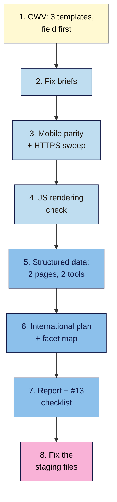

# M12 Capstone — Advanced Technical Report
> By the end of this capstone you'll have an advanced technical report for your project site: Core Web Vitals for three templates with fix briefs, a JavaScript rendering check, a mobile and HTTPS baseline, valid structured data on two pages, an international plan (or a reasoned "not needed"), and a facet decision where relevant. You'll also fix a set of Nila Coffee staging files that contain 15 planted errors.

**Time:** ~5–6 hours (spread over a week) · **Level:** L3 Advanced · **Prereqs:** M12.L01–M12.L06 · **Remediate to:** the lesson named in each task
**Non-negotiables reinforced:** #13 (fast enough, secure, mobile-friendly, valid structured data matching visible content) and #7 (indexable when it should be)
**Verified against:** the sources in M12.L01–L06, all checked on 2026-11-09. The break-it files and figures are invented for practice. No Lighthouse or browser tests were run to write this capstone.

## The brief
Imagine the owner says: "Our developer says we need a ₹1,50,000 'technical SEO overhaul'. What's actually wrong, what matters, and what can wait?"

Answer with an **advanced technical report**: real evidence for each area, a short list of fixes in priority order, and a clear "not needed" for anything that doesn't apply.

- **Path A (your own site):** do every task with Search Console and live pages.
- **Path B (practice):** use your WordPress practice site plus Nila's illustrative figures from each lesson.
- **Path C (client site):** do every task; send fix briefs to the developer and keep the client's approvals.

## How it works


**In words:** measure Core Web Vitals for three templates, field data first. Turn the worst metric for each into a fix brief. Check mobile parity and HTTPS. Check what Google renders on one JavaScript-heavy element. Mark up and validate two pages. Write an international plan (or "not needed") and a facet map if you have filters. Pull it together into a report with a #13 checklist, then fix the staging files.

## Tasks

### 1. Core Web Vitals for 3 templates (L01)
In your **CWV** tab: home, product (or service) and post, mobile and desktop. Record the data source (URL, origin or none), p75 LCP/INP/CLS, lab LCP/CLS/TBT, worst metric and date. **Expected:** "No field data" is a valid, labelled result.

### 2. Fix briefs (L02)
One brief per template: metric (field or lab, date), evidence, likely cause with its web.dev source, fix, owner, and check. Include the View Source hero check. **Expected:** no brief says "compress everything" or "get 100".

### 3. Mobile and HTTPS baseline (L03)
In your **Mobile + HTTPS** tab: parity for 3 templates; HTTP → HTTPS hops; mixed-content list; HTTPS report notes (Path A/C); HSTS present or not. **Expected:** each issue with a fix and owner.

### 4. JavaScript rendering check (L04)
In your **JS rendering check** tab: one JS-heavy element per template, with a phrase and a link, recorded as source / rendered only / missing; robots and canonical in source vs rendered. **Expected:** a fix for every "missing".

### 5. Structured data on 2 pages (L05)
In your **Structured data** tab: a product (merchant listing) and a post (BlogPosting + BreadcrumbList), plus Lesson 11.5's LocalBusiness block if you have a location. Record SMV and RRT results with dates. **Expected:** both valid; every value visible on the page; no self-serving ratings; no FAQ or HowTo for Google.

### 6. International plan and facet map (L06)
Write the hreflang plan (structure, full set, x-default, no redirects) or "No hreflang needed: <reason>, <date>". If you have shop filters, add the **Facet map** with index/block decisions, draft robots.txt rules and the empty-combination check. **Expected:** every decision has a reason.

### 7. The report and #13 checklist
Write the one-page report below, with fixes in priority order (biggest real-user or indexing impact first).

### 8. Break it and fix it: the staging files
Nila's developer shared these staging snippets. Every numbered item contains at least one error. For each, write **what's wrong**, **which lesson**, and **a corrected version**. All details are invented for practice.

> **Nila Coffee staging — product page, brew guide, international set**
> 1. Product JSON-LD: `"offers": {"@type": "AggregateOffer", "price": "0", "priceCurrency": "Rs"}` and no `image`.
> 2. Same block: `"aggregateRating": {"ratingValue": "4.9", "reviewCount": "212"}`. No reviews or rating appear anywhere on the page.
> 3. Brew guide: an "AI SEO" plugin adds `FAQPage` JSON-LD with six Q&As that aren't on the page, "for AI Overviews".
> 4. Kavya's studio home page: `LocalBusiness` markup with `aggregateRating` pulled from her Google reviews widget.
> 5. Brew guide: "Next: French press guide" is `<span onclick="location.href='/french-press'">`.
> 6. Brew guide: steps 4–9 load only after a "Load more steps" click.
> 7. Template: `<meta name="robots" content="noindex">` in the source, removed by a script on live pages.
> 8. Home: `` as the first image, with no `width` or `height`.
> 9. Product page (HTTPS) loads `http://img.nilacoffee.example/beans.jpg` and an `http://` reviews script.
> 10. Theme: the brew-ratio table is set to "hide on mobile".
> 11. `/en-in/` lists `/ta-in/` and `/en-gb/` but not itself.
> 12. `/en-gb/` has no hreflang tags at all.
> 13. A tag reads `hreflang="en-UK" href="/en-gb/french-press/"`.
> 14. The server redirects UK IP addresses to `/en-gb/`, and `/ta-in/` has `rel="canonical"` pointing to `/en-in/`.
> 15. Tomás's filters: empty combinations return 200 "No products found", and every filter URL has `noindex` "to save crawl budget".

Only then check your answers near the end of this page.

## Deliverable: an advanced technical report
Your **CWV**, **Mobile + HTTPS**, **JS rendering check**, **Structured data**, **International** and **Facet map** tabs, and this one-page summary:

```markdown
# Advanced technical report — <site name> (<date>)

## 1. The short answer
<2–3 sentences: what's really wrong, what to fix first, what's not needed>

## 2. Core Web Vitals
| Template | Device | Source (field/origin/lab) | LCP | INP/TBT | CLS | Worst | Date |
<3 fix briefs, linked>

## 3. Mobile and HTTPS
<parity results> · <redirect hops> · <mixed content> · <HSTS status>

## 4. JavaScript rendering
<element · phrase · link · source/rendered/missing · fix>

## 5. Structured data
<page · type · SMV result · RRT result · date> · <retired markup found>

## 6. International and crawl
<hreflang plan or "not needed"> · <facet decisions> · <crawl budget: needed or not>

## 7. Fixes in priority order
| # | Fix | Why (evidence) | Owner | Check |

## 8. #13 checklist
- [ ] CWV good, or fix plan with evidence
- [ ] HTTPS everywhere, one-hop redirect, no mixed content
- [ ] Mobile parity
- [ ] Valid structured data matching visible content

## 9. Break-it lab
1–15: what's wrong · lesson · corrected version
```

## Rubric
Score each criterion. **Good** or better on all five completes the module.

| Criterion | Excellent (4) | Good (3) | Needs work (2) | Missing (1) |
|---|---|---|---|---|
| **Performance** | 3 templates × 2 devices; field first, labelled; lab vs lab; 3 specific briefs with sourced causes and checks | One brief vague | Score-chasing, or lab/field mixed | Not done |
| **Mobile and HTTPS** | Parity on 3 templates; one-hop redirect; mixed content listed and fixed; HSTS understood, not added blind | One check missing | Hidden-on-mobile content missed, or HSTS preload proposed without checks | Not done |
| **Rendering** | Source vs rendered checked in a Google tool; link and noindex traps found; sensible fixes | One element thin | Checked only in own browser | Not done |
| **Structured data** | 2 pages valid in SMV and RRT; values visible; Offer/price/ISO correct; no self-serving or retired markup | One warning unexplained | Invisible or self-serving markup kept | Not done |
| **International, crawl and the lab** | Plan or reasoned "not needed"; full hreflang rules; no redirects; facets decided; crawl budget sized right; all 15 lab errors fixed | 13–14 lab errors fixed | Missing return links or IP redirects kept, or fewer than 12 lab errors | Missing |

## Self-check before you submit
- [ ] Every CWV number says field, origin or lab, with a date.
- [ ] No fix brief aims for a score.
- [ ] The hero image isn't lazy-loaded and has dimensions.
- [ ] Phone pages carry the same content as desktop.
- [ ] Every page and file loads over HTTPS.
- [ ] Every important link is an `<a href>`.
- [ ] No content needs a click or scroll to appear.
- [ ] Structured data values match the page exactly; no FAQ/HowTo for Google; no self-serving stars.
- [ ] hreflang (if used): self, return links, full URLs, ISO codes, x-default; no IP redirects.
- [ ] Crawl budget is marked "not needed" unless the site is very large or fast-changing.

## Check your answers (task 8)

| # | What's wrong | Lesson | Corrected version |
|---|---|---|---|
| 1 | Merchant listings need an `Offer` ("the merchant has to be the seller"), a price "greater than zero", ISO 4217 currency, and `image` | 12.5 | `"@type": "Offer", "price": "650.00", "priceCurrency": "INR"`, plus `"image"` |
| 2 | Rating not visible: "users should be able to see that aggregate rating on the page" | 12.5 | Remove it, or show the real reviews on the page and mark those up |
| 3 | Invisible content, a retired feature (FAQ ended 7 May 2026), and "Structured data isn't required for generative AI search" | 12.5 | Remove the FAQPage block (or put real FAQs on the page for readers, without expecting a rich result) |
| 4 | Self-serving reviews via "an embedded third-party widget" are "ineligible for star review feature" | 12.5, 11.5 | Remove `aggregateRating`; keep the widget for people |
| 5 | Not an `<a>` with an `href` | 12.4 | `<a href="/brew-guides/french-press/">Next: French press guide</a>` |
| 6 | "Google Search does not interact with your page" | 12.4 | All steps in the HTML (or loaded in the viewport) |
| 7 | Google "may skip rendering" after seeing `noindex` | 12.4 | Remove `noindex` from the source of pages that should be indexed (#7) |
| 8 | "Never lazy-load your LCP image"; no dimensions causes CLS | 12.2 | `` |
| 9 | Mixed content: passive (image) and active (script); browsers block it | 12.3 | Serve both over HTTPS |
| 10 | Google indexes the mobile version | 12.3 | Show the table on all devices (an accordion is fine) |
| 11 | "Each language version must list itself" | 12.6 | Add `hreflang="en-in"` pointing to `/en-in/…` itself |
| 12 | No return links: "the tags will be ignored" | 12.6 | Add the full set (all versions + x-default) to `/en-gb/` |
| 13 | `UK` isn't the ISO 3166-1 code; URL must be "fully-qualified" | 12.6 | `hreflang="en-gb" href="https://nilacoffee.example/en-gb/french-press/"` |
| 14 | IP redirects hide versions from a US-based Googlebot; translated pages aren't duplicates, so no cross-language canonical | 12.6 | Remove the redirect (add a banner); self-canonical on `/ta-in/` |
| 15 | Empty combos should return 404; `noindex` doesn't save crawling ("Google will still request, but then drop the page") | 12.6 | 404 for empty combinations; robots.txt disallow for unneeded filters |

Your notes should show that every fix follows the same few rules: measure real users first, keep content and links in the HTML, mark up only what's visible and true, and link every version to every other.

## Running project checkpoint
Before Module 13, make sure your **SEO 101 project** sheet has these tabs complete:
- [ ] **CWV** with 3 templates and 3 fix briefs
- [ ] **Mobile + HTTPS** with parity, redirects, mixed content and HSTS status
- [ ] **JS rendering check**
- [ ] **Structured data** with 2 validated pages (and LocalBusiness if relevant)
- [ ] **International** (plan or "not needed") and **Facet map** if relevant

In Module 13, you'll use Screaming Frog, Bing Webmaster Tools and an SEO plugin to run these checks across the whole site at once.

## Module 12 cheat sheet
One-page summary of everything in this module: `seo-101/cheatsheets/m12-advanced-technical.md`.
