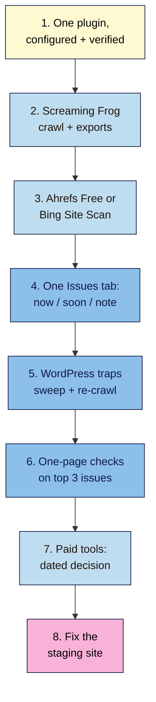

# M13 Capstone — Configured Plugin and Tool-Based Audit
> By the end of this capstone you'll have one SEO plugin configured and verified on your project site, plus a tool-based audit: a Screaming Frog crawl and one other tool's export (Ahrefs Free Site Audit or Bing Site Scan), merged into one prioritised issue list, with every WordPress trap checked and a dated decision on paid tools.

**Time:** ~4–5 hours (spread over a week) · **Level:** L3 Advanced · **Prereqs:** M13.L01–M13.L06 · **Remediate to:** the lesson named in each task
**Non-negotiables reinforced:** #7 (indexable before optimised), #8 (redirect every changed URL, single-hop 301s), #9 (every post passes the publish checklist, now with plugin checks) and #13 (secure, mobile-friendly, valid structured data)
**Verified against:** the sources in M13.L01–L06, all checked on 2026-11-09. The break-it details and figures are invented for practice. No crawl, audit or browser test was run to write this capstone.

## The brief
Imagine the owner says: "A freelancer installed a second SEO plugin to 'try it', and a tool says our health score is 91. Is the site set up properly, and what should we fix first?"

Answer with a **configured plugin and a tool-based audit**: proof that one plugin is set up correctly, an issue list built from two tools and ranked by real impact, the WordPress traps checked, and a clear answer on whether to pay for any tool.

- **Path A (your own site):** do every task on the live site (back up first) or on staging.
- **Path B (practice):** use your WordPress practice site for tasks 1–2 and 4; use your Blogger site or Nila's illustrative figures for task 3.
- **Path C (client site):** do it on staging, with the client's agreement; ask the client to verify the site in Ahrefs Free or Bing.

## How it works


**In words:** configure one SEO plugin and verify every setting from outside WordPress. Crawl the site with Screaming Frog and export the tabs. Run a second tool (Ahrefs Free or Bing Site Scan) and export its issues. Merge both into one Issues tab, bucketed by impact. Sweep the WordPress traps and re-crawl. Explain the top three issues with DevTools. Write a dated decision on paid tools. Then fix the broken staging site below.

## Tasks

### 1. One SEO plugin, configured and verified (L04)
In your **SEO plugin set-up** tab: plugin chosen and why; title and meta templates; sitemap; schema; breadcrumbs; archive `noindex`; redirect tool. For each, record how you verified it (View Source, RRT, sitemap URL, DevTools) and the result. **Expected:** one title and one description per page; one sitemap submitted; `/wp-sitemap.xml` replaced; breadcrumbs visible and marked up.

### 2. Screaming Frog crawl and exports (L01)
Crawl with default settings. Export Response Codes (4xx, 3xx, Redirect Chain), Page Titles, Meta Description and H1 (Missing, Duplicate, Multiple), Directives (Noindex), Canonicals and Images (Missing Alt Text), plus a Bulk Export of links to 4xx pages. Fill your **Screaming Frog settings** tab with your licence decision. **Expected:** exports saved before closing; the crawl's URL count noted.

### 3. A second tool (L02)
Run Ahrefs Free Site Audit (verified site) or Bing Site Scan, and export the issues. Note the health score, but don't act on it. **Expected:** an export and one sentence on how its findings differ from Screaming Frog's and why.

### 4. One Issues tab (L02)
Merge tasks 2–3 into your **Issues** tab: Issue, URLs affected, Found by, Example URL, Bucket (now / soon / note), Why, Owner. Check every "notice" for hidden urgent issues. **Expected:** "fix now" holds only issues that hurt visitors or the indexing of key pages.

### 5. WordPress traps sweep (L05)
In your **WordPress traps** tab, check all seven traps with evidence; fix them in order (two plugins first) and re-crawl. **Expected:** before and after evidence for each trap found; attachment pages not indexable; one plugin; one sitemap; cache purged.

### 6. One-page checks on the top 3 issues (L03)
In your **One-page check** tab, explain the top three "fix now" issues with View Source, Elements, Disable JavaScript and Network (Preserve log, headers). **Expected:** each issue has a cause found in the page or headers, and a fix.

### 7. Paid tools decision (L06)
Fill your **Tool comparison** tab and write a dated buy, trial or stay-free paragraph. **Expected:** prices from vendors' pages with currency and date, or "stay free" with reasons.

### 8. Break it and fix it: the staging site
Nila's freelancer left the staging site like this. Every numbered item contains at least one error. For each, write **what's wrong**, **which lesson**, and **a corrected version**. All details are invented for practice.

> **Nila Coffee staging — set-up notes and findings**
> 1. Plugins: Yoast SEO and Rank Math both active, "so we get Rank Math's free redirects while keeping Yoast's readability checks."
> 2. View Source on the home page: two `<title>` tags, two `meta name="description"`, two `application/ld+json` blocks each with an Organization.
> 3. Search Console sitemaps: `/wp-sitemap.xml`, `/sitemap_index.xml` (Yoast) and `/sitemap_index.xml` again from Rank Math's settings, all submitted.
> 4. Crawl: 1,100 URLs like `/beans/attachment/ethiopia-bag-2/`, each showing one image, all indexable. Note: "WordPress 6.4 turned these off, so ignore them."
> 5. The coffee-beans category's `noindex` was removed two days ago, but the live page and URL Inspection still show it; nobody purged anything.
> 6. Screaming Frog configuration: "Ignore robots.txt" on, 20 threads, run on a competitor's shop at 11 a.m. "to benchmark".
> 7. "Crawled as Googlebot in Screaming Frog and DevTools, so we know exactly what Google sees."
> 8. Screaming Frog free reports "H1: Missing" on all product pages, so the freelancer added a second H1 to every template.
> 9. Report summary: "Ahrefs health score 91 → site is healthy. No action needed." The issues list includes a `noindex` notice on `/beans/`.
> 10. Extensions: the Web Vitals extension installed "for field data", plus six unknown SEO extensions with access to all sites.
> 11. Redirects: `/shop/filter-coffee/` → `/filter-coffee/` → `/beans/filter-coffee/` (two hops), added in two different tools.
> 12. Robots.txt: `Disallow: /?s=` added "to keep search pages out of Google".
> 13. Plan: "Delete 20 of our 38 plugins; fewer plugins is always faster."
> 14. Breadcrumbs: `BreadcrumbList` in the Rich Results Test, but no breadcrumbs shown on any page.
> 15. Budget: "Buy Ahrefs Advanced ($449/mo) for Kavya's 40-page site; every SEO needs it." Price quoted in rupees from a 2023 blog post.

Only then check your answers near the end of this page.

## Deliverable: configured plugin and tool-based audit
Your **SEO plugin set-up**, **Screaming Frog settings**, **Issues**, **WordPress traps**, **One-page check** and **Tool comparison** tabs, the exports, and this one-page summary:

```markdown
# Plugin set-up and tool audit — <site name> (<date>)

## 1. The short answer
<2–3 sentences: is the plugin set up correctly, what to fix first, any tool to buy>

## 2. SEO plugin
<plugin + reason> · <job · setting · how verified · result>

## 3. Audit sources
<Screaming Frog: URLs crawled, date> · <Ahrefs Free or Bing Site Scan: date, score noted but not used>

## 4. Issues in priority order
| # | Issue | URLs | Found by | Bucket | Cause (one-page check) | Fix | Owner |

## 5. WordPress traps
<trap · before · fix · after>

## 6. Tools
<buy / trial / stay free · job · price, currency, date>

## 7. Non-negotiables checklist
- [ ] #7 Key pages indexable: no stray noindex (page, header or cache), correct canonicals
- [ ] #8 Redirects single-hop 301s, in one tool
- [ ] #9 Publish checklist includes: one title, one description, breadcrumbs visible
- [ ] #13 Structured data valid and visible; one graph

## 8. Break-it lab
1–15: what's wrong · lesson · corrected version
```

## Rubric
Score each criterion. **Good** or better on all five completes the module.

| Criterion | Excellent (4) | Good (3) | Needs work (2) | Missing (1) |
|---|---|---|---|---|
| **Tools** | Default-settings crawl with all exports; second tool exported; differences explained; DevTools explains the top 3 | One export missing | Spoofed Googlebot, ignored robots.txt, or high threads on others' sites | Not done |
| **Plugin set-up** | One plugin; every job set and verified outside WordPress; one sitemap; breadcrumbs visible and marked up | One job unverified | Two plugins, or settings trusted without checks | Not done |
| **WordPress traps** | All seven checked with evidence; fixes in order; re-crawl shows the after state | One trap without evidence | Attachment pages or two sitemaps missed; search pages blocked | Not done |
| **Prioritisation** | One Issues tab; buckets by impact; notices checked; score not used | One bucket questionable | Fixed in tool order, or score reported as health | Not done |
| **Ethics, cost and the lab** | Own site or permission; dated vendor prices; cheapest tool for the job; all 15 lab errors fixed | 13–14 lab errors fixed | Paid tool for a small site without a job, or fewer than 13 fixed | Not done |

## Self-check before you submit
- [ ] Exactly one SEO plugin is active.
- [ ] View Source shows one title, one description, one canonical and one JSON-LD graph.
- [ ] Only one sitemap is submitted in Search Console.
- [ ] Attachment pages redirect; archives follow Lesson 5.2; search pages keep `noindex` and aren't blocked.
- [ ] The crawl used default settings on a site you own or have permission for.
- [ ] Every "fix now" issue is about visitors or indexing, not a score.
- [ ] Caches were purged after SEO changes.
- [ ] Every redirect is a single 301 hop.
- [ ] Every price has a currency, a date and a vendor source.

## Check your answers (task 8)

| # | What's wrong | Lesson | Corrected version |
|---|---|---|---|
| 1 | Two SEO plugins: "Using other SEO plugins alongside Rank Math can hurt your website's performance and cause conflicting SEO results" | 13.4, 13.5 | Keep one (import first); add the free Redirection plugin if needed |
| 2 | Duplicate titles, descriptions and schema graphs from two plugins | 13.5 | One plugin; recheck View Source: one of each |
| 3 | Three sitemap entries, two from different plugins plus core's | 13.4, 13.5 | One plugin sitemap submitted; remove the others in Search Console |
| 4 | 6.4 disabled attachment pages for **new** installs only; "On existing sites, the option is set to 1 on upgrade" | 13.5 | Redirect attachment pages in the plugin (file or parent); re-crawl |
| 5 | Stale page or CDN cache serving the old `noindex` (#7) | 13.3, 13.5 | Purge caches, check the `age` header, re-test in URL Inspection |
| 6 | Ignores the owner's robots.txt, risks overloading the server, at peak time | 13.1, 10.2 | Don't crawl others' sites like this; defaults and permission only |
| 7 | A spoofed user agent isn't Googlebot ("It's common for sites to block a spoofed Googlebot request") | 13.1, 13.3 | Use URL Inspection for Google's view |
| 8 | The H1 is added by JavaScript; free Screaming Frog reads raw HTML only. A second H1 breaks #3 | 13.1, 13.2, 12.4 | Check source vs rendered; server-render one H1; remove the extra |
| 9 | Scores are each tool's own weighting; the `noindex` notice on a key category is "fix now" | 13.2 | Fix `/beans/` first; report issues, not the score |
| 10 | Web Vitals extension merged into DevTools (Chrome 132); unknown extensions with broad access | 13.3 | Use the Performance panel and PSI; keep two or three trusted extensions |
| 11 | A redirect chain (#8), split across two tools | 13.3, 6.5 | `/shop/filter-coffee/` → `/beans/filter-coffee/` in one hop, in one tool |
| 12 | Blocking `/?s=` stops Google seeing core's `noindex` | 13.5, 6.2 | Remove the Disallow; keep the `noindex`; don't link to search results |
| 13 | "The number of plugins **and their performance**": count alone isn't the cause | 13.5 | Measure suspects on staging; remove unused or heavy ones |
| 14 | Markup without visible breadcrumbs; markup must match the page (#13) | 13.4, 12.5 | Add breadcrumbs to the theme, or turn the markup off |
| 15 | No job that free tools can't do; out-of-date price in the wrong currency | 13.6 | Stay free for Kavya; quote vendor prices with currency and date |

Your notes should show that every fix follows the same few rules: one plugin and one sitemap, check from outside WordPress, rank issues by real impact, crawl politely, and pay only for a job free tools can't do.

## Running project checkpoint
Before Module 14, make sure your **SEO 101 project** sheet has these tabs complete:
- [ ] **SEO plugin set-up** with every job verified
- [ ] **Screaming Frog settings** with your licence decision, and saved crawl exports
- [ ] **Issues** merging two tools, bucketed
- [ ] **WordPress traps** with before and after evidence
- [ ] **One-page check** for the top 3 issues
- [ ] **Tool comparison** with a dated decision

In Module 14, you'll look at how AI search features find and cite pages, building on the indexable, well-configured site you have now.

## Module 13 cheat sheet
One-page summary of everything in this module: `seo-101/cheatsheets/m13-tools-wordpress.md`.
