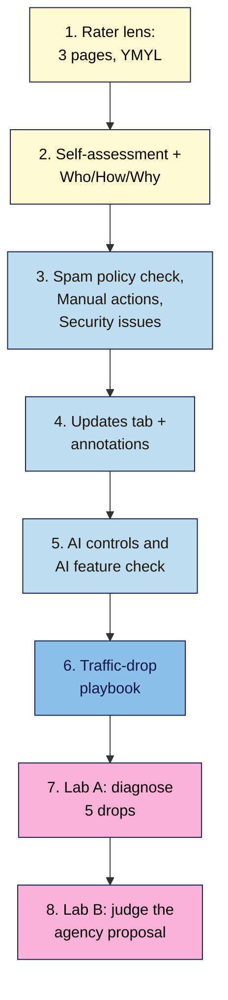

# M14 Capstone — E-E-A-T and Policy Review plus Traffic-Drop Playbook
> By the end of this capstone you'll have an E-E-A-T and policy review of your project site (rater evidence, Who/How/Why standards, YMYL ratings, a spam-policy check, manual action and security status, and your AI controls) and a one-page traffic-drop playbook you can follow the next time traffic falls.

**Time:** ~4–5 hours (spread over a week) · **Level:** L3 Advanced · **Prereqs:** M14.L01–M14.L06 · **Remediate to:** the lesson named in each task
**Non-negotiables reinforced:** #1 (stay inside the spam policies), #6 (people-first content), #10 (a human edits and fact-checks AI-assisted pages), #11 (earn links, never buy them), #12 (one consistent identity) and #14 (diagnose before you act)
**Verified against:** the sources in M14.L01–L06, all checked on 2026-11-10 (rater guidelines September 11, 2025; spam policies 2026-08-28; Status Dashboard to the September 2026 spam update). The lab details and figures are invented for practice.

## The brief
Imagine the owner says: "An agency says our E-E-A-T score is low and sent a growth plan. And last month our traffic dropped. Are we doing anything Google would penalise, and what do we do the next time traffic falls?"

Answer with two things: a **review** that shows, with evidence, how trustworthy the site looks to a rater and whether anything breaks Google's policies, and a **playbook** that turns "traffic is down" into five checks and a proportionate action.

- **Path A (your own site):** do every task on your live site.
- **Path B (practice):** use your practice site for tasks 1–5 and 7; use Nila's illustrative data for task 6.
- **Path C (client site):** do it with the client's agreement. Don't change the Search generative AI control, robots.txt or any content without their sign-off; report findings, not changes.

## How it works


**In words:** start by looking at three pages the way a quality rater would, then assess a sample of pages against Google's people-first questions and set Who, How and Why standards for the site. Check every spam policy and both Search Console status reports, build your update log with annotations, and record your AI controls. Then write your traffic-drop playbook and test it on five illustrative drops, and finish by judging an agency's proposal against the policies.

## Tasks

### 1. Rater lens on three pages (L01)
Complete your **Rater lens** tab for three pages, including the riskiest one. For each: purpose, YMYL rating (not / in between / clear) and area, what the site says, what others say (`"brand" reviews -site:domain`), what's on the page, experience or expert needed, trust verdict and one fix. **Expected:** small sites often have little reputation information, recorded as neutral; any clear YMYL advice has a visible expert or is narrowed to experience.

### 2. Self-assessment and Who/How/Why standards (L02)
Complete your **Self-assessment** tab (5 sampled pages × Google's questions, an unaffiliated reviewer's column, main content scores and a pattern sentence) and your **Who/How/Why** tab with four standards and a true AI use statement. **Expected:** the pattern sentence names what most weak pages lack; the AI statement is true today.

### 3. Spam policy check and status (L04)
Complete your **Spam policy self-check** tab for all 16 policies plus policy circumvention and scam and fraud, with special attention to plugins, user content and third-party content. Record the dated status of **Manual actions** and **Security issues**. If either shows an issue, draft the reconsideration request. **Expected:** every "Maybe" has a fix and a date.

### 4. Updates tab and annotations (L03)
Bring your **Updates** tab up to date from the Status Dashboard (every core and spam update since January 2025, plus any newer than the September 2026 spam update), with Search Console annotations for the start and end of the last two. **Expected:** one before/after comparison with a "small, hold" or "large, assess" decision.

### 5. AI controls and AI feature check (L05)
Record your **Search generative AI** setting, whether robots.txt mentions `Google-Extended`, any `nosnippet`, `max-snippet` or `data-nosnippet` use, and whether you have a Generative AI performance report. Complete your **AI feature check** for five queries. **Expected:** settings recorded, not changed; one commodity page with a plan to add original evidence.

### 6. Your traffic-drop playbook (L06)
Write a one-page **Traffic-drop playbook** for your site using the template in the deliverable: the five questions, exactly where each check lives for your site (report names, the Changes log, your Trends comparisons), the update rules, the action rules and your annotation format. Test it on Nila's dataset from Lesson 14.6. **Expected:** someone else could follow it without asking you anything.

### 7. Break it and fix it, Lab A: five drops
Each case below is a drop at Nila Coffee (illustrative). Use your playbook. For each, write **which question answers it (1–5)**, **the cause**, **the evidence** and **the action (or "no action")**, plus a one-line annotation.

1. **3 March 2026.** GA4 organic sessions fell 45% overnight. Search Console clicks are flat. Changes log, 2 March: "Switched cookie banner plugin."
2. **July–September 2026.** "Cold brew" clicks fell 40% from June. In 2025 they fell 38% over the same months. "Coffee" clicks are flat. Nothing in the Changes log; no manual actions.
3. **Late April 2026.** Impressions fell 22% and average position improved from 14.1 to 11.3. Clicks unchanged. Nothing in the Changes log.
4. **3 weeks after 14 August 2026.** Shop category pages lost 70% of clicks gradually; blog posts are fine. Changes log, 14 August: "Theme update." URL Inspection on `/beans/`: "Excluded by 'noindex' tag."
5. **June 2026.** Brew guides slipped from positions 3–4 to 4–5. The "Best coffee beans in India" listicle fell from 4 to 29. The drop started 23 May. Tracking, indexing, manual actions and security are fine; last year shows no June dip for these queries.

### 8. Break it and fix it, Lab B: the agency proposal
Amara forwards a "growth plan" an agency sent Tomás's hardware shop (Lisbon, ships across the EU). Every numbered item contains at least one problem. For each, write **what's wrong**, **which lesson**, and **what to do instead**. All details are invented for practice.

> **Growth plan for Tomás Hardware**
> 1. Buy `tomashardware-old.pt`, an expired domain with 300 backlinks, and 301-redirect it to the shop.
> 2. Publish 500 AI-written pages: "Best plumbing tools in [city]" for every EU city over 50,000 people.
> 3. Host a sponsored "best online casinos" page under `/deals/` for €400 a month.
> 4. Add an author bio, "Dr. R. Mehta, master electrician", with an AI-generated headshot, to the wiring guides.
> 5. Add an `llms.txt` file and "AI schema" so the shop appears in AI Overviews.
> 6. Block `Google-Extended` in robots.txt so AI Overviews stop using your content.
> 7. Install an "exit-intent" script that loads an offers page when visitors press Back.
> 8. You have a thin content manual action: move the guides to `guides.tomashardware.pt` to escape it.
> 9. Rankings dipped during the September 2026 spam update: rewrite every page this week.
> 10. Our tool rates your E-E-A-T at 62/100; we'll add trust badges to raise it to 90.

## Deliverable: E-E-A-T and policy review plus playbook
Your **Rater lens**, **Self-assessment**, **Who/How/Why**, **Spam policy self-check**, **Updates**, **AI feature check** and **Drop diagnosis** tabs, and these two pages:

```markdown
# E-E-A-T and policy review — <site name> (<date>)

## 1. The short answer
<2–3 sentences: how trustworthy the site looks, any policy risk, the top 3 fixes>

## 2. Rater lens
| Page | YMYL | What we say | What others say | On the page | Expert needed? | Trust verdict | Fix |

## 3. People-first pattern and standards
<pattern sentence> · <Who / How / How (AI) / Why standards> · <AI use statement>

## 4. Spam policies and status
<Maybe rows + fixes> · Manual actions: <status, date> · Security issues: <status, date>

## 5. Updates and AI controls
<last two updates: before/after, decision> · Search generative AI: <setting> · Google-Extended: <yes/no> · snippet controls: <list>

## 6. Non-negotiables checklist
- [ ] #1 No "Maybe" left in the spam policy check without a fix and date
- [ ] #6 Weak-page pattern named, with Who/How/Why standards in place
- [ ] #10 AI use statement is true; AI-assisted pages are human-edited and fact-checked
- [ ] #11 No paid links without `rel="sponsored"`; no link schemes
- [ ] #12 Name, address, phone and profiles consistent on About and author pages
- [ ] #14 Playbook written and tested on Lab A

## 7. Labs
A 1–5: question · cause · evidence · action · annotation
B 1–10: what's wrong · lesson · instead
```

```markdown
# Traffic-drop playbook — <site name>

**Rule:** answer the five questions in order before changing anything. Record each in the Drop diagnosis tab.

1. **Real?** Data anomalies page · GA4 vs Search Console (Module 8 tag check) · date range + time zone · Changes log: <where>
2. **Normal?** Performance → Last 16 months, YoY · Trends for <our seasonal queries> · our known seasons: <months>
3. **Technical or security?** Page indexing · Crawl stats · URL Inspection on <key URLs> · Security issues · Changes log
4. **Manual action?** Manual actions report
5. **Update?** Status Dashboard + Updates tab · wait until complete + 1 week · compare week before start vs week after · small = hold, large = self-assess (L14.2)

**Scope:** site / group / one page (Pages tab, compare, sort by clicks difference) · **Attribute** the loss by cause
**Act:** fix breaks now · no action for seasonal or small moves · improve large losers after updates · one change at a time · recheck in <n> weeks
**Annotation format:** "<what changed> (<why / which update>)"
```

## Rubric
Score each criterion. **Good** or better on all five completes the module.

| Criterion | Excellent (4) | Good (3) | Needs work (2) | Missing (1) |
|---|---|---|---|---|
| **E-E-A-T evidence** | Three pages rated from all three evidence sources; YMYL rated correctly; expert vs experience decided per §3.4.1; an outsider's view used; Who/How/Why standards and a true AI statement | One evidence source thin on one page | An "E-E-A-T score" used, self-praise counted as reputation, or a fabricated author kept | Not done |
| **Policies** | All policies checked incl. plugins, UGC and third-party content; status dated; Lab B 10/10 with current policy names (site reputation 2026, back button hijacking) | Lab B 8–9 | 2024 site reputation rules quoted, or circumvention suggested as a fix | Not done |
| **Updates** | Updates tab complete to today; annotations added; one before/after comparison with the right weeks and a size decision | One update missing | Measured mid-rollout, or retired systems blamed | Not done |
| **AI controls** | Settings recorded and explained; correct control chosen for each goal; Google-Extended scope right; no llms.txt or AI-schema claims | One control's cost not stated | Google-Extended treated as an AI Overviews control, or settings changed without sign-off | Not done |
| **Diagnosis** | Playbook usable by someone else; Lab A 5/5 with the right question, evidence and a proportionate action; mixed causes attributed | Lab A 4/5 | Starts with "it's an update", or several changes at once | Not done |

## Self-check before you submit
- [ ] Every quote from the rater guidelines names the edition (September 11, 2025) and section.
- [ ] No page uses a made-up author, AI headshot or false credential.
- [ ] Clear YMYL advice has a named expert author or reviewer, or has been narrowed.
- [ ] Manual actions and Security issues statuses are dated.
- [ ] The Updates tab includes any update newer than the September 2026 spam update.
- [ ] The Search generative AI control and robots.txt were recorded, not changed without sign-off.
- [ ] The playbook starts with "Is it real?", not "Which update?".
- [ ] Every action in Lab A is one change, with an annotation.

## Check your answers (task 7, Lab A)

| # | Question | Cause | Evidence | Action and annotation |
|---|---|---|---|---|
| 1 | 1 Real? | Tracking break from the new consent banner | Sessions fell, clicks flat; Changes log on 2 March | Fix the GA4 tag or consent setup (Module 8). No SEO change. "GA4 consent fix after banner switch" |
| 2 | 2 Normal? | Seasonality (monsoon dip for cold brew) | Same months last year −38%; "coffee" flat; Trends shows the yearly pattern | No action. Compare with last year in reports. "Seasonal cold brew dip (as 2025)" |
| 3 | 1 Real? | Search Console impressions logging fix (May 13, 2025 – April 27, 2026) | Impressions and position changed, clicks didn't; Data anomalies page | No action; explain in the report. "GSC impressions logging fix (reporting only)" |
| 4 | 3 Technical | Theme update added `noindex` to category pages; slow drop as Google recrawls | Changes log 14 Aug; URL Inspection "Excluded by 'noindex' tag"; only category pages | Remove `noindex`, request indexing for key categories, re-crawl. "Removed theme noindex on categories" |
| 5 | 5 Update | May 2026 core update (21 May – 2 June) | Start inside the window; no seasonality; tracking and indexing fine; brew guides small move, listicle large | Hold the brew guides. After 9 June, self-assess the listicle and improve it with original evidence and a disclosure. "Listicle improved (post-May 2026 core update)" |

## Check your answers (task 8, Lab B)

| # | What's wrong | Lesson | Instead |
|---|---|---|---|
| 1 | Expired domain abuse: bought for its links, not to serve people | 14.4, 9.5 | Don't. "It's fine to use an old domain name for a new, original site that's designed to serve people first." |
| 2 | Scaled content abuse ("no matter how it's created") and doorway abuse | 14.4, 7.4 | A few genuinely useful pages (delivery areas, real local stock) |
| 3 | Site reputation policy: unrelated third-party content, not integrated, there for the host's ranking signals (manual action impact differs in the EEA, but still applies elsewhere) | 14.4 | Decline; any sponsored content must be relevant, edited by Tomás, labelled, with `rel="sponsored"` links |
| 4 | Fabricated creator profile: "a form of deception"; clear YMYL safety topic | 14.1, 14.2 | Pay a real electrician to review the guides and name them, or narrow the guides |
| 5 | Myth: Google Search ignores llms.txt; no special schema needed | 14.5, 12.5 | Indexed pages that can show a snippet, with original content |
| 6 | Wrong control: Google-Extended covers Gemini training and grounding, not Search | 14.5 | Snippet controls or the Search generative AI control, after weighing the cost (lost links) |
| 7 | Back button hijacking (malicious practices), enforced since 15 June 2026 | 14.4 | Remove the script; test the Back button in a private window |
| 8 | Policy circumvention; doesn't fix the thin content | 14.4 | Fix every affected page, keep it visible, then one reconsideration request |
| 9 | Panic change; no diagnosis. A spam update dip isn't necessarily a spam issue | 14.6, 14.3 | Five questions first; check Manual actions; wait until the update completes plus a week |
| 10 | E-E-A-T isn't a score; "Third-party tools don't have access to our internal ranking data" | 14.1 | Rater lens review with specific fixes (bylines, About page, sources) |

Your notes should show the same few rules throughout: trust comes from real evidence, the spam policies judge purpose and value (not the tool or the address), controls are chosen by goal and cost, and every drop is diagnosed before anything changes.

## Running project checkpoint
Before Module 15, make sure your **SEO 101 project** sheet has these tabs complete:
- [ ] **Rater lens** for three pages
- [ ] **Self-assessment** and **Who/How/Why** with an AI use statement
- [ ] **Spam policy self-check** with dated Manual actions and Security issues status
- [ ] **Updates** up to date, with annotations
- [ ] **AI feature check** and your recorded AI controls
- [ ] **Drop diagnosis** and your one-page **Traffic-drop playbook**

In Module 15, you'll bring every tab together into a full SEO audit of your project site.

## Module 14 cheat sheet
One-page summary of everything in this module: `seo-101/cheatsheets/m14-modern-seo.md`.
