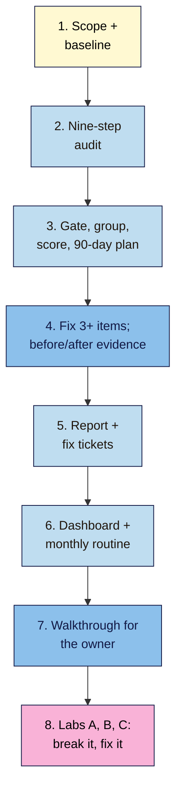

# M15 Final Capstone — Full SEO Audit and 90-Day Plan
> By the end of this capstone you'll have a complete, client-ready SEO audit of your project site: a scope and dated baseline, findings from all nine audit steps with evidence, a prioritised 90-day plan, fixes already made with before and after evidence, fix tickets, a Data Studio dashboard, a monthly routine and a walkthrough a site owner can follow without you.

**Time:** ~12–16 hours (spread over 2–3 weeks, so after-checks have time to show results) · **Level:** L3 Advanced · **Prereqs:** M15.L01–M15.L06 and the module capstones M01–M14 · **Remediate to:** the lesson named in each task
**Non-negotiables assessed:** all, #1–#14
**Verified against:** the sources in M15.L01–L06, all checked on 2026-11-11 (*Do you need an SEO?* 2026-06-05; Search Essentials 2025-12-10; site-move guide 2026-08-20; pause guide 2025-12-10). The lab details and figures are invented for practice.

## The brief
Imagine the owner says: "We've done bits of SEO for a year. Tell us honestly where the site stands, what to fix first, what you've already fixed, and how we keep it healthy after you've gone."

Answer with one **audit report** and the working files behind it. A busy owner should be able to read page one in five minutes and know what to do; anyone checking your work should find the evidence for every claim.

- **Path A (your own site):** do every task on your live site.
- **Path B (practice sites):** use the Blogger property for Search Console data and the WordPress practice site for the crawl and the fixes. Low traffic is fine: the rubric grades method and evidence, not numbers.
- **Path C (client site):** get written permission and read-only access first (Lesson 15.1). Make fixes only with written approval and the access they need; otherwise, task 4 becomes "fixes ready to make", with tickets and test plans.

## How it works


**In words:** agree the scope and record a dated baseline. Run the audit in the nine-step order, then gate blocking issues, group by template, score the rest and write a 90-day plan. Make at least three fixes and test them, keeping before and after evidence. Write the report and a ticket for every planned fix. Connect the dashboard and set up the monthly routine, then write or record a walkthrough the owner can follow. Finish with three break-it labs: a botched domain move, an agency's 213-issue audit, and a closure done the wrong way.

## Tasks

### 1. Scope and baseline (L01)
Complete your **Scope** tab (ten rows, including "out of scope") and a dated **Audit baseline** block: numbers (Search Console Web clicks, impressions, CTR; GA4 organic sessions and key events; baseline period and the same period last year), state (Page indexing counts, Core Web Vitals, Manual actions, Security issues, crawl URL count) and context (seasons, recent changes, updates, data anomalies). **Expected:** every figure has a date range, filters and a source; access is the least needed for your path.

### 2. The nine-step audit (L02)
Fill the **Audit** tab through all nine steps, reusing your earlier tabs (Content audit, keyword map, Core Web Vitals notes, Links, NAP check, Rater lens, Spam policy self-check). Group crawl symptoms by template, drop Google's "shouldn't focus on" items and label accessibility findings as **People**. **Expected:** 10–25 findings, each with step, pages or template, evidence and a dated source; a "checked and fine" list for steps with no findings.

### 3. Prioritise and plan (L03)
Gate blocking issues, then score every other finding with Value / Chance / Effort (1–3 each, added, ties to Value) and a note for each score. Build the **90-day plan** tab: Days 1–30, 31–60, 61–90 and a written "won't do" list, with owner, due date, completion check and an after-check date for each fix. **Expected:** blocking items in Days 1–30; no two changes to the same template in the same week; each block realistic for the hours available.

### 4. Make and test fixes (L04)
Make at least **three** fixes from Days 1–30 (path C: with written approval, or prepare them as tickets with test plans). For each: run the completion test, mark the ticket Done only if it passes, annotate the change in Search Console, and record **before** and **after** evidence. Where four weeks haven't passed, record the completion test now and the after-check date. **Expected:** each fix has a test result you could screenshot (for example `curl -I`, list-mode crawl, URL Inspection live test, Rich Results Test, PSI) and a dated annotation.

### 5. Report and fix tickets (L04)
Write the **audit report** (template below): page one with headline, top findings in business language, the plan in three lines and caveats; then scope and baseline, findings, checked and fine, and the appendix. Write a **Fix ticket** for every item in Days 1–30 and the top three in Days 31–60. Run the red-flag check against *Do you need an SEO?*. **Expected:** no guarantees; every finding sourced; every ticket one task with testable completion criteria.

### 6. Dashboard and monthly routine (L06, M08)
Update your **Data Studio** dashboard (Lesson 8.5) so it shows the KPIs from the scope, with the baseline period as the comparison. Build the **Monthly routine** tab (weekly, monthly, quarterly, yearly checks on fixed days), including after-check dates from the plan and renewal dates for every domain you own. **Expected:** the owner can open one link and see whether the KPIs moved since the baseline; the routine takes about 90 minutes a month.

### 7. Walkthrough for the owner (L04, L06)
Write a 1–2 page walkthrough or record a 5–10 minute screen video that shows the owner how to: read page one of the report, open the dashboard and compare with the baseline, run the monthly checks for steps 1, 2 and 9, check a ticket's completion test, and what to do if traffic drops (the five questions from Lesson 14.6). **Expected:** someone with no SEO training could follow it alone.

### 8. Break it and fix it: three labs
Answer in your report's appendix. Answers are at the end of this page; try first.

**Lab A — Nila's domain move (L05).** Nila moved from `nilacoffee.example` to `nilaroasters.example`. Find the **12** mistakes, name the lesson, and say what she should have done.
1. She launched the new domain on 20 October, the start of her Diwali gifting peak.
2. The same week, she switched to a new theme and renamed every product URL.
3. Old product URLs redirect to the new home page.
4. Old blog posts go `http://nilacoffee.example/post` → `https://nilacoffee.example/post` → `https://nilaroasters.example/blog/post` → `https://nilaroasters.example/blog/post/`.
5. The redirects are 302s "in case we change our minds".
6. The new site's robots.txt still says `Disallow: /` from staging.
7. Every new page's canonical points to the matching old `nilacoffee.example` URL.
8. She submitted Change of Address for `nilacoffee.example`, but most of the old traffic was on `www.nilacoffee.example`, which she didn't submit.
9. The new theme has no GA4 tag, so organic sessions dropped to zero in GA4 on launch day.
10. The brew-guide PDFs stayed on the old host, which was cancelled.
11. Two weeks after launch, with clicks down, she switched DNS back to the old site for a week, then forward again.
12. In April, 180 days after the move, she removed all redirects and let `nilacoffee.example` expire.

**Lab B — Tomás's agency audit (L02, L03, L04).** The agency's 213 rows, summarised:

| # | Agency row | Rows |
|---|---|---|
| 1 | Meta keywords missing (sitewide) | 1 |
| 2 | Low word count on product pages | 180 |
| 3 | Image file names not keyword-rich | 160 |
| 4 | Missing alt text on product images | 160 (same pages as row 3) |
| 5 | Category pages: `noindex` | 24 |
| 6 | Duplicate titles on product variants | 12 |
| 7 | 404s linked from old blog posts | 9 |
| 8 | "Domain authority too low: buy 50 DA50+ links" | 1 |
| 9 | Product structured data missing `price` (product template) | 180 |
| 10 | Mobile LCP "Poor" on the product template (CWV report) | 1 group |
| 11 | Blog in a subfolder, "should be a subdomain" | 1 |
| 12 | "Add an llms.txt file for AI search" | 1 |

Group, gate, drop non-issues, score the rest, and write tickets for the top three (one is blocking).

**Lab C — Kavya's retreat closure (L06).** For a three-week retreat, Kavya: (1) set a maintenance plugin that returns 503 for every URL including robots.txt, for all three weeks; (2) then, worried, added `noindex` to the class pages; (3) used the Removals tool on `/classes/`; (4) deleted the "Workshop" event pages; (5) left her Business Profile showing normal hours; (6) on return, removed everything at once and didn't annotate it. Name each problem and what she should have done instead.

## Deliverable: the audit report
Your **Scope**, **Baseline**, **Audit**, **90-day plan**, **Fix tickets**, **Monthly routine** and earlier tabs, the dashboard link, the walkthrough, and this report:

```markdown
# SEO audit — <site name> (<date>)
Prepared by <name> for <owner> · Path <A/B/C> · Access: <roles>

## 1. Headline
<one sentence>

## 2. Top findings
- <blocking finding, business language first, then cause + source/date>
- <3–4 more>

## 3. The plan
Days 1–30: <…> · Days 31–60: <…> · Days 61–90: <…>

## 4. What we can't promise
<no guarantees; changes take weeks to months; data limits (low traffic, anomalies, access)>

## 5. Scope and baseline
<scope table> · <baseline: numbers, state, context, dated, with filters and sources>

## 6. Findings by audit step
| ID | Step | Finding | Pages/template | Evidence | Source + date | V | C | E | Total | Recommendation |

## 7. Fixes made
| Ticket | Fix | Completion test + result | Annotated | Before | After (date) |

## 8. Checked and fine
<list>

## 9. Keeping it healthy
<dashboard link> · <monthly routine summary> · <walkthrough link>

## 10. Non-negotiables checklist
- [ ] #1 No spam-policy "Maybe" left without a fix and date
- [ ] #2 Baseline recorded before any fix; GSC, Bing and GA4 working
- [ ] #3 Accessibility findings (headings, alt text, link text) included as People
- [ ] #4 Intent mismatches recorded in step 4
- [ ] #5 Cannibalisation checked; one page per topic
- [ ] #6 Duplicate titles and weak pages found, with a plan
- [ ] #7 Steps 1–2 done first; blocking items in Days 1–30
- [ ] #8 Every changed URL redirected in one hop (and Lab A answered)
- [ ] #9 Content fixes go through the brief and publish checklist
- [ ] #10 AI-assisted pages human-edited and fact-checked; AI-written report text checked
- [ ] #11 No link buying in the plan (and Lab B row 8 rejected)
- [ ] #12 NAP and profiles consistent (step 8)
- [ ] #13 HTTPS, mobile, CWV status and structured data checked (steps 5–6)
- [ ] #14 Every fix annotated; drops diagnosed with the five questions

## 11. Appendix
<Audit tab, crawl CSVs, screenshots, Labs A–C>
```

## Rubric
Score each criterion. **Good (3)** counts as **Proficient**; Good or better on all seven completes the course.

| Criterion | Excellent (4) | Good (3) | Needs work (2) | Missing (1) |
|---|---|---|---|---|
| **Scope and baseline** (#2, #14) | Ten-row scope with out-of-scope; least access; baseline of numbers, state and context, all dated with filters and sources | One baseline item lacks a source or filter | Baseline missing state or context, or recorded after a fix | Not done |
| **Audit coverage and evidence** (#3, #4, #5, #6, #7, #12, #13) | All nine steps in order; findings grouped by template; non-issues dropped; People findings kept; every finding sourced and dated; "checked and fine" list | One step thin, or a few page-level rows that should be grouped | Steps skipped, raw export pasted, or non-issues reported as problems | Not done |
| **Prioritising and plan** (#7, #14) | Blocking gate used; scores with notes; won't-do list; realistic 30/60/90 blocks; after-checks; no clashing changes | One block overloaded or one score unexplained | Blocking items scored and buried, or two scoring systems | Not done |
| **Fixes and evidence** (#7, #8, #13, #14) | 3+ fixes with passed completion tests, annotations, before and after evidence (or after-check dates) | One fix lacks an annotation or "after" date | Fixes marked done without tests, or several changes at once | No fixes or test plans |
| **Report and tickets** (#1, #9, #10, #11) | Page one stands alone; business language; caveats; red-flag check passed; tickets one task each with testable criteria | One ticket vague or one finding unsourced | Guarantees, unsourced tool scores, or bundled tickets | Not done |
| **Handover** (#2, #14) | Dashboard compares with baseline; monthly routine on fixed days with renewals; walkthrough an owner can follow alone | Walkthrough misses one routine step | No routine, or dashboard without the baseline | Not done |
| **Labs** (#1, #8, #11, #14) | Lab A 12/12, Lab B grouped and gated correctly with three good tickets, Lab C 6/6 | Lab A 10–11, Lab C 5 | Lab A under 10, or Lab B keeps link buying or meta keywords | Not done |

## Self-check before you submit
- [ ] The baseline is dated earlier than every fix.
- [ ] Page one of the report fits on one page and makes sense on its own.
- [ ] No sentence promises rankings, traffic or a timeframe.
- [ ] Every finding has a source and date; no tool "health score" is used as evidence.
- [ ] Every ticket marked Done has a passed test result.
- [ ] Every fix is annotated in Search Console (or in the Changes log if your access doesn't allow annotations).
- [ ] The monthly routine includes domain renewals and old-redirect checks.
- [ ] Path C: written permission, and no changes made without written approval.

## Check your answers (task 8, Lab A)

| # | Mistake | Lesson | Instead |
|---|---|---|---|
| 1 | Moved in her busiest season | 15.5 | Move "during the recurring traffic dips", after Diwali |
| 2 | Domain, theme and URLs changed together | 15.5 | "one after the other": move domain with the same paths, then the theme later |
| 3 | Old products redirect to the home page | 15.5, 6.5 | One-to-one map to the matching product; never mass redirects to home |
| 4 | Three-hop chain | 6.5, 15.5 | Old URL → final new URL in one hop |
| 5 | 302s for a permanent move | 6.5 | 301 (or 308) |
| 6 | Staging `Disallow: /` left in robots.txt | 15.5, 6.2 | Remove dev blocks at launch; check with the robots.txt report and a crawl |
| 7 | Canonicals point to the old domain | 15.5 | Self-referencing canonicals on every new URL |
| 8 | Change of Address only for the bare domain | 15.5 | Submit for each verified variant, including `www`; the tool doesn't move subdomains |
| 9 | No GA4 tag on the new theme | 15.5, 8.2 | GA4 tag in the pre-launch checklist; check Realtime on launch day |
| 10 | PDFs left behind and lost | 15.5 | "Transfer images and downloads (such as PDF documents)"; include them in the map |
| 11 | Panic rollback | 15.5, 14.6 | Fix real breaks; give it "a few weeks or more"; don't create a second move |
| 12 | Redirects removed at 180 days; old domain expired | 15.5 | Keep redirects at least a year, ideally for good; keep renewing the old domain |

## Check your answers (task 8, Lab B)
Grouped and gated (your scores may differ slightly; your notes should justify them):

| Agency rows | Finding | Decision |
|---|---|---|
| 5 | Category template `noindex` (24 pages) | **Blocking**, Days 1–30, ticket T-01 |
| 9 | Product template missing `price` in structured data (180) | Template finding: V3 C3 E2 = 8, ticket T-02 |
| 6 | Duplicate variant titles (12) | Template finding: V3 C2 E3 = 8, ticket T-03 |
| 7 | 9 broken links from old posts | Page-level: V2 C2 E3 = 7 |
| 3 + 4 | Product images: missing alt text (People); file names | One template finding, People (alt text); file names folded in, low priority |
| 10 | Mobile LCP Poor on product template | Template finding: V3 C2 E1 = 6, Days 61–90 |
| 1, 2, 11 | Meta keywords; word count; subdomain | **Drop**: Google's "shouldn't focus on" list |
| 8 | Buy 50 links | **Reject**: link spam (non-negotiable #11) |
| 12 | llms.txt | **Drop**: not used by Google Search (Lesson 14.5) |

213 rows become six findings plus a won't-do list. Example ticket T-01: *Background:* 24 category pages excluded by `noindex` since the July theme update. *Work:* turn off "noindex category archives" in the theme's SEO settings for all 24 URLs. *Completion:* Screaming Frog list mode shows all 24 Indexable; URL Inspection live test on three samples allows indexing. *After-check:* Page indexing for categories and category clicks vs baseline, four weeks later.

## Check your answers (task 8, Lab C)

| # | Problem | Instead |
|---|---|---|
| 1 | 503 for three weeks, and on robots.txt ("blocks all crawling") | Keep the site online and disable bookings; 503 only for a day or two, robots.txt always 200 |
| 2 | `noindex` "will remove the website's URLs from Google Search" | No `noindex` for closures |
| 3 | Removals tool used for a closure | "Don't use the temporary website removal tool in Search Console for closures." |
| 4 | Event pages deleted | Keep them; mark events cancelled or rescheduled in structured data |
| 5 | Business Profile shows normal hours | "Temporarily closed" for 7+ days (Lesson 11.3) |
| 6 | Everything undone at once, not annotated | Undo in order, check with `curl -I` and URL Inspection, annotate (#14) |

Your notes should show the same few rules throughout: find what stops pages being found before anything else, support every claim with evidence and a source, rank by value, confidence and effort, change one thing at a time, test every fix, and never promise what Google decides.

## Course completion checkpoint
You've finished SEO 101 when:
- [ ] Every module capstone M01–M14 is at **Good** or above.
- [ ] This final capstone is at **Good** or above on all seven criteria.
- [ ] Your **SEO 101 project** sheet has every tab from the course, with the M15 tabs complete: **Scope**, **Baseline** (audit block), **Audit**, **90-day plan**, **Fix tickets**, **Migration checklist** (if relevant) and **Monthly routine**.
- [ ] Path C: the owner has agreed (in writing) to your using the report in a portfolio, or you've anonymised it.

What next: run the monthly routine, and in 90 days compare the KPIs with your baseline and write the next plan. **Modern SEO 101** picks up from here with AI search, answer engines and content automation.

## Module 15 cheat sheet
One-page summary of everything in this module: `seo-101/cheatsheets/m15-seo-audit.md`.
