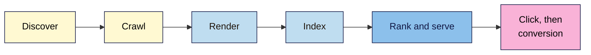

# M01 Cheat Sheet — Marketing & SEO Foundations
*SEO 101 · Module 1 · checked 2026-11-04*

## The big picture

## Where SEO fits (L01–L03)
- **Marketing** = audience + offer + message + channel.
- **Journey:** awareness → consideration → decision → loyalty. Search appears at every stage.
- **SEO** = slow to start, keeps working; **ads** stop when you stop paying. Buying ads doesn't change organic rankings.
- **Three types:** **on-page** (content, titles) · **off-page** (links, mentions, reviews) · **technical** (crawling, speed, indexing).
- `site:yourdomain.com` shows a **sample** of indexed pages, not an exact count.

## What can stop a page (L04)
| Stage | Typical problem |
|---|---|
| Discover | No links in, not in a sitemap |
| Crawl | Server error, blocked by robots.txt |
| Render | Main text depends on a failed script |
| Index | `noindex`, duplicate, low quality |
| Rank and serve | Doesn't match the search, or weaker than rivals |

## Results page (L05)
- **Text result:** attribution + **title link** + **snippet** (+ sitelinks). Google builds them; you supply the ingredients.
- **Often seen:** questions → featured snippet, People also ask · local → local pack · products → ads, rich results.
- **Can't be requested:** featured snippets, People also ask, sitelinks.
- **Search competitors** = whoever ranks for your searches.
- **Operators:** `site:` · `"exact phrase"` · `-word` · `after:` / `before:` · `intitle:` (undocumented).

## The rules (L06)
| Label | Means |
|---|---|
| **White** | Helps people, inside the rules |
| **Grey** | Disputed. Not safe: Google has no such category |
| **Black** | Breaks a named spam policy |

- Paid links need `rel="sponsored"` (or `nofollow`). Goods for links count too.
- **Manual action:** human reviewer → Manual actions report → fix everything → **Request Review**.
- **Algorithmic change:** no message, nothing to request → check the Status Dashboard, assess the whole site.
- **Red flags:** guarantees, "special relationship", "priority submit", cold emails, secrecy, per-link pricing.

## Ranking (L07)
- **Five signals:** meaning · relevance · quality · usability · context. Weights vary by search.
- **Documented:** helpful content, keywords on the page, links, Core Web Vitals, aggregated interaction data, freshness where expected.
- **Myths:** meta keywords, word count targets, keyword domains, Domain Authority as a Google factor. E-E-A-T isn't a single factor.
- **Check any claim:** documented, myth or unproven?
- **Priority order:** indexed → relevant → helpful → usable → linked.

## Set-up checks (L08)
- [ ] Site is public and not blocked from search
- [ ] Search Console: **Domain property** (TXT record added beside others, and kept)
- [ ] Sitemap status: **Success**
- [ ] Bing: **My Sites → Import**
- [ ] GA4: web stream, `G-` ID, **installed once**
- [ ] Your visit seen in **Realtime** (allow 30 minutes)
- [ ] Linked: **Admin → Product links → Search Console Links**; reports published from **Library**
- [ ] Analytics disclosed in the privacy policy
- [ ] Baseline saved, with dates

> ⚠️ Menus, spam policies and SERP features change often. Check Google's own pages before relying on any detail.
