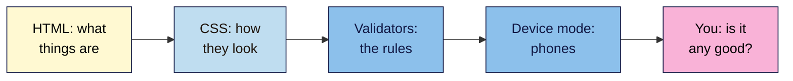

# M02 Cheat Sheet — HTML & CSS for SEO
*SEO 101 · Module 2 · checked 2026-11-06*

## The big picture


## In the `<head>` (L03, L10)
```html
<meta charset="utf-8">
<meta name="viewport" content="width=device-width, initial-scale=1">
<title>Unique, clear, concise page title</title>
<meta name="description" content="A short, honest summary.">
<link rel="stylesheet" href="style.css">
```
- Google may show a different title link or snippet. Google ignores `<meta name="keywords">`.
- Never add `user-scalable=no`.

## Headings and text (L04)
- One `<h1>` for the topic (this course's rule, not a Google penalty). Go down one level at a time.
- Choose headings by structure, never by size.
- `<ol>` if the order matters, otherwise `<ul>`. `<strong>` means important, and `<em>` means stressed.

## Links and images (L05)
| Item | Rule |
|---|---|
| Link | `<a href="…">clear anchor text</a>`, never "click here" |
| `rel="sponsored"` | Paid links |
| `rel="ugc"` | Links that users post |
| `rel="nofollow"` | Sources you don't trust |
| `target="_blank"` | Only when needed, and say so in the link |
| `alt` | Describe the image in context. Use `alt=""` for decoration |
| `` | Keep `width` and `height`. Google doesn't index CSS images |

## Page structure (L06)
`<header>` · `<nav>` (label it if there's more than one) · one `<main>` · `<article>` · `<section>` (with a heading) · `<aside>` · `<footer>`. Use `<div>` for styling only.

## Tables, quotes and embeds (L07)
- **Table:** `<caption>`, `<th scope="col">`, `<th scope="row">`. Never for layout, and never a picture of a table.
- **Quote:** `<blockquote>`, with a visible credit outside it. `<cite>` is for titles of works, not names.
- **Embed:** give an `<iframe>` a `title`, and lazy-load it if it's lower down. Its words aren't in your code, so put key facts in your own text.

## CSS (L08, L09)
- **Which rule wins:** inline, then ID, then class, then element. In a tie, the last one wins. Avoid `!important`.
- **Where it goes:** external file, then a CSS box or `<style>`, then inline as a last resort.
- **Text:** `rem` sizes, `line-height` of at least 1.5, a font list ending in a generic family.
- **Contrast:** 4.5:1 for normal text, 3:1 for large text. Measure it.
- **Box model:** content, padding (inside the border), border, margin (between boxes).

## Hidden content (L09)
| Fine | Spam risk, if done to manipulate search engines |
|---|---|
| Accordions and tabs | White text on white |
| Sliders and tooltips | Text behind an image |
| Screen reader text | Off-screen text |
| | Font size or opacity of 0 |

Keep tab content in the HTML: Google won't click to load it.

## Phones (L10)
```css
img { max-width: 100%; height: auto; }
.table-wrap { overflow-x: auto; }
@media (min-width: 60rem) { /* wider screens */ }
```
- Google uses the mobile version for indexing and ranking. Keep content the same, and use accordions rather than removing it.
- Test in device mode at 320px, then on a real phone. The Mobile-Friendly Test is gone.

## Your tools
| Job | Tool |
|---|---|
| See the code | View Source: **Ctrl+U** (Mac: **Cmd+Option+U**) |
| See what's applied | Right-click, **Inspect**, **Styles**, **Computed** |
| Check HTML | https://validator.w3.org/nu/ |
| Check CSS | https://jigsaw.w3.org/css-validator/ |
| Check contrast | https://webaim.org/resources/contrastchecker/ |

**Remember:** a validator checks rules, not quality.

> ⚠️ **May change:** Google's guidance on snippets, hidden text and mobile; DevTools labels.
