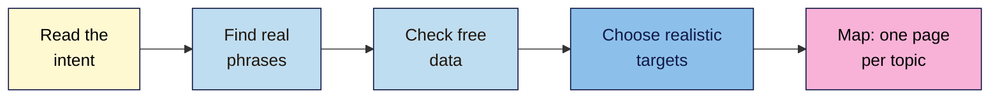

# M03 Cheat Sheet — Keyword Research
*SEO 101 · Module 3 · checked 2026-11-08*

## The big picture

## Intent and its results-page signals (L01)
| Intent | They want to… | Results page usually shows |
|---|---|---|
| **Informational** | Learn | Guides, how-tos, videos, People Also Ask |
| **Navigational** | Reach a site | One brand filling the page |
| **Commercial** | Compare | "Best" lists, reviews, comparisons |
| **Transactional** | Act now | Product and category pages, Shopping results |
| *Local (across these)* | Find a place nearby | A map and business listings |

- The results page beats word clues and tool labels. Use a private window and date every check.
- One primary intent per page (non-negotiable #4). The four labels are an SEO convention, not Google's.

## Finding phrases (L02)
- **Seeds:** your audience, your offer, customers' own words.
- **Expand:** autocomplete, People Also Ask, related searches, forums.
- **Record** source and date, and mark each phrase **Confirmed** or **Unconfirmed**. AI gives ideas, not evidence.

## Free data sources (L03)
| Source | Gives you | Watch for |
|---|---|---|
| Google Keyword Planner | Rounded monthly volume, often as a range | Its **Competition** column is about ads |
| Google Trends | Interest from 0 to 100, and seasonality | Relative, not a count |
| Search Console | Your own site's queries, clicks and impressions | Leaves out anonymized queries |
| Bing Webmaster Tools | Keyword research on Bing's data | Bing's searches only |
| Ahrefs Webmaster Tools and free tools | Estimates and difficulty | Estimates; compare only inside one tool |

No free tool gives one true number. If a figure has no tool, place and date, reject it.

## Realistic targets (L04)
- **Gate:** can your site serve the intent? If not, drop it.
- **Read who ranks:** big brands and exact-match pages are hard; forums, small sites and weak pages are open.
- **Score** Value, Chance and Effort from 1 to 3. Start with about three quick wins and one or two stretch targets.
- "No one can guarantee a #1 ranking on Google."

## Keyword map template (L05)
| Topic | Main phrase | Other phrases | Intent | Page type | URL | Existing or new | Priority | Used twice? | Notes |
|---|---|---|---|---|---|---|---|---|---|

- **Group** phrases that share **3 or more** of their top 10 results *(industry rule of thumb)*, then check intent.
- **Used twice?** `=COUNTIF(F:F, F2)>1` must be FALSE on every row (non-negotiable #5).
- COUNTIF treats `?` and `*` as wildcards, so cut URLs off before any `?`.

## Competing pages (L05)
**Check:** `site:yourdomain.com topic`, then Search Console **Performance > Search results**, filter the query, open **Pages**.

| Situation | Do this |
|---|---|
| Only one page is really shown | Note which page owns the topic, and watch |
| Both shown, different intents | Keep both, and link between them |
| Both shown, same intent | Merge into the stronger page, redirect the other, update links |

- Don't use `noindex` to pick a winner. Canonical tags are for near-duplicates only.
- One page per spelling or word order leans towards doorway abuse.

## Your tabs
**Intent check** · **Keyword ideas** · **Keyword data** · **Targets** · **Overlap** · **Keyword map**

**Remember:** the results page decides, not the words and not the tool.

> ⚠️ **May change:** results pages, Keyword Planner's ranges, free tool limits, Search Console's menus.
