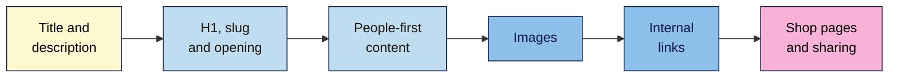

# M04 Cheat Sheet — On-Page SEO
*SEO 101 · Module 4 · checked 2026-11-09*

## The big picture

## Titles and descriptions (L01)
- **Title:** unique on the site, main topic first, natural, brand once at the start or end. No length limit in Google's docs; it's cut to fit the screen.
- **Description:** a one- or two-sentence pitch for this page. Not a ranking factor; Google may show other text.
- **Exception:** paginated pages can share a title and description.
- Google rewrites titles that are empty, old, inaccurate, repeated or unclear.

| Page type | Pattern |
|---|---|
| Home | Brand: what you offer, and where |
| Guide | Topic: the specific promise \| Brand |
| Product | Product name, key detail \| Brand |
| Category | What's in it \| Brand |

## H1, slug and opening (L02)
- **One H1** for readers, matching the title's promise. Headings in order, as an outline.
- **Slug:** short, readable words separated by hyphens; lowercase by convention.
- **Changed a slug?** 301-redirect the old URL and update internal links. WordPress redirects changed post slugs, not page slugs.
- **Opening:** answer the main question in the first few lines.

## People-first content (L03)
- Write for the reader first. Use natural variants and synonyms.
- **Keyword density is a myth.** Repeating words "so often that it sounds unnatural" is stuffing.
- Ask **Who** wrote it, **How** it was made, and **Why**. Add first-hand detail and real evidence. Never invent an author.

## Images (L04)
| Do | Don't |
|---|---|
| One-sentence alt on what the image adds here | Keyword lists, "image of…" |
| `alt=""` (or **Mark as decorative**) for decoration | Leave `alt` out entirely |
| Descriptive file names | `IMG_4482.jpg` |
| No more than about 2× the shown width; WebP or AVIF | 4,000 px photos in 400 px slots |
| Keep `width` and `height`; lazy-load below the fold | Lazy-load the first image |

Check **rendered vs intrinsic size** in DevTools, and file size in **Network > Img**.

## Internal links (L05)
- **Anchor text:** descriptive, concise, makes sense alone. Not "click here" or "read more". Don't cram keywords or chain links.
- **Every page you care about** needs at least one internal link. More links in signal more importance.
- **Find orphans:** sitemap URLs vs **Links > Internal links**, then confirm by hand (the report is a sample).
- **Plan from the keyword map:** guide → product, product → guide, related guides.

## Shop pages and sharing (L06)
- **Categories** link to every product with real `<a href>` links. Google doesn't click **Load more** or use your search box.
- **Pagination:** a unique URL per page (`?page=2`). `rel="next"`/`"prev"` aren't used by Google.
- **Variants:** a path or parameter, never `#`. **Empty categories:** `noindex`.
- **Product pages:** lead with what it is, what it's like, who it's for, size and price, delivery, and proof.
- **Open Graph:** `og:title`, `og:type`, `og:image`, `og:url`, plus `og:description` and `og:image:alt`. Check in Sharing Debugger or Post Inspector.

## Measure it (capstone)
1. Copy a **28-day baseline** per page: clicks, impressions, CTR, average position.
2. Log every change with its date.
3. Check again **28 days after the last change**, over the same length of time. Don't change the page in between.

## Your tabs
**Titles** · **Page outline** · **People-first check** · **Image check** · **Internal links** · **Shop & share check** · **Optimise log**

**Remember:** write for the person searching, and make each page the clearest answer to one need (non-negotiable #6).

> ⚠️ **May change:** Google's title-rewriting (an AI title test was reported in 2026), browser support for AVIF, WordPress 7.1's in-browser image processing, Search Console's Links report, and each app's share-preview rules.
