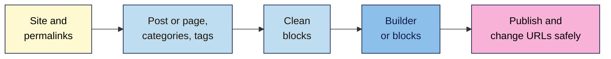

# M05 Cheat Sheet — WordPress for Content Creators
*SEO 101 · Module 5 · checked 2026-11-09 · WordPress 7.1 (7.2 due 8 December 2026)*

## The big picture

## Practice site and permalinks (L01)
| Option | Public? | Use it for |
|---|---|---|
| **Local** | No | Your course site |
| **Playground** | No | Quick tests. **Store permanently** + **Download as .zip** |
| **Hosting** | Yes | Search Console data |

- **Settings → Permalinks → Post name**, before the first post. Reason: readability. Google: URL keywords "have hardly any effect".
- Never change permalinks on a live site without redirects (Module 6).

## Posts, pages and archives (L02)
- **Post** = dated article, one category. **Page** = permanent information, in menus.
- **Categories:** 4–7, rename **Uncategorized**. **Tags:** reuse first, 3+ posts, max 3 per post, never a copy of a category.
- Core adds `noindex` only to search results and non-public sites. Its sitemap lists every category and tag in use.
- **Per tag:** merge duplicates · delete one-offs · keep collections · `noindex` only ones kept for readers. Check clicks first.

## Block editor SEO checklist (L03)
- [ ] Title = H1. H2s for sections, H3s under them. No H1 in the content.
- [ ] **Document Overview > Outline** shows no messages.
- [ ] No bold paragraphs as headings; no levels chosen by size.
- [ ] Lists are List blocks (`- `, `1. `); data is a Table block with **Header section** and caption.
- [ ] Images: **Alternative text** or **Mark as decorative**, sensible **Resolution**.
- [ ] Links: descriptive anchor text; links in synced patterns make sense everywhere.

| Outline message | Fix |
|---|---|
| **(Incorrect heading level)** | Don't jump more than one level deeper |
| **(Multiple H1 headings are not recommended)** | Extra H1s → H2 |
| **(Your theme may already use a H1 for the post title)** | Content H1 → H2 |
| **(Empty heading)** | Delete it, or add text |

## Page builder decision guide (L04)
| Situation | Do |
|---|---|
| New site | Block theme + block editor |
| Need a layout blocks can't make | Test one page's weight with a builder first |
| Site already on a builder | Keep **one** builder; fix headings, images and unused features |
| Still slow or hard to edit | Plan a rebuild in blocks, page by page, with redirects |

- No Google doc names a builder. There's no "text to code ratio" (Mueller, 2018).
- Relevance first; good page experience helps when content is equally good.
- Measure: Outline, View Source heading and `
` counts, DevTools **Network** total.

## Publishing and URLs (L05)
**Save draft → Preview in new tab (mobile too) → Publish / Schedule → Save → Revisions**

| Change a slug on | Old address |
|---|---|
| WordPress **post** (published) | 301, automatically |
| WordPress **page** | "Not found": add a redirect |
| WordPress draft | Nothing to redirect |
| Shopify blog post | Redirects if **Create a URL redirect** stays ticked |
| Wix page | 301, automatically |
| Wix blog post | Add one in **URL Redirect Manager** (custom domains only) |

- "Last updated" only after a significant change. Never change dates to look fresh.
- After any change, visit the old address and check its status.

## Your tabs
**WordPress setup** · **Archive check** · **Outline check** · **Builder check** · **URL change test** · **Publish check**

**Remember:** choose the block for what the content *is*, then style it. Test every address you change.

> ⚠️ **May change:** WordPress 7.2 labels; Playground's Dock; page-builder market shares; Shopify and Wix menu names.
