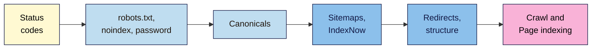

# M06 Cheat Sheet — Technical SEO Fundamentals
*SEO 101 · Module 6 · checked 2026-11-09*

## The big picture

## Can it be indexed? (non-negotiable #7)
| # | Check | Where |
|---|---|---|
| 1 | **200**, in one hop | DevTools **Network** |
| 2 | Crawl allowed | `/robots.txt`; URL Inspection **Crawl allowed?** |
| 3 | No stray `noindex` (source *or* header) | View Source; DevTools **Headers**; **Indexing allowed?** |
| 4 | Correct canonical | View Source; **User-declared canonical** |
| 5 | In the sitemap | Your sitemap |
| 6 | Linked internally | **Internal links** tab; crawl depth |

## Status codes (L01)
| Code | Google |
|---|---|
| 200 | Considered, not guaranteed |
| 301/308 | Permanent: "strong signal" |
| 302/307 | Temporary: "weak signal" |
| 404/410 | Same: not indexed, removed if indexed |
| 429/5xx | Slow down, retry ("about 2 days"); days of errors drop pages |
| **Soft 404** | "Not found" or empty page with 200 → excluded |

Removed page: close replacement → **301**; none → **404/410**; never all to the home page.

## Which tool hides what (L02)
| Want | Use |
|---|---|
| Private (incl. staging) | **Password** |
| Visitable, not in search | **`noindex`** (must be crawlable) |
| PDF or file out of search | **`X-Robots-Tag: noindex`** |
| Images, video, endless parameters | **robots.txt** `Disallow` |

robots.txt: longest matching path wins; tie → least restrictive; case-sensitive prefixes; `*` and `$`; 500 KiB; cached ~24 h. **Never** block and `noindex` the same page.

## Canonicals (L03)
- Duplicates are normal; canonical = "a hint, not a rule".
- Signals: redirect (strong) · `rel="canonical"` (strong) · sitemap (weak). Make them agree.
- Absolute, `https`, self-referencing, in `<head>`; link internally to it.
- Never point to redirected, 404, `noindex` or unrelated pages.

## Sitemaps and IndexNow (L04)
- List only 200, indexable, canonical URLs you want in search.
- Google ignores `priority` and `changefreq`; `lastmod` only if honest.
- 50,000 URLs / 50MB per file. Submit in Search Console and Bing; ping is gone.
- IndexNow: Bing, Naver, Seznam.cz, Yandex, Yep and others. Google not listed.

## Redirects and structure (L05, #8)
- Server-side 301 straight to the final URL: **one hop**, then 200.
- No chains, no loops, no home-page dumping. Keep "at least 1 year".
- Update internal links, the sitemap and canonicals. Keep a redirect map.
- Links, not folders: best pages within about 3 clicks; no orphans.

## Crawl and Page indexing (L06)
- Screaming Frog free: 500 URLs, no saved crawls (export).
- "Not indexed is not necessarily bad." Triage: intended vs fix; **Website** source only.
- Fix → **Test live URL** → **Validate fix** once (~2 weeks) → log it.

## Your tabs
**Status check** · **Crawl control** · **Canonical check** · **Sitemap audit** · **Redirect map** · **Crawl findings** · **Indexing audit**

**Remember:** indexable before optimised. Check the six points before you polish anything.

> ⚠️ **May change:** Google's crawling docs moved to `developers.google.com/crawling/` in 2026; Search Console reason names; Screaming Frog menus and price; IndexNow's engine list.
