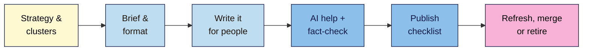

# M07 Cheat Sheet — Content Strategy, SEO Writing & AI Content
*SEO 101 · Module 7 · checked 2026-11-09*

## The big picture

## Strategy and clusters (L01)
- Decide **why** (goal), **for whom** (Snapshot reader), **what** (keyword map), **when** (hours you really have).
- **Cluster:** 1 broad **pillar** + 4–6 **cluster posts**, each with its own phrase, intent and URL. Pillar ↔ every post; sideways links; posts → money page.
- Not a Google signal. Google reads structure from **links**, not folders: "the more links a page has to it within a site, the higher the relative importance".
- "A high quantity of pages doesn't make a website higher quality." A pillar never targets a long-tail phrase.

## The brief (L02)
| Field | Note |
|---|---|
| Title + URL, main phrase | From the Content plan and Keyword map |
| Intent + format | From a **dated SERP check** |
| Reader + need | "Before you start writing, identify a user need" (GOV.UK) |
| **Angle** | "Only we can…": tests, photos, numbers, local knowledge |
| Outline | Answer first; descriptive H2s |
| Questions, sources | People also ask; primary sources only |
| Links in/out, CTA | From the cluster link plan |
| Scope | A range from the outline; "(No, we don't.)" prefer a word count |
| AI use, owner, dates | For the "How" note and the calendar |

## Formats by intent (L02)
| Intent | Format | First thing the reader sees |
|---|---|---|
| How-to | Numbered steps | The ratio or first step |
| Explainer / problem | Causes and fixes | The answer in 1–2 sentences |
| "Best X" | Tested picks + "Last updated" | The short list, who each suits |
| "X vs Y" | Table + verdict | The table |
| Transactional | Product or category page | Price, options, buy |

**Commodity content** "typically adds little unique insight". Add first-hand experience.

## Writing (L03)
- **Answer first.** People "only read 20 to 28% of text on a webpage".
- Split sentences over 25 words · ≤5 sentences per paragraph · everyday words · active voice · descriptive headings (question headings are fine if answered at once).
- Show you did it: numbers, photos, results, mistakes.
- Name and link the **primary source** in the sentence. Citing alone "doesn't replace the need for original effort".
- Cut **filler**. Readability scores are a writing aid, not a ranking factor.

## AI and the fact-check pass (L04, #10)
| AI is good for | AI fails at |
|---|---|
| Ideas, outlines, rewording, missing questions | Statistics, quotes, names, dates, prices, links, your experience |

- "generative models don't retrieve facts". "It is critical to manually factcheck and review all AI-generated content", including **titles, meta descriptions, structured data and alt text**.
- **Fact-check log:** claim · type · source URL · supporting sentence · date · **Keep / Fix / Cut**. Quotes: exact-phrase search. Links: click every one. No source = cut.
- **Disclose** ("How we made this") when readers would "reasonably" expect it. Real bylines only; fake profiles are "a form of deception". Merchant Center AI product data "must be … labeled".
- **Scaled content abuse:** many pages to rank, not help, "no matter how it's created".

## Publish checklist (L05, #9), 24 checks
1. **Plan:** brief · one phrase + intent · not used twice
2. **Content:** answer first · first-hand evidence · plain-language pass · fact-check log done · sources linked · spelling
3. **On-page:** title · meta · headings · slug · images
4. **Links:** ≥2 out · ≥2 in (added on publish day) · descriptive anchors
5. **Trust:** real byline → true bio · "How" note if expected · "Published" visible; "Last updated" only after a significant change
6. **After publishing:** 200 · no `noindex` · self canonical · in sitemap · visible date = `datePublished` · 4-week check booked

## Refresh, merge or retire (L06)
| Situation | Action |
|---|---|
| Working and accurate | **Keep**; don't touch the date |
| Useful but dated or slipping | **Refresh** → fact-check → checklist → "Last updated" |
| Two pages, one question | **Merge** into the stronger; single-hop 301; update links |
| Gone, close replacement | **Retire: 301** to it |
| Gone, no replacement | **Retire: 404/410** ("treated the same"); remove links |

- "Deleting content is a last resort." Mass add/remove to look "fresh": "No, it won't".
- Date change without content change: "just noise & useless" (Mueller, 2022).
- Compare seasonal posts with the **same period last year** (GSC **Date → Compare**).
- Never a soft 404 (empty page at 200) or home-page dumping.

## Your tabs
**Content plan** · **Briefs** · **Fact-check log** · **Publish log** · **Content audit**

**Remember:** brief first, facts checked, checklist passed. Every post, every time.

> ⚠️ **May change:** Google's AI content guidance (updated 2026-10-01) and helpful-content page (2026-10-05); the AI optimisation guide (new in 2026); AI tools and their help pages; Merchant Center AI policy.
