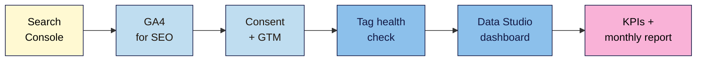

# M08 Cheat Sheet — Analytics, Tracking & Reporting
*SEO 101 · Module 8 · checked 2026-11-09*

## The big picture

## Search Console: which report? (L01)
| Question | Report | Check |
|---|---|---|
| Anything badly wrong? | Overview, **Manual actions**, **Security issues** | Weekly |
| Which searches bring people? | **Insights**, then Performance (weekly/monthly view) | Weekly |
| Can Google index my pages? | Page indexing, Sitemaps, URL Inspection | Monthly / after changes |
| How good is the experience? | Core Web Vitals, HTTPS | Monthly |
| Who links to me? | Links: "It shows a sample"; no nofollow flag | Quarterly |
| Can Google reach my server? | Settings → Crawl stats → **Host status** (green) | Monthly |

- Under ~1,000 pages: you "should not need to use" Crawl stats beyond Host status.
- **Branded filter** (AI; may mislabel; not for sub-properties or low-impression sites) → fallback: Query regex `brand|misspelling`.
- **Query groups** (AI; "don't affect ranking"). **Annotations**: ≤120 chars, hidden in compare and 24-hour views, deleted after 500 days, no personal data.
- Recommendations and Achievements are optional.

## GA4 for SEO (L02)
- **Traffic acquisition:** Organic Search includes "Google's AI Overviews and AI Mode"; ChatGPT, Gemini and others → **AI Assistant** channel. Search `google / organic`.
- **Landing page** report filtered to `google / organic` → key events per page.
- **Key events** (were "conversions" until March 2024): **Admin → Data display → Events** → star. Up to 30. Mark only business actions.
- **Internal traffic:** IP rule → filter in **Testing** → check "Test data filter name" in Explore → **Active** (permanent, not retroactive, 24–36 h).
- Retention affects only explorations and funnels. Thresholds: "You can't adjust them"; widen dates.

## Consent and GTM (L03)
| Basic consent mode | Advanced consent mode |
|---|---|
| Tags blocked until consent; nothing sent on decline | Tags load; cookieless pings on decline |
| Simple, strict | Modelling needs ≥1,000 consenting daily users |

- Consent mode "does not provide a consent banner". Google requires consent signals for EEA, UK and Swiss users. Elsewhere: check local law.
- **GA4 installed one way only:** plugin, platform *or* GTM.
- **GTM:** tag (what) + trigger (when) → **Preview** → DebugView → **Submit → Publish and Create Version** (named) → revert if needed.
- 2026-11-06 snippet: `gtm.js?id=…`; `gtag('config')` deprecated but "will continue to work".

## Why the numbers don't match (L04)
| Reason | Effect on GA4 |
|---|---|
| Tag missing on pages · consent opt-outs · blockers / no JavaScript · bots excluded · PDFs | Lower |
| Search Console in **Pacific Time** | Days shift |
| GSC canonical URL vs GA4 any URL | Page totals differ |

- Compare **trends**: "the general trends have the same pattern". Same dates, same filters, weekly.
- **Steady gap = normal. Sudden jump = tag health check:** View Source (`G-`, `GTM-`) → ID matches **Admin → Data streams** → Tag Assistant "Google tags found" once → DevTools `collect`: one page view per load (204 ≠ right ID) → GTM **Versions** published.

## Data Studio dashboard (L05)
- **Data Studio** = formerly Looker Studio (renamed April 2026), free, datastudio.google.com.
- Sources: Search Console (**URL Impression**, Web; one table per source) · GA4 (`google / organic`; Read & Analyze) · **Changes log** sheet (no native annotations).
- One page: date control + freshness note · 5 scorecards with comparison · weekly clicks chart · landing page table · changes log.
- Freshness: Google sources ~12 hours (GA4 can be 1 or 4); GSC delayed 2–3 days. Avoid ISO-week stacked bars with GA4 sessions.
- **Check every number** against its source. Share **view-only**.

## KPIs and the monthly report (L06)
| Use | Avoid |
|---|---|
| Non-branded clicks · organic key events · key pages indexed | Average position ("can be misleading") · total impressions · site-wide averages |

- Google: "Impressions and clicks are ultimately the measure of success."
- Compare **year over year** (or previous period matching weekdays). Winners and losers: **Compare → Pages → clicks difference**.
- **One page:** headline · KPIs · top 3 up/down with reasons (or "unknown") · dated changes · ≥2 caveats · 3 next actions with owner and date.

## Your tabs
**GSC tour** · **GA4 SEO view** · **Tracking setup** · **Tag health** · **Changes log** · **Dashboard checks** · **KPIs** · **Monthly report**

**Remember:** measure before you change, date every change, and report honestly. Non-negotiable #2.

> ⚠️ **May change:** Search Console's AI-powered features (Insights, query groups, branded filter, generative AI report); GA4's AI Assistant channel and menus; the 2026-11-06 Google tag snippet; Data Studio's name, address and connector fields; consent rules. Not legal advice.
