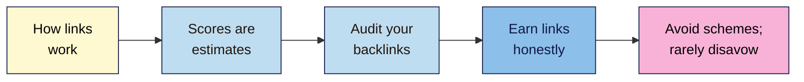

# M09 Cheat Sheet — Off-Page SEO & Link Building
*SEO 101 · Module 9 · checked 2026-11-09*

## The big picture

## How links work (L01)
- **PageRank** (1998): the "random surfer"; a page splits its vote across its links; anchors describe the target. Today it "continues to be part of our core ranking systems", but "PageRank is just one" signal.
- Count **referring domains**, not raw links. Natural anchors: brand, URL, descriptive, some generic.

| rel value | Use for |
|---|---|
| *(none)* | Links you trust and vouch for |
| `sponsored` | Paid, gifted or affiliate links ("sponsored is preferred") |
| `ugc` | Comments, forum posts |
| `nofollow` | When you won't vouch and nothing else applies |

Since 2019 (ranking) and 1 March 2020 (crawling) they're **hints**. A `nofollow` link isn't worthless: it sends visitors.

## Authority scores (L02)
- **DA** (Moz), **DR** (Ahrefs), **AS** (Semrush): tools' own estimates. Google: tools "don't have access to Google's internal ranking data"; Mueller: "We don't use domain authority at all".
- Relative: scores fall when others grow. **Compare within one tool, then check the site.** Never buy, report or disavow because of a score.

## Free backlink audit (L03)
| Tool | Note |
|---|---|
| Search Console → Links | A sample; 1,000-row tables; exports up to 100,000; no `nofollow` info |
| Bing → Backlinks | Any site, including competitors |
| Ahrefs Free (formerly AWT) | Verified sites; 1,000 visible; link types |

**Label each linking site:** **Fine** (real, relevant; paid = `sponsored`) · **Ignore** (unasked spam; Google "typically will ignore") · **Risky** (arranged to move rankings). **Reclaim:** good links to 404s (301 or ask); unlinked mentions (`"brand" -site:yourdomain`).

## The link-earning menu (L04)
Linkable asset (data, tool, chart, guide) · real relationships (suppliers, stockists, associations) · local (press, events; paid = `sponsored`) · digital PR (real stories, real data) · guest content (for their readers, not at scale) · broken-link fixing · unlinked mentions.

**Honest outreach:** one named person · honest subject · who and where you are · why it helps their readers · easy no · ≤1 follow-up · never pay · never ask for anchors. Avoid "aggressive or repeated" requests. Social: "Not directly" a ranking factor.

## "Is this a link scheme?" checklist (L05, #11)
If **any** answer is yes, it's link spam (unless marked `sponsored`/`nofollow`):
- [ ] Money, goods, free products or services exchanged for a followed link?
- [ ] "Link to me and I'll link to you", at scale or via a partners page?
- [ ] Automated or bulk links (directories, bookmarks, comments)?
- [ ] A link required by contract or terms, with no choice to qualify it?
- [ ] Keyword anchors in guest posts, advertorials or press releases?
- [ ] Links hidden in widgets, footers or templates across many sites?
- [ ] Thin sites (a PBN or expired domains) built to link?

**Outcomes:** neutralised by SpamBrain (wasted money) → rank lower → **manual action**.

## Disavow: Step 0
| Situation | Disavow? |
|---|---|
| No manual action; spam you didn't arrange; "toxic" tool scores | **No** |
| You know a considerable number of links were bought or arranged; a manual action is likely | Maybe: remove first |
| Manual action: Unnatural links to your site | Yes, after removal requests; then reconsideration |

File: `.txt`, one URL or `domain:` per line, `#` comments; one list per property (a new upload **replaces** it); **not for Domain properties**. Reconsideration: explain the issue, describe the steps, document the outcome.

## Your tabs
**Links 101** · **Authority scores** · **Backlink audit** · **Outreach** · **Link schemes**

**Remember:** earn links, never buy them. Non-negotiable #11.

> ⚠️ **May change:** spam policies (updated 2026-08-28); the disavow tool (may be removed); Ahrefs Free's limits; email law (not legal advice).
