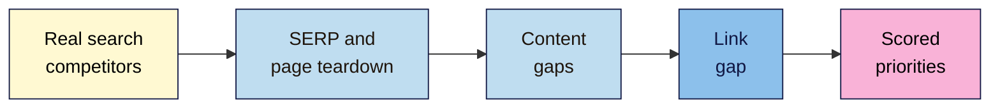

# M10 Cheat Sheet — Competitor Analysis
*SEO 101 · Module 10 · checked 2026-11-09*

## The big picture

## Competitor analysis checklist
**1. Who (L01)**
- [ ] 5 searches across topic clusters (shop, blog, local)
- [ ] Top 5 checked **by hand** in a private window; city, device, date recorded (no scraping Google)
- [ ] Each site labelled **business** / **search-only** / **giant**; giants dropped
- [ ] 3 picks that recur and are beatable
- [ ] `site:` = a sample ("not always exhaustive"); `related:` and `cache:` are retired

**2. Their pages (L02)**
- [ ] Results page: page types, format, dates, features
- [ ] Teardown, theirs vs mine: title, `<h1>`, headings, depth, first-hand evidence, author, date
- [ ] **Rich Results Test** (can't test pages blocked by robots.txt or `noindex`)
- [ ] **PSI lab vs lab**; field only with enough CrUX data
- [ ] **Wayback Machine** for history (gaps possible)
- [ ] Three "be more useful" changes, none copied

**3. Gaps (L03)**
- [ ] Your topics from Search Console (real); theirs from `site:`, menus, free tools (samples and estimates)
- [ ] Missing / weak / strength, plus **Fits us?**
- [ ] Estimate reality check on your own site
- [ ] Free queries planned (Semrush: "10 reports per day across all vital tools")

**4. Links (L04)**
- [ ] Bing Backlinks, Moz Link Explorer (10/month), Ahrefs' free checker
- [ ] Their linking sites minus yours; intersects first
- [ ] Every page opened; labelled **Earnable** / **Not for us** / **Scheme**
- [ ] 3–5 Earnable into Outreach (M09). Never copy schemes.

**5. Priorities (L05)**
- [ ] Score Value / Chance / Effort (1–3, added); ties → Value
- [ ] Evidence and Source + date on every row
- [ ] Top 10 mix; hedged findings; one "won't do"

## Gap analysis template
| Topic | You (page, clicks) | Comp A | Comp B | Comp C | Gap type | Intent | Fits us? | Evidence | Source + date | V | C | E | Total |
|---|---|---|---|---|---|---|---|---|---|---|---|---|---|
| AeroPress guide | — | ✓ | ✓ | — | Missing | How-to | Yes | 2 of 3 rivals; results mostly 2023 guides | `site:` + hand check, 2026-11-09 | 3 | 3 | 2 | 8 |

## Real data vs estimates
| Real | Sample | Estimate |
|---|---|---|
| Your Search Console · results you check by hand · page source · Rich Results Test · PSI lab and field | `site:` · Search Console Links · free backlink lists | Competitor traffic and rankings · DA / DR / AS · Similarweb |

Ahrefs' own 2022 study: median error "49.52%"; some sites off by "more than 1,000%". Write: *"Tool estimates ~X (estimate, date)."*

## Never
Copy or paraphrase a competitor's content ("substituting synonyms" = scraping) · ignore robots.txt on someone else's site · buy the links they bought · report estimates as facts · use numbers an AI tool supplied.

**Your tabs:** **Competitors** · **Page teardown** · **Gap sheet** · **Link gap** · **Opportunities**

> ⚠️ **May change:** free tool limits (Moz, Semrush, Ahrefs); Google operators; the Wayback link in "About this page"; PSI/CrUX metrics.
