# SEO 101 — Course Outline

| Field | Value |
|---|---|
| Slug | `seo-101` |
| Version | 0.1 (see Changelog) |
| Status | draft |
| Last reviewed | 2026-11-03 |
| Author(s) | Napoleon Arouldas, GrandAppStudio |
| Language | English (plain, ~grade 8–10 reading level) |
| Licence | CC BY-SA 4.0 |
| Tagline | Complete SEO, from your first search to your first site audit |

**Place in the catalogue:** SEO 101 is the **prequel to Modern SEO 101** (`modern-seo/`). It teaches classic search engine optimisation in full, from the basics to advanced topics, in the order you need them. Modern SEO 101 builds on it with AEO, GEO, AI-assisted production and automation. SEO 101 graduates can skip Modern SEO 101's M01–M02 using that course's diagnostic quiz.

**Assumptions (from the scaffold session, 2026-11-03):** total beginners; self-paced written course; 8 modules + a final capstone; 2 lessons a week, about 3 h/week.

---

## 1. Promise (required)
After this course you can make any small or medium website easy to find in Google and Bing, from keyword research to a full technical audit and a recovery plan, without paid SEO tools, coding skills or tricks that risk a penalty.

**Problem it solves:** most beginners publish pages and then wait. They don't know whether Google can even see their site, which words people actually search for, or why a competitor ranks above them. Free advice online is either a list of disconnected "hacks" or out of date, and agencies are expensive and hard to judge.

**What makes this course different:**
- **The whole of SEO, in the right order.** How search works → keywords and intent → on-page → crawling and indexing → page experience and structured data → links → local, international and e-commerce → audits, migrations and recovery. Each module needs only what came before it.
- **Diagnose first, then fix.** Every module has a break-it-and-fix-it lab (a planted `noindex`, a redirect chain, a duplicate title, a broken canonical) so learners can find problems on their own, not just follow steps.
- **Free tools only, and the rules up front.** Search Console, Bing Webmaster Tools, Keyword Planner, PageSpeed Insights, Ahrefs Webmaster Tools and the free Screaming Frog crawler. Google's spam policies are taught in Module 1 so nobody builds on a tactic that can get a site penalised.

## 2. Who it's for (required)
**Ideal for:**
- **Complete beginners** who own or run a website (blog, small business, portfolio, shop) and have never done SEO.
- **Graduates of WordPress 101 or Web Development 101** who launched a site and now want people to find it.
- **Career starters** (junior marketers, content writers, virtual assistants) who need a solid SEO foundation before taking client work or moving on to Modern SEO 101.

**Not for:**
- Working SEOs who already run technical audits and keyword research. Start with **Modern SEO 101** instead.
- Paid search and ads management (Keyword Planner is used only as a free data source).
- Enterprise-scale technical SEO (log analysis across millions of URLs, custom JavaScript rendering pipelines, faceted navigation for huge catalogues). These are introduced, not mastered.
- Anyone looking for quick ranking tricks, bought links or mass-produced pages. The course teaches what the search engines' spam policies forbid so you can avoid it.

### Learner personas

| Persona | Background | Goal | Biggest worry | Time available |
|---|---|---|---|---|
| **Kavya, yoga teacher (Chennai)** | WordPress 101 graduate; site with a schedule page and 6 blog posts; never opened Search Console | Students who find her classes on Google, not only on Instagram | "SEO is technical and I'll break my site" | 3 h/week |
| **Tomás, family hardware shop (Lisbon → ships across the EU)** | Shopify store with 300 products, no marketing team; takes over from an agency | Understand what the agency did and do it himself | Paying for SEO he can't check | 3 h/week |
| **Amara, junior content writer (Lagos)** | Writes blog posts for clients; knows nothing about keywords or technical SEO | Write pages that rank and add "SEO" to her CV honestly | Clients asking questions she can't answer | 4 h/week |

## 3. Prerequisites (required)
- **Knowledge:** you can use a browser, a spreadsheet and your site's editor (publish or edit a page). Web Development 101 Modules 1–2 or WordPress 101 Modules 1–2 cover this if you're not sure.
- **A project site (choose one path in Lesson 1.1, see §12):** (A) your own live site, (B) the course's free demo site (shared with Modern SEO 101, deployed to GitHub Pages from a template with step-by-step instructions), or (C) a friend's or client's live site with written permission to access their Search Console.
- **Accounts / tools to set up before Lesson 1:** a Google account (Search Console, Sheets, Looker Studio); a Microsoft account (Bing Webmaster Tools).
- **Hardware / internet:** a laptop or desktop with a modern browser (Chrome or Edge recommended for the developer tools). Mobile works for reading, not for the exercises. M05 and M08 need a desktop install of the free Screaming Frog crawler (Windows, macOS or Linux) or the browser-based alternative given in the lesson.
- **Not required:** coding, paid SEO tools, an ads budget, a big site or existing traffic. You will read a little HTML (titles, headings, links), and the course shows you how.

## 4. Level (required)
**Total beginner → confident SEO generalist.** Lessons are tagged with three levels, as in Web Development 101 and Modern SEO 101:
- **L1 Foundation** (M01–M03): how search works, keyword research, on-page SEO.
- **L2 Practitioner** (M04–M06): crawling and indexing, page experience and structured data, links.
- **L3 Advanced** (M07–M08): local, international and e-commerce SEO; audits, migrations, algorithm updates and recovery.

Exit point: you can audit a site, explain each problem in plain language, fix or brief the fix, and measure the result. That is the starting level for Modern SEO 101.

## 5. Learning outcomes (required)
By the end of the course a learner can:
1. **Diagnose** whether any page can be crawled, indexed and shown in results, using Search Console, Bing Webmaster Tools and a crawler, and fix the common blockers (robots.txt, `noindex`, canonicals, status codes, redirects).
2. **Build** a keyword map that matches each search intent to one page, using free data sources.
3. **Optimise** a page's title, description, headings, content, images and internal links so it is clearly the best match for its query, without keyword stuffing.
4. **Evaluate** a site's page experience (Core Web Vitals, mobile, HTTPS) and structured data, and write a prioritised fix list a developer or the learner can act on.
5. **Plan** ethical link earning and local, international or e-commerce SEO, deciding which ones apply to a given site.
6. **Run** a complete SEO audit, measure against a baseline, and diagnose a traffic drop (or plan a site migration) step by step.

## 6. Format & duration (required)
| Item | Value |
|---|---|
| Format | Self-paced written lessons + exercises, project-based capstones (design guide §1 default) |
| Total learner time | ~40–45 hours (lessons + exercises + capstones) |
| Modules | 8 (+ final capstone) |
| Lessons | ~36 · 15–25 min reading each |
| Exercise time per lesson | 20–45 min |
| Suggested pace | 2 lessons/week, ~3 h/week → about 18–20 weeks |
| Time to first win | Lesson 1.1: in under 30 minutes, run a `site:` search and URL Inspection on your homepage and learn whether Google has indexed it, and record the first line of your baseline |
| Output formats | Markdown source → neps.in LearnPress (web); PDF/slides later if needed |

## 7. Tools & costs (required)
| Tool | Used for | Free option | Paid option (optional) | First used |
|---|---|---|---|---|
| Google Search Console | Indexing, URL Inspection, Performance, sitemaps, page experience reports | Free | — | M01 |
| Bing Webmaster Tools | Bing indexing, Site Scan, keyword research, IndexNow | Free | — | M01 |
| Google Sheets | Baseline, keyword map, audit logs | Free | — | M01 |
| Google Keyword Planner | Search volume ranges | Free with a Google Ads account (no ads need to run) | Exact volumes with active spend | M02 |
| Google Trends, autocomplete, People Also Ask, related searches | Demand and question research | Free | — | M02 |
| Ahrefs Webmaster Tools | Site audit and backlinks for **sites you verify** | Free | Ahrefs / Semrush / Moz subscriptions | M02, M06 |
| Chrome DevTools + Lighthouse | View source, rendered HTML, status codes, performance lab tests | Free | — | M03 |
| Screaming Frog SEO Spider | Crawl a site like a search engine (titles, status codes, canonicals, redirects) | Free version, up to 500 URLs per crawl (⚠️ verify limit) | Paid licence (no URL limit) | M04 |
| PageSpeed Insights | Core Web Vitals field + lab data | Free | — | M05 |
| Rich Results Test, Schema Markup Validator | Structured data checks | Free | — | M05 |
| Google Business Profile | Local listings, reviews | Free | — | M07 |
| GA4 + Looker Studio | Organic traffic, conversions, a simple SEO dashboard | Free | — | M08 |
| AI assistant (ChatGPT, Gemini, Claude, Copilot) | Brainstorming, explaining errors, drafting fix briefs (with checks) | Free tiers | Paid plans | M02 onward |

**Minimum cost to complete the course:** ₹0 / $0. Paid tools are only mentioned as alternatives, and no capstone needs them. Free-tier limits change often and are re-checked when each lesson is written (see §17).

## 8. Non-negotiables
Each is **taught** once, **reinforced** later and **assessed** in a capstone rubric.

| # | Non-negotiable | Why it can't be skipped | Taught | Reinforced | Assessed |
|---|---|---|---|---|---|
| 1 | **Stay inside the search engines' spam policies** (no link schemes, keyword stuffing, cloaking, doorway pages, scaled low-value content) | Manual actions and algorithmic demotions can wipe out a site, and they are slow to undo | M01 | M03, M06, M08 | Cap 6, Final |
| 2 | **Verified Search Console and Bing Webmaster Tools, with a recorded baseline** | Without data you can't diagnose problems or prove improvement | M01 | M04, M08 | Cap 1, Cap 8 |
| 3 | **Read the results page before you write** (one primary intent per page) | Content that doesn't match the intent won't rank, however good it is | M02 | M03, M07 | Cap 2, Cap 3 |
| 4 | **One page per topic** (no keyword cannibalisation) | Two pages competing for the same queries weaken both | M02 | M03, M08 | Cap 2, Cap 8 |
| 5 | **Every indexable page has a unique, descriptive title, one clear H1 and people-first content** | Titles and headings are the strongest on-page signals you control, and thin or duplicate pages drag a site down | M03 | M04, M07 | Cap 3, Final |
| 6 | **Indexable before optimised** (crawlable, not blocked by robots.txt, no stray `noindex`, correct canonical, 200 status, in the sitemap) | A page that isn't indexed can't rank, whatever its content | M04 | M05, M08 | Cap 4, Final |
| 7 | **Redirect every changed or removed URL** (single-hop 301s, no chains or loops, no mass redirects to the homepage) | Broken URLs lose rankings, links and visitors; migrations without a redirect map are the most common cause of big traffic losses | M04 | M07, M08 | Cap 4, Cap 8 |
| 8 | **Secure, mobile-friendly and fast enough** (HTTPS, works on phones, Core Web Vitals at "good" or with a fix plan) | Google indexes the mobile version of your site and uses page experience as one of its ranking signals; slow pages also lose visitors | M05 | M07, M08 | Cap 5, Final |
| 9 | **Structured data that matches visible content and validates** | Mismatched or invalid markup is ignored and can lead to a manual action | M05 | M07 | Cap 5 |
| 10 | **Earn links, never buy them** (no paid links without `rel="sponsored"`, no link exchanges or private blog networks) | Link spam is the classic reason for a manual action, and bought links are a waste of money | M06 | M08 | Cap 6, Final |
| 11 | **One consistent identity for the business or creator** (same name, address, phone, URL and profiles everywhere) | Mismatched details confuse search engines and customers, especially in local results | M07 | M08 | Cap 7 |
| 12 | **Diagnose before you act, and measure against a baseline** (check the data, the date range, the update timeline and the cause before changing things; annotate every change) | Panic changes after a normal dip often cause the real damage | M08 (baseline started in M01) | Final | Cap 8, Final |

## 9. Scope
**Nice-to-have (stretch goals / light coverage):**
- JavaScript SEO basics: rendered vs source HTML, and when content isn't seen (M04, "go further").
- Log-file analysis: what it shows and a small sample to read (M08, "go further").
- Image and video SEO (one lesson section in M05).
- Bing-specific features: IndexNow, Bing Places (mentioned in M04 and M07).
- A short "SEO in an AI-search world" orientation in M01 and M08 that explains AI Overviews in plain terms and points to Modern SEO 101 for the full treatment.

**Deliberately out of scope (and where to learn it instead):**
- AEO, GEO, AI visibility testing, AI crawlers in robots.txt, AI-assisted content production and SEO automation → **Modern SEO 101** (M04–M07).
- Topical authority, content clusters and content calendars at scale → **Modern SEO 101 M03** (SEO 101 covers single-page content quality and basic internal linking).
- Writing HTML and CSS, fixing Core Web Vitals in code, building sitemaps by hand → **Web Development 101 M02, M07** (linked as "how to do it in code").
- SEO plugin setup and WordPress-specific steps → **WordPress 101 M05** (linked as "how to do it in WordPress").
- Analytics and tag setup (GA4 install, GTM, consent) → **Web Development 101 M06**.
- Paid search, social ads, enterprise technical SEO.

## 10. Learning path

```mermaid
flowchart LR
  %% alt: Learning path: diagnostic quiz, then M01 search basics through M08 audits and recovery, ending in the final site audit capstone.
  D[Diagnostic quiz<br/>choose project path]:::pink --> M1[M01 How search<br/>works]:::cream
  M1 --> M2[M02 Keywords<br/>& intent]:::cream
  M2 --> M3[M03 On-page<br/>SEO]:::cream
  M3 --> M4[M04 Crawling<br/>& indexing]:::sky
  M4 --> M5[M05 Page experience<br/>& structured data]:::sky
  M5 --> M6[M06 Links<br/>& authority]:::sky
  M6 --> M7[M07 Local, international<br/>& e-commerce]:::blue
  M7 --> M8[M08 Audits, migrations<br/>& recovery]:::blue
  M8 --> C[Final capstone<br/>full SEO audit + 90-day plan]:::pink
  C -. next course .-> N[Modern SEO 101]:::pink

  classDef cream fill:#FFF9D2,color:#000000,stroke:#111844
  classDef sky   fill:#BFDDF0,color:#1F150C,stroke:#111844
  classDef blue  fill:#8CC0EB,color:#111844,stroke:#111844
  classDef pink  fill:#F9B2D7,color:#000000,stroke:#111844
```

**In words:** take the diagnostic quiz and choose a project path, then work through M01–M08 in order. Foundation modules (cream) cover what search is and how to write for it; practitioner modules (light blue) cover the technical and authority work; advanced modules (blue) cover special site types and audits. The final capstone is a full audit and 90-day plan for your project site. Modern SEO 101 is the next course.

**Quiz → remediation:** same as Web Development 101. Pass mark 70%. Fail twice → the lesson's "Remediate to" link (an earlier lesson in this course, or a lesson in Web Development 101 or WordPress 101), then a 3-question check quiz.

## 11. Diagnostic (placement) quiz
16 questions (2 per module), written after M04 is drafted, saved as `seo-101/diagnostic-quiz.md`. At least one question per block is a scenario or spot-the-error. Most learners are total beginners and will take everything; the quiz exists for learners who already know some of it.

| Module | Questions | Skip rule |
|---|---|---|
| M01 How search works | 2 | 2/2 → skip the lessons, **do Capstone 1** (it creates your baseline) |
| M02 Keywords & intent | 2 | 2/2 → skim the cheat sheet, do Capstone 2 |
| M03 On-page SEO | 2 | 2/2 → skim the cheat sheet, do Capstone 3 |
| M04–M08 | 2 each | No skip. 2/2 means "skim the lessons you know and take their quizzes". Every capstone produces part of the final audit |

**Routes:** total beginners like Kavya take everything. Writers like Amara who know some on-page basics may skip M03's lessons. Every learner does every capstone.

## 12. Running example
**Course demo (shown in every lesson):** *Nila Coffee*, the small roaster from Web Development 101, which later becomes the brew-guide hub in Modern SEO 101. In SEO 101 its site has just launched and nobody can find it. Over the course it gets a keyword map, optimised product and guide pages, a clean technical setup, its first earned links, a **tasting room** (local SEO), **shipping to several countries** (international SEO) and a **subscription shop** (e-commerce SEO). Prices in ₹ and $. Screenshots and numbers are clearly marked as illustrative.

**Learner project (built in the capstones): choose one path in Lesson 1.1** and keep it for the whole course:
- **A. Your own site:** a blog, creator, business or shop site you control (WordPress, Shopify, Wix, hand-coded, any builder).
- **B. The demo site:** a ready-made small site (template repo shared with Modern SEO 101; deploy free on GitHub Pages and verify your own Search Console). For learners with no site of their own. Some bugs are planted for the break-it labs.
- **C. A friend's or client's site:** a real local business or creator who gives written permission and Search Console access (Tomás's and Amara's route).

Every path produces the same deliverables: baseline (M01) → keyword map (M02) → 3 optimised pages (M03) → crawl and indexing audit (M04) → page experience and schema fix list (M05) → link audit and outreach plan (M06) → local / international / e-commerce plan (M07) → dashboard and recovery playbook (M08) → full SEO audit and 90-day plan (final capstone). Low traffic is expected and fine. The rubric grades method and evidence, not traffic numbers.

## 13. Modules (required)
Lessons are planned in detail later by `/plan-module`. The topics below are the source of truth for that.

Every lesson follows `course-framework.md` and includes a **when to use / when not to** note with its trade-off, a troubleshooting table, and a **Use AI for this** section with an example prompt, where the AI gets it wrong and how to check it. Where a step differs by platform, the lesson gives the general method and links to WordPress 101 or Web Development 101 for platform detail.

### M01 — How Search Works & Your First Look (L1)
- **Goal:** know how Google and Bing find, store and rank pages, and find out whether they can see your site today.
- **Topics:**
  - What SEO is (and isn't): organic vs paid results, what you control, how long results take, why "guaranteed #1" is a red flag.
  - How search works: crawl → render → index → rank → serve, explained with Nila Coffee; what "ranking factors" really means; a short orientation on AI Overviews and AI answers (details in Modern SEO 101). ⚠️ freshness
  - Anatomy of a results page: blue links, title links and snippets, rich results, People Also Ask, local pack, images and video, ads.
  - Set up Google Search Console (Domain vs URL-prefix property) and Bing Webmaster Tools; `site:` search, URL Inspection; record a baseline in Sheets.
  - The rules: Google's spam policies and Bing's guidelines in plain words; white-hat vs black-hat; manual actions vs algorithmic changes; how to spot a bad SEO offer.
- **Non-negotiables taught:** #1, #2
- **Module capstone (artifact):** Baseline sheet: Search Console + Bing verified, indexed-page count, top 10 queries and pages (or "no data yet"), a URL Inspection result for 3 key pages, and a "red-flag check" of one real SEO offer or agency pitch. Break-it lab: a test page set to `noindex` on purpose, found with URL Inspection and then fixed and re-inspected.
- **Cheat sheet:** How search works in one diagram; the results-page features; Search Console's first five reports and what each answers; the spam-policy list in plain words.
- **Common failure points:** verifying the wrong property type; expecting data on day one (Search Console needs a few days); treating the `site:` count as exact; believing a "submit to 500 search engines" offer.

### M02 — Keyword Research & Search Intent (L1)
- **Goal:** find the words your audience really uses and decide which page should answer each one.
- **Topics:**
  - Search intent (informational, navigational, commercial, transactional) and how to read it from the results page.
  - Seed keywords and long-tail: brainstorming from customers, autocomplete, People Also Ask, related searches, forums.
  - Free data: Keyword Planner ranges, Google Trends, Bing keyword research, Search Console queries, Ahrefs Webmaster Tools; what volume, difficulty and seasonality mean and how unreliable they are.
  - Competitor research by hand: who ranks, what type of page, and what they cover that you don't.
  - Grouping keywords into topics and building a keyword map (one primary topic per page); spotting cannibalisation.
- **Non-negotiables taught:** #3, #4
- **Module capstone (artifact):** A keyword map for at least 10 pages: page → primary topic → secondary keywords → intent → page type → priority. Includes a break-it lab: two planted pages that cannibalise each other, to find and resolve.
- **Cheat sheet:** Intent types and their results-page signals; free data sources and what each is good for; the keyword-map template.
- **Common failure points:** chasing big volumes over intent; trusting AI-invented search volumes; one page per keyword variant; ignoring queries the site already ranks for.

### M03 — On-Page SEO & Content Quality (L1)
- **Goal:** make each page the clearest, most helpful match for its topic, for readers first and search engines second.
- **Topics:**
  - Title tags and meta descriptions: what Google shows, length guidance, why Google sometimes rewrites them.
  - Headings (one H1, logical H2/H3), URL slugs, the first paragraph, and natural keyword use (no stuffing).
  - People-first content: Google's "helpful, reliable, people-first content" guidance, E-E-A-T explained simply, first-hand experience, author info, sources; thin and duplicate content.
  - Images for SEO: file names, alt text, size and format (linking to Web Dev 101 M07.L02 for the technical detail).
  - Internal linking basics: descriptive anchor text, linking from strong pages, avoiding orphan pages, breadcrumbs.
- **Non-negotiables taught:** #5 (+ #1, #3, #4 reinforced)
- **Module capstone (artifact):** Optimise 3 pages from the keyword map (title, description, headings, content improvements, images, internal links). Before/after table, with a 4-week Search Console check booked. Break-it lab: a planted page with a duplicate title, two H1s, a missing alt text and no internal links, found with a crawl or View Source and fixed.
- **Cheat sheet:** The on-page checklist (one page); title and description formulas; the people-first questions.
- **Common failure points:** the same title on every page; keyword stuffing; meta descriptions treated as a ranking factor; editing the page but not linking to it from anywhere.

### M04 — Technical SEO I: Crawling & Indexing (L2)
- **Goal:** make sure search engines can reach, read and index the pages you want, and skip the ones you don't.
- **Topics:**
  - HTTP status codes (200, 301/302, 404/410, 5xx) and how to check them; soft 404s.
  - `robots.txt` vs `noindex` vs password protection: what each does and the classic mistake of combining them.
  - Canonical URLs and duplicate content: `www` vs non-`www`, `http` vs `https`, trailing slashes, URL parameters.
  - XML sitemaps: what to include, submitting in Search Console and Bing; IndexNow for Bing.
  - Redirects: 301 vs 302, chains and loops, redirect maps; site structure and URL design; crawl depth and orphan pages.
  - Reading Search Console's Page indexing report (including "Crawled/Discovered – currently not indexed") and crawling your own site with Screaming Frog. Go further: rendered vs source HTML and JavaScript content.
- **Non-negotiables taught:** #6, #7 (+ #2 reinforced)
- **Module capstone (artifact):** Crawl and indexing audit: a full crawl of the project site, Page indexing report reviewed, and a prioritised fix list (status codes, redirects, canonicals, sitemap, robots). Break-it lab: diagnose a planted `noindex`, a robots.txt block and a redirect chain on test pages.
- **Cheat sheet:** "Can it be indexed?" decision tree; status code table; robots.txt vs `noindex` vs canonical, compared.
- **Common failure points:** blocking a page in robots.txt and expecting `noindex` to work; canonicals pointing to redirected or `noindex` pages; leaving a staging site's "discourage search engines" setting on; reading "Discovered – currently not indexed" as an error that needs fixing.

### M05 — Technical SEO II: Page Experience & Structured Data (L2)
- **Goal:** make pages fast, secure and mobile-friendly, and describe them to search engines with valid structured data.
- **Topics:**
  - Mobile-first indexing: what it means, checking that the mobile version has the same content.
  - HTTPS and mixed content; why security problems hurt visibility.
  - Core Web Vitals (LCP, INP, CLS): field vs lab data, reading PageSpeed Insights and Search Console's report, and the fixes that matter most for small sites (images, fonts, hosting, plugins); a fix brief for a developer. Code-level fixes in Web Dev 101 M07.L01. ⚠️ freshness
  - Structured data: what it is, JSON-LD, the types that still earn rich results for small sites (Organization, Article, Breadcrumb, Product, Review, LocalBusiness, Recipe, Video) and which no longer do (⚠️ verify FAQ and HowTo status); Rich Results Test and Schema Markup Validator; markup must match visible content.
  - Image and video SEO: image search, video pages and thumbnails, sitemaps for media.
- **Non-negotiables taught:** #8, #9 (+ #6 reinforced)
- **Module capstone (artifact):** A page experience and structured-data report: PageSpeed and CWV results for 3 templates, a mobile check, an HTTPS/mixed-content check, a fix brief, and valid structured data added to 2 pages with test screenshots. Break-it lab: find why a planted Product markup fails validation.
- **Cheat sheet:** Core Web Vitals thresholds and the top causes of each; which schema types earn which rich results; the validation steps.
- **Common failure points:** chasing a perfect Lighthouse score instead of field data; adding schema for content that isn't on the page; copying plugin-generated markup without testing; desktop-only content hidden on mobile.

### M06 — Links & Authority (L2)
- **Goal:** understand why links matter, see who links to you, and earn links the right way.
- **Topics:**
  - How links work: PageRank in plain words, internal vs external links, anchor text, `nofollow`, `sponsored`, `ugc`.
  - Auditing your backlinks with Search Console's Links report, Bing and Ahrefs Webmaster Tools; spotting spammy links; when the disavow tool is (and isn't) needed.
  - Ethical link earning: linkable assets, local and industry links, digital PR basics, guest content done right, fixing broken links that point to you, unlinked brand mentions.
  - Link schemes to avoid: buying links, link exchanges, private blog networks, paid guest posts without `rel="sponsored"`; how penalties for them work.
  - Internal linking strategy, part 2: hub pages, passing authority to important pages, fixing orphan pages found in M04.
- **Non-negotiables taught:** #10 (+ #1 reinforced)
- **Module capstone (artifact):** A link report and 3-month outreach plan: current backlink profile summary, any risky links, internal-link fixes made, one linkable asset idea, and 10 realistic link targets with the reason each would link. Break-it lab: a sample backlink list (provided) to sort into fine / ignore / risky, with a reason for each.
- **Cheat sheet:** Link attributes and when to use each; the link-earning menu; the "is this link a scheme?" checklist.
- **Common failure points:** disavowing links that don't need it; buying "high DA" links; mass outreach emails; ignoring internal links while chasing external ones.

### M07 — Local, International & E-commerce SEO (L3)
- **Goal:** apply SEO to the three special cases most small businesses meet, and know which ones your site needs.
- **Topics:**
  - Local SEO: Google Business Profile set-up and optimisation, categories, reviews and replies, NAP consistency, local citations, local landing pages, Bing Places, the local pack. ⚠️ freshness
  - International SEO: when you need it, ccTLD vs subfolder vs subdomain, `hreflang` basics and common mistakes, currencies and languages (links to Web Dev 101 M08.L04 for implementation).
  - E-commerce SEO: category vs product pages, unique product descriptions, product structured data and merchant listings, out-of-stock and discontinued products, faceted navigation and parameter basics.
  - Choosing what applies: a decision guide for blogs, local services, shops and multi-country sites.
- **Non-negotiables taught:** #11 (+ #3, #5, #7, #8, #9 reinforced)
- **Module capstone (artifact):** A specialised SEO plan for the project site: the decision-guide result, plus either a Google Business Profile audit and fixes, an `hreflang` plan, or a product/category page plan (whichever applies; demo-site learners do the local plan for Nila Coffee's tasting room). Break-it lab: find the errors in a planted `hreflang` set.
- **Cheat sheet:** GBP optimisation checklist; international structure options compared; product page checklist.
- **Common failure points:** fake addresses or keyword-stuffed business names on GBP; automatic IP redirects that hide pages from Googlebot; `hreflang` without return links; deleting out-of-stock products and creating 404s.

### M08 — Measurement, Audits, Migrations & Recovery (L3)
- **Goal:** measure progress honestly, run a complete audit, and handle the high-stakes moments: site moves and traffic drops.
- **Topics:**
  - SEO KPIs and a simple Looker Studio dashboard from Search Console (+ GA4 organic traffic and conversions); annotations; comparing like with like.
  - Running a complete SEO audit: the order (indexing → technical → on-page → content → links → special cases), prioritising by impact × effort, writing the report.
  - Site migrations and redesigns: domain changes, HTTPS, platform moves; the pre-launch checklist, redirect map, Change of Address tool, and post-launch monitoring.
  - Diagnosing traffic drops: tracking errors vs seasonality vs technical breaks vs algorithm updates (Google Search Status Dashboard) vs manual actions; recovery steps; reconsideration requests.
  - Go further: log files (what Googlebot actually crawls) and where SEO is heading with AI search (bridge to Modern SEO 101). ⚠️ freshness
- **Non-negotiables taught:** #12 (+ #2, #4, #6, #7, #10, #11 reinforced)
- **Module capstone (artifact):** A live dashboard with a baseline comparison since M01, a traffic-drop playbook for the project site, and a migration checklist. Break-it lab: a simulated traffic drop (data provided) to diagnose to its real cause.
- **Cheat sheet:** The audit order; the traffic-drop decision tree; the migration checklist.
- **Common failure points:** comparing different date ranges or seasons; blaming an algorithm update for a broken tracking tag; launching a redesign without a redirect map; making many changes at once during a drop.

### Final capstone — Full SEO Audit & 90-Day Plan
Run a complete audit of the project site (path A, B or C) using every module: baseline and policies (M01) → keyword map (M02) → on-page (M03) → crawling and indexing (M04) → page experience and schema (M05) → links (M06) → local, international or e-commerce (M07) → measurement (M08). Deliver a client-ready audit report with a prioritised 90-day plan, the fixes already made with before/after evidence, and a short presentation (written or recorded) a site owner can follow. The rubric grades method, evidence and clear explanations, not traffic numbers.

## 14. Assessment & completion (required)
- **Per lesson:** exercise + 5–8 question quiz (about 40% recall, 40% scenario, 20% spot-the-error; 1–2 spaced-review questions from earlier lessons). Pass mark 70%.
- **Per module:** capstone with a 4-level rubric (Beginning / Developing / Proficient / Exemplary) and a break-it-and-fix-it lab.
- **Final capstone:** the Full SEO Audit & 90-Day Plan. The rubric covers every non-negotiable: policies and baseline (#1, #2) · research and mapping (#3, #4) · on-page quality (#5) · indexing and redirects (#6, #7) · page experience and schema (#8, #9) · links (#10) · identity (#11) · diagnosis and measurement (#12).
- **Completion means:** every module capstone + the final capstone at **Proficient** or above.
- **Proof of skill:** a portfolio audit report (with the owner's permission on path C) and the neps.in course certificate.

## 15. Accessibility & inclusion
- Plain international English; jargon defined on first use and in `glossary.md` (SEO has a lot of jargon, so every lesson ends with its new terms).
- Every Mermaid diagram has a `%% alt:` line and an "In words" paragraph; every image prompt has alt text.
- Examples from India, Portugal/EU, Nigeria, Brazil and the US; prices in ₹ and $; names from many cultures; Google and Bing, and a note where other engines (e.g. Naver, Yandex, Baidu) matter.
- Lessons work from text alone; screenshots are illustrative, never the only way to follow a step.
- Accessibility is taught as part of SEO (alt text, headings, descriptive links), not as an extra.

## 16. Support, community & feedback
- **Questions and errata:** GitHub issues on the course repo; course Q&A on neps.in.
- **Feedback loop:** a 3-question survey after each module capstone (clarity, difficulty, time taken) plus one open question.
- **Peer review:** capstones are peer-reviewed against the shared rubric; optional AI feedback against the rubric, labelled as such.
- **How feedback is used:** reviewed at each maintenance cycle and recorded in the Changelog.

## 17. Freshness & maintenance
| Item | Value |
|---|---|
| Volatility | **Medium** (core principles change slowly; Search Console reports, rich-result eligibility, Core Web Vitals details, Google Business Profile features and free-tool limits change within months) |
| Review cadence | M05, M07 every 6 months; M01, M04, M06, M08 every 6 months or after a Google core or spam update that affects a lesson; M02–M03 yearly |
| Sources to watch | Google Search Central blog and documentation updates, Google Search Status Dashboard, Bing Webmaster blog, web.dev (Core Web Vitals), schema.org releases, Google Business Profile help, Screaming Frog and Ahrefs Webmaster Tools release notes |
| Version-stamped items | Every lesson carries a "Verified against <tool/doc> on <date>" line |

> ⚠️ **Freshness flag:** must be re-verified before each lesson is written. Rich-result eligibility (FAQ and HowTo status; Modern SEO 101 and WordPress 101 both note FAQ results ending in May 2026, so confirm against Google's docs); Core Web Vitals metrics and thresholds (INP replaced FID in March 2024); Search Console report names and the Page indexing statuses; how AI Overviews appear and are reported; Google Business Profile features and guidelines; spam-policy wording (e.g. site reputation abuse); Screaming Frog free-version limits; Keyword Planner access without ad spend.

## 18. Glossary & resources
- `glossary.md` in this folder (built up lesson by lesson).
- Cheat sheets: `cheatsheets/mNN-<slug>.md`, one per module, inlined into each capstone on neps.in.
- **Primary sources:** Google Search Central (SEO Starter Guide, "In-depth guide to how Google Search works", spam policies, "Creating helpful, reliable, people-first content", robots.txt, canonicalization, sitemaps, redirects, site moves, `hreflang`, structured data gallery, page experience docs); Google Search Quality Rater Guidelines; Bing Webmaster Guidelines; web.dev Core Web Vitals; schema.org; Google Business Profile guidelines; Search Console Help.

## 19. What next
- **Modern SEO 101** (next in the track): content strategy and topical authority, AEO, GEO, AI-assisted production, automation and AI-era measurement. Use its diagnostic quiz to skip M01–M02.
- **WordPress 101 M05** or **Web Development 101 M07** if you want to do the fixes yourself on WordPress or in code.
- Practise: audit one friend's or local business's site every quarter (path C), and follow Google Search Central's blog.

## 20. Licence & attribution
- Licence: CC BY-SA 4.0 (others may reuse and adapt with credit, sharing under the same terms).
- Third-party material: quoted guidelines are cited with links; screenshots of tools are illustrative.
- Credit line: "© 2026 GrandAppStudio — SEO 101".

## 21. Changelog
| Version | Date | Change |
|---|---|---|
| 0.1 | 2026-11-03 | Outline drafted as the classic-SEO prequel to Modern SEO 101: total beginners, self-paced written course, 8 modules (L1–L3) + final capstone "Full SEO Audit & 90-Day Plan", 12 non-negotiables, Nila Coffee running example (adds a tasting room, international shipping and a subscription shop), three project paths (own / demo / client site), 16-question diagnostic. AEO, GEO, AI production and automation left to Modern SEO 101; code-level and WordPress how-to linked to Web Dev 101 and WordPress 101. |
