# SEO 101 — Course Outline

| Field | Value |
|---|---|
| Slug | `seo-101` |
| Version | 0.3 (see Changelog) |
| Status | draft |
| Last reviewed | 2026-11-03 |
| Author(s) | Napoleon Arouldas, GrandAppStudio |
| Language | English (plain, ~grade 8–10 reading level) |
| Licence | CC BY-SA 4.0 |
| Live course | neps.in LearnPress course **2566**, "SEO 101: Get Your Website on Page One of Google" (slug `seo-101`) |
| Tagline | Get your website on page one of Google: SEO from zero to a full site audit |

**Structure source:** the 15 sections of neps.in course 2566 are the source of truth for module order and names (course owner's decision, 2026-11-03). Lesson titles for M01 and M02 are taken from the live lesson posts 2569–2586 (title-only shells, no content yet). Modules M03–M15 have no live lessons yet; their lessons are planned here by `/plan-module`.

**Place in the catalogue:** SEO 101 is the beginner course in the SEO track, before **Modern SEO 101** (`modern-seo/`). It teaches SEO from zero, including the marketing, HTML/CSS and WordPress basics a beginner needs, up to a full site audit. AI search gets one orientation lesson in M14; AEO, GEO and automation are taught in depth only in Modern SEO 101.

---

## 1. Promise (required)
After this course you can take a website from "invisible" to "properly optimised": research keywords, write and publish SEO content in WordPress, fix technical problems, track results in Search Console and GA4, and run a full SEO audit, without paid SEO tools, prior coding skills or tricks that risk a penalty.

**Problem it solves:** most beginners publish pages and then wait. They don't know how marketing, websites and search fit together, whether Google can even see their site, which words people search for, or how to tell whether anything worked. Free advice online is a list of disconnected "hacks" or out of date, and agencies are expensive and hard to judge.

**What makes this course different:**
- **Truly from zero, in the right order.** Marketing basics → how websites are built → keywords → on-page → publishing in WordPress → technical SEO → content → analytics → links → competitors → local → advanced technical → tools → modern SEO and algorithms → audit. Each module needs only what came before it.
- **Diagnose first, then fix.** Every module has a break-it-and-fix-it lab (a planted `noindex`, a redirect chain, a duplicate title, a broken GA4 tag) so learners can find problems on their own.
- **Free tools only, and the rules up front.** Search Console, Bing Webmaster Tools, GA4, Keyword Planner, PageSpeed Insights, Ahrefs Webmaster Tools and the free Screaming Frog crawler. White-hat rules come in Module 1 so nobody builds on a tactic that can get a site penalised.
- **Skip what you know.** Graduates of Web Development 101 or WordPress 101 skip the matching modules (M02, M05) via the diagnostic quiz.

## 2. Who it's for (required)
**Ideal for:**
- **Business owners, bloggers, freelancers and marketers with no prior SEO experience** (as the live course description says).
- **Creators with a site** (WordPress or any builder) who want each page and post to bring in search traffic.
- **Career starters** (junior marketers, content writers, virtual assistants) who need a job-ready SEO foundation, up to running an audit for a client.

**Not for:**
- Working SEOs who already run technical audits. Start with **Modern SEO 101**.
- Anyone who mainly wants AEO, GEO or SEO automation; see **Modern SEO 101**.
- Paid search and ads management (Keyword Planner is used only as a free data source).
- Enterprise-scale technical SEO (millions of URLs, custom rendering infrastructure). The same concepts are taught at small-site scale.
- Anyone looking for quick ranking tricks, bought links or mass-produced pages.

### Learner personas

| Persona | Background | Goal | Biggest worry | Time available |
|---|---|---|---|---|
| **Kavya, yoga teacher (Chennai)** | Small WordPress site with a schedule page and 6 blog posts; never opened Search Console or GA4 | Students who find her classes and posts on Google, not only on Instagram | "SEO is technical and I'll break my site" | 4 h/week |
| **Tomás, family hardware shop (Lisbon → ships across the EU)** | Online shop with 300 products, no marketing team; takes over from an agency | Understand what the agency did and do it himself | Paying for SEO he can't check | 3 h/week |
| **Amara, junior content writer (Lagos)** | Writes blog posts for clients; knows nothing about marketing funnels, keywords, analytics or HTML | Write posts that rank, run a basic audit, and add "SEO" to her CV honestly | Clients asking questions she can't answer | 5 h/week |

## 3. Prerequisites (required)
- **Knowledge:** you can use a browser, a spreadsheet and an email account. Everything else (marketing basics, HTML/CSS, WordPress) is taught in M01, M02 and M05.
- **A project site (choose one path in Lesson 1.1, see §12):** (A) your own live site, (B) the course's free practice site (a WordPress test site; set-up guide in Lesson 1.8), or (C) a friend's or client's live site with written permission to access their Search Console and GA4.
- **Accounts / tools:** a Google account (Search Console, GA4, Sheets, Looker Studio); a Microsoft account (Bing Webmaster Tools), set up in Lesson 1.8.
- **Hardware / internet:** a laptop or desktop with Chrome or Edge (for the developer tools). Mobile works for reading, not for the exercises. M06 onward uses the free Screaming Frog crawler (desktop app for Windows, macOS or Linux).
- **Not required:** coding experience, paid SEO tools, an ads budget, a big site or existing traffic.

## 4. Level (required)
**Zero knowledge → job-ready SEO generalist.** Lessons are tagged with three levels, as in Web Development 101 and Modern SEO 101:
- **L1 Foundation** (M01–M05): marketing and SEO foundations, HTML & CSS, keyword research, on-page SEO, WordPress.
- **L2 Practitioner** (M06–M11): technical SEO, content strategy and writing, analytics, link building, competitor analysis, local SEO.
- **L3 Advanced** (M12–M15): advanced technical SEO, tools mastery, modern SEO and algorithms, the full audit.

Exit point: you can set up measurement, research and publish content that ranks, audit a site from crawl to report, explain each problem in plain language, fix it or brief the fix, and measure the result.

## 5. Learning outcomes (required)
By the end of the course a learner can:
1. **Explain** how SEO fits into marketing and digital marketing, and how search engines crawl, index and rank pages.
2. **Build** a keyword map that matches each search intent to one page, using free data sources and competitor research.
3. **Write and publish** SEO-optimised pages and blog posts in WordPress, from brief to indexed page, with clean HTML.
4. **Configure** Search Console, Bing Webmaster Tools, GA4 (incl. GTM) and a Looker Studio report, and read them to make decisions.
5. **Diagnose and fix** technical problems (indexing, redirects, Core Web Vitals, JavaScript, schema, international) and plan ethical link building and local SEO.
6. **Run** a complete SEO audit with a client-ready report, and decide what to do after an algorithm update or traffic drop.

## 6. Format & duration (required)
| Item | Value |
|---|---|
| Format | Self-paced written lessons + exercises, project-based capstones (design guide §1 default) |
| Total learner time | ~120 hours estimated (~83 lessons × ~1 h incl. exercise, + 15 capstones). ⚠️ The live course description says "~181 hours"; reconcile when the description is rewritten |
| Modules | 15 (M15 contains the final capstone) |
| Lessons | ~83 · 15–25 min reading each (M01 = 8, M02 = 10 from the live course; ~5 each in M03–M15) |
| Exercise time per lesson | 20–45 min |
| Suggested pace | 3 lessons/week, ~4 h/week → about 28 weeks (2 lessons/week → about 42 weeks) |
| Time to first win | Lesson 1.1: in under 30 minutes, write a one-page marketing snapshot of your project site (who it's for, what it offers, how people find it today) |
| Output formats | Markdown source → neps.in LearnPress course 2566 (web); PDF/slides later if needed |

## 7. Tools & costs (required)
| Tool | Used for | Free option | Paid option (optional) | First used |
|---|---|---|---|---|
| Google Sheets | Baseline, keyword map, briefs, audit logs | Free | — | M01 |
| Google Search Console | Indexing, URL Inspection, Performance, sitemaps, links | Free | — | M01 (L08), deep in M08 |
| Google Analytics 4 (GA4) | Organic traffic, landing pages, key events | Free | GA4 360 (not needed) | M01 (L08), deep in M08 |
| Bing Webmaster Tools | Bing indexing, Site Scan, keyword research, IndexNow | Free | — | M01 (L08) |
| Chrome DevTools + Lighthouse | View source, HTML/CSS inspection, status codes, headers, lab tests | Free | — | M02 |
| Code editor + browser (VS Code or the browser itself) | HTML & CSS practice | Free | — | M02 |
| Google Keyword Planner | Search volume ranges | Free with a Google Ads account (no ads need to run) | Exact volumes with active spend | M03 |
| Google Trends, autocomplete, People Also Ask | Demand and question research | Free | — | M03 |
| WordPress (practice site) | Publishing, page builders, SEO plugin | Free locally (e.g. WordPress Playground or a local install) or on low-cost hosting | Hosting ~₹150–₹500 / $3–$10 a month | M05 |
| Screaming Frog SEO Spider | Crawl a site like a search engine | Free version, up to 500 URLs per crawl (⚠️ verify limit) | Paid licence | M06 |
| AI assistant (ChatGPT, Gemini, Claude, Copilot) | Brainstorming, outlines, editing help (always fact-checked by you) | Free tiers | Paid plans | M07 |
| Google Tag Manager | Installing GA4 and events without editing code | Free | — | M08 |
| Looker Studio | SEO dashboard from GSC + GA4 | Free | — | M08 |
| Ahrefs Webmaster Tools | Site audit, keywords and backlinks for **sites you verify** | Free | Ahrefs / Semrush / Moz subscriptions | M09, M10 |
| Google Business Profile, Bing Places | Local listings, reviews | Free | — | M11 |
| PageSpeed Insights, Rich Results Test, Schema Markup Validator | Core Web Vitals and structured-data checks | Free | — | M12 |
| SEO plugin (Yoast SEO, Rank Math or AIOSEO) | WordPress titles, sitemaps, schema, redirects | Free versions | Premium versions | M13 |

**Minimum cost to complete the course:** ₹0 / $0 (practice WordPress site run locally or in WordPress Playground). Paid tools are only mentioned as alternatives, and no capstone needs them. Free-tier limits change often and are re-checked when each lesson is written (see §17).

## 8. Non-negotiables
Each is **taught** once, **reinforced** later and **assessed** in a capstone rubric.

| # | Non-negotiable | Why it can't be skipped | Taught | Reinforced | Assessed |
|---|---|---|---|---|---|
| 1 | **Stay white hat: inside the search engines' spam policies** (no link schemes, keyword stuffing, cloaking, doorway pages, scaled low-value content) | Manual actions and algorithmic demotions can wipe out a site, and they are slow to undo | M01 | M09, M14 | Cap 14, Final |
| 2 | **Measurement before changes:** Search Console + Bing verified, GA4 recording with key events, GSC linked to GA4, baseline recorded | Without data you can't diagnose problems or prove improvement, and a broken tag looks exactly like a traffic drop | M01 (set-up) | M08 (in depth), M15 | Cap 1, Cap 8 |
| 3 | **Clean, meaningful HTML** (one H1, real headings in order, descriptive links, alt text, mobile viewport) | Search engines read the code, not the design; broken structure hides content from them and from screen readers | M02 | M04, M05 | Cap 2, Final |
| 4 | **Read the results page before you write** (one primary intent per page) | Content that doesn't match the intent won't rank, however good it is | M03 | M04, M07, M10 | Cap 3, Cap 7 |
| 5 | **One page per topic** (no keyword cannibalisation) | Two pages competing for the same queries weaken both | M03 | M07, M15 | Cap 3, Final |
| 6 | **Every indexable page has a unique, descriptive title and people-first content** | Titles are the strongest on-page signal you control; thin or duplicate pages drag a site down | M04 | M05, M07, M14 | Cap 4, Final |
| 7 | **Indexable before optimised** (crawlable, not blocked by robots.txt, no stray `noindex`, correct canonical, 200 status, in the sitemap) | A page that isn't indexed can't rank, whatever its content | M06 | M12, M13, M15 | Cap 6, Final |
| 8 | **Redirect every changed or removed URL** (single-hop 301s, no chains or loops, no mass redirects to the homepage) | Broken URLs lose rankings, links and visitors | M06 | M13, M15 | Cap 6, Final |
| 9 | **Every post starts from a brief and passes the publish checklist** (one keyword/intent, facts checked, sources cited, internal links in and out) | Posts written without a target or a check rarely rank and are hard to fix later | M07 | M13, M15 | Cap 7, Final |
| 10 | **A human edits and fact-checks every AI-assisted page** | AI makes up facts, sources and quotes; your name is on the page, and mass AI content can break spam policies | M07 | M14 | Cap 7, Final |
| 11 | **Earn links, never buy them** (no paid links without `rel="sponsored"`, no exchanges or private blog networks) | Link spam is the classic reason for a manual action | M09 | M10, M14 | Cap 9, Final |
| 12 | **One consistent identity for the business or creator** (same name, address, phone, URL and profiles everywhere) | Mismatched details confuse search engines and customers, especially in local results | M11 | M14 | Cap 11 |
| 13 | **Secure, mobile-friendly, fast enough, with valid structured data** (HTTPS, same content on mobile, Core Web Vitals "good" or with a fix plan, markup matching visible content) | Google indexes the mobile version and uses page experience as a signal; invalid or misleading markup is ignored or penalised | M12 | M13, M15 | Cap 12, Final |
| 14 | **Diagnose before you act** (check tracking, date range, seasonality, the update timeline and technical changes before changing anything; annotate every change) | Panic changes after a normal dip or an algorithm update often cause the real damage | M14 | M15 | Cap 15, Final |

## 9. Scope
**Nice-to-have (stretch goals / light coverage):**
- E-commerce SEO: product and category pages (M04), faceted navigation (M12).
- Image and video SEO (sections in M04 and M12).
- Log-file analysis (M12, "go further").
- Other search engines where they matter (Naver, Yandex, Baidu, Seznam): one note in M12 (international).

**Deliberately out of scope (and where to learn it instead):**
- **AEO, GEO, AI-visibility testing, AI crawlers and SEO automation in depth → Modern SEO 101.** SEO 101 has one orientation lesson on AI search in M14.
- Full web development (JavaScript programming, hosting set-up, deployment) → **Web Development 101**. M02 teaches only the HTML and CSS an SEO needs.
- Full WordPress site building (themes, security, backups, monetisation) → **WordPress 101**. M05 and M13 teach only content creation and WordPress SEO.
- Paid search, social ads, enterprise technical SEO.

## 10. Learning path

```mermaid
flowchart TD
  %% alt: Learning path through 15 modules in three levels, from marketing and SEO foundations to the SEO audit and capstone, then Modern SEO 101.
  D[Diagnostic quiz]:::pink --> M1[M01 Marketing &<br/>SEO foundations]:::cream
  M1 --> M2[M02 HTML & CSS]:::cream --> M3[M03 Keyword<br/>research]:::cream --> M4[M04 On-page SEO]:::cream --> M5[M05 WordPress for<br/>content creators]:::cream
  M5 --> M6[M06 Technical SEO<br/>fundamentals]:::sky --> M7[M07 Content strategy,<br/>writing & AI content]:::sky --> M8[M08 Analytics &<br/>reporting]:::sky
  M8 --> M9[M09 Off-page SEO &<br/>link building]:::sky --> M10[M10 Competitor<br/>analysis]:::sky --> M11[M11 Local SEO<br/>& GBP]:::sky
  M11 --> M12[M12 Advanced<br/>technical SEO]:::blue --> M13[M13 Tools mastery &<br/>WordPress SEO]:::blue --> M14[M14 E-E-A-T, algorithms,<br/>spam & AI search]:::blue
  M14 --> M15[M15 SEO audit &<br/>capstone project]:::pink
  M15 -. next course .-> N[Modern SEO 101]:::pink

  classDef cream fill:#FFF9D2,color:#000000,stroke:#111844
  classDef sky   fill:#BFDDF0,color:#1F150C,stroke:#111844
  classDef blue  fill:#8CC0EB,color:#111844,stroke:#111844
  classDef pink  fill:#F9B2D7,color:#000000,stroke:#111844
```

**In words:** take the diagnostic quiz, then work through the 15 modules in order. Foundation modules (cream, M01–M05) cover marketing and SEO basics, HTML and CSS, keywords, on-page SEO and WordPress. Practitioner modules (light blue, M06–M11) cover technical SEO, content, analytics, links, competitors and local SEO. Advanced modules (blue, M12–M14) cover advanced technical SEO, tools and modern SEO. M15 is the full audit and capstone project. Modern SEO 101 is the next course.

**Why this order (the live course's sequence):** you need the marketing picture (M01) to know what SEO is for, and enough HTML (M02) to see what search engines read. Keywords (M03) decide what each page targets, on-page SEO (M04) applies them, and WordPress (M05) is where you publish. Technical SEO (M06) makes sure published pages can be indexed; content strategy (M07) scales up publishing; analytics (M08) measures it. Links (M09) and competitor analysis (M10) build authority; local SEO (M11) is next for place-based businesses. The advanced modules (M12–M14) need everything before them, and the audit (M15) uses it all.

**Quiz → remediation:** same as Web Development 101. Pass mark 70%. Fail twice → the lesson's "Remediate to" link (an earlier lesson in this course, or a lesson in Web Development 101 or WordPress 101), then a 3-question check quiz.

## 11. Diagnostic (placement) quiz
30 questions (2 per module), written after M04 is drafted, saved as `seo-101/diagnostic-quiz.md`. At least one question per block is a scenario or spot-the-error.

| Module | Questions | Skip rule |
|---|---|---|
| M01 Marketing & SEO foundations | 2 | 2/2 → skim L01–L02 (marketing), still do **L08 (GSC + GA4 set-up)** and Capstone 1 |
| M02 HTML & CSS | 2 | 2/2 or a Web Development 101 certificate → skip the lessons, do Capstone 2 |
| M03 Keyword research | 2 | 2/2 → skim the cheat sheet, do Capstone 3 |
| M04 On-page SEO | 2 | 2/2 → skim the cheat sheet, do Capstone 4 |
| M05 WordPress for content creators | 2 | 2/2 or a WordPress 101 certificate → skip the lessons, do Capstone 5 |
| M06–M15 | 2 each | No skip. 2/2 means "skim the lessons you know and take their quizzes". Every capstone produces part of the final audit |

**Routes:** total beginners like Kavya take everything. Writers like Amara skim M04. Web Development 101 and WordPress 101 graduates skip M02 and M05.

## 12. Running example
**Course demo (shown in every lesson):** *Nila Coffee*, the small roaster from Web Development 101. In SEO 101 its shop and brew-guide blog run on WordPress, it has just launched, and nobody can find it. Over the course it gets a marketing snapshot, clean HTML, a keyword map, optimised product pages, a WordPress blog with its first posts, a clean technical setup, analytics, its first earned links, a competitor review, a **tasting room** (local SEO), **shipping to several countries** (international SEO), and a full audit. Prices in ₹ and $. Screenshots and numbers are clearly marked as illustrative.

**Learner project (built in the capstones): choose one path in Lesson 1.1** and keep it for the whole course:
- **A. Your own site:** a blog, creator, business or shop site you control (WordPress recommended; other builders work with platform notes).
- **B. The practice site:** a free WordPress test site (set-up guide in Lesson 1.8), with planted bugs for the break-it labs. For learners with no site of their own.
- **C. A friend's or client's site:** a real local business or creator who gives written permission and Search Console/GA4 access.

Low traffic is expected and fine. The rubric grades method and evidence, not traffic numbers.

## 13. Modules (required)
Module names and order follow neps.in course 2566. Lessons for M01 and M02 come from the live lesson titles; M03–M15 lessons are planned by `/plan-module` from the topics below.

Every lesson follows `course-framework.md` and includes a **when to use / when not to** note with its trade-off, a troubleshooting table, an **Under the hood** box where a lesson has a technical mechanism, and a **Use AI for this** section with an example prompt, where the AI gets it wrong and how to check it.

### M01 — Marketing & SEO Foundations (L1)
- **Goal:** see where SEO fits in marketing, how search engines work, what the results page shows, what the rules are, and set up the free tools.
- **Lessons (live titles, posts 2569–2576):** 1.1 Introduction to Marketing · 1.2 Introduction to Digital Marketing · 1.3 Introduction to SEO & types of SEO (On-Page, Off-Page, Technical) · 1.4 How search engines work: crawling, indexing, and ranking · 1.5 SERP features (featured snippets, People Also Ask, local pack, etc.) · 1.6 White hat vs black hat vs grey hat SEO · 1.7 Overview of Google's ranking factors · 1.8 Practice: set up Google Search Console + GA4 on a test site.
- **Non-negotiables taught:** #1, #2
- **Module capstone (artifact):** Marketing & search snapshot of the project site: audience and goal, channels, `site:` results in Google and Bing, the SERP features for its main topic, verified Search Console + GA4, and baseline row 1. Break-it lab: 5 planted "SEO offers" to sort into white / grey / black hat with the policy that applies.
- **Cheat sheet:** Marketing funnel → where SEO fits; crawl → index → rank; SERP features; white/grey/black hat; GSC + GA4 set-up checks.
- **Common failure points:** confusing SEO with ads; treating the `site:` count as exact; believing "guaranteed #1"; verifying a URL-prefix property and missing data; installing GA4 twice.

### M02 — Introduction to Web Development (HTML & CSS for content creators) (L1)
- **Goal:** read and write the HTML and CSS that matter for SEO and content, so you can check what search engines actually see.
- **Lessons (live titles, posts 2577–2586):** 2.1 How websites work: browsers, servers, hosting, domains, and IP addresses · 2.2 CMS vs custom-coded websites · 2.3 HTML fundamentals: elements, tags, attributes & page structure (`<!DOCTYPE>`, `<head>`, `<body>`) · 2.4 Formatting text: headings, paragraphs, lists, bold/italic · 2.5 Links & images (`href`, `alt`, `title`, opening links in new tabs) · 2.6 Semantic HTML for content: `article`, `header`, `nav`, `section`, `footer` · 2.7 Tables, blockquotes & embeds (YouTube videos, social posts) · 2.8 CSS fundamentals: selectors, properties & ways to add CSS (inline, internal, external) · 2.9 Styling text & layout: fonts, colors, spacing, and the box model · 2.10 Responsive design basics: viewport meta tag & mobile-friendly layouts.
- **SEO angle in every lesson:** what each element means to a search engine (title and meta in `<head>`, heading order, link anchor text and `rel`, alt text, semantic structure, mobile viewport). Deeper coverage: Web Development 101 M01–M03 (remediation links).
- **Non-negotiables taught:** #3
- **Module capstone (artifact):** Hand-code one SEO-ready article page (head with title and description, one H1, logical headings, a table, an image with alt text, internal and external links, semantic layout, responsive CSS) and validate it. Break-it lab: a planted page with two H1s, skipped heading levels, empty alt text and a missing viewport tag.
- **Cheat sheet:** SEO-relevant HTML tags; heading rules; link and image attributes; the viewport tag.
- **Common failure points:** using headings for styling; links with "click here"; images without alt text; content only visible on desktop.

### M03 — Keyword Research (L1)
- **Goal:** find the words your audience really uses and decide which page should answer each one.
- **Topics:** search intent (informational, navigational, commercial, transactional) read from the results page; seed and long-tail keywords (autocomplete, People Also Ask, related searches, forums); free data (Keyword Planner, Google Trends, Bing keyword research, Search Console queries, Ahrefs Webmaster Tools) and what volume, difficulty and seasonality really mean; realistic targets for a new site; grouping keywords into topics and building a keyword map; spotting cannibalisation.
- **Non-negotiables taught:** #4, #5
- **Module capstone (artifact):** A keyword map for at least 15 topics: topic → keywords → intent → page type → existing or new page → priority. Break-it lab: two planted pages that cannibalise each other.
- **Cheat sheet:** Intent types and their results-page signals; free data sources; the keyword-map template.
- **Common failure points:** chasing big volumes over intent; trusting AI-invented search volumes; one page per keyword variant.

### M04 — On-Page SEO (L1)
- **Goal:** make each page the clearest, most helpful match for its topic.
- **Topics:** title tags and meta descriptions (and why Google rewrites them); headings, URL slugs and the opening paragraph; natural keyword and synonym use (no stuffing); people-first content and E-E-A-T basics (in depth in M14); image SEO (file names, alt text, size, format); internal linking basics and anchor text; product and category pages for shops; Open Graph tags for sharing.
- **Non-negotiables taught:** #6 (+ #3, #4 reinforced)
- **Module capstone (artifact):** Optimise 3 pages from the keyword map, with a before/after table and a 4-week Search Console check booked. Break-it lab: a planted page with a duplicate title, keyword stuffing and orphaned status.
- **Cheat sheet:** The on-page checklist; title and description formulas.
- **Common failure points:** the same title on every page; keyword stuffing; treating meta descriptions as a ranking factor.

### M05 — WordPress for Content Creators (Content Creation & Page Builders) (L1)
- **Goal:** publish well-structured pages and posts in WordPress, with or without a page builder, without hurting SEO.
- **Topics:** a WordPress practice site (local, Playground or hosting); posts vs pages, categories and tags; the block editor (headings, lists, images, tables, reusable patterns); page builders vs the block editor (when each makes sense, and their speed cost); permalinks; media library and image sizes; menus and internal links; publishing workflow (draft, preview, schedule, update). Platform notes for Shopify/Wix users. Deeper coverage: WordPress 101 M01–M04.
- **Non-negotiables reinforced:** #3, #6
- **Module capstone (artifact):** Publish 2 optimised pages and 1 post on the practice or project site, with clean heading structure and permalinks. Break-it lab: a planted page built with a page builder that uses headings for styling and loads slowly; find and fix the structure.
- **Cheat sheet:** Block editor SEO checklist; page builder decision guide; permalink settings.
- **Common failure points:** changing permalinks on a live site without redirects; tag pages that duplicate posts; page builders adding heavy code.

### M06 — Technical SEO Fundamentals (L2)
- **Goal:** make sure search engines can reach, read and index the pages you want, and skip the ones you don't.
- **Topics:** HTTP status codes and soft 404s; `robots.txt` vs meta robots / `X-Robots-Tag` vs password protection; canonical URLs and duplicate content; XML sitemaps and IndexNow; redirects (301 vs 302, chains, loops, redirect maps); site structure, URL design and crawl depth; Search Console's Page indexing report; crawling your own site with Screaming Frog.
- **Non-negotiables taught:** #7, #8
- **Module capstone (artifact):** Crawl and indexing audit with a prioritised fix list. Break-it lab: diagnose a planted `noindex`, a robots.txt block and a redirect chain.
- **Cheat sheet:** "Can it be indexed?" decision tree; status code table; robots.txt vs `noindex` vs canonical.
- **Common failure points:** blocking a page in robots.txt and expecting `noindex` to work; canonicals pointing to redirected pages; staging sites left open or production left blocked.

### M07 — Content Strategy, SEO Writing & AI Content (L2)
- **Goal:** plan a content programme, write posts that rank, and use AI as a helper without breaking quality or spam rules.
- **Topics:** content strategy (goals, audience, topics from the keyword map, pillar pages and topic clusters, a realistic calendar); the content brief; post formats by intent; SEO writing (structure, readability, examples, sources, first-hand experience); AI-assisted content: where AI helps (ideas, outlines, edits) and where it fails (facts, sources, experience), the human edit and fact-check pass, disclosure, and Google's guidance on AI-generated content and scaled content abuse; the publish checklist; refreshing, merging and retiring content.
- **Non-negotiables taught:** #9, #10 (+ #4, #5, #6 reinforced)
- **Module capstone (artifact):** A 3-month content plan (pillar + cluster) and 2 published posts from briefs, each with an edit/fact-check log. Break-it lab: an AI draft with an invented statistic, a fake quote and the wrong intent, to find and fix.
- **Cheat sheet:** Brief template; post formats by intent; the AI edit and fact-check pass; the publish checklist.
- **Common failure points:** publishing AI drafts unchecked; padding to a word count; clusters with no internal links; never revisiting old posts.

### M08 — Analytics, Tracking & Reporting (GSC, GA4, GTM, Looker Studio) (L2)
- **Goal:** measure SEO properly and turn data into decisions and reports.
- **Topics:** Search Console in depth (every report; Performance filters, comparisons and regex; Links; Crawl stats); GA4 in depth (organic reports, landing pages, key events, explorations, internal-traffic filters, Consent Mode basics ⚠️ freshness); Google Tag Manager basics (installing GA4, events, preview and debug); linking GSC and GA4; why GSC and GA4 numbers differ; a Looker Studio SEO dashboard with annotations; KPIs and an honest monthly report.
- **Non-negotiables reinforced:** #2 (in depth)
- **Module capstone (artifact):** A Looker Studio dashboard + a one-page monthly SEO report for the project site. Break-it lab: a duplicated GA4 tag and a wrong measurement ID, found in GTM preview and DevTools.
- **Cheat sheet:** Which GSC/GA4 report answers which question; GTM set-up checks; KPI definitions.
- **Common failure points:** double-counting with two GA4 installs; no key events; comparing different date ranges; reporting averages that hide a page's loss.

### M09 — Off-Page SEO & Link Building (L2)
- **Goal:** understand why links and mentions matter, see who links to you, and earn links the right way.
- **Topics:** how links work (PageRank in plain words, anchor text, `nofollow`, `sponsored`, `ugc`); why "authority" scores are third-party estimates; auditing backlinks (GSC Links, Bing, Ahrefs Webmaster Tools); ethical link earning (linkable assets, local and industry links, digital PR basics, guest content done right, broken-link fixing, unlinked mentions); link schemes and penalties; when disavow is (and isn't) needed; social signals and brand mentions in perspective.
- **Non-negotiables taught:** #11 (+ #1 reinforced)
- **Module capstone (artifact):** A backlink report and a 3-month outreach plan with 10 realistic targets. Break-it lab: a sample backlink list to sort into fine / ignore / risky.
- **Cheat sheet:** Link attributes; the link-earning menu; the "is this a link scheme?" checklist.
- **Common failure points:** buying "high DA" links; mass outreach emails; disavowing links that don't need it.

### M10 — Competitor Analysis (L2)
- **Goal:** learn from the sites that outrank you and find gaps you can realistically win.
- **Topics:** identifying search competitors (vs business competitors); SERP analysis (page types, formats, features); keyword gap and content gap analysis with free tools; backlink gap analysis; on-page and technical comparison; turning findings into priorities; ethics (learn from, don't copy).
- **Non-negotiables reinforced:** #4, #11
- **Module capstone (artifact):** A competitor analysis of 3 search competitors with 10 prioritised opportunities. Break-it lab: a competitor "report" with wrong conclusions (comparing a forum to a shop, copying a competitor's page) to correct.
- **Cheat sheet:** Competitor analysis checklist; gap analysis template.
- **Common failure points:** treating big brands as realistic targets; copying content; using third-party traffic estimates as facts.

### M11 — Local SEO & Google Business Profile (L2)
- **Goal:** get a place-based business found in local results and maps.
- **Topics:** how local results work (relevance, distance, prominence); Google Business Profile set-up, verification and optimisation (categories, services, photos, posts, Q&A, hours) ⚠️ freshness; reviews and replies; NAP consistency and citations; local landing pages and service-area businesses; LocalBusiness structured data (intro; validation in M12); Bing Places and Apple Business Connect; local rank checking without paid tools.
- **Non-negotiables taught:** #12
- **Module capstone (artifact):** A Google Business Profile audit and fixes (or Nila Coffee's tasting room for path B) with a citation and review plan. Break-it lab: a profile with a keyword-stuffed name, wrong category and inconsistent phone numbers.
- **Cheat sheet:** GBP optimisation checklist; NAP consistency check; review reply templates.
- **Common failure points:** fake addresses; keyword-stuffed business names; buying reviews; one page targeting 20 towns.

### M12 — Advanced Technical SEO (Core Web Vitals, JS SEO, Schema, International) (L3)
- **Goal:** handle the technical topics that separate a basic site from a well-built one.
- **Topics:** Core Web Vitals (LCP, INP, CLS) with field vs lab data and fix briefs ⚠️ freshness; mobile-first indexing and HTTPS (mixed content, HSTS concept); JavaScript SEO (rendered vs source HTML, URL Inspection's crawled page, lazy loading, client-side links); structured data in JSON-LD (Organization, Article, BreadcrumbList, Product, Review, LocalBusiness, VideoObject; which types no longer earn rich results ⚠️ verify FAQ and HowTo); international SEO (ccTLD vs subfolder vs subdomain, `hreflang`, no IP redirects); faceted navigation and parameters; crawl budget and log files ("go further").
- **Non-negotiables taught:** #13 (+ #7 reinforced)
- **Module capstone (artifact):** An advanced technical report: CWV for 3 templates with a fix brief, a JavaScript rendering check, valid structured data on 2 pages, and an `hreflang` or international plan if relevant. Break-it lab: a failing Product markup, a JS-only link and a broken `hreflang` set.
- **Cheat sheet:** CWV thresholds and top causes; schema types and rich results; `hreflang` rules.
- **Common failure points:** chasing a perfect Lighthouse score instead of field data; schema for content not on the page; `hreflang` without return links.

### M13 — SEO Tools Mastery & WordPress SEO (L3)
- **Goal:** use the free SEO toolkit like a professional, and configure WordPress for SEO end to end.
- **Topics:** Screaming Frog in depth (configuration, custom extraction, JS rendering, API connections); Ahrefs Webmaster Tools and Bing Webmaster Tools site audits; Chrome extensions and DevTools for SEO; choosing and configuring one SEO plugin (Yoast SEO, Rank Math or AIOSEO): titles, meta, sitemaps, schema, breadcrumbs, redirects; WordPress-specific SEO issues (attachment pages, tag archives, plugin bloat, caching); paid tools (Ahrefs, Semrush, Moz) and when they're worth paying for.
- **Non-negotiables reinforced:** #7, #8, #9, #13
- **Module capstone (artifact):** A configured SEO plugin + a tool-based audit export (Screaming Frog + one other tool) for the project site. Break-it lab: two SEO plugins active at once, producing duplicate tags and sitemaps.
- **Cheat sheet:** Screaming Frog settings by task; SEO plugin set-up checklist; tool comparison table.
- **Common failure points:** running two SEO plugins; trusting tool "scores" over real issues; crawling without the right settings.

### M14 — Modern SEO: E-E-A-T, Algorithms, Spam Policies & AI Search (L3)
- **Goal:** understand how Google judges quality, how algorithm updates work, what the spam policies forbid in detail, and how AI search is changing the results page.
- **Topics:** E-E-A-T in depth and the Search Quality Rater Guidelines (what raters do and don't do); helpful, people-first content; core updates, spam updates and other ranking systems, with the Google Search Status Dashboard; spam policies in depth (incl. site reputation abuse, expired-domain abuse, scaled content abuse) ⚠️ freshness; manual actions and reconsideration requests; AI search orientation: AI Overviews and AI Mode, what Google documents about them, and what SEO basics still apply (in depth: Modern SEO 101) ⚠️ freshness.
- **Non-negotiables taught:** #14 (+ #1, #6, #10, #11, #12 reinforced)
- **Module capstone (artifact):** An E-E-A-T and policy review of the project site, plus a traffic-drop playbook. Break-it lab: a simulated traffic drop (data provided) to diagnose to its real cause (tracking error, seasonality, technical break or update).
- **Cheat sheet:** E-E-A-T checklist; the spam-policy list; the traffic-drop decision tree.
- **Common failure points:** treating E-E-A-T as a score; blaming every dip on an update; making many changes during a drop.

### M15 — SEO Audit & Capstone Project (L3)
- **Goal:** run a complete, professional SEO audit and deliver it like a client project.
- **Topics:** scoping an audit; the audit order (indexing → crawling and status → architecture and internal links → on-page and content → page experience → structured data → links → local and international → E-E-A-T and policies); prioritising by impact × effort; writing a client-ready report and fix tickets; site migrations and redesigns (redirect map, pre-launch and post-launch checklists, Change of Address); a 90-day plan and monthly routine.
- **Non-negotiables reinforced:** all
- **Final capstone (the course's capstone project):** a full SEO audit of the project site (path A, B or C) with a prioritised 90-day plan, the fixes already made with before/after evidence, a Looker Studio dashboard, and a short walkthrough (written or recorded) a site owner can follow.
- **Cheat sheet:** The audit order and checklist; the migration checklist; the monthly SEO routine.
- **Common failure points:** an audit with 200 issues and no priorities; recommendations without evidence; no plan for checking fixes.

## 14. Assessment & completion (required)
- **Per lesson:** exercise + 5–8 question quiz (about 40% recall, 40% scenario, 20% spot-the-error; 1–2 spaced-review questions from earlier lessons). Pass mark 70%.
- **Per module:** capstone with a 4-level rubric (Beginning / Developing / Proficient / Exemplary) and a break-it-and-fix-it lab.
- **Final capstone (M15):** the full SEO audit and 90-day plan. The rubric covers every non-negotiable (#1–#14).
- **Completion means:** every module capstone + the final capstone at **Proficient** or above.
- **Proof of skill:** a portfolio audit report (with the owner's permission on path C), published posts, and the neps.in course certificate.

## 15. Accessibility & inclusion
- Plain international English; jargon defined on first use and in `glossary.md`.
- Every Mermaid diagram has a `%% alt:` line and an "In words" paragraph; every image prompt has alt text.
- Examples from India, Portugal/EU, Nigeria, Brazil and the US; prices in ₹ and $; names from many cultures.
- Lessons work from text alone; screenshots are illustrative, never the only way to follow a step.
- Accessibility is taught as part of SEO (alt text, headings, descriptive links, semantic HTML), not as an extra.

## 16. Support, community & feedback
- **Questions and errata:** GitHub issues on the course repo; course Q&A on neps.in.
- **Feedback loop:** a 3-question survey after each module capstone (clarity, difficulty, time taken) plus one open question.
- **Peer review:** capstones are peer-reviewed against the shared rubric; optional AI feedback against the rubric, labelled as such.
- **How feedback is used:** reviewed at each maintenance cycle and recorded in the Changelog.

## 17. Freshness & maintenance
| Item | Value |
|---|---|
| Volatility | **Medium–high** (core principles change slowly; Search Console and GA4 interfaces, rich-result eligibility, Core Web Vitals, Google Business Profile, spam policies and AI search features change within months) |
| Review cadence | M08, M11, M12, M14 every 6 months or after a Google core/spam update that affects a lesson; M01, M06, M09, M13 every 6 months; M02–M05, M07, M10, M15 yearly |
| Sources to watch | Google Search Central blog and docs, Google Search Status Dashboard, Search Console Help, GA4 and GTM Help, Bing Webmaster blog, web.dev, schema.org, Google Business Profile help, WordPress release notes, SEO plugin and Screaming Frog release notes |
| Version-stamped items | Every lesson carries a "Verified against <tool/doc> on <date>" line |

> ⚠️ **Freshness flag:** must be re-verified before each lesson is written. Search Console report names and Page indexing statuses; GA4 interface and Consent Mode requirements; how Google labels ads; rich-result eligibility (FAQ and HowTo status); Core Web Vitals metrics and thresholds (INP replaced FID in March 2024); Google Business Profile features; spam-policy wording; AI Overviews / AI Mode behaviour and reporting; Screaming Frog free-version limits; Keyword Planner access without ad spend; SEO plugin features.

## 18. Glossary & resources
- `glossary.md` in this folder (built up lesson by lesson).
- Cheat sheets: `cheatsheets/mNN-<slug>.md`, one per module, inlined into each capstone on neps.in.
- **Primary sources:** Google Search Central (SEO Starter Guide, "Do you need an SEO?", "In-depth guide to how Google Search works", spam policies, "Creating helpful, reliable, people-first content", robots.txt, canonicalization, sitemaps, redirects, JavaScript SEO basics, site moves, `hreflang`, structured data gallery, page experience docs, AI features and your website); Search Console Help; GA4 and GTM Help; Google Search Quality Rater Guidelines; Bing Webmaster Guidelines; web.dev; schema.org; MDN (HTML, CSS, HTTP); WordPress documentation; Google Business Profile guidelines.

## 19. What next
- **Modern SEO 101** (next in the track): AEO, GEO, AI-assisted production, automation and AI-era measurement.
- **Web Development 101** and **WordPress 101** for deeper site-building skills.
- Practise: audit one friend's or local business's site every quarter (path C), and follow Google Search Central's blog.

## 20. Licence & attribution
- Licence: CC BY-SA 4.0 (others may reuse and adapt with credit, sharing under the same terms).
- Third-party material: quoted guidelines are cited with links; screenshots of tools are illustrative.
- Credit line: "© 2026 GrandAppStudio — SEO 101".

## 21. Changelog
| Version | Date | Change |
|---|---|---|
| 0.3 | 2026-11-03 | **Restructured to match neps.in course 2566** (course owner: "live structure wins"): 15 modules named and ordered as its 15 sections; M01 (8 lessons) and M02 (10 lessons) use the live lesson titles (posts 2569–2586, empty shells). Added marketing foundations, HTML & CSS, WordPress content creation, competitor analysis, tools mastery & WordPress SEO, and an AI-search orientation in M14. 13 → 14 non-negotiables (added clean HTML, human edit of AI content; merged page experience and schema). Diagnostic 20 → 30 questions with skips for Web Dev 101 / WordPress 101 graduates. ~83 lessons, ~120 h (live description says ~181 h; to reconcile). Draft lesson "What SEO Is" remapped to M01.L03. |
| 0.2 | 2026-11-03 | SEO only, beginner-friendly, in depth from zero to a technical audit; 10 modules. |
| 0.1 | 2026-11-03 | Outline drafted as the classic-SEO prequel to Modern SEO 101: 8 modules + final capstone. |
