# SEO 101 — Course Outline

| Field | Value |
|---|---|
| Slug | `seo-101` |
| Version | 0.2 (see Changelog) |
| Status | draft |
| Last reviewed | 2026-11-03 |
| Author(s) | Napoleon Arouldas, GrandAppStudio |
| Language | English (plain, ~grade 8–10 reading level) |
| Licence | CC BY-SA 4.0 |
| Tagline | Complete SEO from zero: search basics, GSC and GA4, keywords, blog posts and a full technical audit |

**Place in the catalogue:** SEO 101 is the **prequel to Modern SEO 101** (`modern-seo/`). It is **SEO only**: classic search engine optimisation for Google and Bing, taught in depth from zero knowledge to a professional technical audit. It does **not** teach AEO, GEO, AI-visibility work or automation. Those are in Modern SEO 101, and SEO 101 graduates can skip its M01–M02 using its diagnostic quiz.

**Assumptions (confirmed with the course owner, 2026-11-03):** total beginners; self-paced written course; 2 lessons a week, about 3 h/week. The scope (SEO only, in depth, incl. GSC + GA4 setup, blog post creation and a technical audit) needs 10 modules + a final capstone.

---

## 1. Promise (required)
After this course you can take any small or medium website from "invisible" to "properly optimised": set up Search Console and GA4, research keywords, write blog posts that rank, fix technical problems and run a full SEO audit, without paid SEO tools, coding skills or tricks that risk a penalty.

**Problem it solves:** most beginners publish pages and then wait. They don't know whether Google can even see their site, which words people actually search for, how to write a post that matches them, or how to tell whether anything worked. Free advice online is a list of disconnected "hacks" or out of date, and agencies are expensive and hard to judge.

**What makes this course different:**
- **The whole of SEO, in the right order, from zero.** How search works → measurement set-up → keywords → on-page → blog posts → technical SEO → links → special site types → audits and recovery. Each module needs only what came before it.
- **Under the hood, not just checklists.** Learners see what Googlebot actually requests and receives (status codes, headers, rendered HTML, logs) so they can explain *why* a fix works, not just copy it.
- **Diagnose first, then fix.** Every module has a break-it-and-fix-it lab (a planted `noindex`, a redirect chain, a duplicate title, a broken GA4 tag) so learners can find problems on their own.
- **Free tools only, and the rules up front.** Search Console, Bing Webmaster Tools, GA4, Keyword Planner, PageSpeed Insights, Ahrefs Webmaster Tools and the free Screaming Frog crawler. Google's spam policies come in Module 1 so nobody builds on a tactic that can get a site penalised.

## 2. Who it's for (required)
**Ideal for:**
- **Complete beginners** who own or run a website (blog, small business, portfolio, shop) and have never done SEO.
- **Bloggers and creators**, including WordPress 101 and Web Development 101 graduates, who want each post to bring in search traffic.
- **Career starters** (junior marketers, content writers, virtual assistants) who need a solid, job-ready SEO foundation, up to running a technical audit for a client.

**Not for:**
- Working SEOs who already run technical audits. Start with **Modern SEO 101**.
- Anyone looking for AEO, GEO, AI-visibility tactics or SEO automation. They are deliberately left out; see **Modern SEO 101**.
- Paid search and ads management (Keyword Planner is used only as a free data source).
- Enterprise-scale technical SEO (millions of URLs, custom rendering infrastructure). The same concepts are taught at small-site scale.
- Anyone looking for quick ranking tricks, bought links or mass-produced pages.

### Learner personas

| Persona | Background | Goal | Biggest worry | Time available |
|---|---|---|---|---|
| **Kavya, yoga teacher (Chennai)** | WordPress 101 graduate; site with a schedule page and 6 blog posts; never opened Search Console or GA4 | Students who find her classes and posts on Google, not only on Instagram | "SEO is technical and I'll break my site" | 3 h/week |
| **Tomás, family hardware shop (Lisbon → ships across the EU)** | Shopify store with 300 products, no marketing team; takes over from an agency | Understand what the agency did and do it himself | Paying for SEO he can't check | 3 h/week |
| **Amara, junior content writer (Lagos)** | Writes blog posts for clients; knows nothing about keywords, analytics or technical SEO | Write posts that rank, run a basic audit, and add "SEO" to her CV honestly | Clients asking questions she can't answer | 4 h/week |

## 3. Prerequisites (required)
- **Knowledge:** you can use a browser, a spreadsheet and your site's editor (publish or edit a page). Web Development 101 Modules 1–2 or WordPress 101 Modules 1–2 cover this if you're not sure.
- **A project site (choose one path in Lesson 1.1, see §12):** (A) your own live site, (B) the course's free demo site (a small blog + shop template deployed to GitHub Pages, step by step), or (C) a friend's or client's live site with written permission to access their Search Console and GA4.
- **Accounts / tools to set up before Lesson 1:** a Google account (Search Console, GA4, Sheets, Looker Studio); a Microsoft account (Bing Webmaster Tools).
- **Hardware / internet:** a laptop or desktop with Chrome or Edge (for the developer tools). Mobile works for reading, not for the exercises. M06 onward uses the free Screaming Frog crawler (desktop app for Windows, macOS or Linux); a browser-based alternative is given in the lesson.
- **Not required:** coding, paid SEO tools, an ads budget, a big site or existing traffic. You will learn to *read* a little HTML and HTTP (titles, headings, links, status codes, headers); the course shows you how.

## 4. Level (required)
**Zero knowledge → job-ready SEO generalist.** Lessons are tagged with three levels, as in Web Development 101 and Modern SEO 101:
- **L1 Foundation** (M01–M04): how search works, GSC + Bing + GA4 set-up, keyword research, on-page SEO.
- **L2 Practitioner** (M05–M08): blog post creation, crawling and indexing, site architecture and page experience, links.
- **L3 Advanced** (M09–M10): local, international and e-commerce SEO; technical audits, migrations and recovery.

Exit point: you can set up measurement, research and write content that ranks, audit a site from crawl to report, explain each problem in plain language, fix it or brief the fix, and measure the result.

## 5. Learning outcomes (required)
By the end of the course a learner can:
1. **Configure** Google Search Console, Bing Webmaster Tools and GA4 correctly (verification, data stream, key events, linking, consent basics) and record a baseline.
2. **Build** a keyword map that matches each search intent to one page, using free data sources.
3. **Write and publish** an SEO blog post from keyword to brief to finished, optimised and indexed post, and decide when to refresh, merge or retire old posts.
4. **Diagnose** whether any page can be crawled, rendered and indexed, using Search Console, a crawler, HTTP headers and server logs, and fix the common blockers.
5. **Evaluate** site architecture, page experience, structured data and backlinks, and write a prioritised fix list a developer or the learner can act on.
6. **Run** a complete technical SEO audit with a client-ready report, and diagnose a traffic drop or plan a site migration step by step.

## 6. Format & duration (required)
| Item | Value |
|---|---|
| Format | Self-paced written lessons + exercises, project-based capstones (design guide §1 default) |
| Total learner time | ~55–60 hours (lessons + exercises + capstones) |
| Modules | 10 (+ final capstone) |
| Lessons | ~46 · 15–25 min reading each |
| Exercise time per lesson | 20–45 min |
| Suggested pace | 2 lessons/week, ~3 h/week → about 24 weeks (3 lessons/week → about 16 weeks) |
| Time to first win | Lesson 1.1: in under 30 minutes, run a `site:` search and see which of your pages Google shows, and write the first line of your baseline |
| Output formats | Markdown source → neps.in LearnPress (web); PDF/slides later if needed |

## 7. Tools & costs (required)
| Tool | Used for | Free option | Paid option (optional) | First used |
|---|---|---|---|---|
| Google Search Console | Indexing, URL Inspection, Performance, sitemaps, links, page experience reports | Free | — | M02 |
| Bing Webmaster Tools | Bing indexing, Site Scan, keyword research, IndexNow | Free | — | M02 |
| Google Analytics 4 (GA4) | Organic traffic, landing pages, key events (conversions) | Free | GA4 360 (not needed) | M02 |
| Google Tag Manager (optional) | Installing GA4 and events without editing code | Free | — | M02 |
| Google Sheets | Baseline, keyword map, briefs, audit logs | Free | — | M01 |
| Google Keyword Planner | Search volume ranges | Free with a Google Ads account (no ads need to run) | Exact volumes with active spend | M03 |
| Google Trends, autocomplete, People Also Ask, related searches | Demand and question research | Free | — | M03 |
| Ahrefs Webmaster Tools | Site audit, keywords and backlinks for **sites you verify** | Free | Ahrefs / Semrush / Moz subscriptions | M03, M08 |
| Chrome DevTools + Lighthouse | View source, rendered HTML, status codes, headers, lab performance tests | Free | — | M04 |
| Screaming Frog SEO Spider | Crawl a site like a search engine | Free version, up to 500 URLs per crawl (⚠️ verify limit) | Paid licence (no URL limit, JS rendering at scale, scheduling) | M06 |
| PageSpeed Insights | Core Web Vitals field + lab data | Free | — | M07 |
| Rich Results Test, Schema Markup Validator | Structured data checks | Free | — | M07 |
| Google Business Profile, Bing Places | Local listings, reviews | Free | — | M09 |
| Looker Studio | SEO dashboard from GSC + GA4 | Free | — | M10 |
| AI assistant (ChatGPT, Gemini, Claude, Copilot) | Brainstorming, explaining errors, checking drafts (always verified by you) | Free tiers | Paid plans | M03 onward |

**Minimum cost to complete the course:** ₹0 / $0. Paid tools are only mentioned as alternatives, and no capstone needs them. Free-tier limits change often and are re-checked when each lesson is written (see §17).

## 8. Non-negotiables
Each is **taught** once, **reinforced** later and **assessed** in a capstone rubric.

| # | Non-negotiable | Why it can't be skipped | Taught | Reinforced | Assessed |
|---|---|---|---|---|---|
| 1 | **Stay inside the search engines' spam policies** (no link schemes, keyword stuffing, cloaking, doorway pages, scaled low-value content) | Manual actions and algorithmic demotions can wipe out a site, and they are slow to undo | M01 | M05, M08, M10 | Cap 8, Final |
| 2 | **Measurement before changes:** GSC (Domain property) + Bing verified, GA4 recording correctly with key events, GSC linked to GA4, baseline recorded | Without data you can't diagnose problems or prove improvement, and a broken tag looks exactly like a traffic drop | M02 | M05, M10 | Cap 2, Cap 10 |
| 3 | **Read the results page before you write** (one primary intent per page) | Content that doesn't match the intent won't rank, however good it is | M03 | M04, M05, M09 | Cap 3, Cap 5 |
| 4 | **One page per topic** (no keyword cannibalisation) | Two pages competing for the same queries weaken both | M03 | M05, M10 | Cap 3, Cap 10 |
| 5 | **Every indexable page has a unique, descriptive title, one clear H1 and people-first content** | Titles and headings are the strongest on-page signals you control; thin or duplicate pages drag a site down | M04 | M05, M09 | Cap 4, Final |
| 6 | **Every blog post starts from a brief and passes the publish checklist** (one keyword/intent, facts checked, sources cited, internal links in and out, indexed) | Posts written without a target or a check rarely rank and are hard to fix later | M05 | M10 | Cap 5, Final |
| 7 | **Indexable before optimised** (crawlable, not blocked by robots.txt, no stray `noindex` or `X-Robots-Tag`, correct canonical, 200 status, rendered content visible, in the sitemap) | A page that isn't indexed can't rank, whatever its content | M06 | M07, M10 | Cap 6, Final |
| 8 | **Redirect every changed or removed URL** (single-hop 301s, no chains or loops, no mass redirects to the homepage) | Broken URLs lose rankings, links and visitors; migrations without a redirect map are the most common cause of big traffic losses | M06 | M09, M10 | Cap 6, Cap 10 |
| 9 | **Secure, mobile-friendly and fast enough** (HTTPS, same content on mobile, Core Web Vitals "good" or with a fix plan) | Google indexes the mobile version of your site and uses page experience as a ranking signal; slow pages also lose visitors | M07 | M09, M10 | Cap 7, Final |
| 10 | **Structured data that matches visible content and validates** | Mismatched or invalid markup is ignored and can lead to a manual action | M07 | M09 | Cap 7 |
| 11 | **Earn links, never buy them** (no paid links without `rel="sponsored"`, no link exchanges or private blog networks) | Link spam is the classic reason for a manual action, and bought links are a waste of money | M08 | M10 | Cap 8, Final |
| 12 | **One consistent identity for the business or creator** (same name, address, phone, URL and profiles everywhere) | Mismatched details confuse search engines and customers, especially in local results | M09 | M10 | Cap 9 |
| 13 | **Diagnose before you act** (check tracking, date range, seasonality, the update timeline and technical changes before changing anything; annotate every change) | Panic changes after a normal dip often cause the real damage | M10 (baseline from M02) | Final | Cap 10, Final |

## 9. Scope
**Nice-to-have (stretch goals / light coverage):**
- Image and video SEO (one lesson section in M07).
- Pagination and faceted navigation beyond small shops (M09, "go further").
- Other search engines where they matter (Naver, Yandex, Baidu, Seznam): one note in M09.
- Server-side tagging and advanced GA4 (BigQuery export): mentioned in M02 with a link to Web Development 101 M06.

**Deliberately out of scope (and where to learn it instead):**
- **AEO, GEO, AI Overviews / AI Mode optimisation, AI crawlers, AI-visibility testing → Modern SEO 101 M04–M05.** SEO 101 mentions only that AI answers appear on some results pages and points onward.
- **AI-assisted content production at scale and SEO automation (pipelines, APIs, scheduled publishing) → Modern SEO 101 M06–M07.** SEO 101 posts are written by the learner; "Use AI for this" sections show AI only as a checked helper.
- Writing HTML/CSS and fixing Core Web Vitals in code → **Web Development 101 M02, M07** (linked as "how to do it in code").
- WordPress plugin-specific steps → **WordPress 101 M05** (linked as "how to do it in WordPress").
- Paid search, social ads, enterprise technical SEO.

## 10. Learning path

```mermaid
flowchart LR
  %% alt: Learning path: diagnostic quiz, M01 how search works through M10 audits, then the final full SEO audit capstone and Modern SEO 101.
  D[Diagnostic quiz<br/>choose project path]:::pink --> M1[M01 How search<br/>works]:::cream
  M1 --> M2[M02 GSC, Bing<br/>& GA4 set-up]:::cream
  M2 --> M3[M03 Keywords<br/>& intent]:::cream
  M3 --> M4[M04 On-page<br/>SEO]:::cream
  M4 --> M5[M05 SEO blog<br/>posts]:::sky
  M5 --> M6[M06 Crawling<br/>& indexing]:::sky
  M6 --> M7[M07 Architecture,<br/>speed & schema]:::sky
  M7 --> M8[M08 Links<br/>& authority]:::sky
  M8 --> M9[M09 Local, international<br/>& e-commerce]:::blue
  M9 --> M10[M10 Technical audit,<br/>migrations & recovery]:::blue
  M10 --> C[Final capstone<br/>full SEO audit + 90-day plan]:::pink
  C -. next course .-> N[Modern SEO 101]:::pink

  classDef cream fill:#FFF9D2,color:#000000,stroke:#111844
  classDef sky   fill:#BFDDF0,color:#1F150C,stroke:#111844
  classDef blue  fill:#8CC0EB,color:#111844,stroke:#111844
  classDef pink  fill:#F9B2D7,color:#000000,stroke:#111844
```

**In words:** take the diagnostic quiz and choose a project path, then work through M01–M10 in order. Foundation modules (cream) explain search, set up measurement and teach keyword and on-page work. Practitioner modules (light blue) cover writing blog posts, technical SEO and links. Advanced modules (blue) cover special site types and the full technical audit. The final capstone is a complete audit and 90-day plan for your project site. Modern SEO 101 is the next course.

**Why this order:** you can't measure without tools (M02), can't write without knowing what people search (M03), and can't write well without on-page basics (M04). Blog posts (M05) come before technical SEO so learners publish early and have real pages to inspect. Technical work (M06–M07) comes before links (M08) because links to broken or unindexed pages are wasted. The audit (M10) comes last because it uses every earlier module.

**Quiz → remediation:** same as Web Development 101. Pass mark 70%. Fail twice → the lesson's "Remediate to" link (an earlier lesson in this course, or a lesson in Web Development 101 or WordPress 101), then a 3-question check quiz.

## 11. Diagnostic (placement) quiz
20 questions (2 per module), written after M05 is drafted, saved as `seo-101/diagnostic-quiz.md`. At least one question per block is a scenario or spot-the-error. Most learners are total beginners and take everything; the quiz exists for those who know some of it.

| Module | Questions | Skip rule |
|---|---|---|
| M01 How search works | 2 | 2/2 → skim the cheat sheet, do Capstone 1 |
| M02 GSC, Bing & GA4 | 2 | 2/2 → skip the lessons, **do Capstone 2** (it creates your baseline and checks tracking works) |
| M03 Keywords & intent | 2 | 2/2 → skim the cheat sheet, do Capstone 3 |
| M04 On-page SEO | 2 | 2/2 → skim the cheat sheet, do Capstone 4 |
| M05–M10 | 2 each | No skip. 2/2 means "skim the lessons you know and take their quizzes". Every capstone produces part of the final audit |

**Routes:** total beginners like Kavya take everything. Writers like Amara who know some on-page basics may skip M04's lessons. Every learner does every capstone.

## 12. Running example
**Course demo (shown in every lesson):** *Nila Coffee*, the small roaster from Web Development 101 (later the brew-guide hub in Modern SEO 101). In SEO 101 its site has just launched and nobody can find it. Over the course it gets Search Console and GA4, a keyword map, optimised product pages, its **first five blog posts** (brew guides), a clean technical setup, its first earned links, a **tasting room** (local SEO), **shipping to several countries** (international SEO) and a **subscription shop** (e-commerce SEO), and ends with a full audit. Prices in ₹ and $. Screenshots and numbers are clearly marked as illustrative.

**Learner project (built in the capstones): choose one path in Lesson 1.1** and keep it for the whole course:
- **A. Your own site:** a blog, creator, business or shop site you control (WordPress, Shopify, Wix, hand-coded, any builder).
- **B. The demo site:** a ready-made small blog + shop (template repo; deploy free on GitHub Pages, verify your own Search Console and GA4). For learners with no site of their own. Bugs are planted for the break-it labs.
- **C. A friend's or client's site:** a real local business or creator who gives written permission and Search Console/GA4 access (Tomás's and Amara's route).

Every path produces the same deliverables: first look (M01) → baseline + tracking (M02) → keyword map (M03) → 3 optimised pages (M04) → 2 published blog posts (M05) → crawl and indexing audit (M06) → architecture, speed and schema report (M07) → link report and outreach plan (M08) → local / international / e-commerce plan (M09) → dashboard, audit method and recovery playbook (M10) → full SEO audit and 90-day plan (final capstone). Low traffic is expected and fine. The rubric grades method and evidence, not traffic numbers.

## 13. Modules (required)
Lessons are planned in detail later by `/plan-module`. The topics below are the source of truth for that.

Every lesson follows `course-framework.md` and includes a **when to use / when not to** note with its trade-off, a troubleshooting table, an **Under the hood** box where a lesson has a technical mechanism (what the browser, server or Googlebot actually does), and a **Use AI for this** section with an example prompt, where the AI gets it wrong and how to check it. Where a step differs by platform, the lesson gives the general method plus WordPress, Shopify and plain-HTML notes, and links to WordPress 101 or Web Development 101 for detail.

### M01 — How Search Works (L1)
- **Goal:** know how Google and Bing find, store and rank pages, what SEO can and can't do, and what the rules are.
- **Topics:**
  - What SEO is (and isn't): organic vs paid results, what you control, how long results take, why "guaranteed #1" is a red flag; the three pillars (technical, content, links).
  - Under the hood: crawl → render → index → rank → serve, step by step with Nila Coffee; what a URL, a request and a response are; how Google discovers new pages (links, sitemaps); what "ranking factors" really means.
  - Anatomy of a results page: title links and snippets, sitelinks, rich results, People Also Ask, local pack, images, video, ads. (AI answers appear on some results; optimising for them is in Modern SEO 101.)
  - Search operators for SEO (`site:`, quotes, `-`, `intitle:`) and their limits.
  - The rules: Google's spam policies and Bing's guidelines in plain words; white-hat vs black-hat; manual actions vs algorithmic changes; how to spot a bad SEO offer.
- **Non-negotiables taught:** #1
- **Module capstone (artifact):** "First look" report: `site:` results for the project site, the pages that appear and those that don't, 3 competitors spotted for the main topic, and a red-flag check of one real SEO offer or agency pitch. Break-it lab: a results page with 5 planted "SEO offers" to sort into safe / risky / spam, with the policy that applies.
- **Cheat sheet:** How search works in one diagram; results-page features; search operators; the spam-policy list in plain words.
- **Common failure points:** treating the `site:` count as exact; believing a "submit to 500 search engines" offer; expecting results in days; confusing ads with organic results.

### M02 — Your SEO Toolkit: Search Console, Bing & GA4 Set-Up (L1)
- **Goal:** set up the free tools every SEO decision depends on, correctly, and record a baseline before changing anything.
- **Topics:**
  - Google Search Console: Domain vs URL-prefix property, verification methods (DNS TXT record, HTML file, tag, via GA or GTM), users and permissions, submitting a sitemap.
  - A tour of every Search Console report: Performance (queries, pages, countries, devices, filters, regex), URL Inspection, Page indexing, Sitemaps, Removals, Core Web Vitals, HTTPS, Links, Manual actions, Security issues, Settings (crawl stats).
  - Bing Webmaster Tools: import from Search Console, Site Scan, IndexNow; why Bing matters.
  - GA4 set-up: account → property → web data stream; installing the tag by platform (WordPress plugin, Shopify, plain HTML, optional Google Tag Manager); enhanced measurement; key events (conversions); internal-traffic filter; data retention; consent basics and Consent Mode for EU/UK visitors (⚠️ freshness).
  - Under the hood: what the GA4 tag sends (Tag Assistant / DevTools Network tab); why GA4 and Search Console numbers never match.
  - Linking Search Console to GA4; the organic search reports (landing pages, queries); building the baseline sheet.
- **Non-negotiables taught:** #2
- **Module capstone (artifact):** A verified measurement setup: GSC Domain property + Bing verified and sitemap submitted, GA4 recording (proved with DebugView/Realtime) with at least one key event, GSC linked to GA4, and a baseline sheet (indexed pages, clicks, impressions, top queries and landing pages, organic sessions). Break-it lab: a demo page with a duplicated GA4 tag (double-counted page views) and a wrong measurement ID, to find in DevTools and fix.
- **Cheat sheet:** Set-up order and checks; which Search Console report answers which question; GSC vs GA4: what each measures and why they differ.
- **Common failure points:** verifying a URL-prefix property and missing `www`/`http` data; installing GA4 twice (plugin + theme); no key events; forgetting to filter internal traffic; expecting data on day one; consent banners that block all tracking with no notice to the site owner.

### M03 — Keyword Research & Search Intent (L1)
- **Goal:** find the words your audience really uses and decide which page should answer each one.
- **Topics:**
  - Search intent (informational, navigational, commercial, transactional) and reading it from the results page.
  - Seed keywords and long-tail: brainstorming from customers, autocomplete, People Also Ask, related searches, forums and Reddit.
  - Free data: Keyword Planner ranges, Google Trends, Bing keyword research, Search Console queries (incl. "striking distance" queries at positions 8–20), Ahrefs Webmaster Tools; what volume, difficulty and seasonality mean and how unreliable each is.
  - Competitor research by hand: who ranks, what page type and format, what they cover that you don't; realistic targets for a new site.
  - Grouping keywords into topics (by shared results) and building a keyword map: one primary topic per page; spotting cannibalisation.
- **Non-negotiables taught:** #3, #4
- **Module capstone (artifact):** A keyword map for at least 15 topics: topic → primary and secondary keywords → intent → page type → existing or new page → priority. At least 5 rows are blog post topics for M05. Break-it lab: two planted pages that cannibalise each other, to find in Search Console and resolve.
- **Cheat sheet:** Intent types and their results-page signals; free data sources and what each is good for; the keyword-map template.
- **Common failure points:** chasing big volumes over intent; trusting AI-invented search volumes; one page per keyword variant; ignoring queries the site already ranks for.

### M04 — On-Page SEO (L1)
- **Goal:** make each page the clearest, most helpful match for its topic, for readers first and search engines second.
- **Topics:**
  - Under the hood: the `<head>` and `<body>` a search engine reads; View Source vs Inspect.
  - Title tags and meta descriptions: what Google shows, length guidance, why Google rewrites them, formulas that earn clicks.
  - Headings (one H1, logical H2/H3), URL slugs, the opening paragraph, natural keyword and synonym use (no stuffing).
  - People-first content: Google's "helpful, reliable, people-first content" questions, E-E-A-T explained simply, first-hand experience, author info, sources; thin and duplicate content.
  - Images: file names, alt text, captions, size and format, lazy loading (technical detail in Web Dev 101 M07.L02).
  - Internal linking basics: descriptive anchor text, linking from strong pages, breadcrumbs, avoiding orphan pages; Open Graph tags for social sharing.
- **Non-negotiables taught:** #5 (+ #1, #3, #4 reinforced)
- **Module capstone (artifact):** Optimise 3 existing pages from the keyword map (title, description, headings, content, images, internal links). Before/after table, with a 4-week Search Console check booked. Break-it lab: a planted page with a duplicate title, two H1s, missing alt text and no internal links, found with View Source and fixed.
- **Cheat sheet:** The on-page checklist; title and description formulas; the people-first questions.
- **Common failure points:** the same title on every page; keyword stuffing; treating meta descriptions as a ranking factor; editing the page but not linking to it from anywhere.

### M05 — Writing SEO Blog Posts (L2)
- **Goal:** plan, write, publish and maintain blog posts that match a real search, read well and get indexed.
- **Topics:**
  - Planning a blog: choosing post topics from the keyword map, pillar posts and supporting posts for one topic, a realistic publishing calendar.
  - The content brief: target keyword and intent, reader, angle, what the top results cover (and miss), questions to answer, sources, first-hand experience to add, internal links in and out.
  - Post formats that match intent: how-to, list, guide, comparison, review, case study; outlines built from the results page.
  - Writing and editing: hooks, scannable structure, short paragraphs, examples and original photos, citing sources, plain language, readability; using AI only to check and suggest, with every fact verified by the writer.
  - The publish checklist: on-page (from M04), featured image and alt text, category and tags without duplicate archive pages, internal links, author box, Request Indexing in URL Inspection, sharing.
  - After publishing: tracking a post in GSC and GA4; content refresh vs merge vs redirect vs delete; updating dates honestly.
- **Non-negotiables taught:** #6 (+ #1, #2, #3, #4, #5 reinforced)
- **Module capstone (artifact):** Two published blog posts from the keyword map, each with its brief, outline, publish checklist and a GSC/GA4 tracking row. Break-it lab: a planted post with a wrong intent, broken internal links, an unsourced statistic and a tag page competing with it, to find and fix.
- **Cheat sheet:** The brief template; post format by intent; the publish checklist; the refresh/merge/retire decision tree.
- **Common failure points:** writing about a keyword nobody searches or the wrong intent; padding posts to hit a word count; tag pages that compete with posts; publishing without internal links; never revisiting old posts.

### M06 — Technical SEO I: Crawling, Rendering & Indexing (L2)
- **Goal:** make sure search engines can reach, read and index the pages you want, and skip the ones you don't.
- **Topics:**
  - Under the hood: HTTP requests and responses, status codes (200, 301/302/307/308, 404/410, 5xx), response headers, soft 404s; checking them in DevTools and with a header checker.
  - Controlling crawling and indexing: `robots.txt` (syntax, testing), meta robots and `X-Robots-Tag` headers, password protection; the classic mistake of blocking a `noindex` page.
  - Canonicals and duplicate content: `www`/non-`www`, `http`/`https`, trailing slashes, URL parameters, printer pages, `rel="canonical"` in HTML and headers.
  - XML sitemaps (what to include, sitemap index, lastmod), submitting in GSC and Bing; IndexNow.
  - Redirects: 301 vs 302, chains and loops, server vs plugin vs JavaScript redirects, redirect maps.
  - Rendering and JavaScript SEO: source vs rendered HTML, the URL Inspection "View crawled page", content and links that only appear after JavaScript runs, lazy-loaded content.
  - Crawling your own site with Screaming Frog; reading GSC's Page indexing statuses (incl. "Crawled/Discovered – currently not indexed"); crawl stats and crawl budget (when it matters and when it doesn't).
- **Non-negotiables taught:** #7, #8 (+ #2 reinforced)
- **Module capstone (artifact):** Crawl and indexing audit: a full crawl, the Page indexing report reviewed, headers checked on key templates, and a prioritised fix list (status codes, redirects, canonicals, sitemap, robots, rendering). Break-it lab: diagnose a planted `noindex` header, a robots.txt block, a canonical to a redirected URL and a redirect chain.
- **Cheat sheet:** "Can it be indexed?" decision tree; status code table; robots.txt vs `noindex` vs canonical compared; Page indexing statuses and what to do about each.
- **Common failure points:** blocking a page in robots.txt and expecting `noindex` to work; canonicals pointing to redirected or `noindex` pages; leaving a staging site's "discourage search engines" setting on; treating every "not indexed" status as an error.

### M07 — Technical SEO II: Site Architecture, Page Experience & Structured Data (L2)
- **Goal:** organise the site so important pages are easy to reach, make pages fast, secure and mobile-friendly, and describe them with valid structured data.
- **Topics:**
  - Site architecture: flat vs deep structures, click depth, navigation, categories and hubs, URL design, breadcrumbs, pagination basics.
  - Mobile-first indexing: checking that the mobile version has the same content, links and structured data.
  - HTTPS under the hood: certificates, HTTP→HTTPS redirects, mixed content, HSTS (concept); security issues in GSC.
  - Core Web Vitals (LCP, INP, CLS): field vs lab data, PageSpeed Insights and the GSC report, the biggest fixes for small sites (images, fonts, hosting, caching/CDN, heavy plugins and apps), writing a fix brief for a developer. Code-level fixes in Web Dev 101 M07.L01. ⚠️ freshness
  - Structured data: what it is, JSON-LD, the types that earn rich results for small sites (Organization, Article, BreadcrumbList, Product, Review, LocalBusiness, Recipe, VideoObject) and which no longer do (⚠️ verify FAQ and HowTo status); testing; markup must match visible content.
  - Image and video SEO: image search, video pages, thumbnails, media sitemaps.
- **Non-negotiables taught:** #9, #10 (+ #7 reinforced)
- **Module capstone (artifact):** An architecture, speed and schema report: a site-structure diagram with click depth, PageSpeed/CWV results for 3 templates, mobile and HTTPS checks, a developer fix brief, and valid structured data on 2 pages with test results. Break-it lab: find why a planted Product markup fails validation and why a page has mixed-content warnings.
- **Cheat sheet:** Architecture rules of thumb; CWV thresholds and top causes of each; schema types and the rich results they earn; validation steps.
- **Common failure points:** chasing a perfect Lighthouse score instead of field data; adding schema for content that isn't on the page; desktop-only content hidden on mobile; important pages 5+ clicks deep.

### M08 — Links & Authority (L2)
- **Goal:** understand why links matter, see who links to you, and earn links the right way.
- **Topics:**
  - How links work: PageRank in plain words, internal vs external links, anchor text, `nofollow`, `sponsored`, `ugc`; why "domain authority" scores are third-party estimates, not Google metrics.
  - Auditing backlinks with GSC's Links report, Bing and Ahrefs Webmaster Tools; spotting spammy links; when the disavow tool is (and isn't) needed.
  - Ethical link earning: linkable assets, local and industry links, digital PR basics, guest content done right, broken-link fixing, unlinked brand mentions.
  - Link schemes to avoid: buying links, exchanges, private blog networks, paid guest posts without `rel="sponsored"`; how link penalties work.
  - Internal linking strategy: hub pages, passing authority to important pages, fixing orphans found in M06.
- **Non-negotiables taught:** #11 (+ #1 reinforced)
- **Module capstone (artifact):** A link report and 3-month outreach plan: backlink profile summary, risky links, internal-link fixes made, one linkable asset idea, and 10 realistic link targets with the reason each would link. Break-it lab: a sample backlink list (provided) to sort into fine / ignore / risky, with a reason for each.
- **Cheat sheet:** Link attributes and when to use each; the link-earning menu; the "is this link a scheme?" checklist.
- **Common failure points:** disavowing links that don't need it; buying "high DA" links; mass outreach emails; ignoring internal links while chasing external ones.

### M09 — Local, International & E-commerce SEO (L3)
- **Goal:** apply SEO to the three special cases most small businesses meet, and know which ones your site needs.
- **Topics:**
  - Choosing what applies: a decision guide for blogs, local services, shops and multi-country sites.
  - Local SEO: Google Business Profile set-up and optimisation, categories, reviews and replies, NAP consistency, citations, local landing pages, LocalBusiness markup, Bing Places, the local pack. ⚠️ freshness
  - International SEO: when you need it, ccTLD vs subfolder vs subdomain, `hreflang` (HTML, header, sitemap) and common mistakes, currencies and languages, no automatic IP redirects (implementation in Web Dev 101 M08.L04).
  - E-commerce SEO: category vs product pages, unique product descriptions, product structured data and merchant listings, out-of-stock and discontinued products, faceted navigation and URL parameters, internal search pages.
- **Non-negotiables taught:** #12 (+ #3, #5, #8, #9, #10 reinforced)
- **Module capstone (artifact):** A specialised SEO plan for the project site: the decision-guide result, plus a Google Business Profile audit and fixes, an `hreflang` plan, or a product/category plan (whichever applies; demo-site learners do the local plan for Nila Coffee's tasting room). Break-it lab: find the errors in a planted `hreflang` set.
- **Cheat sheet:** GBP optimisation checklist; international structure options compared; product and category page checklist.
- **Common failure points:** fake addresses or keyword-stuffed business names on GBP; IP redirects that hide pages from Googlebot; `hreflang` without return links; deleting out-of-stock products and creating 404s; faceted URLs creating thousands of duplicates.

### M10 — Technical SEO Audit, Migrations & Recovery (L3)
- **Goal:** run a complete, professional SEO audit, report on it, and handle the high-stakes moments: site moves and traffic drops.
- **Topics:**
  - The audit method, step by step: scoping, crawl configuration (Screaming Frog settings, JavaScript rendering, connecting the GSC and GA4 APIs inside the tool), then the audit order: indexing → crawling and status → architecture and internal links → on-page and content → page experience → structured data → links → special cases.
  - Under the hood: server log files (what Googlebot actually crawls, how to verify Googlebot), and how they compare with crawl and GSC data.
  - Prioritising (impact × effort), writing a client-ready audit report and fix tickets, and checking fixes after release.
  - An SEO dashboard in Looker Studio from GSC + GA4: KPIs, annotations, comparing like with like.
  - Site migrations and redesigns: domain, HTTPS, platform and URL changes; pre-launch checklist, redirect map, staging protection, Change of Address tool, post-launch monitoring.
  - Diagnosing traffic drops: tracking errors vs seasonality vs technical breaks vs algorithm updates (Google Search Status Dashboard) vs manual actions; recovery steps; reconsideration requests.
- **Non-negotiables taught:** #13 (+ #2, #4, #6, #7, #8, #11, #12 reinforced)
- **Module capstone (artifact):** A Looker Studio dashboard with a baseline comparison since M02, the audit checklist and crawl configuration for the project site, a traffic-drop playbook and a migration checklist. Break-it lab: a simulated traffic drop (data and logs provided) to diagnose to its real cause.
- **Cheat sheet:** The audit order and checklist; the traffic-drop decision tree; the migration checklist.
- **Common failure points:** an audit that lists 200 issues with no priorities; comparing different date ranges or seasons; blaming an algorithm update for a broken GA4 tag; launching a redesign without a redirect map; making many changes at once during a drop.

### Final capstone — Full SEO Audit & 90-Day Plan
Run a complete audit of the project site (path A, B or C) using every module: policies (M01) → measurement and baseline (M02) → keyword map (M03) → on-page (M04) → blog content (M05) → crawling, rendering and indexing (M06) → architecture, page experience and schema (M07) → links (M08) → local, international or e-commerce (M09) → audit method and measurement (M10). Deliver a client-ready audit report with a prioritised 90-day plan, the fixes already made with before/after evidence, and a short walkthrough (written or recorded) a site owner can follow. The rubric grades method, evidence and clear explanations, not traffic numbers.

## 14. Assessment & completion (required)
- **Per lesson:** exercise + 5–8 question quiz (about 40% recall, 40% scenario, 20% spot-the-error; 1–2 spaced-review questions from earlier lessons). Pass mark 70%.
- **Per module:** capstone with a 4-level rubric (Beginning / Developing / Proficient / Exemplary) and a break-it-and-fix-it lab.
- **Final capstone:** the Full SEO Audit & 90-Day Plan. The rubric covers every non-negotiable: policies (#1) · measurement (#2) · research and mapping (#3, #4) · on-page and blog content (#5, #6) · indexing and redirects (#7, #8) · page experience and schema (#9, #10) · links (#11) · identity (#12) · diagnosis (#13).
- **Completion means:** every module capstone + the final capstone at **Proficient** or above.
- **Proof of skill:** a portfolio audit report (with the owner's permission on path C), two published blog posts, and the neps.in course certificate.

## 15. Accessibility & inclusion
- Plain international English; jargon defined on first use and in `glossary.md` (SEO has a lot of jargon, so every lesson lists its new terms).
- Every Mermaid diagram has a `%% alt:` line and an "In words" paragraph; every image prompt has alt text.
- Examples from India, Portugal/EU, Nigeria, Brazil and the US; prices in ₹ and $; names from many cultures.
- Lessons work from text alone; screenshots are illustrative, never the only way to follow a step.
- Accessibility is taught as part of SEO (alt text, headings, descriptive links), not as an extra.

## 16. Support, community & feedback
- **Questions and errata:** GitHub issues on the course repo; course Q&A on neps.in.
- **Feedback loop:** a 3-question survey after each module capstone (clarity, difficulty, time taken) plus one open question.
- **Peer review:** capstones are peer-reviewed against the shared rubric; optional AI feedback against the rubric, labelled as such.
- **How feedback is used:** reviewed at each maintenance cycle and recorded in the Changelog.

## 17. Freshness & maintenance
| Item | Value |
|---|---|
| Volatility | **Medium** (core principles change slowly; Search Console and GA4 interfaces, rich-result eligibility, Core Web Vitals details, Google Business Profile features and free-tool limits change within months) |
| Review cadence | M02, M07, M09 every 6 months; M01, M06, M08, M10 every 6 months or after a Google core or spam update that affects a lesson; M03–M05 yearly |
| Sources to watch | Google Search Central blog and docs, Google Search Status Dashboard, Search Console Help, GA4 Help and release notes, Bing Webmaster blog, web.dev (Core Web Vitals), schema.org releases, Google Business Profile help, Screaming Frog and Ahrefs Webmaster Tools release notes |
| Version-stamped items | Every lesson carries a "Verified against <tool/doc> on <date>" line |

> ⚠️ **Freshness flag:** must be re-verified before each lesson is written. Search Console report names and Page indexing statuses; GA4 interface, key-event naming and Consent Mode requirements (EU/UK); rich-result eligibility (FAQ and HowTo status; Modern SEO 101 and WordPress 101 both note FAQ results ending in May 2026, so confirm against Google's docs); Core Web Vitals metrics and thresholds (INP replaced FID in March 2024); Google Business Profile features and guidelines; spam-policy wording (e.g. site reputation abuse); Screaming Frog free-version limits; Keyword Planner access without ad spend.

## 18. Glossary & resources
- `glossary.md` in this folder (built up lesson by lesson).
- Cheat sheets: `cheatsheets/mNN-<slug>.md`, one per module, inlined into each capstone on neps.in.
- **Primary sources:** Google Search Central (SEO Starter Guide, "In-depth guide to how Google Search works", spam policies, "Creating helpful, reliable, people-first content", robots.txt, canonicalization, sitemaps, redirects, JavaScript SEO basics, site moves, `hreflang`, structured data gallery, page experience docs); Search Console Help; GA4 Help; Google Search Quality Rater Guidelines; Bing Webmaster Guidelines; web.dev Core Web Vitals; schema.org; Google Business Profile guidelines; RFC 9309 (Robots Exclusion Protocol); MDN HTTP status codes.

## 19. What next
- **Modern SEO 101** (next in the track): AEO, GEO, AI-assisted content production, automation and AI-era measurement. Use its diagnostic quiz to skip M01–M02.
- **WordPress 101 M05** or **Web Development 101 M07** to make fixes yourself on WordPress or in code.
- Practise: audit one friend's or local business's site every quarter (path C), and follow Google Search Central's blog.

## 20. Licence & attribution
- Licence: CC BY-SA 4.0 (others may reuse and adapt with credit, sharing under the same terms).
- Third-party material: quoted guidelines are cited with links; screenshots of tools are illustrative.
- Credit line: "© 2026 GrandAppStudio — SEO 101".

## 21. Changelog
| Version | Date | Change |
|---|---|---|
| 0.2 | 2026-11-03 | Scope confirmed by the course owner: SEO only, beginner-friendly, in depth from zero to a technical audit. **Added** M02 GSC, Bing & GA4 set-up (GA4 moved in from Web Dev 101 M06), M05 Writing SEO Blog Posts, "Under the hood" boxes, JavaScript/rendering, `X-Robots-Tag`, crawl budget and log files in the core. **Removed** the AI Overviews orientation and AI-search bridge (AEO/GEO/automation are Modern SEO 101 only). 8 → 10 modules (~46 lessons, ~55–60 h); 12 → 13 non-negotiables (#2 now includes GA4; new #6 blog brief + publish checklist); diagnostic 16 → 20 questions; M08 audit topics became M10 Technical SEO Audit, Migrations & Recovery. |
| 0.1 | 2026-11-03 | Outline drafted as the classic-SEO prequel to Modern SEO 101: total beginners, self-paced, 8 modules + final capstone, 12 non-negotiables, Nila Coffee running example, three project paths. |
