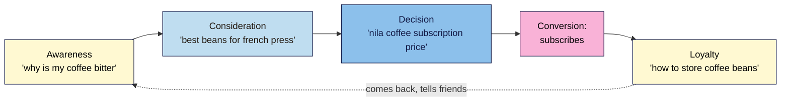

# M01.L01 — Introduction to Marketing
> After this lesson you can explain marketing in four plain words (audience, offer, message, channel), map a customer's journey from "never heard of you" to "buys again", and you'll have a one-page marketing snapshot of your own project site.

**Time:** ~15 min reading + ~25 min exercise · **Level:** L1 Foundation (beginner) · **Prereqs:** none · **Remediate to:** — (entry point: see `seo-101/glossary.md`)
**Verified against:** American Marketing Association, "Definition of Marketing" page, on 2026-11-03. No tools or accounts needed; the exercise uses Google Sheets (any spreadsheet or paper works).

## Learning objectives
1. **Explain** marketing in plain words as finding the right people, making them an offer and telling them about it (audience, offer, message, channel). *(O1)*
2. **Describe** the customer journey (awareness → consideration → decision → loyalty) and what a customer needs at each stage. *(O2)*
3. **Write** a one-page marketing snapshot of your project site and choose your project path (A, B or C). *(O3)*

## Why it matters
Kavya teaches yoga in Chennai. She posts on Instagram every day and has a website with a class schedule and six blog posts. When a friend asks, "Who is your website for?", she says, "Everyone who likes yoga." When asked, "What should a visitor do on it?", she isn't sure. Book a class? Read the blog? Follow her on Instagram? This is why many sites get visitors but no customers. SEO brings people to your site, and marketing decides *which* people, *what* you offer them and *what* you want them to do next. If you skip marketing, you can do SEO perfectly and still attract the wrong visitors, or the right visitors to a page that never asks them to book. That's why this SEO course starts here.

## Core concept
**Plain version:** marketing is finding the right people, making them an offer they want, and telling them about it in the places they already are. Four words carry the whole idea:

| Word | The question | Nila Coffee's answer |
|---|---|---|
| **Audience** | Who exactly is it for? | Home coffee drinkers who want better coffee than supermarket beans but don't own fancy equipment |
| **Offer** | What do they get, and why is it better than the alternatives? | Freshly roasted beans by monthly subscription, with simple brew guides; ₹650 / $9 a bag |
| **Message** | What do you say so they understand and care? | "Café-quality coffee at home, roasted this week, no barista skills needed." |
| **Channel** | Where do they hear it? | Google search, Instagram, the tasting room, email to subscribers |

**Analogy:** think of a stall at a busy market. Marketing is deciding *who* you're setting up for (office workers at lunch), *what* you'll sell them (fresh wraps, ready in two minutes), *what* your sign says ("Hot lunch in 2 minutes"), and *where* to put the stall (by the station exit, not the empty side street). A great wrap in the wrong spot with a confusing sign doesn't sell.

**Precise definition:** the American Marketing Association defines marketing as the activity and processes "for creating, communicating, delivering, and exchanging offerings that have value for customers, clients, partners, and society at large." In short: create something of value, tell people, get it to them, and exchange it fairly.

You may also meet the classic **marketing mix**, or "4 Ps": **Product** (what you sell), **Price**, **Place** (where and how people get it) and **Promotion** (how you tell them). It's the same idea seen from the business's side. This course uses the four plain words above because they map directly onto SEO later: *audience* → who searches, *offer* → which pages you need, *message* → titles and content, *channel* → search is one of them.

### The customer journey
People rarely buy the first time they hear of you. They move through stages, and they need something different at each one. This four-stage version is a simplified **funnel**; you'll see many variations with more or fewer stages, but the idea is the same.

| Stage | What the person is thinking | What they need from you | What they might search (preview of M03) |
|---|---|---|---|
| **Awareness** | "I have a problem or a question." | Helpful information, no sales pitch | `why does my coffee taste bitter` |
| **Consideration** | "What are my options?" | Comparisons, guides, honest pros and cons | `best coffee beans for french press` |
| **Decision** | "Which one should I choose?" | Prices, reviews, a clear way to buy | `nila coffee subscription price` |
| **Loyalty** | "I'm a customer. Help me get the most out of it." | Support, tips, reasons to come back | `how to store coffee beans` |

Notice that search appears at **every** stage. That's one reason SEO is so valuable, and one reason a site needs more than a homepage and a "Buy" button.

The one thing you most want a visitor to do (book a class, buy a subscription, send an enquiry, sign up for emails) is called a **conversion**. Every page should help people towards it, even if only by one step.

## How it works

**In words:** a person starts with a question (awareness), compares options (consideration), chooses (decision) and converts, for example by subscribing. As a customer (loyalty) they keep searching for help, and happy customers come back and tell others, which brings new people into awareness. Each stage has its own kind of search, so each needs its own kind of page.

## Hands-on walkthrough
You need a spreadsheet. Google Sheets is best because you'll keep adding to the same file all course. Create a new sheet called **"SEO 101 project"** with two tabs: **Snapshot** and **Baseline** (leave Baseline empty until Lesson 1.3).

**Part A — Read a worked example (5 min)**
1. Read Nila Coffee's snapshot below. Notice how each line is short and specific. "Everyone who likes coffee" is not an audience; "home coffee drinkers without fancy equipment" is.

| Snapshot | Nila Coffee |
|---|---|
| Site | nilacoffee.example (shop + brew-guide blog) |
| Audience | Home coffee drinkers in India and abroad who want better coffee without barista equipment |
| Offer | Fresh-roasted beans by monthly subscription; tasting room in Kochi; free brew guides |
| Message | "Café-quality coffee at home, roasted this week, no barista skills needed." |
| Main conversion | Start a subscription |
| Second conversion | Join the email list (for people not ready to buy) |
| How people find it today | Instagram (most), friends, tasting-room visitors; almost nobody from Google |
| One journey stage that's missing on the site | Awareness: no pages answer beginner questions like "why is my coffee bitter?" |

**Expected output:** you can say in one sentence who Nila Coffee is for and what it wants visitors to do.

**Part B — Choose your project path (5 min)**
You'll work on one real site for the whole course. Pick one now and write it at the top of your Snapshot tab:
- **A. Your own site:** a blog, business, portfolio or shop site you control. WordPress is ideal (you'll publish with it in Module 5), but any platform works.
- **B. The practice site:** a free WordPress test site. You'll set it up step by step in Lesson 1.8. Until then, fill in the snapshot for a site you'd *like* to build (for example, your hobby or a friend's small business).
- **C. A friend's or client's site:** a real local business or creator who gives you **written** permission (an email or message is enough) to study their site and, in Lesson 1.8, to give you access to their Search Console and Analytics.

Not sure? If you have a site, pick A. If you don't, pick B. Choose C only if you already have permission.

**Part C — Write your snapshot (15 min)**
1. Copy the left-hand column of Nila Coffee's table into your Snapshot tab.
2. Fill in each row for your site. Keep each answer to one or two lines.
   > 🖼️ **Image prompt:** Google Sheets screenshot (1280×720) of a "Snapshot" tab with two columns: labels (Site, Audience, Offer, Message, Main conversion, Second conversion, How people find it today, Missing journey stage) and short filled-in answers for a small yoga studio. Highlight the "Main conversion" row with a 3px #F9B2D7 outline; blur any personal details.
   > **Alt text:** A spreadsheet tab titled Snapshot, listing a small yoga studio's audience, offer, message, conversions and current channels.
3. For **Audience**, test your answer: could you picture one real person who fits it? If your answer would include almost everyone, narrow it (by place, need, budget or experience level).
4. For **Main conversion**, choose **one** action. A site that asks for five things gets none of them.
5. For **How people find it today**, write what you actually know, even if it's "I don't know". Lesson 1.8 sets up the tools that tell you.
6. For **Missing journey stage**, look at your site's pages and ask: is there a page for someone at awareness (a beginner question), consideration (comparing options), decision (prices, booking) and loyalty (help for existing customers)? Write the stage with the fewest pages.

**Expected output:** a filled-in Snapshot tab of 8 short rows. Kavya's might read: *Audience: working women in Adyar, Chennai, aged 30–50, new to yoga, with back or stress problems. Main conversion: book a free trial class. Missing stage: consideration (nothing compares her classes with gym yoga or online apps).*

## When to use / when not to
**Use the snapshot** before any SEO work on a site, and again whenever the business changes (new product, new city, new audience). Every keyword you choose in Module 3 and every page you write in Module 7 should match a line in it.
**Don't over-polish it.** This isn't a business plan or a brand book. A rough, honest snapshot you finish today is more useful than a perfect one you never finish. You'll refine it as you learn what people actually search.

**Trade-off:** a narrow audience feels like turning people away, but it makes every page clearer and easier to rank. "Yoga for everyone" competes with millions of pages; "beginner yoga for back pain in Adyar" competes with a handful. You can widen the audience later, once the narrow version works.

## Use AI for this
**Example prompt:**
> "I run [a yoga studio in Chennai for beginners]. My main goal for the website is [booking a free trial class]. Ask me five questions, one at a time, to help me describe my target audience more precisely. Then suggest a one-sentence message for my homepage, and list one question a customer might search at each stage: awareness, consideration, decision and loyalty."

**What AI does well here:** asking good questions that make you think, suggesting several message options to react to, and brainstorming what people might wonder at each stage.
**Where it gets it wrong:** AI describes "typical" customers that sound believable but come from nowhere, for example inventing age ranges, incomes or statistics about your market. Its messages often drift into empty phrases ("unlock your potential", "elevate your journey") that say nothing specific about your offer.
**How to check:** compare the audience description with real customers you know. Ask two or three of them why they chose you, and use their words. Treat any statistic the AI gives as unverified unless it names a real, checkable source. For example searches, wait for Module 3, where you'll check them against real search data.

## Common mistakes
- **"My audience is everyone."** If you can't picture one real person, the audience is too wide. Narrow it by place, need, budget or experience.
- **Listing features instead of an offer.** "12 classes a month, 60 minutes" is a feature list. "Less back pain in six weeks, with classes after work" is an offer: it says what the customer gets.
- **No single main conversion.** A homepage asking visitors to book, subscribe, follow, call and download at once usually gets none of them.
- **Only building pages for the decision stage.** A shop with only product pages has nothing for people who are still at awareness or consideration, and those are often the biggest groups of searchers.
- **Treating marketing as only advertising.** Promotion is one part. Audience, offer and where people find you come first.

## Troubleshooting
| Symptom | Likely cause | Fix |
|---|---|---|
| You can't decide on one audience | The business serves several groups | Pick the group that brings the most value (or that you most want more of) for this course; note the others for later |
| Your message sounds like every competitor's | It describes the category, not *your* difference | Finish the sentence "Unlike others, we…" and use the answer |
| You don't know how people find the site today | No analytics set up yet | Write "unknown" for now; Lesson 1.8 sets up Search Console and GA4 |
| Path C: the owner hasn't replied about permission | You need written permission to use their data | Start with path B now and switch to C when the permission arrives (note the switch date) |
| You have no site and no idea for one | Path B needs a topic | Use a hobby you know well (cooking, cricket, gardening) or a friend's small business; you need a topic, not a business |

## Exercise
**Task:** complete your **Snapshot** tab (8 rows, as in Part C) and add one more row: **"Journey searches"**, with one example search for each stage (awareness, consideration, decision, loyalty) that someone in your audience might type.
**Expected outcome:** a short, specific snapshot and four example searches, for example from Tomás's hardware shop: *awareness: "why does my tap keep dripping"; consideration: "best cordless drill for home use"; decision: "bosch drill 18v price portugal"; loyalty: "how to change a drill bit".* These are guesses for now; you'll test them with real data in Module 3.
**Stretch goal:** ask one real customer (or a friend in your audience) two questions: "How would you describe what we do?" and "What did you search for, or who did you ask, before you found us?" Compare their words with your Message row and change the row if theirs are clearer.

## Key takeaways
- Marketing = **audience, offer, message, channel**: the right people, something they want, said clearly, where they already are.
- The **customer journey** has four simple stages (awareness → consideration → decision → loyalty), and people search at every stage.
- A **conversion** is the one action you most want visitors to take; every page should move people towards it.
- SEO is one marketing **channel**. Without a clear audience and offer, it can bring the wrong visitors.
- Your one-page **snapshot** guides every SEO decision in this course. Keep it short and honest.

## Teach it back
Explain to a friend in 3 sentences why a business with great SEO can still get visitors but no customers, using the words *audience*, *offer* and *conversion*.

## Glossary terms added
- Marketing — added to `seo-101/glossary.md`
- Target audience — added to `seo-101/glossary.md`
- Offer / value proposition — added to `seo-101/glossary.md`
- Message — added to `seo-101/glossary.md`
- Channel — added to `seo-101/glossary.md`
- Marketing mix (4 Ps) — added to `seo-101/glossary.md`
- Customer journey / funnel — added to `seo-101/glossary.md`
- Conversion — added to `seo-101/glossary.md`

## Further reading
*All checked 2026-11-03.*
- American Marketing Association — Definition of Marketing: https://www.ama.org/the-definition-of-marketing-what-is-marketing/
- Google Search Central — SEO Starter Guide (read the introduction now; it's the basis of Lesson 1.3): https://developers.google.com/search/docs/fundamentals/seo-starter-guide

## Refresher card
*Used by remediation when a learner fails a quiz twice on a later lesson that points back here.*
**Marketing** = **audience** (who exactly), **offer** (what they get), **message** (what you say), **channel** (where they hear it). **Customer journey:** awareness → consideration → decision → loyalty; people search at every stage. **Conversion** = the one action you want visitors to take. SEO is one channel; it only works if the audience and offer are clear.
