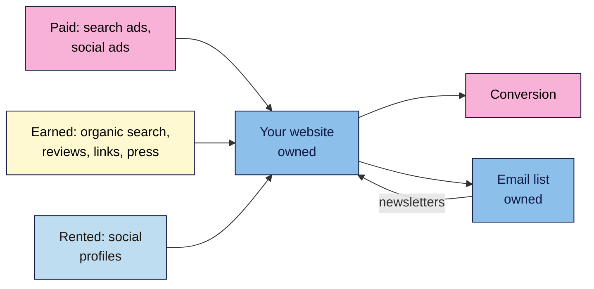

# M01.L02 — Introduction to Digital Marketing
> After this lesson you can name the main digital marketing channels, compare them by cost, speed and how long results last, explain where SEO fits, and you'll have a channel map of your own project site.

**Time:** ~15 min reading + ~25 min exercise · **Level:** L1 Foundation (beginner) · **Prereqs:** M01.L01 · **Remediate to:** M01.L01
**Verified against:** Google Analytics Help, "Default channel group" (GA4), and Google Search Central, "Do you need an SEO?", on 2026-11-03. The exercise uses your "SEO 101 project" sheet from Lesson 1.1.

## Learning objectives
1. **Name** the main digital marketing channels (organic search, paid search, social, email, content, referrals and partnerships) and sort them into owned, earned and paid media. *(O1)*
2. **Compare** channels by cost, speed to results and how long results last, and explain where SEO fits. *(O2)*
3. **Map** your project site's current channels and write the role SEO should play for it. *(O3)*

## Why it matters
In Lesson 1.1, Nila Coffee's snapshot said most visitors come from Instagram. Then, one month, Instagram changes what it shows people and Nila's posts reach far fewer followers. Orders drop by a third, and Nila can do nothing about it: the audience lives on someone else's platform. Meanwhile Tomás, the hardware shop owner, stops his agency's Google Ads to save money, and his online sales stop the same week. Both made the same mistake: they relied on one channel they don't control. Digital marketing is about choosing a *mix* of channels, and knowing which ones you rent, which you earn and which you own. SEO is one of the few that keeps working when you stop paying, which is why it's worth learning well.

## Core concept
**Plain version:** digital marketing is marketing (Lesson 1.1: audience, offer, message, channel) done through online channels: search engines, social media, email, websites and apps. The **channel** is the part that changes; the audience and offer stay the same.

**Analogy:** think of three ways to get people into a shop. You can **pay** for a billboard (people see it while you pay). You can be **recommended** by a newspaper or a happy customer (you earn it, but you can't control it). Or you can **own** the shop window and the customer list (yours to change whenever you like). Most successful shops use all three: paid to start, earned to grow, owned to keep.

**Precise definitions:**
- **Paid media:** attention you buy, such as search ads, social ads and sponsored posts. It stops when the budget stops.
- **Earned media:** attention others give you, such as reviews, press coverage, shares and links from other websites. You can encourage it, never buy it honestly.
- **Owned media:** channels you control, such as your website, your blog and your email list. Social media profiles feel owned but are really **rented**: the platform sets the rules and decides who sees your posts.

### The main channels
| Channel | What it is | Media type | Typical cost | Speed to results | When you stop |
|---|---|---|---|---|---|
| **Organic search (SEO)** | Unpaid results in Google, Bing and others | Earned (rankings) on owned pages | Mostly time; cash only for tools or help | Slow: weeks to months | Keeps working for a while, slowly fades if neglected |
| **Paid search** | Ads on search results, paid per click | Paid | Per click; you set the budget | Fast: same day | Stops at once |
| **Organic social** | Your own posts on Instagram, LinkedIn, YouTube etc. | Rented | Time | Medium | Stops; reach depends on the platform |
| **Paid social** | Ads on social platforms | Paid | Per click or per view | Fast | Stops at once |
| **Email** | Newsletters and messages to people who signed up | Owned | Low (often a free tier) | Fast, once you have a list | The list stays yours |
| **Content marketing** | Useful articles, videos, guides | Owned | Time | Slow | Keeps working; feeds SEO, social and email |
| **Referrals & partnerships** | Links and mentions from other sites, affiliates, collaborations | Earned (affiliates are paid) | Time or commission | Medium | Links often stay for years |
| **Direct** | People who type your address or use a bookmark | Owned (it's your brand) | — | Grows with everything else | Shrinks if people forget you |

"Typical" here means common experience, not a rule: costs and speed vary a lot by industry and country.

**Where SEO fits:** SEO is slow to start, but it reaches people at every stage of the customer journey (Lesson 1.1) at the moment they're searching, and it doesn't charge per visit. Google states that it "never accepts money to include or rank sites in our search results, and it costs nothing to appear in our organic search results." The trade-off is time and effort, and you own the pages but not the rankings: search engines decide those. That's why most businesses combine SEO with at least one fast channel (ads or social) and one owned channel (email).

### How analytics names these channels
When you set up Google Analytics 4 (GA4) in Lesson 1.8, it sorts every visit into a **default channel group**. You'll see names such as **Organic Search**, **Paid Search**, **Organic Social**, **Paid Social**, **Email**, **Referral** and **Direct**, among others. Google defines Organic Search as visits "via non-ad links in organic-search results", and its definition now includes Google's AI Overviews and AI Mode. GA4 also has an **AI Assistant** channel for visits from AI chat tools. AI search is introduced in Module 14 and taught in depth in Modern SEO 101.

## How it works

**In words:** paid channels (ads), earned channels (organic search, reviews, links, press) and rented channels (social profiles) all send visitors to your website, which you own. The website turns visitors into conversions and grows your email list, which you also own. Newsletters then bring people back to the site. The aim is to move people from channels you rent or pay for onto channels you own.

## Hands-on walkthrough
Open your "SEO 101 project" sheet from Lesson 1.1 and add a third tab: **Channels**.

**Part A — Read Nila Coffee's channel map (5 min)**
1. Read the map below. Notice that "what it brings" is honest: where Nila doesn't know, it says so.

| Channel | What Nila does now | Cost per month | What it brings | Media type | Journey stage |
|---|---|---|---|---|---|
| Organic social (Instagram) | 4 posts a week | ~6 hours of time | Most visitors (from Instagram's own stats) | Rented | Awareness |
| Tasting room | Open Fri–Sun in Kochi | Rent and staff | Local customers, some subscriptions | Owned (physical) | Decision, loyalty |
| Email | Monthly newsletter, 340 subscribers | Free tier | Repeat orders | Owned | Loyalty |
| Organic search | Nothing yet | — | Unknown (no tools set up) | Earned | — |
| Paid search | Nothing | — | — | Paid | — |

**Expected output:** you can spot Nila's risk: one rented channel brings most visitors, and search, which could cover every journey stage, isn't being used.

**Part B — Map your own channels (10 min)**
1. Copy the column headings into your Channels tab.
2. Add one row for every channel your site uses now, including offline ones (a shop, events, word of mouth).
3. For **Cost per month**, include time as well as money. An hour a day on social media is a real cost.
4. For **What it brings**, write what you know and where you know it from (a platform's stats, sales records, a guess). If you don't know, write "unknown". Lesson 1.8 sets up the tools that measure the website side.
5. For **Media type**, write paid, earned, rented or owned.
   > 🖼️ **Image prompt:** Google Sheets screenshot (1280×720) of a "Channels" tab with six columns (Channel, What we do now, Cost per month, What it brings, Media type, Journey stage) and 5 rows for a small hardware shop, with "Rented" and "Paid" cells shaded. Highlight the "Media type" column with a 3px #F9B2D7 outline; blur any personal details.
   > **Alt text:** A spreadsheet tab listing a small shop's marketing channels with their cost, results, media type and journey stage.

   **Expected output:** 3–8 rows. It's normal for several "What it brings" cells to say "unknown" at this point.

**Part C — Check your channel risk (5 min)**
Answer two questions below the table:
1. **"If my biggest channel stopped tomorrow, what would I lose?"** If the answer is "most of my customers" and that channel is paid or rented, write it down as your number one risk.
2. **"Which journey stages have no channel?"** Compare the Journey stage column with the four stages from Lesson 1.1.

**Part D — Write SEO's role (5 min)**
Write one sentence: *"For this site, SEO should…"*. Base it on Parts B and C. For example, Nila Coffee writes: *"SEO should bring in awareness and consideration visitors through brew guides, so we depend less on Instagram, and move them onto our email list."*

## When to use / when not to
**Use SEO as a main channel** when people actively search for what you offer or the problems it solves, when you can wait a few months for results, and when you can keep publishing and improving pages.
**Don't rely on SEO alone** when you need sales this week (a launch, an event), when almost nobody searches for your offer yet (a brand-new kind of product), or when your business depends on one short season. Use paid or social channels for speed, and build SEO alongside them.

**Trade-off:** paid channels are fast and easy to switch on, but you pay for every visit, forever. SEO is slow and takes effort, but each good page can keep bringing visitors at no extra cost per visit. Most small businesses do best with a mix: one fast channel, SEO, and an email list.

## Use AI for this
**Example prompt:**
> "I run [a small hardware shop in Lisbon that ships across the EU]. My current channels are [a Facebook page and a printed catalogue]. My budget is [€200 a month and 3 hours a week]. Suggest a simple mix of 3 digital channels for the next 6 months. For each, say whether it's paid, earned, rented or owned, what it costs in time and money, and how soon I could expect results. Point out my biggest channel risk."

**What AI does well here:** listing options you hadn't considered, explaining the trade-offs in plain words, and spotting risks such as depending on one platform.
**Where it gets it wrong:** AI often gives confident numbers that don't apply to you, such as "email marketing returns €36 for every €1" or "SEO takes exactly 6 months", usually from marketing blogs, not primary sources. It may also recommend channels your audience doesn't use, or tools that cost more than your budget.
**How to check:** ask where each number comes from and treat any figure without a primary source as a guess. Check its channel suggestions against your own Channels tab: does your audience (Lesson 1.1) actually use that channel? Prices change often, so check them on the tool's own pricing page.

## Common mistakes
- **Treating social media as owned.** Your followers belong to the platform. Move them to channels you own (your site, your email list) whenever you can.
- **Expecting SEO to work like ads.** Ads can bring visitors the same day; SEO usually takes weeks to months. Judge it on that timescale.
- **Only counting money as cost.** Four hours a week on social media is a real cost. Compare channels by time as well as cash.
- **Ignoring offline channels.** A tasting room, events or word of mouth often bring the best customers. Include them in your map.
- **Chasing every channel at once.** A small team doing five channels badly gets less than one doing two well.

## Troubleshooting
| Symptom | Likely cause | Fix |
|---|---|---|
| You don't know what each channel brings | No tracking yet | Write "unknown" and the source you'd check; Lesson 1.8 sets up GA4 and Search Console |
| Every channel shows "low results" | The audience or offer isn't clear yet | Go back to your Lesson 1.1 snapshot and sharpen the audience and message first |
| A social platform's stats and your sales don't match | Platform stats count views and clicks, not sales | Note both; later you'll use GA4 to see which channel leads to conversions |
| You're not sure if a channel is earned or paid | It mixes both (e.g. an influencer who was given free products) | If anything of value was exchanged, treat it as paid; paid links also have SEO rules (Module 9) |
| Path B: you have no real channels yet | The practice site is new | Map the channels you *plan* to use and mark every row "planned" |

## Exercise
**Task:** complete your **Channels** tab (Part B), answer the two risk questions (Part C) and write your SEO role sentence (Part D). Then spot the error in this plan from a café owner and rewrite it in one sentence:
> *"All our customers come from Instagram, so we'll put our whole budget into Instagram ads and skip the website. We can always rebuild our audience if something changes."*

**Expected outcome:** a channel map with honest "unknown"s, a named biggest risk, an SEO role sentence, and a corrected plan, for example: *"Keep Instagram, but also build our website with pages people search for and collect emails, so we own part of our audience."* The error: everything depends on one rented channel, and an audience on a platform can't simply be "rebuilt" if the rules change.
**Stretch goal:** search Google for your main product or service as a customer would. List which channels you see on the results page (ads, organic results, maps, videos, social posts). You'll learn the names of all these features in Lesson 1.5.

## Key takeaways
- **Digital marketing** is the same marketing (audience, offer, message) through online **channels**.
- Media is **paid** (you buy it), **earned** (others give it) or **owned** (you control it). Social profiles are **rented**.
- **SEO** is slow to start and costs time, but it keeps working without a fee per visit and reaches every journey stage.
- Don't depend on one rented or paid channel. Move people towards channels you own: your website and email list.
- GA4 will sort your visits into channels such as **Organic Search**, **Paid Search** and **Direct** (Lesson 1.8).

## Teach it back
Explain to a friend in 3 sentences the difference between paid, earned and owned media, and why a business that only uses Instagram is taking a risk.

## Glossary terms added
- Digital marketing — added to `seo-101/glossary.md`
- Paid media — added to `seo-101/glossary.md`
- Earned media — added to `seo-101/glossary.md`
- Owned media — added to `seo-101/glossary.md`
- Rented channel — added to `seo-101/glossary.md`
- Paid search (PPC) — added to `seo-101/glossary.md`
- Organic social / paid social — added to `seo-101/glossary.md`
- Email list — added to `seo-101/glossary.md`
- Content marketing — added to `seo-101/glossary.md`
- Referral traffic — added to `seo-101/glossary.md`
- Direct traffic — added to `seo-101/glossary.md`
- Default channel group (GA4) — added to `seo-101/glossary.md`

## Further reading
*All checked 2026-11-03.*
- Google Analytics Help — Default channel group (GA4): https://support.google.com/analytics/answer/9756891
- Google Search Central — Do you need an SEO?: https://developers.google.com/search/docs/fundamentals/do-i-need-seo
- American Marketing Association — Definition of Marketing (from Lesson 1.1): https://www.ama.org/the-definition-of-marketing-what-is-marketing/

> ⚠️ **May change:** GA4's channel names and rules (the AI Assistant channel and the inclusion of AI Overviews and AI Mode in Organic Search are recent). Re-check before publishing.

## Refresher card
*Used by remediation when a learner fails a quiz twice on a later lesson that points back here.*
**Digital marketing** = marketing through online channels. **Paid** (ads; stops when the budget stops), **earned** (organic search, reviews, links, press), **owned** (website, email list); social profiles are **rented**. **SEO:** slow to start, no fee per visit, reaches every journey stage. Don't rely on one rented or paid channel; move people to what you own. GA4 labels visits by channel: Organic Search, Paid Search, Organic Social, Email, Referral, Direct.
