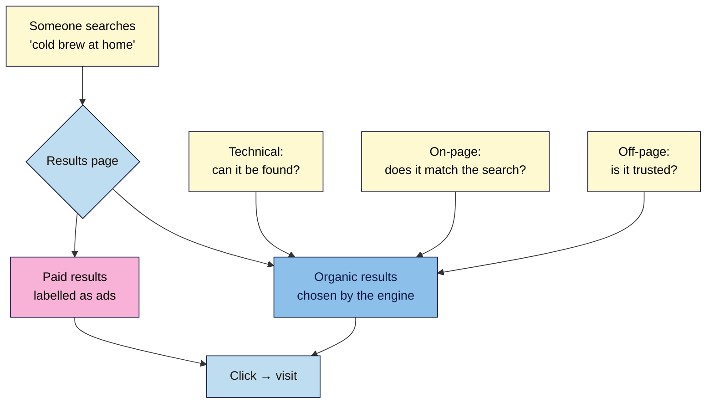
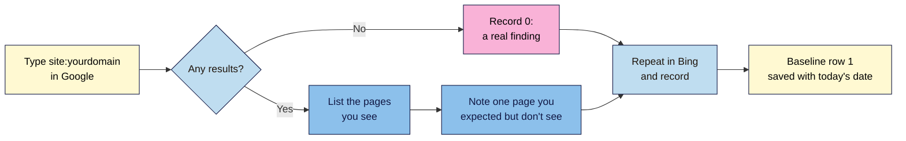

# M01.L03 — Introduction to SEO & Types of SEO (On-Page, Off-Page, Technical)
> After this lesson you can tell paid results from organic ones, name the three types of SEO, and you'll have your first real search finding about your own site: which of its pages Google and Bing show today.

**Time:** ~15 min reading + ~25 min exercise · **Level:** L1 Foundation (beginner) · **Prereqs:** M01.L01, M01.L02 · **Remediate to:** M01.L02
**Verified against:** Google Search Central "SEO Starter Guide", "Do you need an SEO?" and "`site:` search operator" pages on 2026-11-03. Browser steps are written for current desktop Chrome, Edge, Firefox and Safari, and google.com / bing.com.

## Learning objectives
1. **Distinguish** organic results from paid results on a real results page. *(O1)*
2. **Describe** the three types of SEO (on-page, off-page, technical) and give one example task for each on Nila Coffee. *(O2)*
3. **Record** which of your project site's pages Google and Bing show, using a `site:` search: row 1 of your baseline. *(O3)*

## Why it matters
Kavya teaches yoga in Chennai. Her WordPress site has a class schedule and six blog posts, but every new student says they found her on Instagram. Last month an agency emailed her: "We guarantee first-page Google rankings in 30 days for ₹15,000 a month." She almost paid. She didn't know what SEO actually is, how long it takes, or how to check whether Google even knows her site exists. In Lessons 1.1 and 1.2 you saw where search fits among her marketing channels; now you'll see what SEO actually involves. This lesson gives you the answers to all three. By the end you'll have checked your own site in under 30 minutes, without any tools or accounts.

## Core concept
**Plain version:** when someone searches, the search engine shows two kinds of results. **Paid results** are ads: the business pays each time someone clicks. **Organic results** are the rest: the search engine picks them because it thinks they're the best answers, and nobody can pay to be there. **SEO (search engine optimisation)** is the work of making your site the kind of page a search engine wants to show in the organic results, and making that listing worth clicking.

**Analogy:** think of a huge library with one very busy librarian. Ads are the posters at the entrance: anyone can buy one. The librarian's recommendations are the organic results. You can't bribe the librarian. But you *can* make sure your book is on the shelf (they can find it), that its title and contents clearly match what readers ask for (they understand it), and that other trusted books mention it (they trust it). That is SEO.

**Precise definition:** Google's SEO Starter Guide says SEO "is about helping search engines understand your content, and helping users find your site and make a decision about whether they should visit your site through a search engine."

### The three types of SEO
Every SEO task you'll do in this course fits one of three types. Here's what each looks like for **Nila Coffee**, the small coffee roaster you'll follow all course. Its website has just launched, and nobody can find it yet.

| Type | The question it answers | What it covers | Example task for Nila Coffee | Modules |
|---|---|---|---|---|
| **On-page** | Does the page match what people search for, and is it genuinely helpful? | Everything *on* the page you control: content, title, headings, images, internal links | Write the cold brew guide around what people actually search, e.g. "how to make cold brew at home" | M03–M05, M07 |
| **Off-page** | Do other sites and people trust it? | Signals *away from* your site: links from other sites, brand mentions, reviews, your Google Business Profile | Get a link from a local food blogger who reviewed the tasting room | M09–M11 |
| **Technical** | Can search engines find, read and store the pages? | How the site is built and served: crawling, indexing, speed, mobile, redirects, structured data | Make sure the new "Cold brew guide" page isn't accidentally hidden from search engines | M06, M12 |

You may also see content SEO, local SEO or e-commerce SEO named as their own types. They're specialisms that use the same three: local SEO, for example, is mostly off-page (Business Profile, reviews) plus on-page (location pages).

All three types matter. A brilliant guide that search engines can't reach gets no visits. A technically perfect page that answers nobody's question gets no visits either.

### What SEO isn't
- **It isn't paying Google.** Google says it "never accepts money to include or rank sites in our search results, and it costs nothing to appear in our organic search results." Ads are a separate product.
- **It isn't guaranteed.** In Google's own words: "No one can guarantee a #1 ranking on Google." Anyone who promises one is a red flag (Lesson 1.6 covers these in detail).
- **It isn't instant.** Google's Starter Guide says some changes take effect "in a few hours, others could take several months", and suggests waiting "a few weeks" before judging whether a change worked.
- **It isn't a one-time job.** Your competitors keep publishing, search engines keep changing, and your own site keeps growing. SEO is ongoing upkeep, like a shop window.
- **It isn't tricks.** Keyword stuffing, bought links and copied pages break the search engines' rules and can get a site demoted (Lesson 1.6).

## How it works

**In words:** a search produces a results page with two kinds of results. Paid results come from buying ads. Organic results are chosen by the search engine, and the three types of SEO (on-page, off-page and technical) decide whether your page earns a place there. Both kinds lead to clicks and visits, but only ads cost money per click.

## Hands-on walkthrough
You need a browser and the project sheet you started in Lesson 1.1. No accounts yet: Search Console and GA4 come in Lesson 1.8.

**Part A — Spot paid vs organic results (5 min)**
1. Open Google in a private/incognito window, so your past searches don't change the results. Search for something people buy, for example `coffee beans online` or `yoga mat`.
2. Scroll the first page slowly. Find every result marked as an ad. Google currently labels ads with a word such as **"Sponsored"** above the result. The exact wording and placement change from time to time, so look for the label rather than a position.
   > 🖼️ **Image prompt:** Desktop Google results page (1280×800) for "coffee beans online", showing one ad result with its "Sponsored" label at the top and the first organic result below it. Highlight the ad label with a 3px #F9B2D7 outline and add small captions "Paid" and "Organic"; blur any personal details (account icon).
   > **Alt text:** A Google results page with the top result labelled Sponsored as a paid ad, and an unlabelled organic result below it.
3. Now search something informational, for example `how to make cold brew` or `yoga for back pain`.
   **Expected output:** usually fewer ads, or none. People who want to learn something are less likely to buy right away, so advertisers bid less on these searches. Many of the clicks here are organic, and that's where SEO matters most for creators.

**Part B — Your first look: the `site:` search (10 min)**
The `site:` operator asks Google to show only results from one website. Google's documentation says it "doesn't necessarily return all the URLs that are indexed", so treat the result as a quick sample, not an exact count. That's fine for today. Search Console (Lesson 1.8) gives you the full picture.

**In words:** search `site:` plus your domain in Google. If pages appear, list them and note one you expected but can't find. If none appear, record zero, which is a real finding too. Then do the same in Bing and save both results as the first row of your baseline.

1. In Google, type `site:` followed by your domain, **with no space and no `https://`**. For Nila Coffee: `site:nilacoffee.example`. For your site, for example: `site:kavyayoga.in`.
   **Expected output:** a list of pages from that site only. Sometimes there's an approximate count ("About 12 results"); sometimes there isn't.
   > 🖼️ **Image prompt:** Desktop Google results page (1280×800) for a `site:` query on a small site, showing 4–5 results from the same domain and the search box with the query. Highlight the `site:` query in the search box with a 3px #F9B2D7 outline; blur any personal details.
   > **Alt text:** A Google search for site: plus a domain, listing only pages from that one website.
2. Write down: the date, how many results you see (count them on a small site), and the title of each page listed.
3. Think of one important page on the site (a service page, a product, your best blog post). Is it in the list? If not, write "missing: <page>". You'll find out *why* in Lesson 1.4 and Module 6.
4. Repeat steps 1–3 on **bing.com**. Bing supports the same `site:` operator.
   **Expected output:** often a different number from Google. The two engines build separate indexes (their stores of pages), so different results are normal.
5. Save it as **row 1 of your baseline**. A simple layout:

| Date | Check | Google | Bing | Missing pages | Notes |
|---|---|---|---|---|---|
| 2026-11-03 | `site:` search | 9 pages | 4 pages | "Weekend retreat" page | Site launched 2024 |

**What if you see zero results?** That's a real finding, not a failure. It usually means the site is very new, or something is stopping search engines (Lesson 1.4 shows the stages where a page can get stuck). Brand-new practice sites (path B) and freshly launched sites will often show zero. That's your "before" picture.

> **Under the hood:** a `site:` search doesn't visit your website. It searches the engine's **index**, its stored copy of pages it has already collected. That's why a page you published this morning won't appear yet, and why a page you deleted last month may still show up for a while.

## When to use / when not to
**Use a `site:` search** for a quick, free, no-login check: "Does Google know this site exists? Roughly which pages?" It also works on any site, including competitors' (Lesson 1.5).
**Don't use it** to count indexed pages exactly, to report numbers to a client, or to prove a page is or isn't indexed. For that, use Search Console's Page indexing report and URL Inspection tool (Lesson 1.8, in depth in Module 8).

**Trade-off:** `site:` is instant and needs no access, but it's a sample. Search Console is accurate but only works on sites you've verified, and it takes days to collect data. Use `site:` today and Search Console from Lesson 1.8 on.

## Use AI for this
**Example prompt:**
> "I'm new to SEO. My site is [a yoga studio in Chennai / a hardware shop / a food blog]. Give me one example task for each of the three types of SEO (on-page, off-page, technical) that a beginner could do on my site this month, in plain language. Then list 3 things an honest SEO would never promise."

**What AI does well here:** turning the three types into examples from your own world, and explaining terms in simpler words when you ask a follow-up.
**Where it gets it wrong:** AI often states timelines as fact ("you'll rank in 3 months") or repeats myths, for example that you must "submit your site to Google" before it can appear, or that meta keywords help ranking. It can also invent statistics ("75% of users never scroll past page one") with no source.
**How to check:** compare any claim about how Google works with Google Search Central (Further reading). If AI gives a number, ask "what's your source?", and if it can't point to a real, primary source, don't repeat the number.

## Common mistakes
- **Clicking your own ads, or thinking an ad "is" SEO.** Ads stop the moment you stop paying. SEO is what keeps working in the organic results.
- **Typing `site: example.com` with a space**, or including `https://`. The space turns it into an ordinary search; use `site:example.com`.
- **Reading the `site:` count as exact.** It's an estimate and changes between searches. Compare it only with itself, roughly, over time.
- **Expecting results next week.** Changes can take weeks or months to show. Write down the date of every change you make so you can tell later what worked.
- **Believing "guaranteed #1" offers.** Google says no one can guarantee a #1 ranking.

## Troubleshooting
| Symptom | Likely cause | Fix |
|---|---|---|
| The `site:` search shows results from other websites | A space after `site:`, or a typo in the domain | Type it with no space: `site:yourdomain.com` |
| Zero results for a site that's been live for months | Search engines may be blocked, or the site has no links pointing to it | Note it in your baseline; Lesson 1.4 and Module 6 show how to find the cause |
| Pages from an old or test version of the site appear (e.g. `staging.` or `dev.`) | The test site was left open to search engines | Note the address; you'll learn to fix this in Module 6 |
| Google and Bing show very different numbers | Each engine has its own index and its own sampling | Normal. Record both and compare each engine with itself over time |
| Ads don't appear on any of your searches | Some searches have no advertisers, or your location/ad settings | Try a commercial search like "buy running shoes" |
| Results look personal or local | You're signed in, or Google uses your location | Use a private/incognito window; local results still vary by location, which is normal |

## Exercise
**Task:** add three things to your project sheet:
1. The site's address and your path (A, B or C, chosen in Lesson 1.1).
2. Baseline row 1: the date, the `site:` result in Google and Bing, and any page you expected to see but didn't.
3. One example task for each of the three types of SEO **for your site**, in one sentence each (use Nila Coffee's table as a model).

**Expected outcome:** for example, Kavya writes: *"Path A — kavyayoga.in. 2026-11-03: Google shows 9 pages, Bing 4; missing: 'Weekend retreat'. Technical: check why the retreat page doesn't appear. On-page: rewrite the schedule page around 'yoga classes in Adyar'. Off-page: ask the local wellness magazine that featured me to link to my site."*
**Stretch goal:** run `site:` on two sites that rank for your main topic. Note roughly how many pages each shows compared with yours. It's a first, rough sense of the size of the competition. You'll do this properly in Lesson 1.5.

## Key takeaways
- **Organic results** can't be bought; **paid results** are ads and are labelled as such.
- SEO is helping search engines understand your content and helping people decide to visit. It has three types: **on-page, off-page and technical**.
- No one can guarantee rankings, and changes can take weeks or months to show.
- `site:yourdomain` is a quick, free sample of what Google or Bing has stored, not an exact count.
- Zero results is a valid first finding. Write down the date and what you see: that's your baseline.

## Teach it back
Explain to a friend in 3 sentences the difference between an ad and an organic result, and why someone who promises "guaranteed #1 on Google" shouldn't be trusted.

## Glossary terms added
- SEO (search engine optimisation) — added to `seo-101/glossary.md`
- Search engine — added to `seo-101/glossary.md`
- Results page (SERP) — added to `seo-101/glossary.md`
- Query — added to `seo-101/glossary.md`
- Organic result — added to `seo-101/glossary.md`
- Paid result (search ad) — added to `seo-101/glossary.md`
- Types of SEO (on-page, off-page, technical) — added to `seo-101/glossary.md`
- Index — added to `seo-101/glossary.md`
- Search operator — added to `seo-101/glossary.md`
- `site:` operator — added to `seo-101/glossary.md`
- Baseline — added to `seo-101/glossary.md`

## Further reading
*All checked 2026-11-03.*
- Google Search Central — SEO Starter Guide: https://developers.google.com/search/docs/fundamentals/seo-starter-guide
- Google Search Central — Do you need an SEO?: https://developers.google.com/search/docs/fundamentals/do-i-need-seo
- Google Search Central — `site:` search operator: https://developers.google.com/search/docs/monitor-debug/search-operators/all-search-site
- Google Search Central — Google Search Essentials: https://developers.google.com/search/docs/essentials
- Bing Webmaster Guidelines: https://www.bing.com/webmasters/help/webmasters-guidelines-30fba23a

> ⚠️ **May change:** how Google and Bing label ads, and whether `site:` shows a result count. Re-check before publishing.

## Refresher card
*Used by remediation when a learner fails a quiz twice on a later lesson that points back here.*
**Organic** = chosen by the engine, can't be bought. **Paid** = ads, labelled. **SEO** = help engines understand your content + help people decide to visit, three types: **on-page** (does it match the search?), **off-page** (is it trusted?), **technical** (can it be found?). No guarantees; changes take weeks to months. `site:yourdomain` = a quick sample of the index, not an exact count.
