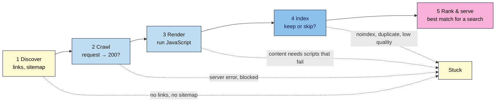

# M01.L04 — How Search Engines Work: Crawling, Indexing and Ranking
> After this lesson you can explain the journey every page takes from "published" to "shown in Google", spot where a page can get stuck, and check two things Googlebot sees on your own site: the page's code and its status code.

**Time:** ~20 min reading + ~30 min exercise · **Level:** L1 Foundation (beginner) · **Prereqs:** M01.L03 · **Remediate to:** M01.L03; Web Development 101 M01.L03 (how a page loads)
**Verified against:** Google Search Central, "In-depth guide to how Google Search works" and "Googlebot", on 2026-11-03. Browser steps are written for current desktop Chrome and Edge (Firefox and Safari notes in Troubleshooting).

## Learning objectives
1. **Explain** the stages a page passes through (crawl → render → index → rank → serve) and what can stop it at each one. *(O1)*
2. **Describe** how search engines discover URLs (links and sitemaps) and what a request and response are (status code and HTML). *(O2)*
3. **Trace** one Nila Coffee page through each stage and predict where a given problem (no links in, `noindex`, a server error) would stop it. *(O3)*

## Why it matters
In Lesson 1.3, Kavya's `site:` search showed 9 pages, but her "Weekend retreat" page was missing. Was it too new? Hidden? Not good enough? She can't fix it until she knows *where* it got stuck, and "Google doesn't like it" isn't an answer. Every page goes through the same steps before it can appear in results, and each step has its own typical problems. Once you know the steps, a missing page stops being a mystery and becomes a checklist: *Can Google find it? Can it fetch it? Can it read it? Did it keep it? Does it show it for the right searches?* Every technical lesson in this course (Modules 6 and 12) hangs on this one model.

## Core concept
**Plain version:** a search engine works like a huge library that sends out robots to collect pages. The robots follow links to **find** pages, **fetch** them, **read** them, decide whether to **store** them, and later **pick** the best stored pages for each search.

**Analogy:** imagine a librarian building a catalogue of every book in a city. First she has to hear that a book exists (someone mentions it, or the publisher sends a list). Then she visits the bookshop and asks for a copy. She reads it, decides whether it's worth a place in the catalogue, and files it under the right subjects. When a reader asks a question, she picks the best few books from her catalogue, not from every shop in the city.

**Google's official model has three stages.** Google's guide says: "Google Search works in three stages, and not all pages make it through each stage":
1. **Crawling:** Google downloads text, images and videos from pages it finds.
2. **Indexing:** Google analyses the page and stores the information in its **index**, a huge database.
3. **Serving search results:** when someone searches, Google returns the most relevant results from the index.

**This course splits those three into five steps**, because each step fails in a different way and you'll check each one separately:

| Step | Part of Google's stage | What happens | Typical way it fails |
|---|---|---|---|
| **1. Discover** | Crawling | Google learns the URL exists, mostly from links on pages it already knows, or from a **sitemap** you submit | No other page links to it, and it's not in a sitemap |
| **2. Crawl** | Crawling | **Googlebot** requests the URL and the server sends back a response | Server errors, network problems, or `robots.txt` rules that block Googlebot; pages behind a login |
| **3. Render** | Crawling | Google runs the page's JavaScript "using a recent version of Chrome" to see the page as a visitor would | Important content only appears after clicks or scripts that fail |
| **4. Index** | Indexing | Google analyses the content, groups duplicates and decides whether to store the page | Low-quality or duplicate content; a `noindex` rule; a design that's hard to read |
| **5. Rank & serve** | Serving | For each search, Google picks and orders the most relevant pages it has stored | The content doesn't match what people search for, or a better page exists |

Two facts from Google that matter all course:
- **Nothing is guaranteed.** "Google doesn't guarantee that it will crawl, index, or serve your page, even if your page follows the Google Search Essentials."
- **Not every page is kept.** "Indexing isn't guaranteed; not every page that Google processes will be indexed." Google also "doesn't crawl all the pages it discovered."

**Duplicates and the canonical.** When several URLs show the same or very similar content (for example, the same product reachable at two addresses), Google groups them and picks one to represent the group. That chosen URL is the **canonical**. The others usually aren't shown. You'll control this in Module 6.

**Ranking in one paragraph.** Google says relevance "is determined by hundreds of factors", which can include "the user's location, language, and device (desktop or phone)". That's why two people can see different results for the same search. Lesson 1.7 looks at what Google says about these factors.

### Requests, responses and status codes
Every crawl is a conversation. Googlebot (or your browser) sends a **request**: "please send me `nilacoffee.example/cold-brew-guide`". The server sends a **response**: a **status code** that says how it went, plus the page's code (HTML) if it worked.

| Status code | Meaning | What Google does |
|---|---|---|
| **200 OK** | Here's the page | Can continue to render and index it |
| **301 / 302** | The page has moved; go here instead | Follows the redirect to the new address |
| **404 Not Found** | No page at this address | Drops it over time |
| **500-range** | The server had a problem | Tries again later; repeated errors can slow crawling |

You'll learn the full list in Module 6. For now, remember: **a page can only be indexed if it answers with 200.**

## How it works

**In words:** a page is first discovered through links or a sitemap, then crawled (Googlebot requests it and hopes for a 200 response), then rendered (JavaScript is run), then indexed (Google decides whether to keep it), and finally ranked and served for matching searches. At each of the first four steps a page can get stuck: no links or sitemap, a server error or block, content that only appears with failing scripts, or a `noindex` rule, duplicate or low-quality content.

## Hands-on walkthrough
Use desktop Chrome or Edge and one page from your project site (path B learners: use any small public website you like until Lesson 1.8, for example a local business site).

**Part A — See the code Googlebot receives (10 min)**
1. Open your homepage. Press **Ctrl+U** (Windows/Linux) or **Cmd+Option+U** (Mac) to open **View Source**. This is the HTML the server sent: what Googlebot gets *before* rendering.
2. Press **Ctrl+F** / **Cmd+F** and search for `<title>`. Read the text between `<title>` and `</title>`.
   **Expected output:** your page title, e.g. `<title>Nila Coffee | Fresh-roasted coffee subscriptions</title>`. This is often the blue headline in search results (Lesson 1.5).
   > 🖼️ **Image prompt:** Chrome View Source tab (1280×720) for a small business homepage, with the browser's find bar searching "<title>" and the matching `<title>…</title>` line found. Highlight the title line with a 3px #F9B2D7 outline; blur any personal details.
   > **Alt text:** A browser's View Source page with the HTML title tag of a homepage highlighted by the find bar.
3. Now search the source for a sentence you can see on the page, for example the first line of your main heading.
   **Expected output:** usually you find it. If you **can't**, the text is probably added by JavaScript after the page loads. Google can often render it (step 3), but it's a risk worth noting. You'll test it properly in Module 12.

**Part B — Check the status code (10 min)**
1. On the same page, press **F12** (or **Ctrl+Shift+I** / **Cmd+Option+I**) to open DevTools, then click the **Network** tab.
2. Reload the page (**F5** / **Cmd+R**). Scroll to the very first row of the list: it has your page's address (or just `/` for the homepage) and the type **document**.
3. Read the **Status** column for that row.
   **Expected output:** `200`. If you see `301` or `302`, the address redirected; click the row and look at the **Headers** panel for the `location` line, which shows where it went.
   > 🖼️ **Image prompt:** Chrome DevTools Network panel (1280×720) after reloading a homepage, with the first "document" row showing Status 200. Highlight the Status cell of the first row with a 3px #F9B2D7 outline; blur any personal details.
   > **Alt text:** Browser developer tools Network tab showing the homepage request with status 200 in the first row.
4. Now type a made-up address on the same site, such as `yourdomain.com/this-page-does-not-exist`, and check the status of the first row again.
   **Expected output:** `404`. If you see `200` on a page that says "not found", note it: that's a **soft 404**, a real problem you'll fix in Module 6.

**Part C — Trace three pages (10 min)**
In your project sheet, add a tab **Trace** with these columns, and fill one row for each of three pages (your homepage, an important page, and the page you noted as missing in Lesson 1.3):

| Page | Discover: linked from? | In sitemap? | Crawl: status code | Render: main text in View Source? | Seen in `site:` (L1.3)? | Where might it be stuck? |
|---|---|---|---|---|---|---|

- **Linked from?** Is it in the menu, the footer, or linked from another page?
- **In sitemap?** Try `yourdomain.com/sitemap.xml`. WordPress sites also have `yourdomain.com/wp-sitemap.xml` (or `sitemap_index.xml` with some SEO plugins). Search the sitemap for the page's address. No sitemap at all? Write "no sitemap".
- **Where might it be stuck?** Use the five-step table above to make your best guess. It's a hypothesis; Search Console (Lesson 1.8) will confirm it.

**Expected output (Nila Coffee):**

| Page | Linked from? | In sitemap? | Status | Main text in source? | In `site:`? | Stuck where? |
|---|---|---|---|---|---|---|
| Home | — | Yes | 200 | Yes | Yes | Not stuck |
| Subscription | Menu | Yes | 200 | Yes | Yes | Not stuck |
| Cold brew guide | Nowhere | No | 200 | Yes | No | **Discover**: no links and not in the sitemap, so Google may not know it exists |

> **Under the hood: who is Googlebot?** Googlebot is the name of Google's crawler. It comes in two types, smartphone and desktop, and Google says that for most sites "the majority of Googlebot crawl requests will be made using the mobile crawler", because Google mainly indexes the mobile version of pages. Googlebot announces itself with a **user agent** (a name sent with each request), but Google warns that this "is often spoofed by other crawlers". The reliable check is a reverse DNS lookup on the visitor's IP address, or matching it against Google's published Googlebot IP ranges. You'll use this in Module 12 when reading server logs.

## When to use / when not to
**Use the five-step model** whenever a page is missing from search, or before you spend time improving a page's content. Always ask the earlier questions first: there's no point rewriting a page (step 5) that Google can't find (step 1).
**Don't use View Source and DevTools as proof** that a page is or isn't indexed. They show what *your* browser gets. Google's own view (URL Inspection in Search Console, Lesson 1.8) is the final word.

**Trade-off:** your own checks are instant and free on any site, but they're guesses about what Google does. Search Console shows what Google actually did, but only for sites you've verified and only after some delay. Use both: quick checks to form a guess, Search Console to confirm it.

## Use AI for this
**Example prompt:**
> "Explain how Google crawls, renders, indexes and ranks a web page, as if to a small business owner with no technical background. Use the example of a page called 'Cold brew guide' on a coffee shop's website that nobody links to. Then tell me which step it's probably stuck at and why."

**What AI does well here:** explaining the steps in friendly language and giving everyday analogies, and turning your Trace table into a plain-English summary for a client.
**Where it gets it wrong:** AI often blurs the steps, for example saying "Google indexes every page it crawls" (Google says it doesn't) or "you must submit every page to Google" (Google finds most pages through links). It may also claim fixed timings ("Google crawls every site every 24 hours") that Google never states.
**How to check:** compare any claim with Google's "In-depth guide to how Google Search works" (Further reading). If AI states a timing or a number, ask for the source. If it can't name a Google page, treat it as unverified.

## Common mistakes
- **Thinking "published" means "in Google".** A page must be discovered, crawled, rendered and indexed first. That can take days or weeks, and some pages are never indexed.
- **Rewriting content when the problem is discovery.** If nothing links to a page, better content won't help. Link to it and add it to the sitemap first.
- **Believing you must submit every page.** Google finds most pages by following links. A sitemap helps, but good internal links matter more.
- **Ignoring status codes.** A "Page not found" message that returns `200` (a soft 404) confuses search engines.
- **Assuming everyone sees the same results.** Location, language and device change what Google serves.

## Troubleshooting
| Symptom | Likely cause | Fix |
|---|---|---|
| Ctrl+U does nothing in Safari | Safari hides developer features by default | Safari → Settings → Advanced → turn on "Show features for web developers", then Develop → Show Page Source |
| The Network tab is empty | DevTools was opened after the page loaded | Keep DevTools open on the Network tab and reload the page |
| You can't find the first "document" row | The list is sorted or filtered | Click the **Doc** filter in the Network toolbar, or sort by the **Waterfall** column |
| Status shows `(disk cache)` or `304` | Your browser used a saved copy | Tick **Disable cache** in the Network toolbar and reload |
| `sitemap.xml` shows a 404 | The site uses a different sitemap address, or has none | Try `/wp-sitemap.xml` or `/sitemap_index.xml`, or check `yourdomain.com/robots.txt` for a `Sitemap:` line |
| The made-up URL redirects to the homepage | The site sends every missing page to the homepage | Note it; Google may treat these as soft 404s (Module 6) |

## Exercise
**Task:** complete your **Trace** tab for three pages (Part C). For each page, write one sentence: *"If this page is missing from Google, the most likely step is ___ because ___."* Then answer: Nila Coffee's "Wholesale" page returns status `500` every time Googlebot visits. Which step fails, and what will Google do?
**Expected outcome:** three trace rows with a best guess each, and the Wholesale answer: *step 2, crawl: the server reports an error, so Google can't get the content; it will try again later, and if the error continues the page can drop out of the index.*
**Stretch goal:** find one page on your site where the main text is **not** in View Source (try a page built with a page builder or with tabs and sliders). Note it in the Trace tab for Module 12, where you'll check how Google renders it.

## Key takeaways
- Google's official model has **three stages**: crawling, indexing and serving. This course splits them into **five steps**: discover → crawl → render → index → rank & serve.
- Pages are **discovered** mostly through links, and also through sitemaps.
- A page can only be indexed if the server answers **200**; check it in DevTools' Network tab.
- **Nothing is guaranteed:** Google doesn't crawl every page it discovers or index every page it crawls.
- When a page is missing, check the **earliest** step first.

## Teach it back
Explain to a friend in 3 sentences why a brand-new blog post that no other page links to might not appear in Google, using the words *discover*, *crawl* and *index*.

## Glossary terms added
- Crawling — added to `seo-101/glossary.md`
- Crawler / Googlebot — added to `seo-101/glossary.md`
- Discovery — added to `seo-101/glossary.md`
- Rendering — added to `seo-101/glossary.md`
- Indexing — added to `seo-101/glossary.md`
- Canonical URL — added to `seo-101/glossary.md`
- Ranking / serving — added to `seo-101/glossary.md`
- Sitemap (XML sitemap) — added to `seo-101/glossary.md`
- Request / response — added to `seo-101/glossary.md`
- Status code (200, 301, 404, 500) — added to `seo-101/glossary.md`
- Soft 404 — added to `seo-101/glossary.md`
- User agent — added to `seo-101/glossary.md`
- View Source — added to `seo-101/glossary.md`

## Further reading
*All checked 2026-11-03.*
- Google Search Central — In-depth guide to how Google Search works: https://developers.google.com/search/docs/fundamentals/how-search-works
- Google Search Central — Googlebot: https://developers.google.com/search/docs/crawling-indexing/googlebot
- Google Search Central — Verifying Googlebot and other Google crawlers: https://developers.google.com/search/docs/crawling-indexing/verifying-googlebot
- MDN — HTTP response status codes: https://developer.mozilla.org/en-US/docs/Web/HTTP/Status

## Refresher card
*Used by remediation when a learner fails a quiz twice on a later lesson that points back here.*
**Google's 3 stages:** crawling → indexing → serving. **This course's 5 steps:** discover (links, sitemap) → crawl (request; must return **200**) → render (JavaScript run in recent Chrome) → index (keep or skip; duplicates grouped under one **canonical**) → rank & serve (relevance; location, language, device). Nothing is guaranteed. Missing page? Check the earliest step first.
