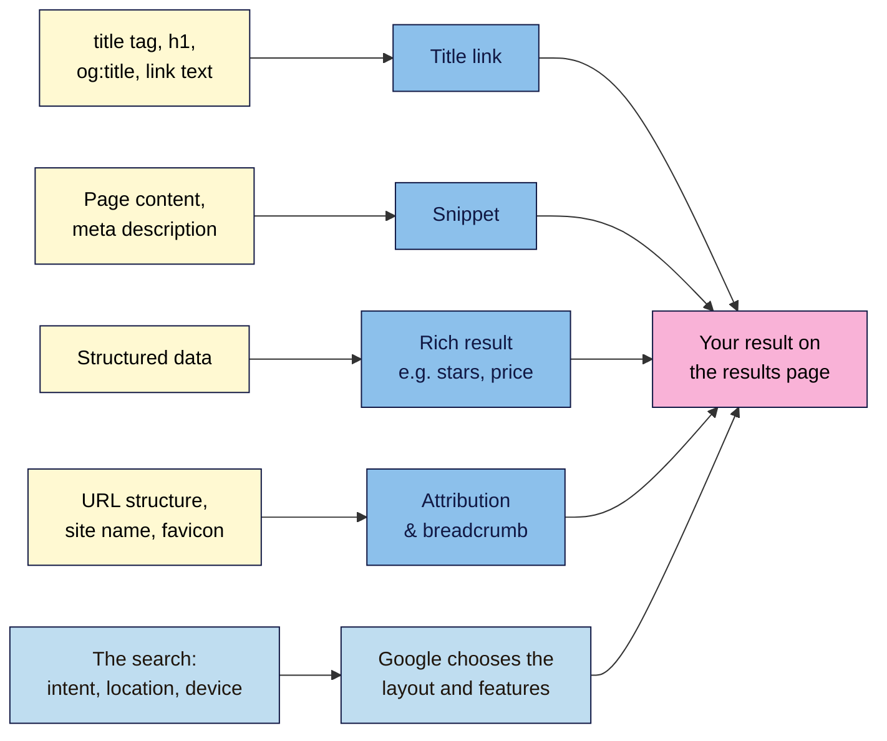

# M01.L05 — SERP Features (Featured Snippets, People Also Ask, Local Pack, etc.)
> After this lesson you can name every part of a search result and the main features on a results page, explain where Google gets your title and snippet from, and size up who you're really competing with in search.

**Time:** ~20 min reading + ~30 min exercise · **Level:** L1 Foundation (beginner) · **Prereqs:** M01.L04 · **Remediate to:** M01.L04
**Verified against:** Google Search Central "Visual elements gallery", "Title links", "Snippets", "Featured snippets", "Sitelinks", "Search operators", "AI features and your website" and "Latest documentation updates" pages on 2026-11-04. Results pages change often and differ by country, language and device; your screens will not match these examples exactly.

## Learning objectives
1. **Identify** the parts of a search result (title link, URL/breadcrumb, site name, snippet, sitelinks) and where each comes from on the page. *(O1)*
2. **Name** the main SERP features (featured snippets, People also ask, local pack, images, video, rich results, ads) and which kinds of search trigger them. *(O2)*
3. **Compare** three results pages for your topic, and use `site:`, quotes, `-` and `intitle:` to size up your search competitors. *(O3)*

## Why it matters
Amara writes blog posts for a bakery in Lagos. The owner shows her a search for `chocolate cake lagos`: a competitor appears with star ratings, a photo and a map pin, while the bakery's post is a plain blue link halfway down. "Why do they get all that and we don't?" Amara can't answer, because she doesn't know what each part of the results page is called, which ones you can influence and which ones you can't. The **results page (SERP)** is where every SEO effort is judged. In Lesson 1.4 you learned how a page gets *into* the index; this lesson shows how it's *displayed*, and how much the display decides whether anyone clicks.

## Core concept
**Plain version:** a results page is no longer ten blue links. It's a mix of ordinary results and special boxes: answers, questions, maps, images, videos and ads. Each piece is built automatically from what Google has stored about pages. You can't buy or request a place in the organic parts, but you can make your pages good material for them.

**Analogy:** think of a newspaper front page. There are ordinary articles (text results), a big highlighted quote box (featured snippet), a "readers also asked" column (People also ask), a local events map, photo strips and paid adverts. The editor (Google) decides the layout for each edition (each search). You supply the material.

### Part 1 — Anatomy of one result
Google calls an ordinary result a **text result**. Its parts, using Google's own names:

| Part | What it is | Where Google gets it (documented) | Can you control it? |
|---|---|---|---|
| **Attribution** | Favicon (the small logo), **site name**, and the **visible URL** shown as domain + **breadcrumb** | Your site, its favicon file, site name data and URL structure | Partly: you provide the inputs |
| **Title link** | The clickable headline | Your `<title>` element, plus several other sources: the "main visual title shown on the page", headings such as `<h1>`, `og:title` (a tag set for social sharing), other prominent text, anchor text, "text within links that point to the page" and `WebSite` structured data | Partly: Google says generating title links "is completely automated" |
| **Snippet** | The description under the title | "Google primarily uses the content on the page"; it uses your **meta description** only "sometimes", when it describes the page better | Partly: write a good description; you can also limit snippets (see below) |
| **Byline date** | A date, e.g. for articles | Google's estimate of when the page was updated or published | Partly: show a clear date on the page |
| **Sitelinks** | Extra links to pages on the same site under a result | Automated: "At the moment, sitelinks are automated" | No; clear structure and headings help |

The key lesson: **you supply ingredients; Google cooks the result.** That's why Google can show a different title from the one you wrote. You'll write titles and descriptions properly in Module 4.

### Part 2 — The main SERP features
| Feature | What it looks like | Often triggered by | What influences it | Course module |
|---|---|---|---|---|
| **Featured snippet** | A box at the top where "the format of a regular search result is reversed, showing the descriptive snippet first" | Questions: "how to", "what is", "why" | Clear, direct answers on the page. Google: you **can't** mark up a page to get one | M04, M07 |
| **People also ask** (Google: "related questions group") | Expandable list of related questions; opening one shows a featured snippet | Informational searches | Pages that answer related questions clearly; Google says "you can't control what shows up here" | M03, M07 |
| **Related searches** | Suggested searches near the bottom | Most searches | Not controllable; great keyword ideas | M03 |
| **Rich results** | Results with extras such as star ratings, prices, recipe times | Products, recipes, reviews, events | Valid **structured data** (code that labels page content for search engines); Google says a rich result "typically relies" on it | M12 |
| **Image and video results** | Image strips, video results with thumbnails | Visual or "how to" searches | Good images (alt text, file names); videos with clear titles | M04, M12 |
| **Local pack** *(observed)* | A map with 3 or so businesses | Searches with local intent: "near me", a city name, services | Google Business Profile, reviews, location pages | M11 |
| **Top stories** *(observed)* | News article carousel | News and trending topics | Timely news content | — |
| **Knowledge panel** *(observed)* | A box about an entity (a business, person, place) | Brand and entity names | Consistent business information across the web | M11, M14 |
| **Ads** *(observed)* | Results labelled as sponsored, at the top or bottom | Commercial and product searches | Paid only (Lesson 1.3) | — |
| **AI Overviews** *(observed)* | An AI-written summary with links, on some searches | Some informational searches | The page must be indexed and able to show a snippet; Google says no special markup or files are needed. Introduced in M14; in depth in Modern SEO 101 | M14 |

*(observed)* = commonly seen on results pages but not listed in Google's "Visual elements gallery". Google documents these features elsewhere or not at all, and they change often. The **Often triggered by** column is observed practice for every row: Google doesn't publish which searches trigger which features.

**Features also disappear.** Google retires rich result types it no longer wants to show. FAQ rich results stopped appearing on 7 May 2026, so any guide telling you to add FAQ markup for extra space on the results page is out of date.

**Opting out of snippets.** If you ever need to stop Google showing text from a page, Google documents three controls: the `nosnippet` rule (no snippet at all, and no featured snippet), `max-snippet:[number]` (limits snippet length; Google says a low value "doesn't guarantee" removal from featured snippets), and `data-nosnippet` on parts of a page. Most sites never need these; they're mentioned so you recognise them in an audit.

### Search operators for sizing up competitors
Search operators narrow a search. Google's Search Central documents `site:`, `filetype:`, `imagesize:` and `src:`, and Google's Search Help page "Refine Google searches" lists popular ones: quotes, `site:`, `-`, `before:`, `after:` and `filetype:`. Don't put a space after the colon. Useful ones for SEO:

| Operator | Example | What it does | Status |
|---|---|---|---|
| `site:` | `site:nilacoffee.example` | Results from one site only (a sample, Lesson 1.3) | Documented |
| `"…"` | `"cold brew concentrate"` | Results containing that exact phrase | Documented (Search Help) |
| `-` | `cold brew -starbucks` | Excludes results with that word | Documented (Search Help) |
| `after:` / `before:` | `cold brew guide after:2025-01-01` | Results last updated after (or before) a date: useful to see how fresh competitors' pages are | Documented (Search Help) |
| `intitle:` | `intitle:"cold brew"` | Results with the words in the title | **Not documented by Google** (not in Search Central or Search Help); works in practice, may change |

Google itself notes that operators are limited and that **URL Inspection** in Search Console is "more reliable for debugging purposes". Use operators to explore, not to prove anything.

**Search competitors vs business competitors:** your search competitors are whoever ranks for *your* searches. For Nila Coffee's `how to make cold brew` that's food blogs, YouTube and big recipe sites, not other roasters. You compete with different sites at different journey stages (Lesson 1.1).

## How it works

**In words:** your page supplies the ingredients: the title tag, headings and link text feed the title link; the page content and meta description feed the snippet; structured data can add rich results such as stars or prices; and your URL structure, site name and favicon make up the attribution. Separately, the search itself (its intent, the searcher's location and device) decides which features appear on the page. Google combines both into what the searcher sees.

## Hands-on walkthrough
Use a private/incognito window so your history doesn't change the results. Add a new tab **SERPs** to your project sheet.

**Part A — Label three results pages (10 min)**
1. Pick three searches about your project site's topic, one of each type:
   - **Informational:** a question (e.g. `how to make cold brew at home`, `yoga for lower back pain`)
   - **Local:** with a place or "near me" (e.g. `coffee roasters in kochi`, `yoga classes adyar`)
   - **Product or service:** something people buy (e.g. `coffee beans subscription india`, `yoga mat online`)
2. Search each one and scroll through the whole first page. In your SERPs tab, list every feature you see from top to bottom, using the names in Part 2's table.
   > 🖼️ **Image prompt:** Desktop Google results page (1280×900) for a local search such as "coffee roasters in kochi", showing ads (if any), a map with three business listings, and the first organic text results. Label each area with a short caption: "Ad", "Local pack", "Text result". Highlight the local pack with a 3px #F9B2D7 outline; blur any personal details.
   > **Alt text:** A Google results page for a local search, with the map and three businesses highlighted as the local pack above the text results.

   **Expected output:** three different layouts. Usually the informational search shows People also ask, videos and perhaps a featured snippet or AI Overview; the local search shows a map with businesses; the product search shows ads and shopping-style results. If you see an AI Overview, just note it.

**Part B — Find where a title and snippet came from (10 min)**
1. On your informational search, pick one organic result. Write down its site name, visible URL, title link and snippet exactly.
   > 🖼️ **Image prompt:** Close-up of one Google text result (900×300) with small labels on its favicon, site name, visible URL/breadcrumb, title link and snippet. Highlight the title link with a 3px #F9B2D7 outline; blur any personal details.
   > **Alt text:** One search result with its favicon, site name, URL breadcrumb, title link and snippet each labelled.
2. Click through to the page, open **View Source** (Ctrl+U / Cmd+Option+U, Lesson 1.4) and search for `<title>` and `name="description"`.
3. Compare: is the title link the same as the `<title>`? Is the snippet the meta description, or a sentence from the page? Search the page (Ctrl+F) for the snippet's words.
   **Expected output:** often the title matches the `<title>` (sometimes shortened or with the site name added), and the snippet is either the meta description or a sentence from the page that matches your search words. Try a different search on the same page and the snippet may change, because Google picks text that fits each search.

**Part C — Size up your search competitors (10 min)**
1. Look back at your three searches. In the SERPs tab, list the top three organic sites for each and their **page type**: blog post, product page, category page, video, forum, directory, local business.
2. For the most common competitor, run `site:theirdomain.com` and note roughly how many pages appear.
3. Try `"your main phrase"` (with quotes) and `-` to remove a big brand that dominates the results, e.g. `cold brew recipe -starbucks`. Note any smaller sites that appear: they're often more realistic competitors.
4. Optional: try `intitle:"your main phrase"` to see how many pages put the phrase in their title. Remember it's undocumented, so treat the result as a rough hint.

**Expected output (Nila Coffee):** for `how to make cold brew at home`, the top results are two food blogs and a YouTube video, plus People also ask and a video strip. None is a coffee roaster. Lesson learned: to compete there, Nila needs a genuinely helpful guide, ideally with a video, not a product page.

## When to use / when not to
**Use SERP analysis** before you create or change any page: the results show what kind of page Google thinks fits the search. If every top result is a video or a recipe blog, a product page is unlikely to rank there.
**Don't chase every feature.** Many features can't be requested (featured snippets, People also ask, sitelinks) or need things you may not have (structured data, a Business Profile, videos). Focus on the features that match your offer and journey stage.

**Trade-off:** a feature like a featured snippet can bring visibility at the very top, but it also answers the question on the results page, so some searchers never click. For quick facts that can mean fewer visits; for "how to" and buying searches, being the chosen answer often still helps (observed practice, not a Google claim). Judge by the search, not by the feature's size.

## Use AI for this
**Example prompt:**
> "Here are the features I saw on Google's first page for 'coffee roasters in kochi', from top to bottom: [paste your list]. Explain in plain language what each feature means for a small coffee roaster, which ones I could realistically appear in, and what I'd need for each. Keep it to the features I listed."

**What AI does well here:** explaining features in plain words and suggesting what kind of page or profile fits each one.
**Where it gets it wrong:** AI often describes results pages from its training data rather than what you see today, and invents features or tactics, for example "add FAQ schema to get a featured snippet" (Google says you can't mark up a page for a featured snippet, and FAQ rich results ended in May 2026) or "submit your site for sitelinks" (sitelinks are automated). It can't see your results page unless you paste or describe it.
**How to check:** describe your actual results page to the AI rather than asking "what does Google show for…". Check any "do this to get feature X" claim against the matching Google Search Central page in Further reading.

## Common mistakes
- **Thinking you can buy or request organic features.** Featured snippets, sitelinks and People also ask are automated. Only ads are paid.
- **Assuming your `<title>` is always the title link.** Google may use your `<h1>`, other prominent text or link text instead, especially if your title is vague or stuffed with keywords.
- **Writing a meta description and expecting Google to always use it.** Google uses it only sometimes; it usually prefers page text that matches the search.
- **Treating business competitors as search competitors.** For many searches you're up against blogs, videos and directories, not other shops.
- **Reading one results page as the truth.** Results differ by location, language and device, and they change over time.

## Troubleshooting
| Symptom | Likely cause | Fix |
|---|---|---|
| Your results page looks very different from the examples | Country, language, device and time all change the layout | Normal. Record what *you* see, with the date and device |
| No local pack for a local search | Not enough local businesses, or the search isn't clearly local | Add a city name or "near me" and search again |
| People also ask doesn't appear | The search may be commercial or very specific | Try a "how/why/what" version of the search |
| The snippet text isn't anywhere in View Source | It may come from content loaded by JavaScript, or from another source such as structured data | Search the page with Ctrl+F after it fully loads; note it as a rendering case (Lesson 1.4, Module 12) |
| `intitle:` returns odd or no results | It's undocumented and behaves inconsistently | Treat it as a hint only, and rely on your manual review of the top results |
| Results show your past searches or a far-away location | You're signed in, or location settings are off | Use a private window; local results will still use your rough location |

## Exercise
**Task:** complete your **SERPs** tab for three searches (Part A), the title-and-snippet comparison for one result (Part B) and the competitor list (Part C). Then write two sentences: *"For my main topic, the results page rewards ___ (page type). The feature I could realistically aim for is ___ because ___."*
**Expected outcome:** three labelled layouts, one title/snippet comparison, a list of 3–9 search competitors with page types, and a realistic target, e.g. Kavya: *"For 'yoga classes adyar' the results page rewards local businesses with reviews. I could aim for the local pack, because I have a real studio address; I need a Business Profile and reviews (Module 11)."*
**Stretch goal:** repeat one search on your phone (or open DevTools and press Ctrl+Shift+M / Cmd+Shift+M for the device toolbar) and list what changes in the layout. Google mainly indexes the mobile version of pages (Lesson 1.4), and many searches happen on phones.

## Key takeaways
- A **text result** has an attribution (favicon, site name, URL/breadcrumb), a **title link**, a **snippet** and sometimes **sitelinks**; Google builds them automatically from your page.
- Google uses your `<title>` and meta description as inputs, not orders: it may show other text from the page.
- **SERP features** depend on the search: questions often bring featured snippets and People also ask, local searches the local pack, and product searches ads and rich results.
- You **can't** request featured snippets, People also ask or sitelinks. You can make pages good material for them.
- Your **search competitors** are whoever ranks for your searches, often blogs, videos and directories, not just similar businesses.

## Teach it back
Explain to a friend in 3 sentences why their business might appear in Google with a different title from the one they wrote, and what a featured snippet is.

## Glossary terms added
- Text result — added to `seo-101/glossary.md`
- Title link — added to `seo-101/glossary.md`
- Snippet — added to `seo-101/glossary.md`
- Meta description — added to `seo-101/glossary.md`
- Attribution (favicon, site name, visible URL, breadcrumb) — added to `seo-101/glossary.md`
- Sitelinks — added to `seo-101/glossary.md`
- SERP feature — added to `seo-101/glossary.md`
- Featured snippet — added to `seo-101/glossary.md`
- People also ask (related questions) — added to `seo-101/glossary.md`
- Rich result — added to `seo-101/glossary.md`
- Structured data (first mention) — added to `seo-101/glossary.md`
- Local pack — added to `seo-101/glossary.md`
- Knowledge panel — added to `seo-101/glossary.md`
- Search competitor — added to `seo-101/glossary.md`
- `nosnippet` / `max-snippet` / `data-nosnippet` — added to `seo-101/glossary.md`
- AI Overview — added to `seo-101/glossary.md`

## Further reading
*All checked 2026-11-04.*
- Google Search Central — Visual elements gallery of Google Search: https://developers.google.com/search/docs/appearance/visual-elements-gallery
- Google Search Central — Influencing your title links: https://developers.google.com/search/docs/appearance/title-link
- Google Search Central — Snippets and meta descriptions: https://developers.google.com/search/docs/appearance/snippet
- Google Search Central — Featured snippets: https://developers.google.com/search/docs/appearance/featured-snippets
- Google Search Central — Sitelinks: https://developers.google.com/search/docs/appearance/sitelinks
- Google Search Central — Search operators: https://developers.google.com/search/docs/monitor-debug/search-operators
- Google Search Help — Refine Google searches: https://support.google.com/websearch/answer/2466433
- Google Search Central — AI features and your website: https://developers.google.com/search/docs/appearance/ai-features
- Google Search Central — Latest documentation updates (FAQ rich results, 2026): https://developers.google.com/search/updates

> ⚠️ **May change:** which features appear and how they look (especially AI Overviews, local results and ads); whether `intitle:` keeps working; which rich result types Google still shows; Google's controls for generative AI features (documentation updated October 2026). Re-check before publishing.

## Refresher card
*Used by remediation when a learner fails a quiz twice on a later lesson that points back here.*
**Text result** = attribution (favicon, site name, URL/breadcrumb) + **title link** (from `<title>`, `<h1>`, prominent text, link text; automated) + **snippet** (mostly page content; meta description only sometimes) + maybe **sitelinks** (automated). **Features** depend on the search: questions → featured snippet, People also ask; local → local pack; products → ads, rich results (usually need structured data). You can't request featured snippets or sitelinks. **Search competitors** = whoever ranks for your searches.
