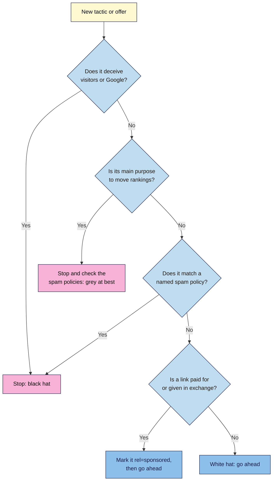
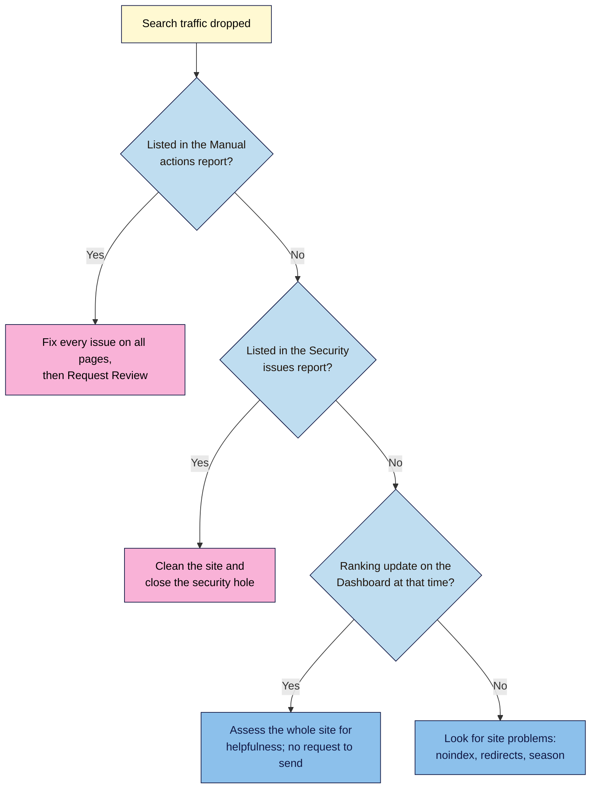

# M01.L06 — White Hat vs Black Hat vs Grey Hat SEO
> After this lesson you can tell a safe SEO tactic from a risky one, name the spam policy it touches, tell a manual action from an algorithmic drop, and spot an SEO offer you shouldn't buy.

**Time:** ~20 min reading + ~30 min exercise · **Level:** L1 Foundation (beginner) · **Prereqs:** M01.L03 · **Remediate to:** M01.L03
**Verified against:** Google Search Central "Spam policies", "Do you need an SEO?", "Using generative AI content", "Qualify outbound links", "Debugging Search traffic drops", "Ranking systems guide", "Report quality issues" and "Latest documentation updates" pages, the Search Central blog post on the site reputation policy (28 August 2026), Search Console Help "Manual actions report" and the Google Search Status Dashboard on 2026-11-04. Spam policies change several times a year; re-read the policy page before you rely on any detail here.

## Learning objectives
1. **Define** white-, grey- and black-hat SEO with examples, and summarise Google's spam policies in plain words. *(O1)*
2. **Distinguish** a manual action from an algorithmic change, and say where each shows up. *(O2)*
3. **Evaluate** an SEO offer or agency pitch and flag the claims that break the rules or can't be promised. *(O3)*

## Why it matters
Tomás is taking over the SEO for his family's hardware shop from an agency. In the last invoice he finds a line: "200 high-authority backlinks: €150." (A backlink is a link from another site to yours.) In his inbox is another pitch: "We guarantee page one in 30 days." He can't tell whether either is a bargain or a danger, and Google is clear about who carries the risk: "you are responsible for the actions of any companies you hire." This lesson gives you the rules before you build anything, so nothing you do in this course has to be undone later.

## Core concept
**Plain version:** **white hat** means improving your site for people, inside the search engines' rules. **Black hat** means trying to trick search engines or visitors, against the rules. **Grey hat** means tactics in between, which aren't obviously cheating but whose main purpose is still to move rankings.

**Analogy:** think of an exam. Studying is white hat. Copying from a neighbour is black hat. Writing notes "just for reference" on your water bottle is grey hat: you can argue about it, until the exam supervisor picks up the bottle.

**Precise definition:** the hat colours are industry slang, borrowed from old Western films. You won't find them in Google's spam policies page. Google's own term is **spam**: "techniques used to deceive users or manipulate our Search systems into featuring content prominently", which now includes "attempting to manipulate generative AI responses in Google Search."

| Label | What it means in practice | Example | Risk |
|---|---|---|---|
| **White hat** | Helps people first; fits the policies | A cold brew guide based on your own tests | None from the policies |
| **Grey hat** | Not clearly named, or depends on scale and intent | A few link swaps with friendly sites | Can become a violation; the label is no defence |
| **Black hat** | Breaks a named policy | Hidden keywords, paid links with no label | Lower rankings or removal |

**Grey hat is not a safe zone.** Google has no grey category, and it says it "may act against any type of spam practices we detect", not only the ones it lists. This course's rule is simple: **stay white hat**. If a tactic only makes sense because search engines exist, stop and check it.

### Part 1 — The spam policies in plain words
This lesson uses Google's policies because they're detailed and public. Other search engines publish their own rules. You'll study them in depth in Module 14; for now, know what each one is about.

| Plain-language group | Policies (Google's names) | In short |
|---|---|---|
| **Showing Google one thing, people another** | Cloaking · Sneaky redirects · Hidden text and link abuse | Different content for search engines and visitors, or text people can't easily see |
| **Faking popularity** | Link spam | Links made "primarily for the purpose of manipulating search rankings" |
| **Lots of pages, little value** | Scaled content abuse · Doorway abuse · Scraping · Thin affiliation · Keyword stuffing | Mass-made, copied or stuffed content with little use to a reader |
| **Borrowing someone else's reputation** | Expired domain abuse · Site reputation policy | Buying an old domain to rank junk, or publishing third-party content on a strong site mainly to use that site's ranking signals |
| **Harming or tricking visitors** | Malicious practices (malware, unwanted software, back button hijacking) · Misleading functionality | Harmful software, blocked back buttons, or fake tools and services |
| **Done to your site by others** | Hacked content · User-generated spam | Spam added through a security hole or your comment forms; you still have to clean it up |
| **Abusing Google itself** | Machine-generated traffic | Automated queries sent to Google without permission |

Three details beginners get wrong:

- **Paid links aren't banned; hidden paid links are.** Google says buying and selling links is "a normal part of the economy of the web" for advertising, as long as they're marked with a `rel` attribute, a small label in the link's HTML (Module 2): `rel="nofollow"` or `rel="sponsored"`. `sponsored` is the preferred value for paid placements.
- **Link spam includes goods and favours, not just money.** Google's examples include "Sending someone a product in exchange for them writing about it and including a link".
- **AI content isn't banned; AI spam is.** Scaled content abuse applies "no matter how it's created". The example is "Using generative AI tools or other similar tools to generate many pages without adding value for users". Module 7 covers using AI properly.

### Part 2 — Two ways spam hits a site
Google says it detects violations "both through automated systems and, as needed, human review that can result in a manual action." Its automated spam detection includes a system called **SpamBrain**. That gives you two different problems with two different fixes.

| | **Manual action** | **Algorithmic change** |
|---|---|---|
| **What happens** | "A human reviewer at Google has determined that pages on the site are not compliant" | Google's automated systems change how your pages rank |
| **Where it shows** | The **Manual actions** report in Search Console, plus the Search Console message center | No message and no report for your site (observed practice: Google lists no such report). Compare your drop dates with the **Ranking** history on the Google Search Status Dashboard |
| **Scope** | "Some or all" of the site | Can be some pages or the whole site |
| **Fix** | Fix every listed issue on all affected pages, then select **Request Review** | Improve the site. There's no request to send |
| **Timing** | Reviews "can take several days or weeks", and link-related ones may take longer | Unknown. Google says "there's no guarantee" that changes will have a noticeable effect |

"Penalty" is the word people use for both, but only a manual action is a penalty someone applied to your site. An algorithmic drop may not be about spam at all: after an update, "there might not be anything fundamentally wrong with your content." The two kinds you'll see most on Google's Dashboard are **spam updates** and **core updates**. You'll work with them in Module 14.

A good review request (Google calls it a **reconsideration request**) does three things, says Google: "Explains the exact quality issue", "Describes the steps you've taken to fix the issue" and "Documents the outcome of your efforts."

### Part 3 — What Google says about hiring an SEO
Google's "Do you need an SEO?" page works as a free buyer's guide. It also says plainly: "If you run a small local business, you can probably do much of the work yourself."

| Red flag | Google's words |
|---|---|
| Guaranteed rankings | "No one can guarantee a #1 ranking on Google." |
| Inside access | Beware of SEOs who "allege a 'special relationship' with Google" |
| Fast lanes | Beware of those who "advertise a 'priority submit' to Google" |
| Cold pitches | "Be wary of SEO firms and web consultants or agencies that email you out of the blue." |
| Secrecy | "Be careful if a company is secretive or won't clearly explain what they intend to do." |
| Linking to them | "You should never have to link to an SEO." |
| Link schemes, mass submission | "Avoid SEOs that talk about link popularity schemes or submitting your site to thousands of search engines." |
| "Approved" tools | "Be wary of tools that claim to be 'acceptable' or 'approved' by Google Search." |
| Too much access for an audit | For an audit, "only grant read access to Search Console" |

Google also says it "never accepts money to include or rank sites" in its organic results. One more flag, from observed practice rather than Google: any price per link, such as "200 backlinks for €150". That's buying links for ranking purposes.

**Good signs:** they show past work, follow Google Search Essentials (Google's core rules for appearing in Search), explain what results to expect and when, and "share with me all the changes you make to my site".

## How it works
**Is this tactic safe?** Run any tactic through these questions, in order.

**In words:** if a tactic deceives anyone, stop. If its main purpose is moving rankings, stop and read the policies, because that's grey at best. If it matches a named policy, stop. If a link is paid for or exchanged, mark it `rel="sponsored"`. Anything that passes all four is white hat.

**Search traffic dropped: what kind of problem is it?** Check in this order.

**In words:** first look for a manual action, because it has a clear fix. Next check for a security problem. If neither is listed, see whether a ranking update happened at the same time. If one did, assess your whole site. If not, look for ordinary causes such as a stray `noindex` (Lesson 1.4), broken redirects or a seasonal dip. You'll get Search Console in Lesson 1.8 and diagnose a simulated drop in Module 14.

## Hands-on walkthrough
You need a browser and your project sheet. Add a new tab **Rules**. You don't need Search Console yet.

**Part A — Sort 10 tactics (10 min)**
1. Copy these Nila Coffee tactics into your Rules tab. Beside each one, write white, grey or black, plus the policy it touches. Don't peek at the answers.
   1. Write a cold brew guide using your own taste tests.
   2. Add a footer listing "best coffee kochi, cheap coffee kochi, coffee beans kochi…".
   3. Pay a food blog ₹5,000 for a link, with no `rel` value on it.
   4. Pay the same blog, with `rel="sponsored"` on the link.
   5. Send free beans to a blogger on condition that the post links to you.
   6. Publish 50 near-identical pages: "Coffee beans in [city]", changing only the city.
   7. Publish 500 AI-written posts with no editing.
   8. Use AI to outline a post, then write and fact-check it yourself.
   9. Swap links with a café you honestly recommend.
   10. Put white keywords on a white background.
2. Check your answers.

   **Expected output:**

   | # | Label | Policy or reason |
   |---|---|---|
   | 1 | White | Original, useful content |
   | 2 | Black | Keyword stuffing |
   | 3 | Black | Link spam: "Exchanging money for links" |
   | 4 | White | Paid link correctly marked: it's advertising, and it passes no ranking credit |
   | 5 | Black | Link spam: a named example, even with no money involved |
   | 6 | Black | Doorway abuse: "pages targeted at specific regions or cities" |
   | 7 | Black | Scaled content abuse |
   | 8 | White | A person adds value and checks the facts (Module 7) |
   | 9 | Grey | One honest link is normal; "excessive link exchanges" are link spam |
   | 10 | Black | Hidden text and link abuse |

   If you marked number 5 grey, you've found the lesson's main trap: many tactics that feel grey are named in the policy.
3. In two sentences, summarise Google's spam policies in your own words.

   **Expected output:** something like *"Google doesn't allow tricks that deceive people or manipulate rankings, such as fake links, hidden text and masses of low-value pages. Breaking the rules can mean lower rankings or removal."*

**Part B — Red-flag check of one real offer (10 min)**
1. Find one real SEO offer: a cold email in your inbox or spam folder, or a results page for `guaranteed first page google seo`. Don't reply to it, click links in an unknown email, or buy anything.
2. In your Rules tab, list each red flag from Part 3 and mark it yes or no for this offer. Copy the exact words that triggered it.
3. Write a verdict: **avoid**, **ask questions** or **worth a call**. Our course rule: a ranking guarantee, a "special relationship" or per-link pricing means avoid.

   **Expected output (made-up example for Tomás):** "We guarantee page one in 30 days with 200 DA50 backlinks for €150 a month. (DA is a score from a third-party tool, not from Google; Module 9.) We're a Google insider partner." Flags: guarantee, special relationship, cold email, link scheme, per-link pricing. Verdict: **avoid**.

**Part C — Diagnose three traffic drops (10 min)**
1. Open the Google Search Status Dashboard's Ranking history: https://status.search.google.com/products/rGHU1u87FJnkP6W2GwMi/history. Write down the three most recent updates and their start dates.
   > 🖼️ **Image prompt:** Google Search Status Dashboard, Ranking incident history (1280×720), showing several dated spam and core updates. Highlight one update row with a 3px #F9B2D7 outline; blur any personal details.
   > **Alt text:** The Search Status Dashboard listing recent Google spam and core updates, each with a start date and duration.

   **Expected output:** on 2026-11-04 the top entries were the September 2026 spam update (24 Sep), the August 2026 spam update (18 Aug) and the June 2026 spam update (24 Jun). Yours may be newer.
2. Use the second flowchart to diagnose each case, and write what to do next.
   - **Case 1:** Search Console's Manual actions report lists "Unnatural links to your site".
   - **Case 2:** Traffic fell in the week of a spam update. The Manual actions and Security issues reports are clear.
   - **Case 3:** Traffic fell after a redesign. No reports show a problem, no update happened that week, and the main pages now contain `noindex`.

   > 🖼️ **Image prompt:** Search Console Manual actions report (1280×720) on a healthy site, showing the green check mark and no-issues message. Highlight the message with a 3px #F9B2D7 outline; blur any personal details.
   > **Alt text:** The Search Console Manual actions report showing a green check mark and a message that no issues were detected.

   **Expected output:** Case 1 is a manual action: fix all the links involved, then Request Review. Case 2 is probably algorithmic: there's nothing to request, so assess the whole site honestly. Case 3 isn't about spam: remove the `noindex` (Lesson 1.4).

## When to use / when not to
**Use the tactic check** before you try anything you read in a forum, an AI answer or a sales pitch. **Use the red-flag list** before you pay anyone, and on any work a previous agency did.
**Don't panic about small things.** A single honest link between friends, or an old page with a few repeated keywords, doesn't call for a clean-up project. "Small fluctuations in position can happen at any time."

**Trade-off:** black-hat tactics can bring quick gains, and spammy pages do sometimes rank for a while (observed practice). The cost comes later, and it can be lower rankings or removal, slow recovery and paying to undo the work. A site you plan to keep can't afford that bet, and white-hat work keeps its value after each update. It's slower, and that's the price.

## Use AI for this
**Example prompt:**
> "Here's an SEO offer I received: [paste it, with names removed]. Compare each claim with Google's 'Do you need an SEO?' page and spam policies. List anything that's a red flag and quote the exact claim. If you aren't sure a claim breaks a policy, say so. Don't guess."

**What AI does well here:** spotting vague promises in sales language and explaining a policy in plain words.
**Where it gets it wrong:** policies change, and AI answers often lag behind. It may call risky tactics "safe if done carefully", invent policy names, or say a page was "penalised" when no manual action exists.
**How to check:** open Google's spam policies page and find the named policy yourself. If you can't find it, don't trust the claim.

## Common mistakes
- **Thinking grey hat is safe.** Google has no grey category. Many "grey" tactics are named examples of spam.
- **Blaming the agency.** The site is yours, and so is the result. Know what anyone working on it is doing.
- **Calling every drop a penalty.** Many drops have no manual action behind them. Check the report first.
- **Fixing only the worst pages.** Google says partial fixes won't earn "a partial return to search results".
- **Believing AI content is banned.** The problem is many pages with no value, however they were made.
- **Ignoring your comment section.** User-generated spam and hacked content count even though you didn't write them.
- **Copying a competitor who seems to get away with it.** They may be caught later. If a site breaks the rules, you can file a search quality user report, and Google "may use your report to take manual action".

## Troubleshooting
| Symptom | Likely cause | Fix |
|---|---|---|
| You can't decide between grey and black | The tactic matches a named example | Search the spam policies page for it. If it's named, it's black |
| You can't find a real SEO offer | Your inbox is clean | Use the search in Part B, or ask a business owner you know for a pitch they received |
| An offer has no red flags at all | It may be a good one, or it may be too vague to judge | Ask Google's questions: past work, Search Essentials, what changes they'll share |
| The Dashboard shows no update near your drop | The cause is something else | Follow the last box in the flowchart |
| Your site inherited bad links or content from an agency or an old owner | Past work is still there | Note it now and don't panic; Module 9 and Module 14 cover the clean-up. If you bought a site with a manual action, say so in your review request |
| Spam comments appear on your site | Open comment forms | Moderate or close comments, and remove the spam |

## Exercise
**Task:** complete your **Rules** tab: the 10-tactic sort and policy summary (Part A), the red-flag check with a verdict (Part B) and the three diagnoses (Part C). Then write your own one-line **SEO rule** for your project site, and list one thing you or a past provider did that you now want to check.
**Expected outcome:** a sorted list with policy names, a two-sentence summary, one scored offer, three diagnoses and a personal rule, e.g. Kavya: *"I won't do anything for my site that I'd be embarrassed to explain to my students. To check: a directory listing a past web designer paid for."*
**Stretch goal:** look at your project site with fresh eyes for one spam-policy risk: a keyword-stuffed footer, spam comments, near-identical location pages, or paid links with no `rel` value. Note what you find in the tab. If your site is on path C, share it with the owner rather than changing it.

## Key takeaways
- **White hat** helps people inside the rules, **black hat** breaks them, and **grey hat** isn't a safe zone: Google has no such category.
- Google's **spam policies** cover deception, fake popularity, low-value pages at scale, borrowed reputation, harm to visitors and spam on your site.
- A **manual action** comes from a human reviewer, shows in Search Console and has a review process. An **algorithmic change** shows no message and has nothing to request.
- Paid links are fine only if marked; AI content is fine only if it adds value and a person has checked it.
- "No one can guarantee a #1 ranking on Google", and you're responsible for what anyone you hire does.

## Teach it back
Explain to a friend in 3 sentences why "we guarantee page one" is a red flag, and what the difference is between a manual action and a drop after an update.

## Glossary terms added
- White hat SEO — added to `seo-101/glossary.md`
- Black hat SEO — added to `seo-101/glossary.md`
- Grey hat SEO — added to `seo-101/glossary.md`
- Spam policies — added to `seo-101/glossary.md`
- Manual action — added to `seo-101/glossary.md`
- Reconsideration request — added to `seo-101/glossary.md`
- Algorithmic change — added to `seo-101/glossary.md`
- Spam update / core update — added to `seo-101/glossary.md`
- Link spam — added to `seo-101/glossary.md`
- Scaled content abuse — added to `seo-101/glossary.md`
- Doorway abuse — added to `seo-101/glossary.md`
- Cloaking — added to `seo-101/glossary.md`
- Keyword stuffing — added to `seo-101/glossary.md`
- `rel="sponsored"` — added to `seo-101/glossary.md`

## Further reading
*All checked 2026-11-04.*
- Google Search Central — Spam policies for Google web search: https://developers.google.com/search/docs/essentials/spam-policies
- Google Search Central — Do you need an SEO?: https://developers.google.com/search/docs/fundamentals/do-i-need-seo
- Search Console Help — Manual actions report: https://support.google.com/webmasters/answer/9044175
- Google Search Central — Debugging drops in Google Search traffic: https://developers.google.com/search/docs/monitor-debug/debugging-search-traffic-drops
- Google Search Central — Qualify outbound links: https://developers.google.com/search/docs/crawling-indexing/qualify-outbound-links
- Google Search Central — Using generative AI content: https://developers.google.com/search/docs/fundamentals/using-gen-ai-content
- Google Search Central — Ranking systems guide: https://developers.google.com/search/docs/appearance/ranking-systems-guide
- Google Search Status Dashboard — Ranking history: https://status.search.google.com/products/rGHU1u87FJnkP6W2GwMi/history
- Google Search Central — Report quality issues: https://developers.google.com/search/help/report-quality-issues
- Google Search Central Blog — Site reputation policy update (28 August 2026): https://developers.google.com/search/blog/2026/08/update-site-reputation-policy
- Google Search Central — Latest documentation updates: https://developers.google.com/search/updates

> ⚠️ **May change:** Google changed these rules several times in 2026. It added back button hijacking (April), said it may use spam reports to take manual action (April), extended the policies to generative AI responses (May), and, from 30 August, stopped site reputation manual actions from affecting results shown to users in the European Economic Area (they still apply elsewhere). Spam updates ran in March, June, August and September 2026. Re-check the policy names, the review process and the Dashboard before publishing.

## Refresher card
*Used by remediation when a learner fails a quiz twice on a later lesson that points back here.*
**White hat** = helps people, inside the rules. **Black hat** = breaks a named spam policy. **Grey hat** = disputed, not safe; Google has no such category. **Spam policies** cover cloaking, hidden text, link spam, scaled content, doorways, keyword stuffing and more. Paid links need `rel="sponsored"`. **Manual action** = a human reviewer; see the Manual actions report; fix everything, then Request Review. **Algorithmic change** = no message and no request; check the Status Dashboard and improve the site. **Red flags:** guarantees, a "special relationship", "priority submit", cold pitches, per-link pricing.
