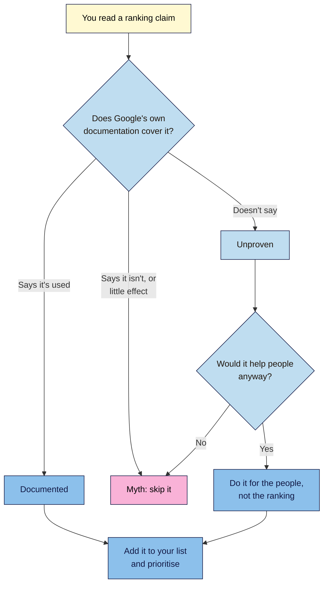
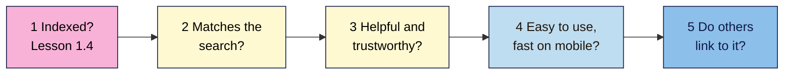

# M01.L07 — Overview of Google's Ranking Factors
> After this lesson you can explain what Google says it looks at when ranking pages, sort real ranking factors from myths, and pick the three improvements that matter most for your site.

**Time:** ~20 min reading + ~25 min exercise · **Level:** L1 Foundation (beginner) · **Prereqs:** M01.L04, M01.L06 · **Remediate to:** M01.L04
**Verified against:** Google's "How Search Works: ranking results" page and Google Search Central "In-depth guide to how Google Search works", "Ranking systems guide", "Creating helpful, reliable, people-first content", "Understanding page experience", "Core Web Vitals", "SEO Starter Guide", "Link best practices" and "Optimizing for generative AI features" pages on 2026-11-04. Google doesn't publish a full list of factors or their weights, so everything here is what Google has chosen to say.

## Learning objectives
1. **Summarise** what Google says it looks at when ranking (meaning, relevance, quality, usability, context), using its own documentation. *(O1)*
2. **Separate** documented ranking factors from myths and unproven claims (e.g. word count, meta keywords, "domain authority"). *(O2)*
3. **Prioritise** three ranking-related improvements for your project site and say which SEO type each belongs to. *(O3)*

## Why it matters
Amara's client forwards her an article: "The 200 Google ranking factors you must fix this year." The client wants all of it done by Friday: 2,000-word posts, a higher Domain Authority, keywords in the domain name. Amara can't tell which items matter, which are wrong, and which nobody can prove. Without a way to check, she'll spend the client's money on things Google says it ignores. In Lesson 1.4 you learned that ranking happens after indexing. This lesson shows what's known about that step, and how to check a claim yourself.

## Core concept
**Plain version:** when someone searches, Google works out what they mean, finds pages that match, prefers the ones that seem most helpful and trustworthy, and adjusts for the searcher's situation. It uses a lot of signals to do this. Nobody outside Google knows the full list or the exact weights.

**Analogy:** think of a hiring panel. First it works out what the job really needs (meaning). Then it picks candidates with the right skills (relevance), checks references (quality), asks whether they'd be easy to work with (usability), and considers the location and team (context). A hospital and a start-up weigh these differently. Google does the same from one search to the next.

**Precise definition:** a **ranking factor** (Google also says **signal**) is any piece of information Google's automated **ranking systems** use to order results. Google says relevancy "is determined by hundreds of factors", and that "the weight applied to each factor varies depending on the nature of your query."

### Part 1 — The five key signals
Google's "How Search Works" page names five. Each one maps to work you'll do later in this course.

| Signal | What Google says | In plain words | SEO type · module |
|---|---|---|---|
| **Meaning** | It needs to establish "the intent behind your query" | What is this person really looking for? | On-page · M03 |
| **Relevance** | "The most basic signal that information is relevant is when content contains the same keywords as your search query." | Does the page cover what was searched? | On-page · M04 |
| **Quality** | Signals of "expertise, authoritativeness, and trustworthiness", such as whether "other prominent websites link or refer to the content" | Is it helpful, and do others trust it? | On-page and off-page · M07, M09 |
| **Usability** | "When all other signals are relatively equal, content that people will find more accessible may perform better." | Is it easy to use, including on a phone? | Technical · M06, M12 |
| **Context** | "Your location, past Search history, and Search settings" | Who is searching, and where? | Local · M11 |

Three things follow from this:

- **Weights change with the search.** Google's example: "when searching for current news topics, content freshness plays a bigger role than dictionary definitions."
- **Relevance comes first.** Google "always seeks to show the most relevant content, even if the page experience is sub-par." A fast page that doesn't answer the search won't win.
- **Nobody can pay for this.** "Nobody can pay us to do so", Google says of ranking. Buying ads doesn't change organic results (Lessons 1.3 and 1.6).

**Ranking systems.** Google's "Ranking systems guide" describes notable systems behind these signals. You don't need to memorise them, but a few names are useful: **freshness systems**, **link analysis systems and PageRank** (links help show what pages are about and which might be most helpful), **original content systems**, the **reviews system** and the **site diversity system**, which "generally won't show more than two web page listings from the same site in our top results."

Old advice often mentions Panda, Penguin or the "helpful content update". Google lists all three under **Retired systems**, because they became part of its **core ranking systems**. Helpful content joined them in March 2024.

### Part 2 — What's documented, what's a myth, what's unproven
Use three labels for any claim:

| Label | Meaning |
|---|---|
| **Documented** | Google's own documentation says it's used |
| **Myth** | Google says it isn't used or has little or no effect, or it's a tool's score rather than Google's |
| **Unproven** | Google's documentation doesn't confirm it; the evidence is studies, reports or opinion |

**Documented** (Google says these matter):

| Factor | Google's words | Keep in mind |
|---|---|---|
| **Helpful content** | "Creating content that people find compelling and useful will likely influence your website's presence in search results more than any of the other suggestions in this guide." | This comes first, always |
| **Keywords on the page** | Matching keywords are "the most basic signal" of relevance | Write naturally; keyword stuffing is spam (Lesson 1.6) |
| **Links** | "Google uses links as a signal when determining the relevancy of pages and to find new pages to crawl." | PageRank "is just one" of many signals. Earn links; never buy them |
| **Core Web Vitals** | "Core Web Vitals are used by our ranking systems." | Good scores don't "guarantee that your pages will rank at the top". Details in M12 |
| **Freshness** | Systems "designed to show fresher content for queries where it would be expected" | Only for some searches. Changing a date without real updates is a warning sign, Google says |

**Myths** (Google says don't focus on these):

| Claim | What Google says |
|---|---|
| "Use the meta keywords tag" | "Google Search doesn't use the keywords meta tag." |
| "Aim for 2,000 words" | "There's no magical word count target, minimum or maximum" |
| "Get keywords in your domain" | Keywords in the domain or URL path "alone have hardly any effect beyond appearing in breadcrumbs" |
| "A `.com` ranks better" | The domain ending "only matters if you're targeting a specific country's users, and even then it's usually a low impact signal" |
| "Headings must be in perfect order to rank" | For Google Search "it doesn't matter", though correct order is "fantastic for screen readers", so still do it |
| "Duplicate content gets you penalised" | Content on several URLs is "not something that will cause a manual action". Copying others' content is a different story |
| "E-E-A-T is a ranking factor" | "No, it's not." See below |
| "Domain Authority affects Google rankings" | DA is a score made by an SEO tool company. Third-party tools "don't have access to Google's internal ranking data" |

**E-E-A-T** stands for experience, expertise, authoritativeness and trustworthiness. It isn't one score. Google's systems use "a mix of factors" that can identify content showing these qualities, and "trust is most important". Google gives this "even more weight" for **YMYL** ("Your Money or Your Life") topics such as health and finances. So: no single E-E-A-T factor exists, but the qualities matter a lot. Module 14 goes deeper.

**Unproven:** clicks, time on page and social shares are the usual examples. Google's ranking documentation that we checked doesn't list them as factors. Reports on testimony from the 2023 US antitrust trial and a 2024 leak of internal Google documents suggest Google has used click data, but those are secondary reports, and they don't tell you how to rank. Most "200 factors" lists mix documented items, myths and guesses without saying which is which.

**A note on AI search:** Google says SEO best practices "continue to be relevant" because its generative AI features "are rooted in our core Search ranking and quality systems." The basics in this lesson apply there too (Module 14).

## How it works
**Check any ranking claim.**

**In words:** look the claim up in Google's own documentation. If Google says it's used, it's documented. If Google says it isn't, or that the effect is tiny, it's a myth, so skip it. If Google doesn't say, it's unproven: do it only if it would help people anyway.

**Choose what to work on first.** Go down this list and stop at the first real gap. Everything below it can wait.

**In words:** a page that isn't indexed can't rank, so check that first. Then ask whether it matches the search, whether it's helpful and trustworthy, whether it's easy to use, and whether others link to it. This order is our course's advice, built on Google's statements about relevance and content; Google publishes no such list.

## Hands-on walkthrough
You need a browser and your project sheet. Add a new tab **Ranking**.

**Part A — Read the source (5 min)**
1. Open Google's page: https://www.google.com/search/howsearchworks/how-search-works/ranking-results/
   > 🖼️ **Image prompt:** Google's "How Search Works" ranking results page (1280×720), scrolled to the list of key Search signals. Highlight the list of signals with a 3px #F9B2D7 outline; blur any personal details.
   > **Alt text:** Google's How Search Works page showing its key signals: meaning, relevance, quality, usability and context.
2. In your Ranking tab, write the five signals with one line each in your own words, using your own site as the example.

   **Expected output (Nila Coffee):** *"Meaning: someone searching `cold brew ratio` wants a number, not a shop. Relevance: my guide must state the ratio. Quality: I show my own tests and who wrote them. Usability: it reads well on a phone. Context: a searcher in Kochi may see local roasters first."*

**Part B — Fact-check 8 claims (10 min)**
1. Copy these claims into the tab. Label each **documented**, **myth** or **unproven**, using Part 2 and the Google pages in Further reading. Add the source for each one.
   1. "Posts under 1,500 words can't rank."
   2. "Add a meta keywords tag to every page."
   3. "Links from other sites can help a page rank."
   4. "Your page should contain the words people search for."
   5. "Core Web Vitals are used in ranking."
   6. "You must raise your Domain Authority above 40."
   7. "More Facebook shares mean higher Google rankings."
   8. "Google ranks pages higher when visitors stay longer."
2. Check your labels.

   **Expected output:**

   | # | Label | Why |
   |---|---|---|
   | 1 | Myth | No word count target exists |
   | 2 | Myth | Google doesn't use the tag |
   | 3 | Documented | Links are a stated signal |
   | 4 | Documented | Matching keywords are the most basic relevance signal |
   | 5 | Documented | Stated, with no guarantee of top rankings |
   | 6 | Myth | A third-party score, not one of Google's |
   | 7 | Unproven | Not in Google's ranking documentation; you can't prove cause and effect |
   | 8 | Unproven | Not in Google's documentation; reports are secondary |

   For 7 and 8, the flowchart still helps: shares and engaged readers are good for your business, so a page people want to share is worth making. Just don't report them as ranking factors.

**Part C — Prioritise three improvements (10 min)**
1. Look at your Trace tab (Lesson 1.4) and your SERPs tab (Lesson 1.5). List up to six possible improvements for your site.
2. Use the second flowchart to pick the **top three**. For each one, record: the improvement, the signal it supports, the SEO type (on-page, off-page or technical, Lesson 1.3), why it's first and the module that covers it.
3. Don't make the changes yet. You're choosing, not fixing. Later modules show how.

   **Expected output (Nila Coffee):**

   | # | Improvement | Signal | SEO type | Why now | Module |
   |---|---|---|---|---|---|
   | 1 | Write a cold brew guide with Nila's own tests | Relevance, quality | On-page | Results show guides, and Nila has none | M04, M07 |
   | 2 | Replace the slow, oversized homepage photo | Usability | Technical | Most visitors use phones | M06, M12 |
   | 3 | Ask the food blogger who reviewed the tasting room to link to it | Quality | Off-page | Earned links are the safe way to get this signal | M09 |

   > 🖼️ **Image prompt:** A spreadsheet tab named "Ranking" (1200×500) with three prioritised improvements and columns for signal, SEO type, reason and module. Highlight the SEO type column with a 3px #F9B2D7 outline; blur any personal details.
   > **Alt text:** A spreadsheet listing three prioritised SEO improvements with their signal, SEO type, reason and module.

## When to use / when not to
**Use the claim check** whenever an article, tool, AI answer or client gives you a "ranking factor". **Use the priority order** before you start any SEO work.
**Don't chase a perfect score** in any tool. Google says that trying for a perfect Core Web Vitals score "just for SEO reasons may not be the best use of your time." The same goes for an SEO plugin's green light.

**Trade-off:** sticking to documented factors keeps you safe from wasted work, but Google doesn't document everything, so "unproven" doesn't mean "false". Experienced SEOs do test unproven ideas. As a beginner, spend your limited hours on what's documented, then wait: Google says you likely want "to wait a few weeks" before judging a change.

## Use AI for this
**Example prompt:**
> "Here's a list of SEO claims: [paste]. For each one, tell me whether Google's public documentation confirms it, denies it, or doesn't address it. Give the page name for each answer. If you aren't sure, write 'not sure' and don't guess."

**What AI does well here:** turning a long article into a list of checkable claims, and explaining terms in plain words.
**Where it gets it wrong:** AI repeats popular SEO myths because they appear all over its training data. It often cites retired systems as current, states percentages for factor weights that Google has never published, and invents quotes.
**How to check:** open the Google page it names and find the words yourself. Treat any specific weight or percentage as false unless Google published it.

## Common mistakes
- **Believing a "200 factors" list.** Google hasn't published one. Check each item.
- **Treating correlation as cause.** Top pages may be long because they cover a topic well. That doesn't make length the reason they rank.
- **Polishing speed before fixing content.** Relevance comes first; a fast page that doesn't answer the search won't win.
- **Treating E-E-A-T as a score.** No tool can read it, and Google says it isn't a single factor.
- **Reporting tool scores as Google's.** Domain Authority and similar scores are made by third parties.
- **Following old advice.** Check for retired names such as Panda and Penguin, which are clues that a guide may be out of date.

## Troubleshooting
| Symptom | Likely cause | Fix |
|---|---|---|
| You can't find a claim in Google's docs | Google doesn't address it | Label it unproven, then use the flowchart |
| Two Google pages seem to disagree | One may be older or more specific | Prefer the most specific page, and note both |
| A Google employee said something different on social media | Staff comments are useful, but less formal | Note it, and treat the documentation as your main source |
| Your Trace or SERPs tab is empty | You skipped Lesson 1.4 or 1.5 | Complete one search and one page trace, then come back |
| All your improvements look technical | It's easy to list what's measurable | Ask first whether your pages match the searches |
| A client insists on a myth | They read it somewhere | Show them Google's sentence and the page it's on |

## Exercise
**Task:** complete your **Ranking** tab: five signals in your own words (Part A), 8 labelled claims with sources (Part B) and your top three improvements (Part C). Then find one more "ranking factor" claim in an article or video of your choice and label it with the first flowchart.
**Expected outcome:** a tab you could show a client, with a sourced label for each claim and three priorities, e.g. Kavya: *"1. Add a clear class timetable page for `yoga classes adyar` (relevance, on-page). 2. Show who teaches and their training (quality, on-page). 3. Fix the schedule table on phones (usability, technical)."*
**Stretch goal:** take one page on your site and answer three Google self-assessment questions about it: "Does the content provide original information, reporting, research, or analysis?", "Is this the sort of page you'd want to bookmark, share with a friend, or recommend?" and "Is it self-evident to your visitors who authored your content?"

## Key takeaways
- Google names five key signals: **meaning, relevance, quality, usability and context**. Their weights vary by search, and nobody outside Google knows them.
- Helpful, relevant content comes first. Links and Core Web Vitals are documented, but neither guarantees a ranking.
- **Myths:** the meta keywords tag, word count targets, keyword domains, and Domain Authority as a Google factor.
- **E-E-A-T** isn't a single ranking factor, but the qualities behind it matter, especially for YMYL topics.
- Label every claim **documented, myth or unproven**, and fix gaps in order: indexed, relevant, helpful, usable, linked.

## Teach it back
Explain to a friend in 3 sentences why "write 2,000 words to rank" is a myth, and what Google says matters instead.

## Glossary terms added
- Ranking factor (signal) — added to `seo-101/glossary.md`
- Ranking system / core ranking systems — added to `seo-101/glossary.md`
- PageRank — added to `seo-101/glossary.md`
- E-E-A-T — added to `seo-101/glossary.md`
- YMYL — added to `seo-101/glossary.md`
- Core Web Vitals — added to `seo-101/glossary.md`
- Domain Authority (DA) — added to `seo-101/glossary.md`
- Correlation vs cause — added to `seo-101/glossary.md`

## Further reading
*All checked 2026-11-04.*
- Google — How Search Works: ranking results: https://www.google.com/search/howsearchworks/how-search-works/ranking-results/
- Google Search Central — In-depth guide to how Google Search works: https://developers.google.com/search/docs/fundamentals/how-search-works
- Google Search Central — A guide to Google Search ranking systems: https://developers.google.com/search/docs/appearance/ranking-systems-guide
- Google Search Central — Creating helpful, reliable, people-first content: https://developers.google.com/search/docs/fundamentals/creating-helpful-content
- Google Search Central — Understanding page experience: https://developers.google.com/search/docs/appearance/page-experience
- Google Search Central — Core Web Vitals: https://developers.google.com/search/docs/appearance/core-web-vitals
- Google Search Central — SEO Starter Guide: https://developers.google.com/search/docs/fundamentals/seo-starter-guide
- Google Search Central — Link best practices: https://developers.google.com/search/docs/crawling-indexing/links-crawlable
- Google Search Central — Optimizing for generative AI features: https://developers.google.com/search/docs/fundamentals/ai-optimization-guide

> ⚠️ **May change:** Google's ranking systems change constantly (see the core and spam updates in Lesson 1.6), and it can edit these pages at any time. Re-check the five signals, the Core Web Vitals wording and the "Things we believe you shouldn't focus on" table before publishing. The click-data reports in Part 2 come from secondary sources, not from Google's documentation.

## Refresher card
*Used by remediation when a learner fails a quiz twice on a later lesson that points back here.*
**Five key signals:** meaning (intent), relevance (matching content), quality (expertise, trust, links), usability (accessible, good on mobile), context (location, history, settings). **Weights vary by search** and aren't public. **Documented:** helpful content, keywords on the page, links, Core Web Vitals, freshness where expected. **Myths:** meta keywords, word count targets, keyword domains, Domain Authority as a Google factor. **E-E-A-T** isn't a single factor. **Unproven:** check it, and do it only if it helps people. **Priority order:** indexed → relevant → helpful → usable → linked.
