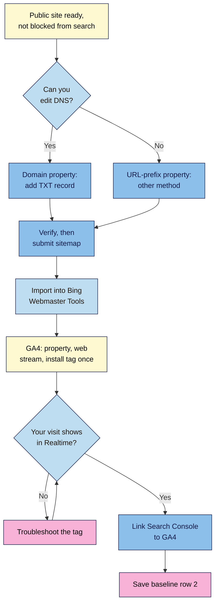

# M01.L08 — Practice: Set Up Google Search Console + GA4 on a Test Site
> After this lesson you can prove you own a site to Google and Bing, submit a sitemap, see your own visit in GA4, link the two tools and save a dated baseline.

**Time:** ~10 min reading + ~45 min hands-on (plus waiting for DNS, if needed) · **Level:** L1 Foundation (beginner) · **Prereqs:** M01.L03 · **Remediate to:** M01.L03; Web Development 101 M06 (analytics)
**Verified against:** Search Console Help "Add a website property", "Verify your site ownership" and "Sitemaps report"; Google Analytics Help "Set up Analytics for a website and/or app", "Realtime report", "Confirm that you're collecting data", "Enhanced measurement events", "Data retention", "Connect Search Console to Google Analytics" and "Privacy Disclosures Policy"; the Bing Webmaster blog post on importing from Search Console (updated June 2025); Blogger Help "Create a blog" and "Control access to your blog"; "Managing owners, users, and permissions"; "Add, edit, and delete Analytics users"; "Build and submit a sitemap"; WordPress.com Support and the Site Kit plugin page (version 1.191.0) and set-up guide on 2026-11-04. Screens were not tested live; button names come from these pages and may differ slightly on yours.

## Learning objectives
1. **Set up** a test site (or use your project site) and verify it in Google Search Console as a Domain property, then import it into Bing Webmaster Tools. *(O1)*
2. **Create** a GA4 property and web data stream, install the tag, and confirm it records a visit in Realtime. *(O2)*
3. **Link** Search Console to GA4 and record baseline row 2 (verification status, sitemap submitted, first GA4 visit). *(O3)*

## Why it matters
Kavya spent a weekend improving her class pages. A month later a student asks whether it worked, and she has no idea: she can't say how many people found her through Google, or which searches brought them. Worse, she can't tell whether the numbers were already going up. Every lesson after this one depends on data, and these tools only start collecting once they're set up. **Set them up today, before you change anything,** so you have a "before" to compare with. That's the course rule: measurement before changes.

## Core concept
**Plain version:** you need two free tools because they see different halves of the journey. **Google Search Console** shows what happens *before* the click: which searches your pages appeared for, how often they were clicked, and which pages are indexed. **Google Analytics 4 (GA4)** shows what happens *after* the click: who arrived, what they did and whether they converted. **Bing Webmaster Tools** is Bing's version of Search Console.

**Analogy:** think of a shop. Search Console is the street survey: how many people saw your sign, and how many walked in. GA4 is the camera inside the shop: where people went, and who bought something.

**Precise definition:** a **Search Console property** is the website or part of a website you've proved you control. A **GA4 property** is the container for your site's analytics data, and a **web data stream** is the connection that sends data from your site into it, identified by a **Measurement ID** such as `G-AB12CD34EF`.

| | **Search Console** | **GA4** |
|---|---|---|
| **Answers** | How do people find me in Google? Is my site indexed? | What do visitors do on my site? |
| **Data from** | Google's own search systems | A tag on your pages |
| **Needs on your site** | Proof of ownership | The Google tag (a small piece of code on every page) |
| **First data** | "In a few days" | Realtime within about 30 minutes; most reports "24-48 hours" |
| **In depth** | M08 | M08 |

### Two property types
| | **Domain property** (`example.com`) | **URL-prefix property** (`https://example.com/`) |
|---|---|---|
| **Covers** | All subdomains (such as `blog.example.com`), protocols (`http` and `https`) and subpaths | Only URLs that start with that exact prefix |
| **Verification** | DNS record only | Several methods, such as an HTML tag or file |
| **Use it when** | You can edit your domain's DNS (**the default for this course**) | You can't edit DNS, or you're on a free address such as `yourname.blogspot.com` |

**DNS** is the internet's address book for your domain. Verifying a Domain property means adding a **TXT record** there: a line of text that only someone in control of the domain could add.

### Which site will you use?
Search Console and GA4 only work on a site that real visitors and Google can reach. That rules some options out for now.

| Your path (Lesson 1.1) | What to use today |
|---|---|
| **A. Your own live site** | That site |
| **B. Practice site, with hosting** | WordPress on low-cost hosting with your own domain (about ₹150–₹500 / $3–$10 a month) |
| **B. Practice site, at no cost** | A free **Blogger** site. It's public, and it has a field for GA4. You'll use URL-prefix instead of Domain, and you'll work with WordPress itself in Module 5 |
| **C. A friend's or client's site** | That site, with written permission (see the box in Part B) |

**Not suitable for this lesson:** WordPress Playground stores your site in your own browser, and a local install lives on your computer, so Google can't reach either. They're fine for practising WordPress in Module 5. The free WordPress.com plan is public, but WordPress.com says Google Analytics needs its Premium plan or above.

## How it works

**In words:** start with a public site that isn't blocked from search. If you can edit DNS, create a Domain property with a TXT record; if not, use URL-prefix. Submit your sitemap, then import the site into Bing. Create GA4, install the tag once, and don't move on until you see your own visit in Realtime. Finally, link Search Console to GA4 and save the results in your baseline.

## Hands-on walkthrough
Use the Google account you'll keep for this site, not a temporary one. Keep your project sheet open.

**Part A — Get the site ready (5–10 min)**
1. **Blogger route only:** sign in to https://www.blogger.com with the Google account you'll use for Search Console. Create a new blog, enter a name, choose an address, click **Save** and publish two or three short posts on your topic. Blogs are public by default.
2. Open your site in a private window to confirm that it loads for the public.
3. **WordPress sites:** in **Settings → Reading**, make sure **Discourage search engines from indexing this site** is *not* ticked. It adds a `noindex` rule (Lesson 1.4) and also turns off WordPress's built-in sitemaps.
4. Find your sitemap by opening one of these addresses:
   - WordPress: `https://yoursite.com/wp-sitemap.xml` (an SEO plugin may use `/sitemap_index.xml` instead)
   - Blogger: try `https://yourname.blogspot.com/sitemap.xml` (observed practice: Google says Blogger likely makes a sitemap available, but doesn't name the address)

   **Expected output:** a page of links or XML code, not a "not found" error. Write the address down.

**Part B — Verify in Search Console (10 min, plus any DNS wait)**

> **Path C:** don't create new accounts until you've asked the owner, because many sites already have these tools. Ask to be added to the existing ones. In Search Console, the owner uses **Settings → Users and permissions → Add user**. In GA4, they use **Admin → Access Management**, click **+**, then **Add users**. Linking the two tools needs a verified Search Console owner, so plan to do Part G together.

1. Go to https://search.google.com/search-console, select **+ Add property**, then choose **Website property**.
2. Choose **Domain property** and enter just the domain: `example.com`, with no `https://`, no `www` and no path. (**Blogger:** Google says new blogs "should be added and verified automatically", so first check whether your blog is already in the property list. If it is, skip to Part C. If it isn't, choose **URL-prefix property**, enter `https://yourname.blogspot.com/` and follow the steps shown.)
   > 🖼️ **Image prompt:** Search Console's add-property screen (1100×650) showing the Domain property and URL-prefix property choices. Highlight the Domain property field with a 3px #F9B2D7 outline; blur any personal details.
   > **Alt text:** The Search Console add-property screen, offering a Domain property or a URL-prefix property.
3. Copy the TXT record that Search Console gives you. It starts with `google-site-verification=`.
4. In a new tab, sign in to wherever your domain's DNS is managed (often your hosting provider or your **registrar**, the company you bought the domain from). Add a new record:
   - **Type:** TXT
   - **Host/Name:** blank or `@`, as your provider's help says
   - **Value:** the string you copied

   If your domain already has a TXT record, **add this one beside it. Don't overwrite the old one:** it may be doing another job, such as an earlier verification or email security.
5. Back in Search Console, click **Verify**.

   **Expected output:** a message that ownership is verified. If it fails, don't panic: "It can take a few minutes or even days" for the record to be visible to Google. Wait, click **Verify** again, and carry on with GA4 in the meantime.
6. **Leave the record in place.** Google says: "To stay verified, don't remove the DNS record from your provider, even after verification succeeds."

**Part C — Submit your sitemap (3 min)**
1. In Search Console, open **Sitemaps**.
2. Paste your full sitemap address into **Add a new sitemap**, then click **Submit**.

   **Expected output:** a row with the status **Success**. A status of **Couldn't fetch** or **Has errors** means you should click the row for details. A sitemap is a list of your pages; Google calls submitting one "merely a hint", so it doesn't guarantee anything will be crawled or indexed (Lesson 1.4).

**Part D — Import into Bing (4 min)**
1. Go to https://www.bing.com/webmasters and sign in, or create an account.
2. On **My Sites**, click **Import**.
3. Sign in with your Google account and click **Allow**, so Bing can see your verified sites and sitemaps.
4. Select your site and click **Import**.

   **Expected output:** your site appears in Bing Webmaster Tools. Traffic data can take "up to 48 hours". If you later remove this access, you'll need another method, such as a meta tag or DNS record.

**Part E — Create GA4 (8 min)**

**First, check that the site doesn't already have GA4** (paths A and C): open View Source (Lesson 1.4) and search for `G-` and `gtag`. Installing it twice counts every visit twice.

1. Go to https://analytics.google.com and click **Start Measuring**. If you already have an account, go to **Admin**, click **Create**, then choose **Property**.
2. Enter an **account name**, such as your business name, and review the data-sharing settings. Click **Next**.
3. Enter a **property name**, and choose your reporting **time zone** and **currency**. Click **Next**, answer the questions about your business, click **Create** and accept the terms.
4. Choose **Web**. Enter your site's URL and a **stream name**, leave **enhanced measurement** on, and click **Create stream**.
5. Copy the **Measurement ID**. It starts with `G-`. You can find it later in **Admin → Data streams**.
6. Go to **Admin → Data Settings → Data Retention** and check **Event data retention**. Choose **14 months** and click **Save**, so you can compare this year with last year.

**Enhanced measurement** collects useful events with no extra code, including `page_view`, `scroll`, `click` (outbound links), `view_search_results`, `file_download` and form events.

**Part F — Install the tag once, and see your visit (8 min)**
1. Install the tag using the route that fits your site:

   | Your site | How |
   |---|---|
   | **WordPress** | Install **Site Kit by Google**, the official plugin. During set-up, tick **Connect Google Analytics as part of your setup** and choose the property you just made. Site Kit also connects Search Console and can verify the site for you |
   | **Blogger** | **Settings → Basic → Google Analytics Measurement ID**, paste your ID, **Save** |
   | **Wix, Shopify, Squarespace, other builders** | Google's set-up page links to instructions for each: paste the ID into the field provided |
   | **Hand-coded site** | Paste the Google tag "immediately after the `<head>`" on each page |

2. Open your site in a private window and click two or three pages. Turn off any ad blocker and accept any cookie banner for this test, because either can stop the tag (observed practice).
3. In GA4, go to **Reports → Realtime**.
   > 🖼️ **Image prompt:** GA4 Realtime report (1280×720) showing 1 active user in the last 5 minutes and page_view in the event list. Highlight the active users card with a 3px #F9B2D7 outline; blur any personal details.
   > **Alt text:** The GA4 Realtime report showing one active user and page view events from a test visit.

   **Expected output:** at least one active user, plus events such as `page_view`. Data "may take up to 30 minutes to begin", so wait and try again before you change anything. Don't move on until you've seen your visit.
4. **Tell visitors.** Google's policy says you "must disclose the use of Google Analytics and how it collects and processes data." Add a sentence to your privacy policy now. Cookie consent can also be required, depending on where your visitors are; you'll set that up in Module 8. On a client's site, raise it with the owner.

**Part G — Link the tools (5 min)**
1. In GA4, go to **Admin → Product links → Search Console Links**, then click **Link**. You need the Editor role in GA4 and must be a verified owner in Search Console.
2. Under **Link to Search Console properties I manage**, click **Choose accounts**, select your property, then click **Confirm** and **Next**.
3. Select your web data stream, click **Next**, then review and submit.
4. In GA4, open **Reports → Library**, find the **Search Console** collection and publish it. It's "unpublished by default", so you won't see the reports until you do.

   **Expected output:** a link listed in **Search Console Links**, and two reports: **Google Organic Search Queries** and **Google Organic Search Traffic**. They may stay empty for a while: data arrives 48 hours after Search Console collects it, and a new site may have none yet.

**Part H — Record baseline row 2 (2 min)**
Add this to your **Baseline** tab, under row 1 from Lesson 1.3:

| Date | Check | Google | Bing | Missing pages | Notes |
|---|---|---|---|---|---|
| 2026-11-04 | Tools set up | Domain property verified; sitemap: Success | Imported | — | First GA4 visit seen in Realtime; Search Console linked to GA4; retention 14 months |

**Expected output:** a dated row you can point to. Anything still pending, such as a DNS wait, is written down as pending.

## When to use / when not to
**Use a Domain property** whenever you can edit DNS: one property covers `www`, non-`www`, `http`, `https` and subdomains. **Use URL-prefix** when you can't, or for a free subdomain.
**Don't start changing pages** until you've seen Realtime working and saved the baseline. **Don't add a second analytics tag** "to be safe": it doubles your numbers.

**Trade-off:** a Domain property takes more effort up front, because you have to find and edit DNS, and it can take time. In return you get complete data and one place to look. URL-prefix is quicker, but it's easy to miss data from another version of your address.

## Use AI for this
**Example prompt:**
> "My domain is managed at [provider]. I need to add a TXT record for Google Search Console. Tell me where to find the DNS settings, and what to enter for type, host and value. Tell me which of your steps might be out of date, and link your provider's help page."

**What AI does well here:** finding the right menu at a provider you don't know, and explaining an error message in plain words.
**Where it gets it wrong:** it often describes old screens, including Universal Analytics, which GA4 replaced, and `UA-` IDs. It may tell you to replace your existing TXT record.
**How to check:** follow your provider's own help page, and treat the screen in front of you as the truth. Never paste passwords, API keys or verification codes for someone else's site into a chatbot.

## Common mistakes
- **Replacing an existing TXT record** instead of adding a new one. This can break an earlier verification or your email.
- **Deleting the TXT record after verifying.** You may lose access after a grace period.
- **Installing GA4 twice,** for example through a plugin and a pasted tag. Your numbers double.
- **Assuming no data means failure.** Reports take time; Realtime is the right test on day one.
- **Using a throwaway Google account.** Business data should sit in an account the owner controls. On client sites, the client should own the accounts.
- **Forgetting the Search Console reports in GA4.** They're unpublished until you publish them from **Library**.
- **Leaving out the privacy disclosure.** Google's policy requires it.

## Troubleshooting
| Symptom | Likely cause | Fix |
|---|---|---|
| Verification failed | The record hasn't reached Google yet, or it's in the wrong place | Check the Host/Name and Value, wait a day or two, and try again |
| You can't find your DNS settings | The domain is managed somewhere other than your host | Check the account of your registrar (the company you bought the domain from), or ask your web person. Meanwhile, use URL-prefix, or Site Kit on WordPress |
| Sitemap shows **Couldn't fetch** | Wrong address, or the site is blocked | Open the address in a private window, then resubmit. On Blogger, search Blogger Help for its current sitemap or feed address |
| WordPress sitemap shows "not found" | **Discourage search engines** is ticked, or an SEO plugin replaced it | Untick the box, or use the plugin's sitemap address |
| Bing import shows no sites | You signed in with a different Google account | Use the account that owns the property, or add the site by hand |
| Realtime stays at 0 | Too soon, a blocker or cookie banner, or the tag isn't on the page | Wait 30 minutes, turn off blockers, accept the banner, then look for your `G-` ID in View Source |
| Visitor numbers look double | The tag is installed twice | Keep one method, and remove the other |
| **Link** is unavailable in GA4 | You aren't a verified owner or an Editor | Ask the owner to give you the role, or to link it |
| Search Console reports are empty | Too soon, or a new site with no search visits | Check again in a few days, and note it in your baseline |

## Exercise
**Task:** complete Parts A–H for your project site, then write down: your property type, sitemap address and status, Bing import status, your Measurement ID, and the date of your first Realtime visit.
**Expected outcome:** verified Search Console and Bing, a submitted sitemap, GA4 showing your visit in Realtime, the two tools linked and baseline row 2 saved, e.g. Kavya: *"2026-11-04: Domain property verified, wp-sitemap.xml Success, Bing imported, first Realtime visit seen, linked. No search data yet."*
**Stretch goal:** a week from now, open Search Console's **Performance** report and GA4's **Google Organic Search Queries** report. Note one search that brought up your site, and add it to your baseline. If there's no data yet, write that down: it's a finding too.

## Key takeaways
- **Search Console** shows what happens before the click, and **GA4** shows what happens after it. You need both, set up before you change anything.
- A **Domain property** covers your whole domain and needs a DNS TXT record. Add it beside any others, and never delete it.
- Importing from Search Console is the quick way into **Bing Webmaster Tools**.
- Install GA4 **once**, and don't trust it until you've seen your own visit in **Realtime**.
- Link the tools, publish the reports from **Library**, disclose analytics in your privacy policy and save **baseline row 2**.

## Teach it back
Explain to a friend in 3 sentences why a website needs both Search Console and GA4, and why you should set them up before changing the site.

## Glossary terms added
- Google Search Console — added to `seo-101/glossary.md`
- Search Console property — added to `seo-101/glossary.md`
- Domain property — added to `seo-101/glossary.md`
- URL-prefix property — added to `seo-101/glossary.md`
- DNS TXT record — added to `seo-101/glossary.md`
- Bing Webmaster Tools — added to `seo-101/glossary.md`
- GA4 property — added to `seo-101/glossary.md`
- Web data stream — added to `seo-101/glossary.md`
- Measurement ID — added to `seo-101/glossary.md`
- Enhanced measurement — added to `seo-101/glossary.md`
- Realtime report — added to `seo-101/glossary.md`

## Further reading
*All checked 2026-11-04.*
- Search Console Help — Add a website property: https://support.google.com/webmasters/answer/34592
- Search Console Help — Verify your site ownership: https://support.google.com/webmasters/answer/9008080
- Search Console Help — Sitemaps report: https://support.google.com/webmasters/answer/7451001
- Google Search Central — Build and submit a sitemap: https://developers.google.com/search/docs/crawling-indexing/sitemaps/build-sitemap
- Search Console Help — Managing owners, users, and permissions: https://support.google.com/webmasters/answer/7687615
- Bing Webmaster Blog — Import sites from Search Console: https://blogs.bing.com/webmaster/september-2019/Import-sites-from-Search-Console-to-Bing-Webmaster-Tools
- Google Analytics Help — Set up Analytics for a website and/or app: https://support.google.com/analytics/answer/9304153
- Google Analytics Help — Realtime report: https://support.google.com/analytics/answer/9271392
- Google Analytics Help — Confirm that you're collecting data: https://support.google.com/analytics/answer/9333790
- Google Analytics Help — Enhanced measurement events: https://support.google.com/analytics/answer/9216061
- Google Analytics Help — Data retention: https://support.google.com/analytics/answer/7667196
- Google Analytics Help — Connect Search Console to Google Analytics: https://support.google.com/analytics/answer/10737381
- Google Analytics Help — Privacy Disclosures Policy: https://support.google.com/analytics/answer/7318509
- Google Analytics Help — Add, edit, and delete Analytics users: https://support.google.com/analytics/answer/9305788
- Google Analytics Help — Set up your Google tag with Blogger: https://support.google.com/analytics/answer/13126712
- Google Analytics Help — Site Kit plugin (WordPress): https://support.google.com/analytics/answer/11898619
- Blogger Help — Create a blog: https://support.google.com/blogger/answer/1623800
- WordPress.org — Site Kit by Google: https://wordpress.org/plugins/google-site-kit/
- WordPress.com Support — Google Analytics: https://wordpress.com/support/google-analytics/

> ⚠️ **May change:** every menu in this lesson. Google and Bing rename and move settings often. Re-check all button names, the GA4 set-up flow, Blogger's menus and sitemap address, WordPress.com plan limits, and consent rules before publishing.

## Refresher card
*Used by remediation when a learner fails a quiz twice on a later lesson that points back here.*
**Search Console** = before the click (searches, indexing). **GA4** = after the click (behaviour). **Domain property** = whole domain, DNS TXT record only; add it beside existing records and keep it. **URL-prefix** = one exact prefix, several methods. **Sitemap:** Search Console → Sitemaps → Submit → **Success**. **Bing:** My Sites → Import. **GA4:** account → property → web stream → Measurement ID (`G-`) → install once → check **Realtime** (allow 30 minutes). **Link:** Admin → Product links → Search Console Links; publish the reports from **Library**. Disclose analytics in your privacy policy, and save the baseline.
