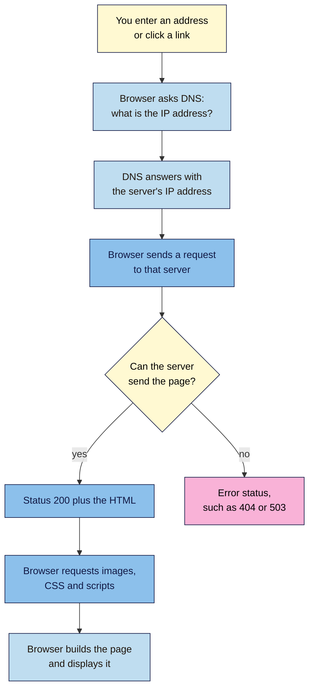
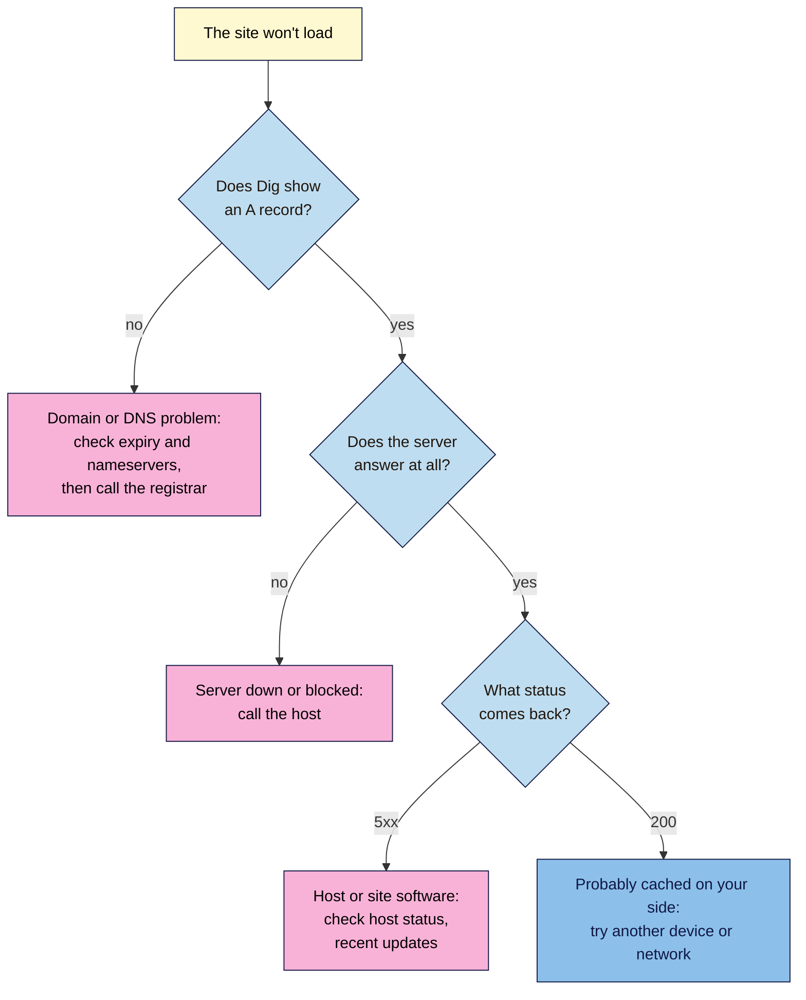

# M02.L01 — How Websites Work: Browsers, Servers, Hosting, Domains and IP Addresses
> After this lesson you can explain what happens between typing an address and seeing a page, find out who runs each part of your own site, and tell which hosting problems really affect SEO.

**Time:** ~20 min reading + ~30 min hands-on · **Level:** L1 Foundation (beginner) · **Prereqs:** M01.L04 · **Remediate to:** M01.L04; Web Development 101 M01.L02 (domains and DNS), M01.L03 (hosting)
**Verified against:** MDN "How the web works", "What is a domain name?" and "What is a web server?"; ICANN's glossary; Google's "How HTTP Status Codes Affect Google's Crawlers", "Crawl Budget Management", "Changing Your Web Hosting and SEO" and "Managing Multi-Regional and Multilingual Sites" on 2026-11-04. ICANN Lookup, Google Admin Toolbox Dig and ARIN's Whois/RDAP search were confirmed online that day, but their screens were not tested live, so labels may differ slightly on yours.

> ⚠️ **Freshness flag:** many older guides say "do a WHOIS lookup". ICANN replaced WHOIS with **RDAP** for generic domains such as `.com` and `.org` in January 2025, so this lesson uses RDAP tools.

## Learning objectives
1. **Explain** what browsers, servers, hosting, domains, DNS and IP addresses each do when a page loads. *(O1)*
2. **Find** your project site's registrar, expiry date, nameservers, IP address and likely host using free lookup tools. *(O2)*
3. **Judge** which hosting and domain problems affect SEO, separating Google's documentation from myths such as "shared hosting hurts rankings". *(O3)*

## Why it matters
Tomás has taken over his shop's site from the agency. One Monday the site vanishes. The hosting company says its servers are fine. The agency has stopped answering emails. After two days he learns the domain was registered in the agency's account, the renewal card had expired, and nobody at the shop has the login. No amount of keyword work helps a site that nobody can reach, Googlebot included. This lesson shows you what your site is made of and who controls each part, **before** something breaks.

## Core concept
**Plain version:** a website is a set of files on a computer that's always switched on. Your browser needs to find that computer and ask it for the files. Five parts make that happen.

**Analogy:** think of visiting a shop.

| Part | In the shop analogy | What it really is | Who you usually pay |
|---|---|---|---|
| **Browser** | The customer | The app that asks for pages and displays them (Chrome, Edge, Safari) | Nobody |
| **Domain name** | The shop's name | The readable address, such as `nilacoffee.example` | A registrar, every year |
| **DNS** | The address book | The system that turns a domain name into an IP address | Often included with your registrar or host |
| **IP address** | The street address | The number that identifies a computer on the internet | Included with hosting |
| **Server and hosting** | The building, and the rent | The computer holding your site, and the company that runs it | A host, monthly or yearly |

**Precise definitions:**

- A **browser** is a client: a program that requests pages. Googlebot is also a client, which is why this whole journey applies to search engines too.
- A **web server** can mean the computer, the software on it, or both. MDN says the term "can refer to hardware or software, or both of them working together."
- **Hosting** is the service of keeping your site on a server that's always online. The company that does this is your **host**.
- A **domain name** gives people "a human-readable address for any web server". You don't own one. MDN is direct about this: "you pay for the right to use a domain name for one or more years." If you stop renewing it, you lose that right.
- A **registrar** is the company you register through. A **registry** keeps the master database for one ending, such as `.com`. ICANN calls a registry "an authoritative master database of the domain names registered in a top-level domain". You deal with the registrar, not the registry.
- An **IP address** comes in two formats. **IPv4** looks like `192.0.2.10` and **IPv6** looks like `2001:db8::10`. Sites often have both. (These two are reserved examples used in documentation, so they won't lead anywhere.)
- **DNS (Domain Name System)** is, as MDN puts it, "like an address book for websites". A **nameserver** is the computer that holds the official address details for your domain, called **DNS records**. An **A record** points to an IPv4 address, and an **AAAA record** points to an IPv6 address. You met another type in Lesson 1.8: the TXT record that proves you control a domain.

Your registrar, DNS provider and host can be **one company or three different ones**. That's the most useful fact in this lesson, because when something breaks, you need to know whom to call.

### Common types of hosting
| Type | What you get | Rough cost | Good fit |
|---|---|---|---|
| **Shared** | Space on one server used by many other sites | ₹150–₹600 / $2–$8 a month | Small sites on a budget, like Kavya's |
| **Managed WordPress** | The host handles updates, backups and caching | ₹1,000–₹3,000 / $15–$35 a month | Businesses whose time costs more than the fee |
| **Cloud or VPS** | Your own virtual server to set up and maintain | From a few dollars to a lot | Developers, custom sites, high traffic |
| **Website builder** | Hosting and an editor in one package (Lesson 2.2) | About $15–$40 a month | People who never want to touch the set-up |

*Prices are rough ranges from Web Development 101, checked 2026-11-02. They vary by country and change often.*

A **CDN (content delivery network)** keeps copies of your files on servers around the world, so visitors get them from somewhere nearby. Many hosts include one, or you can add one.

## How it works
Here's what happens when someone opens `https://nilacoffee.example/cold-brew-guide`:

**In words:** the browser asks DNS for the server's IP address, then sends a request to that server. If the server can send the page, it replies with status 200 and the HTML; if not, it replies with an error status. The HTML lists other files, such as images and CSS, so the browser requests those too, then builds the page. The rules for this conversation are called **HTTP**. **HTTPS** is the encrypted version (Module 12).

This picks up where Lesson 1.4 left off. There you saw the request and response. This lesson adds the steps *before* the request, and they matter because **a failure here stops everyone**. If DNS can't find your site, no status code exists to read: there's no server to answer.

> **Under the hood: why DNS changes aren't instant.** To save time, DNS answers are remembered (cached) for a set period called the **TTL (time to live)**. If your record has a TTL of 3,600 seconds, computers around the world may keep using the old answer for up to an hour after you change it. That's why a site can look moved on your phone but not on your laptop. Before a host move, Google suggests you "consider lowering the TTL to a conservative low value (for example, a few hours) at least a week in advance".

### What this means for SEO
Popular advice about hosting is often wrong, so here is what the sources actually say.

| Claim | Verdict | What the source says |
|---|---|---|
| Server errors can hurt your indexing | **Documented** | "5xx and 429 server errors prompt Google's crawlers to temporarily slow down with crawling", and indexed URLs are kept "but eventually dropped" if errors continue |
| A healthy server lets Google crawl more | **Documented, with a limit** | If response times stay stable or improve, Google's crawl capacity limit goes up; slowdowns and errors bring it down. This comes from a guide for **large sites**, so a small site rarely needs to worry |
| Changing hosts causes a temporary crawl dip | **Documented** | Google says "it's normal to see a temporary drop in Googlebot's crawl rate immediately after the launch" |
| Server location affects who you reach | **Documented, but weak** | Google lists it as a signal about your intended audience, then adds that it's "not a definitive signal", as CDNs and foreign hosting are common. Google says country domains "provide a strong signal" (Module 12) |
| Shared hosting or a shared IP hurts rankings | **Myth, by Google's public comments** | We found no Search Central page on this (checked 2026-11-04). Google's John Mueller has said in public that shared hosting and shared IPs are normal and fine; these remarks reach us through industry news reports. The real risk is an overloaded server that's slow or returns errors |
| You need "SEO hosting" with many IP addresses | **Red flag** *(observed practice)* | This is often sold to make a group of sites look unconnected, which is the idea behind the link schemes you met in Lesson 1.6 |

## Hands-on walkthrough
You'll look up your project site's parts and record them in a new **Site facts** tab. Nila Coffee's values are illustrative.

**Before you start: which steps apply to you?**
- **Path A (your own site):** do every part.
- **Path B on Blogger (`yourname.blogspot.com`):** you don't have your own domain, so practise Part B on `wikipedia.org` instead. In Part E, write "Platform address, run by Blogger" in the domain rows.
- **Path C (a client's site):** Parts A to D use public information, so they need no logins. Ask the owner the login questions in Part E.

**Part A — Watch a page load (5 min)**
1. Open your homepage in Chrome or Edge. Press **F12** to open DevTools and click **Network**, as you did in Lesson 1.4.
2. Reload the page. Look at the summary line at the bottom of the panel.
   **Expected:** a count of requests, often dozens. One page is many files, and each is a separate request.
3. Click the first row (your page, type `document`), then **Headers**. Under **General**, find **Remote Address**.
   **Expected:** an IP address followed by a port, such as `192.0.2.10:443`. This is the machine that answered you.
   > 🖼️ **Image prompt:** Chrome DevTools Network panel (1280×720) with the first "document" row selected and the Headers tab open, showing Status Code 200 and Remote Address under General, with the request count visible at the bottom. Highlight the Remote Address line with a 3px #F9B2D7 outline; blur any personal details.
   > **Alt text:** Chrome DevTools Headers tab for a page request, with the Remote Address line highlighted.

**Part B — Find the registrar and expiry date (5 min)**
1. Open **ICANN Lookup** at `https://lookup.icann.org/` and enter your domain, without `https://` or `www`.
2. Note the **registrar**, the **expiry date** and the **nameservers**.
   **Expected:** a registration record. Personal contact details are usually hidden for privacy, which is normal. For `nilacoffee.example` the record would show something like: *Registrar: Example Registrar Ltd · Expires: 2027-03-14 · Nameservers: `ns1.examplehost.example`, `ns2.examplehost.example`*.
   > 🖼️ **Image prompt:** ICANN Lookup result page (1280×800) for a well-known .com domain, showing Registrar, Registry Expiry Date and Name Servers, with redacted contact fields visible. Highlight the expiry date and name servers with a 3px #F9B2D7 outline; blur any personal details.
   > **Alt text:** An ICANN Lookup result for a domain with the expiry date and name servers highlighted.

**Part C — Read the DNS records (5 min)**
1. Open **Google Admin Toolbox Dig** at `https://toolbox.googleapps.com/apps/dig/`. Enter your domain and choose **A**.
   **Expected:** a line with your domain, a number (the TTL in seconds), `IN A` and an IP address.
2. Choose **NS**.
   **Expected:** the same nameservers as Part B. Their names often show who runs your DNS, such as a name containing `cloudflare`, `awsdns` or your host's brand. This is where you'd add a TXT record, as in Lesson 1.8.
3. Compare the A record with Part A's Remote Address.
   **Expected:** often the same, but not always. Large sites use several servers, and a CDN can answer from different addresses.

**Part D — Find the likely host (5 min)**
1. Open **ARIN Whois/RDAP** at `https://search.arin.net/rdap/` and enter your IP address. ARIN is the registry for North America, so if the address belongs to another region, the result may send you to that registry (for example RIPE, APNIC or AFRINIC). Follow it.
2. Note the organisation or network name.
   **Expected:** a company name, which is your **likely** host. If it's a CDN or a large cloud company, it may not be the company you pay. Your hosting invoice is the real proof.

**Part E — Fill in your Site facts tab (10 min)**
1. Add a tab called **Site facts** to your "SEO 101 project" sheet, using the rows below.
2. Fill in what you found, then answer the login questions. Write who holds each login, and **never put passwords in the sheet**.

   | Row | Nila Coffee (illustrative) |
   |---|---|
   | Site address | `nilacoffee.example` |
   | Registrar | Example Registrar Ltd |
   | Domain expiry date | 2027-03-14 |
   | Auto-renew on? | Yes; card last checked 2026-11-04 |
   | Who holds the registrar login? | Nila's owner, on a company email address |
   | DNS provider (from nameservers) | Example Host |
   | IP address | `192.0.2.10` |
   | Likely host or CDN | Example Host (matches the invoice) |
   | Who holds the hosting login? | Nila's owner |
   | Support contact for each company | Example Registrar and Example Host help pages |

   > 🖼️ **Image prompt:** Google Sheets screenshot (1280×720) of a "Site facts" tab with two columns listing registrar, expiry date, auto-renew, login holders, DNS provider, IP address and likely host for a small coffee shop site. Highlight the expiry date row with a 3px #F9B2D7 outline; blur any personal details.
   > **Alt text:** A spreadsheet tab listing a small site's registrar, renewal date, DNS provider, IP address and login holders.
3. Add a calendar reminder for **30 days before** the expiry date, even if auto-renew is on. Cards expire.

**Expected output:** a Site facts tab with no blank rows, or with each blank marked as a question for someone by name.

### When something breaks: find the layer first
Use the same order the browser uses, so you call the right company.

**In words:** first check whether the domain still gives an IP address. If it doesn't, the problem is the domain or DNS, so look at the expiry date and nameservers and contact the registrar. If it does but the server doesn't answer, contact the host. A 5xx status points to the host or the site's software. If the page returns 200 for others but looks wrong for you, an old copy is probably cached on your side.

## When to use / when not to
**Change hosts when you have evidence:** repeated downtime, 5xx errors in your logs or Search Console, or slow server responses that your host can't fix.

**Don't change hosts because** someone says shared hosting is bad for SEO, or to get a "better" IP address or a server in another country for rankings.

**The trade-off:** a good move can fix real reliability problems, but every move carries risk, takes time and causes a short crawl dip. If you do move, keep the old host running until, in Google's words, "the traffic to the old provider reaches zero". Moving hosts without changing URLs needs no redirects; changing URLs does (Module 6).

## Use AI for this
**Example prompt:**
> "I run a small website. Here are my lookup results: [paste registrar, nameservers, A record]. Explain in plain words which company does what, and list what you can't tell from this information. Don't guess the name of my host."

**What AI does well here:** explaining a confusing lookup result, translating technical emails from a host, and drafting a clear support request.
**Where it gets it wrong:** it may name a host from an IP address with false confidence, send you to WHOIS tools that are out of date, and repeat myths about shared hosting and "bad IP neighbourhoods".
**How to check:** compare its answer with your invoices and the lookup tools, and check SEO claims against the Google pages below. Never paste passwords, recovery codes or card details into an AI tool.

## Common mistakes
- **Thinking you own your domain.** You hold it for a paid period, and it can be lost if the renewal fails.
- **Leaving the domain in someone else's account.** A web designer or agency may have registered it for you. Check that the registrar account belongs to the business.
- **Using an old email address for the registrar.** Renewal warnings go there, and so do login recovery messages.
- **Confusing the registrar with the host.** Renewing your hosting doesn't renew your domain, and the other way round.
- **Assuming the IP owner is your host.** With a CDN, the lookup shows the CDN.
- **Buying "SEO hosting".** Pay for reliability and support, not for promises about rankings.

## Troubleshooting
| Symptom | Likely cause | Fix |
|---|---|---|
| ICANN Lookup shows nothing for a `.in`, `.de` or other country domain | Some country-code registries don't provide data through ICANN | Use the country registry's own lookup; find it in IANA's Root Zone Database |
| Dig shows an old IP after you changed DNS | The old answer is still cached | Wait for the TTL to run out, then check again |
| Remote Address is missing in DevTools | The file came from the browser's cache | Tick **Disable cache** in the Network tab and reload |
| ARIN shows a company you've never heard of | The address belongs to a CDN, a cloud provider or your host's supplier | Trust your invoice; record it as "CDN or network" |
| Chrome shows an error such as `DNS_PROBE_FINISHED_NXDOMAIN` | The name can't be found: the domain may have expired, or nameservers may be wrong | Check the expiry date and NS records |
| You don't know who registered your domain | The record hides contact details | Search old email for the registrar's name, then use its account recovery; ask your previous designer or agency |

## Exercise
**Task:** complete your **Site facts** tab (Part E) and set the renewal reminder. Then name the layer (domain or DNS, server or host, or your own device's cache) for each of these Nila Coffee problems and say whom to contact:
1. The site has gone for everyone. Dig shows no A record, and an old email says "payment failed".
2. Dig shows the correct A record, but every page returns `503` for visitors everywhere.
3. Yesterday Nila moved to a new host. The new site appears on a phone but the old one still appears on a laptop.

**Expected outcome:** a complete tab, and these answers: **1** domain or DNS: the registration has probably lapsed, so contact the registrar now. **2** server or host: DNS works but the server can't serve pages, so contact the host; a long outage can lead to pages being dropped from Google's index. **3** cache: the laptop still has the old DNS answer, so wait for the TTL and keep the old host running.
**Stretch goal:** choose **TXT** in Dig for your domain and find the verification record you added in Lesson 1.8. Blogger users can try it on a large brand's domain instead.

## Key takeaways
- A page load runs in order: DNS finds the IP address, the browser requests the page, and the server responds.
- Your domain, DNS and hosting can sit with different companies, so know who runs each and who holds each login.
- You rent a domain. A missed renewal can take a whole site offline, for visitors and Googlebot alike.
- Reliability matters for SEO: repeated server errors slow crawling and can eventually remove pages from the index.
- Shared hosting isn't the problem. A slow or failing server is.

## Teach it back
Explain to a friend in 3 sentences what happens between typing a web address and seeing the page, and why renewing hosting doesn't protect your domain.

## Glossary terms added
- Browser — added to `seo-101/glossary.md`
- CDN (content delivery network) — added to `seo-101/glossary.md`
- DNS (Domain Name System) — added to `seo-101/glossary.md`
- DNS record (A, AAAA) — added to `seo-101/glossary.md`
- Domain name — added to `seo-101/glossary.md`
- Hosting — added to `seo-101/glossary.md`
- HTTP and HTTPS — added to `seo-101/glossary.md`
- IP address — added to `seo-101/glossary.md`
- Nameserver — added to `seo-101/glossary.md`
- Registrar — added to `seo-101/glossary.md`
- Registry — added to `seo-101/glossary.md`
- Shared hosting — added to `seo-101/glossary.md`
- TTL (time to live) — added to `seo-101/glossary.md`
- Web server — added to `seo-101/glossary.md`

## Further reading
*All checked 2026-11-04 unless marked.*
- MDN — How the web works: https://developer.mozilla.org/en-US/docs/Learn_web_development/Getting_started/Web_standards/How_the_web_works
- MDN — What is a domain name?: https://developer.mozilla.org/en-US/docs/Learn_web_development/Howto/Web_mechanics/What_is_a_domain_name
- MDN — What is a web server?: https://developer.mozilla.org/en-US/docs/Learn_web_development/Howto/Web_mechanics/What_is_a_web_server
- ICANN — Acronyms and terms: https://www.icann.org/en/icann-acronyms-and-terms?nav-letter=r&page=1
- ICANN — Launching RDAP; Sunsetting WHOIS (27 Jan 2025; checked 2026-11-02): https://www.icann.org/en/announcements/details/icann-update-launching-rdap-sunsetting-whois-27-01-2025-en
- ICANN Lookup: https://lookup.icann.org/
- Google Admin Toolbox Dig: https://toolbox.googleapps.com/apps/dig/
- ARIN Whois/RDAP search: https://search.arin.net/rdap/
- IANA — Root Zone Database (checked 2026-11-02): https://www.iana.org/domains/root/db
- Google Crawling Infrastructure — How HTTP status codes affect Google's crawlers: https://developers.google.com/search/docs/crawling-indexing/http-network-errors
- Google Crawling Infrastructure — Crawl budget management (large sites): https://developers.google.com/search/docs/crawling-indexing/large-site-managing-crawl-budget
- Google Search Central — Changing your web hosting and SEO: https://developers.google.com/search/docs/crawling-indexing/site-move-no-url-changes
- Google Search Central — Managing multi-regional and multilingual sites: https://developers.google.com/search/docs/specialty/international/managing-multi-regional-sites
- *Secondary source, for Google's public comments:* Search Engine Journal — Google: no SEO advantage to dedicated hosting: https://www.searchenginejournal.com/google-no-seo-advantage-to-dedicated-hosting/414066/
- *Secondary source:* Search Engine Roundtable — Sharing IP addresses on shared servers is normal: https://www.seroundtable.com/sharing-ip-addresses-shared-servers-google-seo-37171.html

> ⚠️ **May change:** hosting prices, the lookup tools' screens, and Google's documentation on crawling and geotargeting. Re-check the shared hosting row before publishing: it relies on public comments, not on a Google documentation page.

## Refresher card
*Used by remediation when a learner fails a quiz twice on a later lesson that points back here.*
**Order of a page load:** domain → DNS → IP address → request to the server → status code and HTML → other files → page displayed. **Registrar** = where you rent the domain. **Nameservers** = where the DNS records live. **Host** = who runs the server. They can be three different companies. Look them up with ICANN Lookup, Google Admin Toolbox Dig and ARIN Whois/RDAP. **TTL** = how long a DNS answer is cached. **For SEO:** repeated 5xx errors slow crawling and can drop pages; shared hosting by itself is not a problem; server location is only a weak signal. Record who holds each login, and set a renewal reminder.
