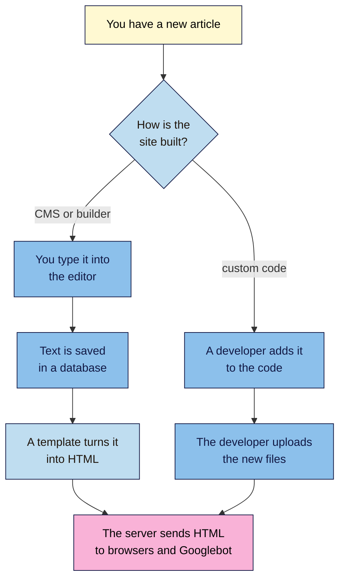
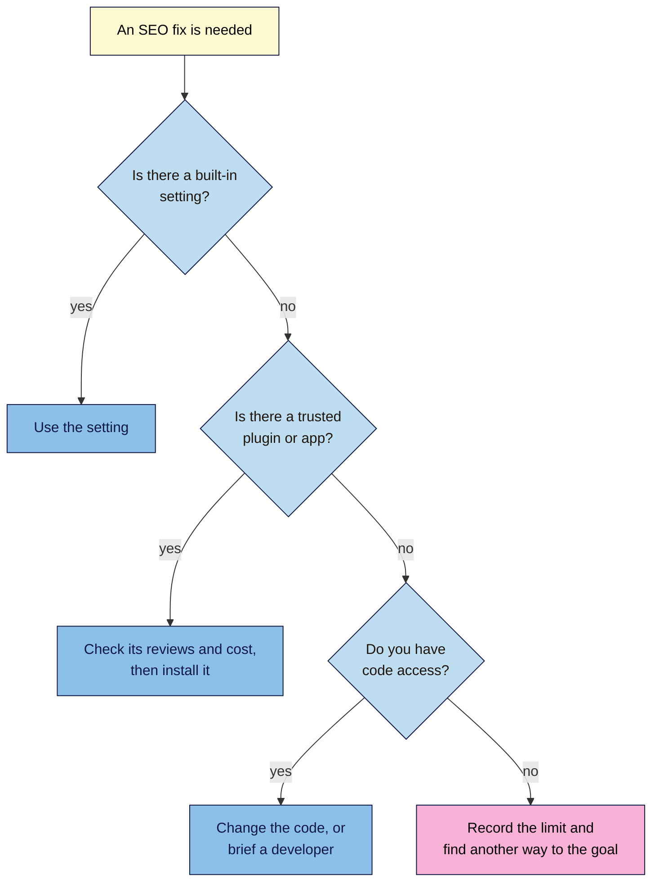

# M02.L02 — CMS vs Custom-Coded Websites
> After this lesson you can tell what any site is built with, compare the main ways to build a site, and list exactly which SEO settings you can and can't change on yours.

**Time:** ~18 min reading + ~25 min hands-on · **Level:** L1 Foundation (beginner) · **Prereqs:** M02.L01 · **Remediate to:** M02.L01; Web Development 101 M01.L04 (code vs CMS vs no-code)
**Verified against:** Google Search Central ("Update your robots.txt file", "Introduction to robots.txt", "Build and submit a sitemap", "Block Search indexing with noindex", "Intro to structured data"); Shopify Help Center; Wix Help Center; Blogger Help; WordPress.org and WordPress.com support pages; W3Techs, on 2026-11-04. Squarespace's help articles and Wix's redirect articles were read through search excerpts and summaries, not in full, so check them before you rely on a detail. No platform's screens were tested live, so labels may differ slightly on yours.

> ⚠️ **Freshness flag:** platforms add and remove SEO settings, rename menus and change which plans include what. Treat the access table in this lesson as a starting point, and confirm your row in your platform's own help pages.

## Learning objectives
1. **Compare** CMSs, website builders and custom-coded sites on control, cost, skills and SEO access. *(O1)*
2. **Identify** what a site is built with, using its source code and free checks. *(O2)*
3. **List** which SEO settings you can and can't change on your project site's platform. *(O3)*

## Why it matters
Amara sends her first client a list of six SEO fixes. Two come back marked "impossible". The client's site runs on Squarespace, and one fix says "edit the `robots.txt` file", which Squarespace users can't do. Amara wrote good advice for the wrong platform, and now the client is asking how much she really knows. Every SEO recommendation has to pass one test first: **can this be changed on this platform, and how?** This lesson shows you how to answer that before you promise anything.

## Core concept
**Plain version:** there are three common ways to build a site. You can use software that manages your content, rent a service that does everything, or have the site coded from scratch. All three can rank. They differ in what you're allowed to change, and in who does the work.

**Analogy:** carry on with the shop from Lesson 2.1.

| Way to build | In the shop analogy | You get | You give up |
|---|---|---|---|
| **Self-hosted CMS** (WordPress) | Renting your own premises and fitting them out from a catalogue | Lots of freedom, and many add-ons | You look after the building: updates, backups, security |
| **Website builder or hosted CMS** (Wix, Squarespace, Shopify) | A unit in a shopping mall | The landlord handles the building | You follow the mall's rules, and moving out is harder |
| **Custom-coded site** | Building a shop from the ground up | Anything you can pay for | Every change needs a builder |

**Precise definitions:**

- A **CMS (content management system)** is software that lets people create and edit content in a browser while the system builds the pages. A **template** or **theme** controls how those pages look, and a **plugin** (some platforms say **app**) adds a feature.
- A **self-hosted CMS** runs on hosting you choose. WordPress from `wordpress.org` is the main example, and it powers roughly 40% of all websites (W3Techs, autumn 2026).
- A **website builder** is a hosted service that bundles an editor, templates and hosting. Wix and Squarespace are the best known. Shopify is the same idea built for selling, at about 5% of websites, with Wix at about 4%. Blogger is a free hosted blog platform from Google.
- A **custom-coded site** is built by developers, by hand or with a framework, and has no ready-made admin screens unless someone builds them.
- **Lock-in** is how hard it is to leave a platform. Builders are usually the hardest to leave, and a self-hosted CMS is much easier.

The line between these isn't sharp. Google's own documentation calls Wix, Blogger and Shopify a "CMS" too. So when a Google page says "if you use a CMS", it means you.

> **Two different WordPresses.** **WordPress.org** gives you free software to run on your own hosting. **WordPress.com** is a hosted service that runs WordPress for you, closer to a builder. Plans matter there: plugins need a paid plan, and its built-in SEO tools need Premium or above. If someone says "my site is on WordPress", ask which one.

### Compare the options
| | **Self-hosted CMS** | **Website builder** | **Shop platform** | **Custom-coded** |
|---|---|---|---|---|
| **Examples** | WordPress | Wix, Squarespace | Shopify | Built by a developer |
| **Control** | High | Medium: inside the platform's rules | Medium | Total |
| **Rough cost** | Hosting from $3–35 / ₹200–3,000 a month, plus a domain | About $15–40 a month | About $30–40 a month, plus payment fees | A one-off build, often thousands, plus a developer for changes *(observed practice)* |
| **Skills needed** | Comfortable with a dashboard; someone handles updates | Basic computer skills | Basic computer skills | A developer for most changes |
| **SEO access** | High, mostly through plugins | Good for common tasks, with some fixed limits | Good, with fixed URL patterns | Anything, but **nothing comes built in** |
| **Leaving later** | Easier | Harder | Medium | Your files are yours |

*Prices are rough ranges from Web Development 101, checked 2026-11-02. They vary by country and change often.*

## How it works
Here's the same job, publishing one article, on each kind of site.

**In words:** on a CMS or builder, you type into an editor, the text is saved in a database, and a template turns it into HTML. On a custom-coded site, a developer usually changes the code and uploads it. Either way, the same thing comes out at the end: HTML sent to browsers and to Googlebot. Search engines read that HTML, so they don't need to care how it was made.

### What this means for SEO
| Claim | Verdict | What the source says |
|---|---|---|
| WordPress ranks better than Wix or other platforms | **Myth, by Google's public comments** | John Mueller of Google: "There's no ranking-boost for using WP", and "We don't prioritize crawling, indexing, or ranking by platform used." These reach us through industry news reports |
| Mainstream platforms are about equal for SEO | **Google's public comment** | Mueller: "there's no fundamental SEO difference between mainstream CMSs, even static hosting with modern frameworks is fine." This was a Reddit comment in October 2025, not a documentation page |
| You may not be able to edit `robots.txt` on your platform | **Documented** | "If you use a CMS, such as Wix or Blogger, you might not need to (or be able to) edit your robots.txt file directly." A settings page may do the job instead |
| Your platform probably already has a sitemap | **Documented** | "If you're using a CMS such as WordPress, Wix, or Blogger, it's likely that your CMS has already made a sitemap available to search engines." |
| You may not be able to edit your HTML | **Documented** | Google says the same about `noindex` and structured data: the CMS may offer "a search engine settings page" or a plugin |
| Custom code is better for SEO | **Not by itself** *(observed practice)* | It removes limits, but also the defaults. Titles, sitemaps and redirects exist only if someone builds them |
| Page speed depends on the platform | **Partly** *(observed practice)* | Themes, plugins, images and apps often matter as much as the platform. Module 12 covers how to measure this |

So the platform doesn't give you a ranking bonus or penalty. What it does decide is **what you can fix, how, and who has to do it**.

### What you can change, platform by platform
You'll meet these tasks properly later. For now, you only need to know what each one does:
- **Title and description:** the text you set for search results (Lesson 2.3, Module 4).
- **Hide a page:** a `noindex` rule that keeps a page out of search results (Module 6).
- **Redirect:** sends an old address to a new one (Module 6).
- **`robots.txt`:** a file telling crawlers which URLs not to request (Module 6).
- **Sitemap:** the list of URLs you met in Lesson 1.4.

| Platform | Title and description | Hide a page | Redirects | `robots.txt` | Sitemap | Code access |
|---|---|---|---|---|---|---|
| **WordPress (self-hosted)** | SEO plugin, as core has no meta description field *(observed practice; Module 13)* | SEO plugin; the site-wide **Search Engine Visibility** box hides everything | Plugin *(Module 13)* | Plugin or host file access *(observed practice)* | Built in at `/wp-sitemap.xml` | Full, through your host |
| **Wix** | **SEO basics** in each page's settings | **Let search engines index this page** toggle | **URL Redirect Manager**; automatic when you change a page's slug, but not for blog pages | **Robots.txt Editor**, marked advanced | Automatic at `/sitemap.xml` | Added tags and custom code; no full template access |
| **Squarespace** | **SEO** tab in page settings; the homepage is set separately | **Hide page from search results** toggle; not for the homepage | **URL mappings**, 301 or 302; none are made for you when you change a slug | **Can't be edited**: all sites share one file | Automatic, can't be edited | Code injection, on some plans only |
| **Shopify** | **Search engine listing** on each page or product | Theme code or an app *(observed practice)* | **Content > Menus > View URL Redirects**; only from URLs that are already broken | `robots.txt.liquid` template; Shopify Support can't help with edits | Automatic at `/sitemap.xml` | Theme code, through **Edit code** |
| **Blogger** | **Enable search description** in Settings | **Custom robots tags** in the post editor | **Custom redirects** in Settings | **Enable custom robots.txt** in Settings | Likely available (Lesson 1.8) | Theme HTML *(observed practice)* |
| **Custom-coded** | Whatever was built | Whatever was built | Server or code change | A file on the server | Must be created | Full, if you have a developer |

*Checked 2026-11-04. Plans differ, so confirm your row in your platform's help pages. On WordPress.com, see the note on plans above.*

Two rows hide a trap. On **Shopify**, "You can redirect only from broken URLs", so a redirect does nothing while the old page still loads. **Squarespace** has the same rule: the old page must be deleted or disabled first.

### When a fix isn't in the table
Use this order whenever a task isn't obvious on your platform.

**In words:** look for a built-in setting first, because it's the safest choice and the platform supports it. If there isn't one, look for a trusted plugin or app. If that fails, use code access, or brief a developer. If none of these is possible, write the limit down and look for another way to reach the same goal. Amara's client can't edit `robots.txt`, but can hide a page with a toggle, which is what the client actually needed.

## Hands-on walkthrough
You'll identify three platforms and record what yours allows. Nila Coffee's values are illustrative.

**Before you start: which steps apply to you?**
- **Path A (your own site):** do every part.
- **Path B on Blogger:** do every part, and use the Blogger row. You'll work in WordPress itself in Module 5.
- **Path C (a client's site):** Parts A, B and C need no logins. Ask the owner to show you the settings in Part D, or to give you access.

**Part A — Identify your platform (5 min)**
1. Open your project site's homepage in Chrome or Edge. Press **Ctrl+U** (Mac: **Cmd+Option+U**) to open View Source, as you did in Lesson 1.4.
2. Press **Ctrl+F** (Mac: **Cmd+F**) and search for each clue below, one at a time.

   | Search the source for | Strongly suggests |
   |---|---|
   | `/wp-content/` or `wp-json` | WordPress |
   | `cdn.shopify.com` | Shopify |
   | `wixstatic.com` | Wix |
   | `static1.squarespace.com` | Squarespace |
   | `blogger.com` or `blogspot.com` | Blogger |
   | `name="generator"` | Many CMSs name themselves here, such as `content="WordPress 7.1"` |

   **Expected:** one clue with many matches. Write your verdict and the proof, such as "WordPress: 87 matches for `/wp-content/`".
   > 🖼️ **Image prompt:** Chrome's View Source page (1280×720) for a WordPress site with the find bar open, searching for `/wp-content/`, showing the match count and several highlighted matches. Highlight the find bar and match count with a 3px #F9B2D7 outline; blur any personal details.
   > **Alt text:** View Source page with the find bar showing many matches for wp-content, which suggests the site runs WordPress.
3. If nothing matches, write **Custom or unknown**. Large sites often build their own or hide these clues, so this is a real answer, not a failure.

**Part B — Check two competitors (5 min)**
1. Take two search competitors from your list in Lesson 1.5 and repeat Part A for each.
   **Expected:** a platform or "Custom or unknown" for each, with the clue that proves it.
2. *(Optional)* Compare your answers with a free detector such as the **Wappalyzer** extension or **BuiltWith** at `https://builtwith.com`. Free limits change, so if a tool asks you to pay or sign up, your own verdict is enough.

**Part C — Run two public checks (5 min)**
1. Add `/robots.txt` to the end of your domain and open it.
   **Expected:** a plain text page with lines such as `User-agent` and `Disallow`, and often a `Sitemap:` line. This is the file search engines read, wherever it's managed from.
2. Open your sitemap: use the `Sitemap:` line if there is one, or try `/sitemap.xml` (WordPress: `/wp-sitemap.xml`).
   **Expected:** a list of links to pages or to smaller sitemaps. A 404 doesn't always mean there's no sitemap, so also check your platform's row in the table.

**Part D — Fill in your SEO access tab (10 min)**
1. Add a tab called **SEO access** to your "SEO 101 project" sheet. In your **Site facts** tab from Lesson 2.1, add a row called **Platform** and fill it in.
2. For each row below, find the real setting in your platform's admin screens. **Look, but don't change anything yet.** Write one of these answers: **Yes**, **With a plugin or app**, **Paid plan only**, **No** or **Don't know yet**.

   | Task | Nila Coffee (WordPress, illustrative) | Where or how |
   |---|---|---|
   | Edit page titles | With a plugin or app | SEO plugin, chosen in Module 13 |
   | Edit meta descriptions | With a plugin or app | SEO plugin |
   | Hide a page from search | With a plugin or app | SEO plugin |
   | Create redirects | With a plugin or app | Redirect plugin or SEO plugin |
   | Change `robots.txt` | With a plugin or app | SEO plugin, or a file at the host |
   | Sitemap exists | Yes | `/wp-sitemap.xml` |
   | Edit the site's code | Yes | Hosting login, held by Nila's owner |

   > 🖼️ **Image prompt:** Google Sheets screenshot (1280×720) of an "SEO access" tab with three columns (Task, Answer, Where or how) listing page titles, meta descriptions, hide a page, redirects, robots.txt, sitemap and code access for a small coffee shop site. Highlight the Answer column with a 3px #F9B2D7 outline; blur any personal details.
   > **Alt text:** A spreadsheet tab listing seven SEO tasks with whether each can be done on the site's platform and where.
3. For each **Don't know yet**, search your platform's help pages, such as `wix redirect` or `shopify meta description`. Google suggests searches like this too.

**Expected output:** a seven-row **SEO access** tab with a named setting beside each answer, a **Platform** row in Site facts, and the platforms of two competitors.

## When to use / when not to
**Choose by who edits the site, how often, and what it has to do:**
- **Self-hosted CMS:** content changes often, several people publish, or you want plugins. **Trade-off:** updates, backups and security are your job.
- **Website builder:** you want to launch fast and never touch the set-up. **Trade-off:** monthly fees, fixed limits and a harder exit.
- **Shop platform:** selling products is the main job. **Trade-off:** fixed URL patterns, and costs that grow with apps.
- **Custom-coded:** you have needs no platform covers, and a budget for a developer. **Trade-off:** every change, including basic SEO features, costs developer time.

**Don't change platform only for rankings.** A move often changes URLs and templates, which puts search traffic at risk unless every changed URL is redirected (Modules 6 and 15). Move when you've hit a real limit you've written down, such as a fix that your **SEO access** tab shows you can't make. Kavya's WordPress site and Tomás's shop both have what they need to rank. Neither needs a new platform first.

## Use AI for this
**Example prompt:**
> "My site runs on [platform and plan]. I want to [task, e.g. redirect an old page]. Tell me if this is possible, give the steps, and link to the platform's official help page for each step. If you aren't sure the feature still exists, say so."

**What AI does well here:** explaining a platform's terms, drafting a brief for a developer, and turning a fix list into plain steps.
**Where it gets it wrong:** it may describe old menus, invent settings, mix up WordPress.com with WordPress.org, and say "WordPress is best for SEO" as if it were fact.
**How to check:** open the official help page it links to and find the setting in your own admin screens. If the link fails or the setting isn't there, treat the answer as wrong.

## Common mistakes
- **Giving advice before checking the platform.** Fix lists need to fit the site they're for.
- **Mixing up WordPress.com and WordPress.org.** They have different limits, and plans change what you can do.
- **Assuming a sitemap or title setting is missing.** Many platforms handle these automatically or keep them in a page's settings.
- **Installing a plugin for something the platform already does.** You can end up with two tools doing one job. Module 13 shows what this breaks.
- **Editing `robots.txt` for fun.** Shopify warns that incorrect use "can result in loss of all traffic". Use it only when you know why.
- **Rebuilding a site to fix a ranking problem.** Find the cause first.
- **Changing a URL without a redirect.** Some platforms make one for you, and many don't.

## Troubleshooting
| Symptom | Likely cause | Fix |
|---|---|---|
| No clue matches in View Source | Custom site, or the clues are hidden | Record "Custom or unknown"; ask the owner or developer |
| Two platforms seem to match | A shop or blog on a separate system, or leftover code | Check the page you care about; the shop and the blog may differ |
| `/sitemap.xml` shows a 404 | The sitemap has another address, or the site is private | Look for the `Sitemap:` line in `/robots.txt` and check the platform's help pages |
| `/robots.txt` says `Disallow: /` for all crawlers | The site may be hidden or blocked on purpose | Check the platform's visibility setting, such as WordPress's **Search Engine Visibility**, and ask the owner before changing it |
| A setting from this lesson isn't in your admin screens | Different plan, editor version or renamed menu | Search the platform's help pages for the task, and record your plan |
| A Shopify or Squarespace redirect does nothing | The old URL still loads a page | Delete or disable the old page, then test again |

## Exercise
**Task:** complete your **SEO access** tab (Part D). Then decide what you'd do in each of these cases, using the access table and the "When a fix isn't in the table" flowchart:
1. A Squarespace client wants a private offer page kept out of Google. A blog post says to edit `robots.txt`.
2. Tomás's shop is on Shopify. He renames a product's handle (its URL slug) and the old URL now shows a 404.
3. An agency tells Kavya: "Move from WordPress to a custom-coded site or you'll never rank." Her pages load well, and she can change everything she needs to.

**Expected outcome:** a complete tab, and these answers: **1** Squarespace users can't edit `robots.txt`, so use the page's **Hide page from search results** toggle. **2** Create a redirect in **Content > Menus > View URL Redirects**; it will work because the old URL is now broken. **3** Stay on WordPress: Google says it doesn't rank by platform, she has no recorded limit, and a rebuild adds cost and risk. Ask the agency which specific fix WordPress prevents.
**Stretch goal:** pick one **No** or **Paid plan only** row in your tab and write two sentences: what you'd lose by leaving it that way, and what it would cost to change.

## Key takeaways
- All mainstream platforms can rank. Google says it doesn't rank by platform.
- The platform decides what you can change, how you change it, and who has to do it.
- Check the platform before you give advice: View Source shows it in minutes.
- Fix in this order: built-in setting, trusted plugin or app, code, then record the limit.
- Change platform for a recorded limit, not for a promised ranking boost.

## Teach it back
Explain to a friend in 3 sentences why Google doesn't care whether a site uses Wix or WordPress, and why the choice still matters to the person doing the SEO.

## Glossary terms added
- CMS (content management system) — added to `seo-101/glossary.md`
- Custom-coded site — added to `seo-101/glossary.md`
- Lock-in — added to `seo-101/glossary.md`
- Plugin (app) — added to `seo-101/glossary.md`
- Redirect — added to `seo-101/glossary.md`
- `robots.txt` — added to `seo-101/glossary.md`
- Self-hosted CMS — added to `seo-101/glossary.md`
- Theme (template) — added to `seo-101/glossary.md`
- Website builder — added to `seo-101/glossary.md`

## Further reading
*All checked 2026-11-04.*
- Google Search Central — Update your robots.txt file: https://developers.google.com/search/docs/crawling-indexing/robots/submit-updated-robots-txt
- Google Search Central — Introduction to robots.txt: https://developers.google.com/search/docs/crawling-indexing/robots/intro
- Google Search Central — Build and submit a sitemap: https://developers.google.com/search/docs/crawling-indexing/sitemaps/build-sitemap
- Google Search Central — Block Search indexing with noindex: https://developers.google.com/search/docs/crawling-indexing/block-indexing
- Google Search Central — Intro to structured data: https://developers.google.com/search/docs/appearance/structured-data/intro-structured-data
- W3Techs — Usage statistics of content management systems: https://w3techs.com/technologies/overview/content_management
- WordPress.org — Reading settings screen: https://wordpress.org/documentation/article/settings-reading-screen/
- WordPress core — Sitemaps merge announcement: https://make.wordpress.org/core/2020/06/10/merge-announcement-extensible-core-sitemaps/
- WordPress.com — Plugins: https://wordpress.com/support/plugins/
- WordPress.com — SEO tools: https://wordpress.com/support/seo-tools/
- Wix — Customizing your page's SEO settings: https://support.wix.com/en/article/customizing-your-pages-seo-settings-in-the-seo-panel
- Wix — Editing your site's robots.txt file: https://support.wix.com/en/article/editing-your-sites-robotstxt-file
- Wix — Setting up a 301 redirect for a page: https://support.wix.com/en/article/setting-up-a-301-redirect-for-a-page-on-your-site
- Wix — Understanding your site's sitemap file: https://support.wix.com/en/article/understanding-your-sites-sitemap-file
- Squarespace — URL mappings: https://support.squarespace.com/hc/en-us/articles/205815308-URL-mappings
- Squarespace — Understanding Google SEO emails and console errors: https://support.squarespace.com/hc/en-us/articles/206543207-Understanding-Google-SEO-emails-and-console-errors
- Squarespace — Hiding your site from search results: https://support.squarespace.com/hc/en-us/articles/21829426828045-Hiding-your-site-from-search-results
- Squarespace — View your site map: https://support.squarespace.com/hc/en-us/articles/206543547-View-your-site-map
- Shopify — Editing robots.txt: https://help.shopify.com/en/manual/promoting-marketing/seo/editing-robots-txt
- Shopify — URL redirects: https://help.shopify.com/en/manual/online-store/menus-and-links/url-redirect
- Shopify — Finding and submitting your sitemap: https://help.shopify.com/en/manual/promoting-marketing/seo/find-site-map
- Shopify — Adding keywords to your pages: https://help.shopify.com/en/manual/promoting-marketing/seo/adding-keywords
- Blogger Help — Manage your blog's settings: https://support.google.com/blogger/answer/9691230
- Blogger Help — Help people find your blog on search engines: https://support.google.com/blogger/answer/41373
- *Secondary source, for Google's public comments:* Search Engine Roundtable — John Mueller on the best CMS for SEO (28 Oct 2025): https://www.seroundtable.com/google-best-cms-for-seo-40329.html
- *Secondary source:* Search Engine Roundtable — Google doesn't prioritise by platform (18 Dec 2020): https://www.seroundtable.com/google-crawling-indexing-or-ranking-by-platform-30623.html

> ⚠️ **May change:** every cell in the access table, plan limits, prices and market shares. Re-check the two "public comments" rows before publishing, as they rely on comments reported by news sites, not on a Google documentation page.

## Refresher card
*Used by remediation when a learner fails a quiz twice on a later lesson that points back here.*
**Three ways to build:** self-hosted CMS (WordPress: most freedom, you do the upkeep), website builder or shop platform (Wix, Squarespace, Shopify: less work, fixed limits), custom-coded (no limits, but nothing is built in). **WordPress.org** is software you host; **WordPress.com** is a hosted service. **Identify a platform** in View Source: `/wp-content/`, `cdn.shopify.com`, `wixstatic.com`, `static1.squarespace.com`. **For SEO:** Google says it doesn't rank by platform; the platform decides what you can change. **Fix order:** built-in setting → trusted plugin or app → code → record the limit. Squarespace users can't edit `robots.txt`, and Shopify and Squarespace redirects work only once the old URL is broken.
