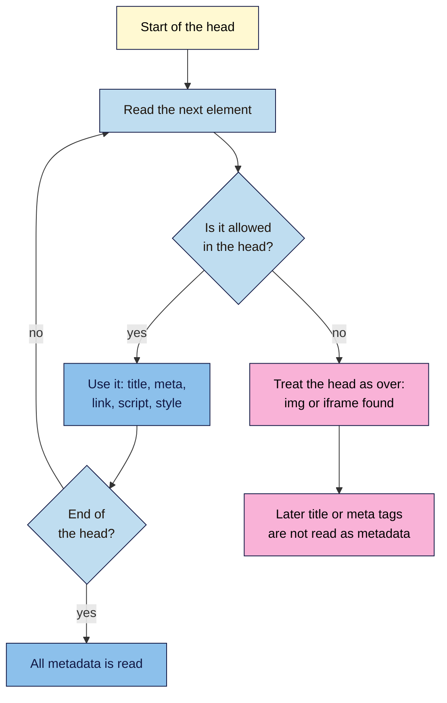

# M02.L03 — HTML Fundamentals: Elements, Tags, Attributes & Page Structure
> After this lesson you can read the parts of any HTML element, build a valid page from a blank file, and explain what the `<title>` and meta description do for search results.

**Time:** ~18 min reading + ~30 min hands-on · **Level:** L1 Foundation (beginner) · **Prereqs:** M02.L01 · **Remediate to:** M01.L04; Web Development 101 M02.L01 (anatomy of an HTML page)
**Verified against:** MDN "Basic HTML syntax", `lang`, `<title>` and `<meta name>` pages; Google Search Central "Title links", "Snippets", "Meta tags and attributes that Google supports", "Use valid HTML to specify page metadata", "SEO Starter Guide" and "Localized versions of your pages"; the W3C Nu HTML Checker (this lesson's code examples were run through it) on 2026-11-04.

> ⚠️ **Freshness flag:** HTML itself changes slowly. How Google builds title links and snippets changes more often, so re-check those rows before publishing.

## Learning objectives
1. **Label** the parts of an element: opening tag, attribute, content and closing tag. *(O1)*
2. **Build** a valid page skeleton with `<!DOCTYPE>`, `<html lang>`, `<head>` and `<body>`. *(O2)*
3. **Explain** what the `<title>` and meta description in `<head>` do for search results. *(O3)*

## Why it matters
Kavya's yoga site gets a few visits from Google, but her search results look poor. Every page shows up as "Home", so people can't tell the Monday class from the blog post. She thinks this is a deep technical problem. It's one line of text on each page. HTML is the language search engines read, and even if you never hand-code a site, you need to read it to check what your platform really produced. By the end of this lesson, you'll be able to open any page's code and find that line in seconds.

## Core concept
**Plain version:** HTML is plain text with labels around each piece of content. The labels tell browsers and search engines what each piece *is*: a heading, a paragraph, a link. Every page has the same frame: a line saying "this is modern HTML", a **head** with information *about* the page, and a **body** with what people see.

**Analogy:** think of a parcel. The **head** is the shipping label: nobody treats it as the contents, but it says what the parcel is and where it should go. The **body** is what's inside the box. **Tags** are the labels on each item inside.

### The parts of an element
```html
<a href="/cold-brew-guide" class="link">Read the cold brew guide</a>
```

| Part | In the example | What it does |
|---|---|---|
| **Opening tag** | `<a …>` | Starts the element and names it (`a` means link) |
| **Attribute** | `href="/cold-brew-guide"` and `class="link"` | Gives extra information as `name="value"`; always sits in the opening tag |
| **Content** | `Read the cold brew guide` | The text or other elements inside |
| **Closing tag** | `</a>` | Ends the element; the same name with a `/` |
| **Element** | All of the above | The whole thing, from opening tag to closing tag |

**Precise definitions:**

- **HTML (HyperText Markup Language)** is made of elements, which, in MDN's words, "enclose, wrap, or *mark up* different parts of content".
- **Attributes** "contain extra information about the element that isn't part of its content."
- **Void elements** are elements "that cannot contain other HTML content", so they have one tag and no closing tag. `<meta>`, `` and `<br>` are examples. You may see them written as `<br />`, but that slash isn't needed.
- **Nesting** means putting elements inside each other, like boxes. The last one opened is the first one closed:
  - ✅ `<p>Keep it <strong>cold</strong>.</p>`
  - ❌ `<p>Keep it <strong>cold.</p></strong>` (the boxes cross)

People often say "title tag" when they mean the whole `<title>` element. That's fine in conversation, and you'll see both in this course.

### The page skeleton
Here's a complete page. Every line has a job.

```html
<!DOCTYPE html>
<html lang="en">
  <head>
    <meta charset="utf-8">
    <title>Cold Brew at Home: A Simple 12-Hour Guide | Nila Coffee</title>
    <meta name="description" content="Make smooth cold brew at home with coarse-ground coffee, cold water and 12 hours in the fridge. Ratios, steps and storage tips.">
  </head>
  <body>
    <h1>Cold Brew at Home</h1>
    <p>You need 100 g of coarse-ground coffee, 1 litre of cold water and a jar. Our beans start at ₹499 / $6.</p>
  </body>
</html>
```

| Line | Its job | What goes wrong without it |
|---|---|---|
| `<!DOCTYPE html>` | MDN calls it "a historical artifact that needs to be included for everything else to work correctly" | Browsers use an older mode, and the checker reports an error |
| `<html lang="en">` | Wraps the whole page; `lang` names its language (`en`, `pt-BR`, `hi`) | Screen readers may use the wrong pronunciation |
| `<head>` | Holds "information about the page that *isn't* part of the content" | — |
| `<meta charset="utf-8">` | Sets the text encoding, which covers ₹, €, é and other languages | Symbols can turn into nonsense like `₹` |
| `<title>` | Names the page in the browser tab and feeds the title link in search results | The checker reports an error, and Google has to pick a title from elsewhere |
| `<meta name="description">` | A short summary of the page; Google may use it for the snippet | Google builds the snippet from the page, which is often fine |
| `<body>` | Holds everything people see | — |

The doctype works in any letter case, and you may see it as `<!doctype html>`. Lesson 2.10 adds one more line to the head: the viewport tag for phones.

### What `<title>` and the meta description do for search
You saw these in Lesson 1.5 from the results page side. Now you can see them in the code.

| Claim | Verdict | What the source says |
|---|---|---|
| Every page should have its own `<title>` | **Documented** | "Make sure every page on your site has a title specified in the `<title>` element." A good title "is unique to the page, clear and concise, and accurately describes the contents of the page" |
| Google always shows your `<title>` | **False** | Title links are "completely automated". Google uses several sources and "might modify the title link" if it decides "the page title doesn't reflect the page content" |
| Titles must be under 60 characters | **Rule of thumb** | Google: "there's no limit on how long a `<title>` element can be", but the title link "is truncated … as needed". MDN says search engines typically show about the first 55–60 characters, so put the important words first |
| Google always shows your meta description | **False** | Google "sometimes uses the meta description", and "snippets are primarily created from the page content itself" |
| The meta description helps you rank | **No, by Google's own statement** | "We still don't use the description `meta` tag in our ranking." This comes from an archived 2009 Google post, and we found no newer page that says otherwise. A good description still helps people choose your result |
| Add `<meta name="keywords">` to rank | **Myth** | "The meta-keyword tag is not used by Google Search, and it has no effect on indexing and ranking at all." |
| `lang` tells Google the page's language | **False, but keep it** | Google "doesn't rely on code annotations such as the `lang`". It reads the text instead. Keep `lang` anyway: screen readers use it for "the correct pronunciation" |
| Invalid HTML hurts your rankings | **Not stated** | We found no Google page saying this. Google says "the web in general is not valid HTML". The head is the exception that matters (see below) |

## How it works
This is the part that catches people out. Google reads the head in order, and it's strict about what belongs there.


**In words:** Google works through the head one element at a time. Allowed elements are `title`, `meta`, `link`, `script`, `style`, `base`, `noscript` and `template`. If it finds anything else, such as an `` or `<iframe>`, Google "assumes the end of the `<head>` element and stops reading any further elements" in it. So a stray image at the top of the head can hide your description, or a `noindex` tag, from Google, even though the page looks fine. Plugins and pasted tracking codes can cause this, which is why the head is worth checking.

> **Under the hood: browsers repair bad HTML without telling you.** If you make a mistake, a browser guesses what you meant and shows the page anyway. That's why a broken page can look fine. View Source shows what the server sent, while the **Elements** panel in DevTools shows the browser's repaired version. A **validator** is a free tool that checks your code against the HTML rules and reports what the browser quietly fixed.

## Hands-on walkthrough
You'll build a page, check it, break it on purpose, and then read your live site's head. Nila Coffee's values are illustrative.

**Before you start: which steps apply to you?**
- **All paths:** do Parts A, B and C. They use a file on your own computer and don't touch any website.
- **Path A or C:** in Part D, use your project site, and path C needs no logins, because the code is public.
- **Path B on Blogger:** in Part D, use one of your blog posts.

**Part A — Create the page (10 min)**
1. Make a folder called `seo-101-html`. You'll add to this page in the next lessons and finish it in the Module 2 capstone.
2. Open a plain text editor. **Windows:** Notepad. **Mac:** TextEdit, then choose **Format > Make Plain Text**. VS Code also works, and it's free.
3. Type the skeleton above rather than pasting it, so you feel each part. Swap in your own topic if you like.
4. Save it as `article.html` in your folder. In Notepad, set **Save as type** to **All files** so it doesn't become `article.html.txt`.
5. Double-click the file to open it in your browser.
   **Expected:** the heading and paragraph on the page, the ₹ sign displayed correctly, and your title in the browser tab. The description appears nowhere on the page, because it's in the head.
   > 🖼️ **Image prompt:** A browser window (1280×720) showing a simple unstyled "Cold Brew at Home" page opened from a local file, with the page title visible in the tab. Highlight the browser tab with a 3px #F9B2D7 outline; blur any personal details.
   > **Alt text:** A plain web page opened from a local file, with the title text highlighted in the browser tab.

**Part B — Validate it (5 min)**
1. Open the **W3C Nu HTML Checker** text box at `https://validator.w3.org/nu/#textarea`.
2. Paste in all your code and click **Check**.
   **Expected:** "Document checking completed. No errors or warnings to show." If you see errors, fix the first one and check again, because one mistake often causes several messages.

**Part C — Break the head on purpose (5 min)**
1. In `article.html`, add this line just below the `<meta charset>` line, and save:
   ```html
   
   ```
2. Reload the page in your browser.
   **Expected:** it looks almost normal: only a small broken-image icon or the words "Nila Coffee logo" appear at the top. The tab still shows your title. Nothing warns you.
3. Paste the code into the checker again.
   **Expected:** six errors. The first says the head "is missing a required instance of child element 'title'", and the next says `title` is "not allowed as child of element 'body'". The checker treated the head as finished at the image, just as Google's documentation describes.
4. Delete the `` line, save, and check again.
   **Expected:** no errors.

**Part D — Read your live site's head (10 min)**
1. Open your project site's homepage and press **Ctrl+U** (Mac: **Cmd+Option+U**) for View Source. Then do the same for one inner page, such as a blog post.
2. Press **Ctrl+F** (Mac: **Cmd+F**) and find each item: `<!DOCTYPE`, `<html`, `</head>`, `<title`, `name="description"`. Your platform may write the code differently, such as with single quotes or with everything on one long line, so if a search fails, try a shorter one such as `description`.
   **Expected:** you can find the doctype, the `lang` value and the title. The description may be missing, which is common.
   > 🖼️ **Image prompt:** Chrome View Source page (1280×720) of a small website's head section, showing the doctype, html lang attribute, title and meta description lines. Highlight the title and meta description lines with a 3px #F9B2D7 outline; blur any personal details.
   > **Alt text:** View Source showing a page's head, with the title and meta description lines highlighted.
3. Add a tab called **Head check** to your "SEO 101 project" sheet and fill it in for both pages.

   | Check | Nila Coffee homepage (illustrative) | Cold brew guide (illustrative) |
   |---|---|---|
   | `lang` value | `en` | `en` |
   | `<title>` text | Home | Cold Brew at Home: A Simple 12-Hour Guide \| Nila Coffee |
   | Clear and unique? | No: too vague | Yes |
   | Meta description | Missing | Present, 127 characters |
   | Anything odd in the head? | No | No |

4. Don't fix anything yet. Module 4 covers writing titles and descriptions. Your **SEO access** tab from Lesson 2.2 shows where you'd change them.

**Expected output:** a valid `article.html`, and a **Head check** tab for two pages with at least one thing to improve noted.

## When to use / when not to
**Hand-write HTML when** you're learning, building a small page, or need to see exactly what's happening. This course does it so you can read code with confidence.

**Don't hand-edit HTML when** your platform has a setting for the job. On a CMS, your title and description come from a field, and the platform writes the code for you. Editing a theme by hand to change a title is slower, and an update may overwrite it.

**The trade-off:** a platform's settings are safer, but you only know they worked if you can read the result. So use the setting, then check the source.

## Use AI for this
**Example prompt:**
> "Here is the `<head>` of my page: [paste]. List each element and say in plain words what it does. Flag anything that isn't allowed in the head, any duplicates, and anything missing. Don't rewrite it."

**What AI does well here:** explaining unfamiliar lines, spotting duplicates, and turning a long head into a readable list.
**Where it gets it wrong:** it may say meta keywords help, give a strict character limit as if it were Google's rule, or say the `lang` attribute tells Google the language. It can also claim code is valid when it isn't.
**How to check:** run the code through the W3C checker, and compare SEO claims with the Google pages below.

## Common mistakes
- **Writing the same title on every page.** Google says a good title is "unique to the page". "Home" helps nobody.
- **Forgetting that the head isn't visible.** Text you want people to read belongs in the body.
- **Putting an image or heading in the head.** This ends the head early for Google.
- **Crossing tags.** Close the last one you opened first.
- **Leaving out quote marks.** A missing closing quote can swallow the rest of your page.
- **Adding meta keywords.** Google doesn't use them, and they show competitors your target words.
- **Trusting how a page looks.** Browsers repair errors silently, so check with a validator.

## Troubleshooting
| Symptom | Likely cause | Fix |
|---|---|---|
| The browser shows your tags as text | The file was saved as rich text or as `article.html.txt` | In TextEdit, choose **Make Plain Text**. In Notepad, choose **All files** and save again |
| `₹` looks like `₹` | The file's encoding doesn't match, or `<meta charset>` is missing | Save as UTF-8, and keep `<meta charset="utf-8">` first in the head |
| Your changes don't appear | The file wasn't saved, or you're looking at another copy | Save, then reload the browser tab |
| The checker lists many errors | One early mistake caused the others | Fix the first error and check again |
| Text after a link has vanished | A closing quote is missing, so the browser read the rest as part of an attribute | Find the attribute, and add the closing `"` |
| You can't find `<title>` in View Source | The site adds it with JavaScript, or it's written differently | Search for `title`. Module 12 covers JavaScript sites |
| Your title link differs from your `<title>` | Google chose another source | Check that the title matches the page; Module 4 covers this |

## Exercise
**Task:** complete your **Head check** tab (Part D). Then fix this planted page. Find all six problems, correct them and get it through the checker with no errors.

```html
<html>
  <head>
    <meta charset="utf-8">
    <title>Home</title>
    <h1>Cold Brew at Home</h1>
    <meta name="description" content="Make smooth cold brew at home.">
  </head>
  <body>
    <p>Keep it in the fridge for <strong>up to a week.</p></strong>
    <a href=guide.html class="link>Read the guide</a>
  </body>
</html>
```

**Expected outcome:** a complete tab, and these six fixes:
1. Add `<!DOCTYPE html>` as the first line.
2. Add a language: `<html lang="en">`.
3. Replace "Home" with a clear, unique title.
4. Move `<h1>` to the body. In the head, it ends the head early, so Google misses the description.
5. Uncross the tags: `<strong>up to a week.</strong></p>`.
6. Fix the link: `<a href="guide.html" class="link">`. The missing `"` after `link` swallows the rest of the page.

The checker doesn't flag a vague title, so you have to catch number 3 yourself. A validator checks rules, not quality.
**Stretch goal:** find a page on any large site where the title link in Google differs from its `<title>`, and suggest why, using the table in this lesson.

## Key takeaways
- An element is an opening tag, content and a closing tag, and attributes add extra information in the opening tag.
- The head describes the page, and the body holds what people see.
- A clear, unique `<title>` is worth your effort, though Google may still change the title link.
- The meta description can shape your snippet, but it isn't a ranking factor.
- An invalid element in the head can make Google miss everything after it, so check the code, not just the look.

## Teach it back
Explain to a friend in 3 sentences the difference between the head and the body of a page, and why a page can look fine but still have a broken head.

## Glossary terms added
- Attribute — added to `seo-101/glossary.md`
- Doctype — added to `seo-101/glossary.md`
- Element (HTML) — added to `seo-101/glossary.md`
- `<head>` and `<body>` — added to `seo-101/glossary.md`
- HTML — added to `seo-101/glossary.md`
- `lang` attribute — added to `seo-101/glossary.md`
- Meta keywords — added to `seo-101/glossary.md`
- Nesting — added to `seo-101/glossary.md`
- Tag (HTML) — added to `seo-101/glossary.md`
- `<title>` element — added to `seo-101/glossary.md`
- Validator — added to `seo-101/glossary.md`
- Void element — added to `seo-101/glossary.md`

## Further reading
*All checked 2026-11-04.*
- MDN — Basic HTML syntax: https://developer.mozilla.org/en-US/docs/Learn_web_development/Core/Structuring_content/Basic_HTML_syntax
- MDN — `lang` attribute: https://developer.mozilla.org/en-US/docs/Web/HTML/Reference/Global_attributes/lang
- MDN — `<title>` element: https://developer.mozilla.org/en-US/docs/Web/HTML/Reference/Elements/title
- MDN — Standard metadata names: https://developer.mozilla.org/en-US/docs/Web/HTML/Reference/Elements/meta/name
- Google Search Central — Title links: https://developers.google.com/search/docs/appearance/title-link
- Google Search Central — Snippets: https://developers.google.com/search/docs/appearance/snippet
- Google Search Central — Meta tags and attributes that Google supports: https://developers.google.com/search/docs/crawling-indexing/special-tags
- Google Search Central — Use valid HTML to specify page metadata: https://developers.google.com/search/docs/crawling-indexing/valid-page-metadata
- Google Search Central — SEO Starter Guide: https://developers.google.com/search/docs/fundamentals/seo-starter-guide
- Google Search Central — Localized versions of your pages: https://developers.google.com/search/docs/specialty/international/localized-versions
- Google Search Central Blog (archived, 21 Sep 2009) — Google does not use the keywords meta tag in web ranking: https://developers.google.com/search/blog/2009/09/google-does-not-use-keywords-meta-tag
- W3C Nu HTML Checker: https://validator.w3.org/nu/

> ⚠️ **May change:** how Google builds title links and snippets, and the checker's wording. Re-check the meta description row before publishing: it rests on an archived 2009 post, although Google's banner on that post confirms only the keywords part still applies.

## Refresher card
*Used by remediation when a learner fails a quiz twice on a later lesson that points back here.*
**Element** = opening tag + content + closing tag. **Attribute** = extra information in the opening tag, as `name="value"`. **Void elements** such as `<meta>` and `` have no closing tag. **Skeleton:** `<!DOCTYPE html>`, `<html lang="en">`, `<head>` (charset, title, description), `<body>`. **Head** = about the page; **body** = what people see. **`<title>`:** unique, clear, accurate; Google may change the title link. **Meta description:** may feed the snippet, doesn't affect ranking. **Meta keywords:** not used. **`lang`:** for screen readers, not Google. Only `title`, `meta`, `link`, `script`, `style`, `base`, `noscript` and `template` belong in the head; anything else makes Google stop reading it. Check code with `https://validator.w3.org/nu/#textarea`.
