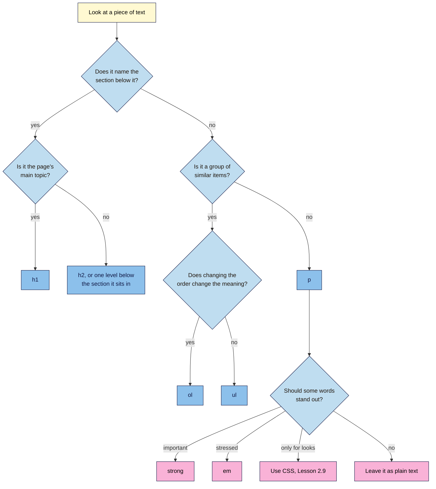

# M02.L04 — Formatting Text: Headings, Paragraphs, Lists, Bold & Italic
> After this lesson you can structure an article with clear headings, pick the right text element by meaning, and audit the heading outline of any live page.

**Time:** ~18 min reading + ~30 min hands-on + ~10 min exercise · **Level:** L1 Foundation (beginner) · **Prereqs:** M02.L03 · **Remediate to:** M02.L03; Web Development 101 M02.L02 (text, links, images and media)
**Verified against:** MDN pages for heading elements, `<p>`, `<br>`, `<ul>`, `<ol>`, `<strong>`, `<em>`, `<b>` and `<i>`; W3C WAI "Headings" tutorial; Google Search Central "SEO Starter Guide", "Title links", "Featured snippets" and "Creating helpful, reliable, people-first content"; WebAIM Screen Reader User Survey #11; Blogger Help "Help people find your blog on search engines"; Gutenberg source code (bold, italic, Heading block and its transforms); the Twenty Twenty-Four and Twenty Twenty-Five `single.html` templates; the W3C Nu HTML Checker (this lesson's code examples were run through it) on 2026-11-06. The Console command in Part D wasn't run in a live browser for this draft, but it gave the expected output in jsdom, a browser simulator.

> ⚠️ **Freshness flag:** HTML's rules change slowly. Google's advice on headings can change, and the WebAIM figure changes with each new survey (the latest ran in 2026), so re-check both before publishing.

## Learning objectives
1. **Structure** an article with one H1 and headings in logical order. *(O1)*
2. **Choose** between paragraphs, lists, `<strong>` and `<em>` by meaning, not by looks. *(O2)*
3. **Audit** a live page's heading outline and fix headings used only for styling. *(O3)*

## Why it matters
Amara hands a client a 1,500-word blog post. In the editor it looks fine: she picked Heading 4 because Heading 2 looked too big, and she made the other section titles bold by hand. Her client's visitor, who uses a screen reader, jumps from heading to heading and finds almost nothing. A skimming reader on a phone sees one long grey block. And when the client asks why the headings "jump around", Amara has no answer. Every choice she made was about looks, but HTML records meaning. This lesson shows you how to make those choices so the page works for everyone who reads it.

## Core concept
**Plain version:** every piece of text on a page should be marked as what it *is*. A title for the section below it is a heading. A group of related items is a list. A block of sentences is a paragraph. How it looks is a separate decision, and CSS handles that (Lessons 2.8 and 2.9).

**Analogy:** think of a recipe book. The contents page lists chapters and the sections inside them, so you can find "Cold drinks" without reading every page. Headings are that contents page, built into your article. Ingredients are a list you can scan. The method is a numbered list, because the order matters. The notes are paragraphs.

**Precise definition:** `<h1>` to `<h6>` are the six **heading** levels. Together, a page's headings form its **heading outline**: the same headings, read in order and indented by level. "The most important heading has the rank 1 (`<h1>`), the least important heading rank 6 (`<h6>`)" (W3C). In W3C's wording, "rank" means heading level. It has nothing to do with search rankings.

### Heading rules
A good outline looks like this:

```text
h1  Cold Brew at Home
    h2  What you need
    h2  How to make it
    h2  How to serve it
        h3  Over ice
        h3  Warm
    h2  How long it keeps
```

1. **Use one `<h1>` that names the page's topic.** More than one is allowed, but MDN says "A page should generally have a single `<h1>` element that describes the content of the page".
2. **Go down one level at a time.** "Make sure that a `<h2>` is not followed directly by an `<h4>`" (W3C).
3. **Going back up is fine.** "It is ok to skip ranks when closing subsections", so an `<h2>` can follow an `<h4>` when a new section starts.
4. **Choose the level by structure, never by size.** MDN: "Do not use heading elements to resize text."
5. **Make each heading describe what's below it.** "How long it keeps" tells a skimming reader more than "More info".

### Choosing the right text element

| Element | Use it for | Don't use it for |
|---|---|---|
| `<p>` | A paragraph of text | Adding space. Empty `<p>` elements are "problematic for people who navigate with screen-reading technology" |
| `<br>` | Line breaks that belong to the content, as in "a poem or an address" | Separating paragraphs or faking a list |
| `<ul>` | Items where "their order in the list is meaningless", such as ingredients | Items that must happen in order |
| `<ol>` | Items where "the order is meaningful", such as "Steps in a recipe" | Numbers you typed by hand in paragraphs |
| `<li>` | One item, inside `<ul>` or `<ol>` | Anything outside a list |
| `<strong>` | Content of "strong importance, seriousness, or urgency", such as a warning | Making text look bold |
| `<em>` | Stress that "affects the meaning of the sentence" | Making text look italic |
| `<b>` | Drawing attention without extra importance, such as "product names in a review" | Headings or importance |
| `<i>` | Text "set off from the normal prose", such as technical terms | Stress or decoration |

**Paragraphs:** keep each one to a single idea. Long blocks are hard to read on a phone (observed practice), and Google's advice is to "break up long content".

**The list test:** MDN's rule is to "try changing the order of the list items". If the meaning changes, use `<ol>`. If it doesn't, use `<ul>`.

**The `<em>` test:** read the sentence aloud. "Cold brew *never* gets hot" means something a little different from the flat version. If stressing a word changes the meaning, use `<em>`.

Browsers show `<strong>` and `<b>` the same way, and `<em>` and `<i>` the same way. As MDN says of `<em>` and `<i>`: "By default, the visual result is the same. However, the semantic meaning is different." In the WordPress block editor, the **B** button writes `<strong>` and the **I** button writes `<em>` (checked in its source code).

### What this does for search

| Claim | Verdict | What the source says |
|---|---|---|
| Headings should help people navigate | **Documented** | "Break up long content into paragraphs and sections, and provide headings to help users navigate your pages." |
| Headings can feed your title link | **Documented** | Google's sources include "Heading elements, such as `<h1>` elements". If a page has several large headings, Google "may use the first heading as the text for the title link" |
| Your main heading should summarise the page | **Documented** | Google's self-check asks: "Does the main heading or page title provide a descriptive, helpful summary of the content?" |
| Headings must be in perfect order to rank | **False, but keep them in order** | "Having your headings in semantic order is fantastic for screen readers, but from Google Search perspective, it doesn't matter if you're using them out of order." |
| Two H1s will hurt your rankings | **Not in Google's docs** | "There's also no magical, ideal amount of headings a given page should have." Google staff have said the same in public comments. This course still uses one H1, because that's clearer for readers and easier to audit |
| Your post needs a minimum word count | **Myth** | There's "no magical word count target, minimum or maximum" |
| A list will win you a featured snippet | **Can't be forced** | Asked how to mark a page as a featured snippet, Google says "You can't." Its systems decide. Use a list when the content is a list |
| Bold keywords help you rank | **Not in Google's docs** | None of the Google guides listed below mention it. In 2021, Google's John Mueller said bold can help Google understand a page, but that it won't "make your site rocket up in rankings" (a public comment, reported by a third party). Bold for readers, not for robots |

Why does Google care so little about the fine detail? Google says the following, where "semantic" simply means "to do with meaning": "The web in general is not valid HTML, so Google Search can rarely depend on semantic meanings hidden in the HTML specification."

So the case for good structure is mainly about people. In WebAIM's 2026 survey of screen reader users, 67.8% of respondents said they'd first navigate through the headings to find information on a long page. It's still the most common method by far. Respondents chose to take part, so treat this as a strong signal, not an exact figure. Skimming readers on phones use headings in a similar way.

## How it works
Use this flow each time you're unsure which element a piece of text should be.


**In words:** if the text names the section below it, it's a heading: `<h1>` for the page's main topic, otherwise `<h2>` or one level below the section it sits in. If it's a group of similar items, it's a list: `<ol>` when changing the order changes the meaning, `<ul>` when it doesn't. Anything else is a paragraph. Inside a paragraph, important words get `<strong>` and stressed words get `<em>`. If you only want a different look, use CSS. If nothing needs to stand out, leave the text plain.

> **Under the hood: why `<h1>` looks big.** Size isn't part of what a heading means. Every browser has a built-in stylesheet that makes `<h1>` large and `<h6>` small, and your CSS can replace it. That's why "this heading looks too big" is never a reason to change its level. Change the size with CSS and keep the level.

## Hands-on walkthrough
You'll mark up a real article, test its headings, then audit a live page. Nila Coffee's values are illustrative.

**Before you start: which steps apply to you?**
- **All paths:** do Parts A, B and C. They use `article.html` from Lesson 2.3 and don't touch any website.
- **Path A:** do Parts D and E on your project site.
- **Path B on Blogger:** do Parts D and E on one of your blog posts.
- **Path C:** do Part D, because the code is public. In Part E, write your fix as a recommendation and don't change the site.

**Part A — Mark up a brew guide (12 min)**
1. Open `article.html` from your `seo-101-html` folder.
2. Keep the head as it is. Delete the paragraph in the body, keep the `<h1>`, and add this text below it:

   ```text
   Cold brew is coffee made with cold water and time. Iced coffee is hot coffee cooled down, but cold brew never gets hot. It takes about 10 minutes of work. Our beans start at ₹499 / $6.

   What you need
   100 g of coarse-ground coffee
   1 litre of cold water
   A large jar with a lid
   A fine strainer or paper filter

   How to make it
   Put the coffee in the jar.
   Pour in the water and stir.
   Cover the jar and leave it in the fridge for 12 hours.
   Strain the coffee into a clean bottle.

   How to serve it
   Over ice
   Pour it over ice and add milk if you like.
   Warm
   Heat it gently in a pan, and don't let it boil.

   How long it keeps
   Keep it in the fridge for up to a week. Throw it away if it smells sour.
   ```

3. Add the tags yourself, using the flowchart. Make "never" stressed, and make the sentence about throwing it away important.
4. Save, reload the page in your browser, and compare your body with this one:

   ```html
   <body>
     <h1>Cold Brew at Home</h1>
     <p>Cold brew is coffee made with cold water and time. Iced coffee is hot coffee cooled down, but cold brew <em>never</em> gets hot. It takes about 10 minutes of work. Our beans start at ₹499 / $6.</p>

     <h2>What you need</h2>
     <ul>
       <li>100 g of coarse-ground coffee</li>
       <li>1 litre of cold water</li>
       <li>A large jar with a lid</li>
       <li>A fine strainer or paper filter</li>
     </ul>

     <h2>How to make it</h2>
     <ol>
       <li>Put the coffee in the jar.</li>
       <li>Pour in the water and stir.</li>
       <li>Cover the jar and leave it in the fridge for 12 hours.</li>
       <li>Strain the coffee into a clean bottle.</li>
     </ol>

     <h2>How to serve it</h2>
     <h3>Over ice</h3>
     <p>Pour it over ice and add milk if you like.</p>
     <h3>Warm</h3>
     <p>Heat it gently in a pan, and don't let it boil.</p>

     <h2>How long it keeps</h2>
     <p>Keep it in the fridge for up to a week. <strong>Throw it away if it smells sour.</strong></p>
   </body>
   ```

   **Expected:** headings in decreasing sizes, bullets for the ingredients, numbers 1 to 4 for the method, and "never" in italics. You didn't type the numbers: the browser added them.

**Part B — Check the outline (3 min)**
1. Open `https://validator.w3.org/nu/#textarea` and tick **outline** under the text box.
2. Paste in all your code and click **Check**.
   **Expected:** a green message saying there are no errors or warnings (the exact wording can change). Below that, the **Outline** section lists your headings in order, each with its level, such as `<h2> What you need`.
   > 🖼️ **Image prompt:** W3C Nu HTML Checker results page (1280×720) for the cold brew article with "outline" ticked, showing the success message and the heading outline. Highlight the Outline section with a 3px #F9B2D7 outline; blur any personal details.
   > **Alt text:** W3C checker results showing no errors and an outline of the article's headings.

**Part C — Break the headings on purpose (5 min)**
1. Change `<h2>What you need</h2>` to `<h4>What you need</h4>`, then check the code again.
   **Expected:** one error: *The heading "h4" (with computed level 4) follows the heading "h1" (with computed level 1), skipping 2 heading levels.*
2. Put that heading back to `<h2>`. Now change `<h2>How long it keeps</h2>` to `<h1>How long it keeps</h1>`, and check again.
   **Expected:** no errors or warnings at all. The HTML rules allow a second `<h1>`, so the checker stays quiet. Only the outline shows the problem, with `<h1> How long it keeps` near the end. A validator checks rules, not quality.
3. Put it back to `<h2>` and save.

**Part D — Audit a live page's outline (7 min)**
1. Open an article or blog post on your project site in Chrome or Edge.
2. Press **Ctrl+Shift+J** (Mac: **Cmd+Option+J**) to open the **Console** in DevTools.
3. Type this on one line and press **Enter**:

   ```js
   document.querySelectorAll('h1,h2,h3,h4,h5,h6').forEach(h => console.log(h.tagName, h.textContent.trim()))
   ```

   Typing is better than pasting here. Chrome may block pasting into the Console until you type `allow pasting`, because scammers trick people into pasting harmful code. Only run code you understand. This line reads the page and changes nothing.
   **Expected:** one line per heading, such as `H1 Cold Brew at Home`, in page order, then the word `undefined`. That last word isn't an error: the command just has nothing more to return.
   > 🖼️ **Image prompt:** Chrome DevTools Console (1280×720) on a small blog post, listing each heading as a line such as "H1 Cold Brew at Home" and "H2 What you need". Highlight the list of headings with a 3px #F9B2D7 outline; blur any personal details.
   > **Alt text:** DevTools Console listing a page's headings in order, each with its level.

   **Prefer no Console?** Enter the page's address at `https://validator.w3.org/nu/`, tick **outline** and click **Check**. Some sites block the checker.
4. Add a tab called **Heading check** to your "SEO 101 project" sheet and fill it in.

   | Check | Nila Coffee post (illustrative) |
   |---|---|
   | Page | Cold brew guide |
   | Number of H1s | 2 |
   | H1 text | "Nila Coffee" (site name) and "Cold Brew at Home" |
   | Skipped levels going down? | Yes: H2 straight to H4 in the sidebar |
   | Headings used only for styling | "Free shipping this week!" (H3), "Follow us" (H4) |
   | Bold text that should be a heading | "How long it keeps" |
   | Headings from the theme or from the post? | Site name, sidebar and footer: theme. The rest: post |

5. Compare the list with the page. Scroll through and look for bold lines acting as headings, because they won't be in your list. The list may also show headings you can't see, such as ones in a hidden mobile menu.

**Part E — Fix one heading (3 min)**
Choose one heading used only for styling, or one bold line that should be a heading, in the *content* of a page you can edit.
- **WordPress:** click the block, then change the level in the Heading block's toolbar. A new Heading block starts at H2. Turn a bold paragraph into a real heading with the block's **Transform** option, then remove the bold, because it carries over. Click **Save** or **Update** when you're done.
- **Blogger:** open the post, highlight the text, click the **Paragraph** menu and choose a heading type, then update the post.
- **Other platforms and path C:** use your **SEO access** tab from Lesson 2.2 to find where headings are set, or write the fix as a recommendation.

Nothing to fix in the content? Note that in your tab and move on.

Then reload the page and rerun Part D. **Expected:** the outline shows the fix. Headings from the theme, such as a sidebar title, usually need a theme setting or a developer, so note them in your tab and move on.

**Expected output:** a valid, structured `article.html`, a **Heading check** tab for one page, and one fix made or recommended.

## When to use / when not to
**Use headings when** a section is long enough that a reader might want to skip to it or past it. **Use lists when** items are short and similar. **Use `<strong>` when** missing those words could cost the reader something, such as a safety warning.

**Don't add headings to every paragraph.** Google warns about heading count too: "if you think it's too much, then it probably is." **Don't turn real reasoning into bullets**, because a list drops the "because" and "so" that link your ideas.

**The trade-off:** more structure makes a page easier to scan, but too much breaks it into fragments that say little. Aim for an outline that makes sense on its own. If someone read only your headings, they should know what the page covers.

## Use AI for this
**Example prompt:**
> "Here is the heading outline of my article, with levels: [paste]. Tell me where levels are skipped, which headings are vague, and which headings don't seem to fit their section. Don't rewrite my article, and don't add keywords."

**What AI does well here:** spotting skipped levels, flagging vague headings, and suggesting clearer wording.
**Where it gets it wrong:** it often says two H1s or out-of-order headings hurt rankings, gives a "perfect" number of headings, or stuffs keywords into every heading.
**How to check:** compare any ranking claim with the table in this lesson, and run the outline through the checker. Read each suggested heading and ask whether it's true of the section below it.

## Common mistakes
- **Picking a heading level for its size.** Choose the level by structure and resize with CSS.
- **Bold paragraphs as headings.** They look like headings, but they aren't in the outline, so screen reader users can't jump to them.
- **Adding a second H1 inside a post.** WordPress's default themes make the post title the H1 (checked in Twenty Twenty-Four and Twenty Twenty-Five), and many others do the same (observed practice). So start your content at H2. Other themes may differ, so check with Part D.
- **Using headings for promos and small print.** "Free shipping!" doesn't name a section, so it isn't a heading.
- **Typing "1." by hand.** Use `<ol>`, so the numbers stay right when you add a step.
- **Using `<br>` or empty paragraphs for spacing.** Use `<p>` for paragraphs. Spacing is a job for CSS.
- **Bolding everything.** When every line is important, nothing stands out.

## Troubleshooting
| Symptom | Likely cause | Fix |
|---|---|---|
| A list has no bullets or numbers | The theme's CSS removes them, or the `<li>` items aren't in a `<ul>` or `<ol>` | Check the code first. If it's right, it's a styling matter (Lesson 2.9) |
| The whole page turned bold or huge | A closing tag is missing, such as `</strong>` or `</h2>` | Run the checker, and fix the first error |
| The Console says `Uncaught SyntaxError` | The line was mistyped, often a quote or bracket | Retype it carefully, and use straight quotes |
| The Console lists nothing | The page has no heading elements, or you're in the wrong tab | Reload, and check the page itself. If the list is still empty, that's a finding: note it |
| Your fix doesn't show up | The update wasn't saved, or you're seeing a cached copy | Check that the post was updated, then reload. If the site uses a caching plugin, clear its cache |
| The list shows headings you can't see | They sit in hidden menus or pop-ups | Note them and focus on the main content |
| The checker shows no error, but the outline looks wrong | The rules allow it, as with a second `<h1>` | Trust the outline. Fix it by hand |
| Your site name is the H1 on every page | Your theme marks up the site name that way | Note it in your tab. Theme issues come up again in Module 13 |

## Exercise
**Task:** complete your **Heading check** tab (Part D). Then fix this planted page. Find all seven problems, correct them, and get it through the checker with a clean outline. The head isn't part of this exercise.

```html
<!DOCTYPE html>
<html lang="en">
  <head>
    <meta charset="utf-8">
    <title>French Press Coffee: A Simple Guide | Nila Coffee</title>
  </head>
  <body>
    <h1>Free shipping on orders over ₹1,500!</h1>
    <h1>French Press Coffee</h1>
    <p><b>What you need</b></p>
    <p>30 g of coarse-ground coffee<br>500 ml of hot water<br>A French press</p>
    <h4>How to make it</h4>
    <p>1. Add the coffee to the press.</p>
    <p>2. Pour in the water and wait 4 minutes.</p>
    <p>3. Press the plunger down slowly and pour.</p>
    <p></p>
    <h5>Prices may change without notice.</h5>
  </body>
</html>
```

**Expected outcome:** a complete tab, and these seven fixes:
1. Make the shipping promo a `<p>`. It doesn't name a section, and it takes the first `<h1>` spot.
2. Make "What you need" an `<h2>`, not a bold paragraph.
3. Turn the `<br>` lines into a `<ul>`, because the order doesn't matter.
4. Change `<h4>` to `<h2>`, as it's a main section.
5. Turn the typed numbers into an `<ol>`, because the order matters.
6. Delete the empty `<p>`.
7. Make the small print a `<p>`. It doesn't name a section either.

The checker reports only one of the seven: the skipped level. You have to catch the other six yourself.

**Stretch goal:** run Part D on a competitor's page for the same topic. Read only its headings, and write one sentence on what the page covers. Could a reader do the same with your page?

## Key takeaways
- Headings are your page's contents list: one H1, then levels in order, chosen by structure and never by size.
- Lists are for groups of items: use `<ol>` if the order matters and `<ul>` if it doesn't.
- `<strong>` means important and `<em>` means stressed. If you only want a look, use CSS.
- Google says heading order doesn't matter for Search, but it matters to people, and headings can feed your title link.
- A validator can't judge headings for you, so read the outline yourself.

## Teach it back
Explain to a friend in 3 sentences why a heading level shouldn't be chosen by size, and what you'd do instead if a heading looks too big.

## Glossary terms added
- `<em>` and `<strong>` — added to `seo-101/glossary.md`
- Heading — added to `seo-101/glossary.md`
- Heading outline — added to `seo-101/glossary.md`
- `<h1>` — added to `seo-101/glossary.md`
- Ordered and unordered lists — added to `seo-101/glossary.md`
- Skipped heading level — added to `seo-101/glossary.md`

## Further reading
*All checked 2026-11-06.*
- MDN — Heading elements: https://developer.mozilla.org/en-US/docs/Web/HTML/Reference/Elements/Heading_Elements
- MDN — `<p>`: https://developer.mozilla.org/en-US/docs/Web/HTML/Reference/Elements/p
- MDN — `<br>`: https://developer.mozilla.org/en-US/docs/Web/HTML/Reference/Elements/br
- MDN — `<ul>`: https://developer.mozilla.org/en-US/docs/Web/HTML/Reference/Elements/ul
- MDN — `<ol>`: https://developer.mozilla.org/en-US/docs/Web/HTML/Reference/Elements/ol
- MDN — `<strong>`: https://developer.mozilla.org/en-US/docs/Web/HTML/Reference/Elements/strong
- MDN — `<em>`: https://developer.mozilla.org/en-US/docs/Web/HTML/Reference/Elements/em
- MDN — `<b>`: https://developer.mozilla.org/en-US/docs/Web/HTML/Reference/Elements/b
- MDN — `<i>`: https://developer.mozilla.org/en-US/docs/Web/HTML/Reference/Elements/i
- W3C WAI — Headings tutorial: https://www.w3.org/WAI/tutorials/page-structure/headings/
- Google Search Central — SEO Starter Guide: https://developers.google.com/search/docs/fundamentals/seo-starter-guide
- Google Search Central — Title links: https://developers.google.com/search/docs/appearance/title-link
- Google Search Central — Featured snippets: https://developers.google.com/search/docs/appearance/featured-snippets
- Google Search Central — Creating helpful, reliable, people-first content: https://developers.google.com/search/docs/fundamentals/creating-helpful-content
- WebAIM — Screen Reader User Survey #11: https://webaim.org/projects/screenreadersurvey11/
- Blogger Help — Help people find your blog on search engines: https://support.google.com/blogger/answer/41373
- Chrome for Developers — How DevTools helps to defend against self-XSS attacks: https://developer.chrome.com/blog/self-xss
- W3C Nu HTML Checker: https://validator.w3.org/nu/

**Public comments (reported by third parties, not Google documentation):**
- Search Engine Journal on John Mueller and H1 headings, 2019: https://www.searchenginejournal.com/google-h1-headings-seo/328459/
- Search Engine Roundtable on John Mueller and bold text, 2021: https://www.seroundtable.com/google-bold-seo-32418.html

> ⚠️ **May change:** Google's Starter Guide wording on headings, the WebAIM figure, the checker's messages, Chrome's paste warning, and WordPress and Blogger editor labels.

## Refresher card
*Used by remediation when a learner fails a quiz twice on a later lesson that points back here.*
**Headings** (`<h1>`–`<h6>`) form the page's outline. Use one H1 for the topic, go down one level at a time, and choose by structure, never by size. **Lists:** `<ol>` if changing the order changes the meaning, otherwise `<ul>`, with each item in `<li>`. **`<p>`** is for paragraphs; don't use `<br>` or empty paragraphs for spacing. **`<strong>`** = important, **`<em>`** = stressed, CSS = looks. **Google:** heading order "doesn't matter" for Search and there's no ideal number, but headings help people navigate and can feed the title link. **Check** an outline in the Console or with the checker's **outline** option, and read it yourself, because the checker allows a second H1.
