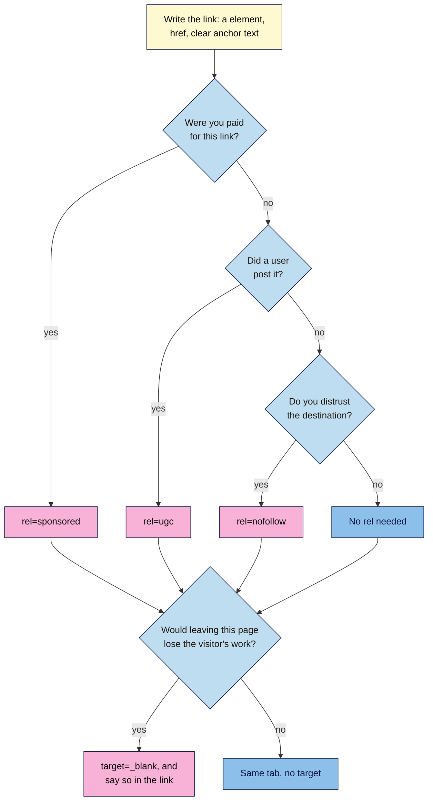
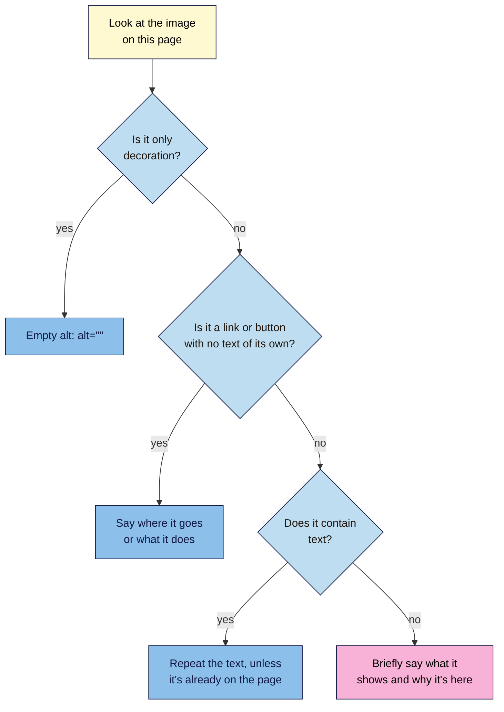

# M02.L05 — Links & Images: href, alt, title and New Tabs
> After this lesson you can write links search engines can follow, add images with useful alt text, and decide when `rel`, `target="_blank"` and `title` are worth adding.

**Time:** ~18 min reading + ~30 min hands-on + ~10 min exercise · **Level:** L1 Foundation (beginner) · **Prereqs:** M02.L04 · **Remediate to:** M02.L03; Web Development 101 M02.L02 (text, links, images and media)
**Verified against:** Google Search Central "Link best practices for Google", "Qualify outbound links", "Google image SEO best practices", "Spam policies", "Lazy loading" and "SEO Starter Guide"; MDN `<a>`, ``, `rel`, `noopener`, `title` and "Creating links" pages; W3C WAI alt decision tree, "Decorative images" and "Functional images"; WebAIM "Alternative text"; WCAG 2.2 "Link purpose (in context)" and technique G201; the W3C Nu HTML Checker (this lesson's code examples were run through it) on 2026-11-06. The DevTools steps in Part E weren't run in a live browser for this draft.

> ⚠️ **Freshness flag:** HTML's link and image rules change slowly. Google's advice on `rel` values and image SEO can change, so re-check the claims table before publishing.

## Learning objectives
1. **Write** crawlable links with descriptive anchor text, and tell internal links from external ones. *(O1)*
2. **Add** images with useful alt text, dimensions and sensible file names. *(O2)*
3. **Decide** when to use `rel` values, `target="_blank"` and the `title` attribute, and when to leave them out. *(O3)*

## Why it matters
Tomás takes over his family shop's site from an agency. Every product link says "Click here", every photo is called something like `IMG_4482.jpg` with no alt text, and the "Shop all" button is a script that works fine with a mouse. Each one looks harmless. But links are how people and search engines move through a site, and alt text is how an image reaches anyone who can't see it. Google can't reliably follow that button, and a screen reader may just read out the file name. None of these problems shows up by looking at the page, so you need to read the code.

## Core concept
**Plain version:** a link is a real `<a>` element with an address in `href` and clear words between the tags. An image is an `` element with a file address in `src` and a text replacement in `alt`. Most of what can go wrong sits in those few parts.

**Analogy:** think of signposts in a town. A good sign says "Railway station", not "Click here", and it's fixed to a real post. A link painted on a wall looks like a sign, but a delivery driver's map doesn't include it. Alt text is like describing a photo to a friend over the phone: you say what matters, not every detail.

**Precise definitions:**
- **Anchor text** (or link text) is "the text part of a link that you can see" (Google).
- **Internal links** point to another page on your own site. **External links** point to a different site.
- **Alt text** is "a textual replacement for the image" (MDN). Google calls it "a short, but descriptive piece of text that explains the relationship between the image and your content."

### The parts of a link

```html
<a href="/cold-brew-guide">cold brew guide</a>
```

| Part | In the example | What it does |
|---|---|---|
| `<a>` | The element | Makes a link |
| `href` | `/cold-brew-guide` | "The URL that the hyperlink points to" (MDN) |
| Anchor text | `cold brew guide` | Tells people and search engines what's at the other end |

An `href` can be written in three ways:

| Type | Example | Use it for |
|---|---|---|
| Absolute | `https://nilacoffee.example/shop` | External links. Always include `https://` |
| Root-relative | `/shop` | Internal links on a live site. The root is the top level of your site, so this works from any page. It won't work on files opened from your computer |
| Relative | `french-press.html` | Files next to the current page, as in your practice folder |

**Crawlable links:** "Generally, Google can only crawl your link if it's an `<a>` HTML element … with an `href` attribute."

| Code | Can Google follow it? |
|---|---|
| ✅ `<a href="/shop">Shop all beans</a>` | Yes |
| ✅ `<a href="https://example.com">Example</a>` | Yes |
| ❌ `<a onclick="goto('/shop')">Shop</a>` | Not reliably: there's no `href` |
| ❌ `<span onclick="location.href='/shop'">Shop</span>` | Not reliably: it isn't a link |
| ❌ `<a href="javascript:goTo('shop')">Shop</a>` | Not reliably: `href` holds a script, not an address |

**Anchor text:** "Good anchor text is descriptive, reasonably concise, and relevant to the page that it's on and to the page it links to." MDN adds that link text should say where the link goes "even out of context", because "Screen reader users like jumping around from link to link on the page, and reading links out of context."

| Weak | Why | Better |
|---|---|---|
| `Click here` to see our guide | Says nothing about the destination | See our `cold brew guide` |
| `Read more` | Means nothing out of context | `Read more about the House Blend` |
| `best coffee beans India buy cheap coffee` | Keyword stuffing | `Shop our coffee beans` |

### The parts of an image

```html

```

| Part | What it does | Good practice |
|---|---|---|
| `src` | Gives the image's address | Use a file name that's "short, but descriptive": `my-new-black-kitten.jpg` beats `IMG00023.JPG` (Google) |
| `alt` | Replaces the image for screen readers, and when it fails to load | Write what the image adds to this page |
| `width`, `height` | Give the image's real size in pixels | They let the browser reserve the space, "reducing or even preventing a layout shift" (MDN), which is the page jumping as images load |

`` is a void element, as you saw in Lesson 2.3, so it has no closing tag.

Use a real `` for any image you want found in search: "Google doesn't index CSS images." A CSS image is one added by the stylesheet as a background, not with an `` in the HTML. Google also says to place images "near relevant text".

### Three optional extras
- **`rel`** describes your relationship with the link's destination. Google's default is simple: for regular links, "you don't need to add a `rel` attribute."
  - `rel="sponsored"`: "advertisements or paid placements". Google's test is whether "you were paid in some way for the link", so this course also marks affiliate links, which earn you a commission on sales.
  - `rel="ugc"`: user-generated content "such as comments and forum posts".
  - `rel="nofollow"`: when "other values don't apply, and you'd rather Google not associate your site with, or crawl the linked page from, your site".
- **`target="_blank"`** opens a link in a new tab. It "implicitly provides the same `rel` behavior as setting `rel="noopener"`" in modern browsers, so you don't need to add that for safety. The real cost is confusion: people using screen readers, or with cognitive concerns, "may be confused when a new tab, window, or application opens unexpectedly" (MDN). If you use it, say so in the link, as in `Wikipedia (opens in new tab)`. W3C treats this warning as good practice, not as a strict requirement.
- **`title`** adds a tooltip. MDN says its use is "highly problematic" for touch, keyboard and screen reader users, and on images it's "not an acceptable substitute for the `alt` attribute". Leave it out. (Its main use is on an `<iframe>`, which you'll meet in Lesson 2.7. It's a different thing from the `<title>` element.)

### What this does for search

| Claim | Verdict | What the source says |
|---|---|---|
| Important pages need internal links | **Documented** | "Every page you care about should have a link from at least one other page on your site." |
| There's an ideal number of links per page | **False** | "There's no magical ideal number of links a given page should contain. However, if you think it's too much, then it probably is." |
| External links lose you ranking power, so nofollow them all | **False** | External links "can help establish trustworthiness (for example, citing your sources)". Use `nofollow` "only when you don't trust the source, and not for every external link on your site" |
| Paid links must be marked | **Documented** | "If you were paid in some way for the link, qualify these links with `sponsored` or `nofollow`." Paid links are "not a violation of our policies" when they're marked this way. Module 9 covers link schemes |
| `nofollow` keeps a page out of Google | **False** | Such links "will generally not be followed", but the linked pages "may still be crawled" if they're found in other ways |
| Stuff keywords into alt text | **Don't** | It "results in a negative user experience and may cause your site to be seen as spam" |
| Alt text on a linked image counts | **Documented** | "Google uses the `alt` attribute of the `img` element as anchor text" |
| The `title` attribute helps SEO | **Not in Google's docs** | The only mention we found is as a last resort: Google "can use the `title` attribute as anchor text if the `<a>` element is for some reason empty" |
| Opening links in new tabs helps or hurts SEO | **Not in Google's docs** | Neither page on links mentions it. Decide based on your readers |

## How it works
Two decisions come up every time. First, the link.


**In words:** always start with a real `<a>`, an `href` and clear anchor text. Add `rel="sponsored"` if you were paid, `rel="ugc"` if a user posted the link, and `rel="nofollow"` if you don't trust the destination. Otherwise, add no `rel`. Then ask whether leaving the page would lose the visitor's work, such as a half-filled form. If so, open a new tab and say so in the link. If not, use the same tab. Most links end at "no `rel`, same tab".

Second, the alt text. This is a short version of W3C's decision tree, which itself "does not cover all cases".


**In words:** decorative images get an empty `alt=""`, so screen readers skip them. If an image is a link or button with no text of its own, the alt text says where it goes or what it does. If the image contains text, repeat that text, unless it's already on the page nearby. Otherwise, write a brief description of what the image shows and why it's here. Never leave `alt` out completely, because "some screen readers will announce the file name of the image instead" (W3C).

> **Under the hood: how a crawler uses a link.** When Googlebot reads a page, it pulls out the `href` of each `<a>`, turns it into a full address, and adds that to its list of pages to visit (Lesson 1.4). Google says it "does not interact with your page". So a script that only runs on a click isn't a link at all from the crawler's side, even though a visitor with a mouse never notices. JavaScript isn't the problem by itself: links a script adds to the page are fine, as long as they're real `<a href>` links.

## Hands-on walkthrough
You'll add a link and an image to your article, practise on some examples, then inspect a live page. Nila Coffee's values are illustrative.

**Before you start: which steps apply to you?**
- **All paths:** do Parts A to D. They use your `seo-101-html` folder and this lesson's examples, and don't touch any website.
- **Path A or C:** in Part E, use your project site. Path C needs no logins, because the code is public.
- **Path B on Blogger:** in Part E, use one of your blog posts, and add an image to it first if it has none.

**Part A — Add two links (7 min)**
1. Save your fixed French press page from Lesson 2.4 as `french-press.html` in your `seo-101-html` folder. If you didn't keep it, copy `article.html` and rename the copy.
2. Open `article.html`. Below the paragraph under `<h3>Warm</h3>`, add an internal link:
   ```html
   <p>Prefer it hot from the start? Try our <a href="french-press.html">French press guide</a>.</p>
   ```
3. At the end of the `<h2>How long it keeps</h2>` section, add an external link:
   ```html
   <p>You can read more about <a href="https://en.wikipedia.org/wiki/Cold_brew_coffee">cold brew coffee on Wikipedia</a>.</p>
   ```
4. Save, reload and click both links.
   **Expected:** each link is underlined, and blue or purple. The first opens your French press page and the second opens Wikipedia, both in the same tab. Use the browser's Back button to return.

**Part B — Add an image (8 min)**
1. Make a folder called `images` inside `seo-101-html`.
2. Pick any photo of your own, even a quick phone photo of a drink. Copy it into `images`, and rename the copy `cold-brew-jar.jpg`. If it's a PNG, use `.png` throughout.
3. Find its real size in pixels. **Windows:** right-click the file, then choose **Properties > Details**. **Mac:** select it in Finder and press **Cmd+I**, then look under **More Info**.
4. Below your first paragraph, add this line, using your real numbers and a description of your photo:
   ```html
   
   ```
5. Save and reload.
   **Expected:** the photo appears at the size you gave. A large photo may spill off the screen. That's fine for now: Lesson 2.10 makes images fit.
6. Change `src` to `images/oops.jpg`, then save and reload.
   **Expected:** your alt text where the image should be, usually with a broken-image icon. Browsers differ a little. This is what the alt text is for.
   > 🖼️ **Image prompt:** A browser window (1280×720) showing the cold brew article with a broken-image icon and the alt text "A glass jar of cold brew coffee in a fridge" in its place. Highlight the alt text with a 3px #F9B2D7 outline; blur any personal details.
   > **Alt text:** A web page with a broken image, showing the image's alt text in its place.
7. Put `src` back. Now delete the whole `alt="…"` part, and paste your code into `https://validator.w3.org/nu/#textarea`.
   **Expected:** one error: *An "img" element must have an "alt" attribute, except under certain conditions.*
8. Put the `alt` back and check again.
   **Expected:** "Document checking completed. No errors or warnings to show."

**Part C — Rewrite five weak anchors (5 min)**
In a note, rewrite the link in each sentence. The linked words are in square brackets.
1. [Click here] to see our cold brew guide.
2. Our shipping rates are [here].
3. [https://nilacoffee.example/returns]
4. House Blend: rich and chocolatey. [Read more]
5. [best cold brew coffee recipe easy cold brew at home cold brew guide]

**Expected**, or something close:
1. See our [cold brew guide].
2. See our [shipping rates].
3. Read our [returns policy].
4. [Read more about the House Blend].
5. Try our [cold brew recipe].

**Part D — Write alt text for three images (5 min)**
Use the second flowchart. Write the `alt` for each of these Nila Coffee images.
1. A photo on the shop page showing a 250 g bag of House Blend beside a cup of coffee.
2. A thin leaf pattern used as a divider between sections.
3. The Nila Coffee logo at the top of every page, which links to the homepage.

**Expected**, or something close:
1. `alt="A 250 g bag of Nila Coffee House Blend beside a cup of black coffee"`
2. `alt=""`, because it's decoration.
3. `alt="Nila Coffee home"`, because the image is the link, so the alt says where it goes. W3C's own example is `alt="W3C home"`. WebAIM says "home" often isn't needed, so `alt="Nila Coffee"` is fine too. "Logo" adds nothing.

**Part E — Inspect a live link and image (5 min)**
1. Open a blog post or inner page on your project site in Chrome or Edge.
2. Right-click a link in the main text and choose **Inspect**.
   **Expected:** the **Elements** panel opens with that `<a>` highlighted. Read its `href`, its anchor text and any `rel` or `target`.
   > 🖼️ **Image prompt:** Chrome DevTools Elements panel (1280×720) docked beside a blog post, with a link's `<a>` element selected and its href and anchor text visible. Highlight the selected element with a 3px #F9B2D7 outline; blur any personal details.
   > **Alt text:** DevTools Elements panel with a link's code selected beside the page it belongs to.
3. Do the same for an image. If you land on a `<div>` with `background-image`, it's a CSS image, which Google doesn't index.
4. *(Optional)* To list images with no `alt` at all, open the **Console** as in Lesson 2.4, type this on one line and press **Enter**:
   ```js
   document.querySelectorAll('img:not([alt])').forEach(i => console.log(i.src))
   ```
   **Expected:** one address per image with no `alt`, then `undefined`. If only `undefined` appears, every image has an `alt`. Whether each one is any *good* is your call.
5. Add a tab called **Link & image check** to your "SEO 101 project" sheet and fill it in.

   | Check | Nila Coffee cold brew guide (illustrative) |
   |---|---|
   | Link checked | "Read more" to the House Blend page |
   | Real `<a>` with `href`? | Yes |
   | Internal or external? | Internal |
   | Anchor text clear out of context? | No: change to "Read more about the House Blend" |
   | `rel` or `target` used? Needed? | `target="_blank"`: not needed |
   | Image checked | `IMG_4482.jpg` |
   | Real ``? | Yes |
   | Alt text | Missing |
   | `width` and `height` set? | No |
   | File name descriptive? | No |

6. Don't fix anything yet, unless it's a quick alt text change on your own site. Path C: change nothing. Module 4 covers internal linking and image SEO in more depth.

**Expected output:** an `article.html` with two links and an image that passes the checker, your rewrites and alt text, and a **Link & image check** tab.

## When to use / when not to
**Use an internal link when** another page of yours would help the reader next. **Use an external link when** you're citing a source or sending people somewhere truly useful.

**Use `rel` only when one of its three cases applies.** Most links need none. **Use a new tab only when** leaving would lose the visitor's work, such as a help link inside a form. **Leave `title` out** of links and images.

**On a platform,** you rarely write this code yourself. In WordPress, an image's settings include a field for alt text, and the link settings handle new tabs. For Blogger, see the "Make your images searchable" section of Blogger Help. Your **SEO access** tab from Lesson 2.2 shows what else you can reach. Check the result with Part E.

**The trade-off:** a new tab keeps a visitor on your site, but it takes that choice away from them and can confuse people. They can always open a new tab themselves, so the default should be the same tab.

## Use AI for this
**Example prompt:**
> "Here are the images on my page, each with what it shows and what it's for: [list]. Using W3C's alt decision tree, write alt text for each, or say it should be empty. Keep each to a few words or one short sentence. Don't add keywords that aren't really in the image."

**What AI does well here:** applying a decision tree the same way across many images, and rewriting weak anchors.
**Where it gets it wrong:** it describes images it can't see, adds keywords, starts with "Image of", and may say all external links need `nofollow` or that `title` helps SEO.
**How to check:** close your eyes and read the alt text alone: does it give the same information as the image? Compare any SEO claim with the table in this lesson.

## Common mistakes
- **"Click here" and "Read more".** These words say nothing about the destination.
- **Buttons built from scripts.** If you need a link, use `<a href>`, then style it to look like a button.
- **Leaving out `alt`.** Use `alt=""` for decoration, and never leave the attribute out.
- **Describing decoration.** "Green leaf" on a divider just adds noise for screen reader users.
- **Stuffing alt text.** Google warns this "may cause your site to be seen as spam".
- **Starting alt text with "Image of".** This is redundant, because "screen readers already announce 'graphic'" (WebAIM).
- **Copying alt text into `title`.** Some screen readers may then "announce the same text twice" (MDN).
- **Adding `nofollow` to every external link.** Google says not to.
- **Forgetting to mark affiliate links.** Paid links need `rel="sponsored"` or `nofollow`.
- **Opening every link in a new tab.** Keep it for when leaving would cost the visitor something.

## Troubleshooting
| Symptom | Likely cause | Fix |
|---|---|---|
| A broken-image icon appears | The path or file name doesn't match exactly | Check the folder, spelling, capitals and extension. Hosted sites often treat `Jar.jpg` and `jar.jpg` as different files |
| A link says the file can't be found | The `href` is mistyped, starts with `/`, or the file is in another folder | Check that `french-press.html` sits next to `article.html`, and use `href="french-press.html"` |
| An external link opens a broken address | `https://` is missing, so the browser treats it as a local file | Use the full address |
| The image looks stretched | `width` and `height` don't match its real shape | Use the file's real numbers |
| The image is enormous | It's a large file with its real size set | Fine for now. Lesson 2.10 makes images fit, and Module 4 covers file size |
| **Inspect** selects a `<div>` or `<span>` | A layer sits on top, or it isn't a real link or image | Look inside the highlighted element, then check for `background-image` or `onclick` |
| The checker passes but the links are poor | It checks rules, not quality | Use the tables and flowcharts in this lesson |

## Exercise
**Task:** complete your **Link & image check** tab (Part E). Then fix this planted page. Find all eight problems and get it through the checker with no errors. Invent sensible file names and alt text where you need to.

```html
<!DOCTYPE html>
<html lang="en">
  <head>
    <meta charset="utf-8">
    <title>Our Beans: Fresh Roasted Coffee | Nila Coffee</title>
  </head>
  <body>
    <h1>Our Beans</h1>
    
    <p>Our best seller is the House Blend. <a href="house-blend.html" target="_blank">Click here</a> to read more.</p>
    <p><span onclick="location.href='shop.html'">Shop all beans</span></p>
    
    
    <p>We earn a commission on this grinder: <a href="https://partner.example/grinder">see the Hand Grinder</a>.</p>
  </body>
</html>
```

**Expected outcome:** a complete tab, and these eight fixes:
1. Add useful `alt` text to the first image, along with `width` and `height`.
2. Rename `IMG_4482.jpg` to something descriptive, such as `house-blend-bag.jpg`.
3. Replace "Click here" with anchor text that names the destination.
4. Remove `target="_blank"` from that internal link.
5. Replace the `<span>` with a real link: `<a href="shop.html">Shop all beans</a>`.
6. Empty the divider's alt: `alt=""`.
7. Rewrite the grinder's alt without stuffing, such as `alt="A steel hand coffee grinder on a kitchen counter"`, and delete its `title`.
8. Add `rel="sponsored"` to the commission link.

The checker reports only the missing `alt`. The page's other problems are all valid HTML, so you have to catch them yourself.

**Stretch goal:** pick a page on your project site that matters to you. Does any other page link to it with clear anchor text? If not, note where a link could go.

## Key takeaways
- A crawlable link is an `<a>` with an `href`, and good anchor text makes sense out of context.
- Every `` needs `alt`: useful words for images that matter, and `alt=""` for decoration.
- Set `width` and `height`, and use short, descriptive file names.
- Most links need no `rel`. Use `sponsored` for paid links, `ugc` for user-posted links and `nofollow` when you don't trust the destination.
- Keep links in the same tab unless leaving would cost the visitor something, and leave `title` out.

## Teach it back
Explain to a friend in 3 sentences why a button that works perfectly with a mouse might still not be a link to Google, and how you'd check.

## Glossary terms added
- Alt text — added to `seo-101/glossary.md`
- Anchor text — added to `seo-101/glossary.md`
- Crawlable link — added to `seo-101/glossary.md`
- Decorative image — added to `seo-101/glossary.md`
- Internal and external links — added to `seo-101/glossary.md`
- `rel` attribute (`sponsored`, `ugc`, `nofollow`) — added to `seo-101/glossary.md`
- `target="_blank"` — added to `seo-101/glossary.md`

## Further reading
*All checked 2026-11-06.*
- Google Search Central — Link best practices for Google: https://developers.google.com/search/docs/crawling-indexing/links-crawlable
- Google Search Central — Qualify outbound links: https://developers.google.com/search/docs/crawling-indexing/qualify-outbound-links
- Google Search Central — Google image SEO best practices: https://developers.google.com/search/docs/appearance/google-images
- Google Search Central — Spam policies (link spam): https://developers.google.com/search/docs/essentials/spam-policies
- Google Search Central — Fix lazy-loaded content: https://developers.google.com/search/docs/crawling-indexing/javascript/lazy-loading
- Google Search Central — SEO Starter Guide: https://developers.google.com/search/docs/fundamentals/seo-starter-guide
- MDN — `<a>`: https://developer.mozilla.org/en-US/docs/Web/HTML/Reference/Elements/a
- MDN — ``: https://developer.mozilla.org/en-US/docs/Web/HTML/Reference/Elements/img
- MDN — `rel`: https://developer.mozilla.org/en-US/docs/Web/HTML/Reference/Attributes/rel
- MDN — `noopener`: https://developer.mozilla.org/en-US/docs/Web/HTML/Reference/Attributes/rel/noopener
- MDN — `title` attribute: https://developer.mozilla.org/en-US/docs/Web/HTML/Reference/Global_attributes/title
- MDN — Creating links: https://developer.mozilla.org/en-US/docs/Learn_web_development/Core/Structuring_content/Creating_links
- W3C WAI — An alt decision tree: https://www.w3.org/WAI/tutorials/images/decision-tree/
- W3C WAI — Decorative images: https://www.w3.org/WAI/tutorials/images/decorative/
- W3C WAI — Functional images: https://www.w3.org/WAI/tutorials/images/functional/
- WebAIM — Alternative text: https://webaim.org/techniques/alttext/
- W3C — WCAG 2.2 Understanding Link Purpose (In Context): https://www.w3.org/WAI/WCAG22/Understanding/link-purpose-in-context.html
- W3C — WCAG technique G201, warning about new windows: https://www.w3.org/WAI/WCAG22/Techniques/general/G201
- Blogger Help — Help people find your blog on search engines: https://support.google.com/blogger/answer/41373
- W3C Nu HTML Checker: https://validator.w3.org/nu/

> ⚠️ **May change:** Google's `rel` guidance, its supported image formats, the checker's messages, and WordPress and Blogger settings.

## Refresher card
*Used by remediation when a learner fails a quiz twice on a later lesson that points back here.*
**Link:** `<a href="…">clear anchor text</a>`. Google can only reliably crawl an `<a>` with an `href`, not a script on a `<span>`. **Anchor text** should be descriptive, concise and clear out of context; avoid "Click here". **Internal** = your site; **external** = another site. **Image:** ``, with a short, descriptive file name. **Alt:** describe what the image adds; a linked image says where it goes; `alt=""` for decoration; never leave `alt` out or stuff it. Google doesn't index CSS images. **`rel`:** none by default; `sponsored` for paid links, `ugc` for user-posted links, `nofollow` for links you don't trust. **`target="_blank"`:** only when leaving would lose the visitor's work, and say so in the link. **`title`:** leave it out.
