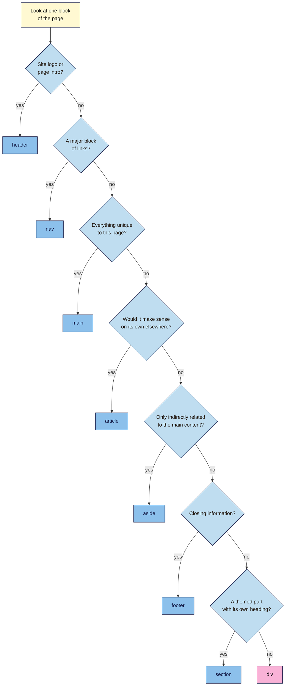

# M02.L06 — Semantic HTML for Content: article, header, nav, section, footer
> After this lesson you can replace generic `<div>` containers with the right semantic elements, say honestly what that does for search, and map the landmarks of any live page.

**Time:** ~16 min reading + ~30 min hands-on + ~10 min exercise · **Level:** L1 Foundation (beginner) · **Prereqs:** M02.L04, M02.L05 · **Remediate to:** M02.L04; Web Development 101 M02.L03 (semantic HTML and heading structure)
**Verified against:** MDN pages for `<article>`, `<section>`, `<header>`, `<footer>`, `<nav>`, `<main>`, `<aside>`, `<div>`, `<search>`, "Semantics" and "Accessibility tree"; W3C WAI "Page regions" and ARIA Authoring Practices "Landmark regions"; the WHATWG HTML Standard (sections); Google Search Central "SEO Starter Guide" and "Creating helpful, reliable, people-first content"; WebAIM Screen Reader User Survey #11; Gutenberg source code (Group block); the W3C Nu HTML Checker (this lesson's code examples were run through it) on 2026-11-06. The Console command in Part D wasn't run in a live browser for this draft, but it gave the expected output in jsdom, a browser simulator.

> ⚠️ **Freshness flag:** these elements have been stable for years. Google's documentation doesn't mention them, and its public comments on them date from 2021–2023, so re-check that row before publishing.

## Learning objectives
1. **Replace** generic `<div>` containers with the right semantic elements. *(O1)*
2. **Explain** how semantic structure helps screen readers and machines, and what Google does and doesn't say about it. *(O2)*
3. **Map** the landmarks of a real page from your project site. *(O3)*

## Why it matters
One of Kavya's yoga students uses a screen reader. Every page on Kavya's site starts with 30 menu links, and the student has to get past them on every visit to reach the class times. The page looks tidy, but under the surface it's all `<div>`s, so nothing marks where the menu ends and the content begins. A few different elements would let the student jump straight there. Those same elements also make a page easier for you to audit, because the code tells you what each part is. This lesson shows you what to use, and it's honest about what it will and won't do for your rankings.

## Core concept
**Plain version:** Lesson 2.4 labelled small pieces of text as headings and lists. This lesson labels the big blocks of a page: the top, the menu, the main content, the sidebar and the bottom. A `<div>` says nothing about what's inside it. A `<nav>` says "these are the main links". **Semantic** just means "to do with meaning".

**Analogy:** think of a newspaper page. You know the title at the top, the contents strip, the main story, the side column and the small print at a glance, because each one has its place. A page of `<div>`s is that newspaper with all the layout removed, so a reader has to work out what's what line by line.

**Precise definition:** a **semantic element** gives its content a role or meaning (MDN). Some of these elements create **landmarks**, which let screen readers "provide keyboard navigation to important sections of a page" (W3C).

### The elements

| Element | What it's for | Screen readers call it | Good to know |
|---|---|---|---|
| `<header>` | Content that's "introductory", such as the logo and menu | banner, when it's the page's header | Inside `<article>`, `<section>` or `<main>`, it's no longer a landmark |
| `<nav>` | A "major block of navigation links" | navigation | "It's not necessary for all links to be contained in a `<nav>`" |
| `<main>` | The page's "dominant content" | main | "A document mustn't have more than one" visible `<main>`. Leave out repeated items such as sidebars and site logos |
| `<article>` | A "self-contained composition": a blog post, a product card, a comment | Not a landmark | Should have a heading. Ask: would this make sense on its own, somewhere else? |
| `<section>` | A themed part of a page, with a heading | region, but only if it has a label | "If you are only using the element as a styling wrapper, use a `<div>` instead" |
| `<aside>` | Content "only indirectly related" to the main content, such as a sidebar | complementary | Not for content the page needs |
| `<footer>` | Closing information: author, copyright, related links | contentinfo, when it's the page's footer | Inside `<article>` or `<section>`, it's no longer a landmark |
| `<div>` | A "generic container" | Nothing | Use it "only when no other semantic element … is appropriate". It's still the right tool for styling |

There's also a newer element, `<search>`, for search forms. It creates a search landmark.

A typical blog post page looks like this:

```text
body
├── header          logo and site name
│   └── nav         main menu
├── main
│   ├── article     the post
│   │   ├── h1
│   │   ├── section   h2 and its content
│   │   └── section   h2 and its content
│   └── aside       related posts
└── footer          copyright, legal links
```

Three rules catch most mistakes:
1. **Use one `<main>`** that holds what's unique to this page.
2. **Label a `<nav>` if there's more than one.** "If a page includes more than one `navigation` landmark, each should have a unique label." Use `aria-label`, a name that screen readers read out but the page doesn't show: `<nav aria-label="Main">`. Don't put "navigation" in the label, or a screen reader says "Main navigation navigation".
3. **`<section>` doesn't change heading levels.** Old tutorials say each section can start again with an `<h1>`. It can't: headings "have a heading level given by the number in their name" (WHATWG). Keep the outline from Lesson 2.4.

`<section>` is optional. Headings already divide an article, so plain `<h2>`s with no `<section>` are fine too. This lesson uses it so you can practise.

### What this does for search and for people

| Claim | Verdict | What the source says |
|---|---|---|
| Semantic elements help screen reader users | **Documented** | Landmarks give "keyboard navigation to important sections of a page" |
| Google's documentation recommends these elements | **Not in Google's docs** | We checked the Starter Guide, the helpful content guide and the pages on title links and snippets, and none of them mention `<article>`, `<main>` or `<nav>`. The closest line is "Google Search can rarely depend on semantic meanings hidden in the HTML specification" |
| Semantic elements boost your rankings | **No, by Google's public comments** | John Mueller: "It's not a ranking factor, but it can help our systems to understand your content better." And "The `<article>` HTML element does not have any particular effect in Google Search." (2023, reported by a third party) |
| Semantic HTML is a quality signal | **No, by Google's public comments** | Mueller: "I don't see it as a quality signal, but it definitely helps us to better understand pages" (2021, reported by a third party) |
| `<main>` tells Google what your "main content" is | **Not in Google's docs** | Google defines main content as "any part of the web page that directly helps the page achieve its purpose". That's a description of the content, not of the HTML element |
| Screen reader users rely on landmarks as much as on headings | **Not in the survey data** | In WebAIM's 2026 survey, 28.3% of respondents use landmarks always or often, but only 3.4% start with them on a long page. For headings, it's 67.8% |

**A source conflict worth noticing:** MDN's Semantics glossary page says search engines treat semantic markup's contents "as important keywords to influence the page's search rankings". MDN is an excellent HTML reference, but on how Google ranks pages, Google's own statements carry more weight. So don't sell semantic HTML to a client as a ranking boost. Use it because it's better for readers and easier to audit, and because Google says it can aid understanding.

## How it works
Use this flow for each block on a page. Stop at the first "yes".


**In words:** work down the questions and stop at the first "yes". The site logo or a page intro is a `<header>`. A major block of links is a `<nav>`. The wrapper around everything unique to this page is `<main>`. Inside it, something that makes sense on its own is an `<article>`, and something only indirectly related is an `<aside>`. Closing information is a `<footer>`. A themed part with its own heading is a `<section>`. Anything else, including a box that's only there for styling, stays a `<div>`.

> **Under the hood: the accessibility tree.** Browsers build an "accessibility tree" from your HTML for assistive technology, meaning tools such as screen readers. It records each element's role (what it is) and name. `<nav aria-label="Main">` appears there as navigation "Main". A plain `<div>` has no role to report. That's why you can't see semantic HTML by looking at a page: both versions can look identical. Web Development 101 M02.L03 shows how to view this tree in DevTools.

## Hands-on walkthrough
You'll convert a page, apply the same structure to your article, test it, then map a live page. Nila Coffee's values are illustrative.

**Before you start: which steps apply to you?**
- **All paths:** do Parts A, B and C. They use files in your `seo-101-html` folder and don't touch any website.
- **Path A or C:** in Part D, use your project site. Path C needs no logins, because the code is public.
- **Path B on Blogger:** in Part D, use one of your blog posts.

**Part A — Convert a "div soup" page (10 min)**
1. Save this page as `story.html` in your `seo-101-html` folder.

   ```html
   <!DOCTYPE html>
   <html lang="en">
     <head>
       <meta charset="utf-8">
       <title>Our Story | Nila Coffee</title>
     </head>
     <body>
       <div class="top">
         <div class="logo"><a href="index.html">Nila Coffee</a></div>
         <div class="menu">
           <ul>
             <li><a href="shop.html">Shop</a></li>
             <li><a href="guides.html">Brew guides</a></li>
             <li><a href="about.html">About</a></li>
           </ul>
         </div>
       </div>
       <div class="content">
         <div class="post">
           <h1>Why We Roast in Small Batches</h1>
           <p>Small batches let us taste every roast before it ships.</p>
           <div class="part">
             <h2>What a small batch means</h2>
             <p>We roast 5 kg at a time, about 20 bags.</p>
           </div>
           <div class="part">
             <h2>Why it tastes better</h2>
             <p>Beans reach you within a week of roasting.</p>
           </div>
         </div>
         <div class="side">
           <h2>Try it yourself</h2>
           <p>Our <a href="shop.html">House Blend</a> starts at ₹499 / $6.</p>
         </div>
       </div>
       <div class="bottom">
         <p>© 2026 Nila Coffee</p>
       </div>
     </body>
   </html>
   ```

2. Paste it into `https://validator.w3.org/nu/#textarea` and click **Check**.
   **Expected:** a green message saying there are no errors or warnings (the exact wording can change). A page with no structure at all still passes. The checker can't tell you to use better elements.
3. Using the flowchart, replace each `<div>` with the right element. Change each closing tag too, and delete the `class` attributes you no longer need. The logo's `<div>` sits inside the header, so make it a `<p>`, and give the menu the label `aria-label="Main"`.
4. Compare your body with this one:

   ```html
   <body>
     <header>
       <p><a href="index.html">Nila Coffee</a></p>
       <nav aria-label="Main">
         <ul>
           <li><a href="shop.html">Shop</a></li>
           <li><a href="guides.html">Brew guides</a></li>
           <li><a href="about.html">About</a></li>
         </ul>
       </nav>
     </header>
     <main>
       <article>
         <h1>Why We Roast in Small Batches</h1>
         <p>Small batches let us taste every roast before it ships.</p>
         <section>
           <h2>What a small batch means</h2>
           <p>We roast 5 kg at a time, about 20 bags.</p>
         </section>
         <section>
           <h2>Why it tastes better</h2>
           <p>Beans reach you within a week of roasting.</p>
         </section>
       </article>
       <aside>
         <h2>Try it yourself</h2>
         <p>Our <a href="shop.html">House Blend</a> starts at ₹499 / $6.</p>
       </aside>
     </main>
     <footer>
       <p>© 2026 Nila Coffee</p>
     </footer>
   </body>
   ```

5. Save, reload the page and check it again.
   **Expected:** no errors or warnings, and the page looks almost exactly as it did. The change is in the meaning, not the design.

**Part B — Add structure to your article (8 min)**
1. Open `article.html`. Keep your content, and wrap it in this structure:

   ```html
   <body>
     <header>
       <p><a href="article.html">Nila Coffee</a></p>
       <nav aria-label="Main">
         <ul>
           <li><a href="article.html">Cold brew guide</a></li>
           <li><a href="french-press.html">French press guide</a></li>
         </ul>
       </nav>
     </header>
     <main>
       <article>
         <!-- your h1, first paragraph and image -->
         <section>
           <!-- What you need -->
         </section>
         <section>
           <!-- How to make it -->
         </section>
         <section>
           <!-- How to serve it, with its two h3s -->
         </section>
         <section>
           <!-- How long it keeps -->
         </section>
       </article>
       <aside>
         <!-- the French press link goes here -->
       </aside>
     </main>
     <footer>
       <p>© 2026 Nila Coffee</p>
     </footer>
   </body>
   ```

2. Move the "Prefer it hot from the start?" paragraph into the `<aside>`, and add `<h2>Prefer it hot?</h2>` above it. It's related to the article, but the article works without it.
3. Save, reload and check the code.
   **Expected:** no errors or warnings. Your heading levels haven't changed, and each `<section>` starts with its `<h2>`.

**Part C — Break it on purpose (4 min)**
Use `story.html` for these tests, and undo each change afterwards.
1. Delete the line `<h2>Why it tastes better</h2>` and check the code.
   **Expected:** a warning: *Section lacks heading. Consider using "h2"-"h6" elements to add identifying headings to all sections, or else use a "div" element instead for any cases where no heading is needed.* The checker's advice is the same as this lesson's.
2. Put the heading back. Change `<article>` to `<main><article>` and `</article>` to `</article></main>`, then check again.
   **Expected:** two errors, including *A document must not include more than one visible "main" element.*
3. Undo that change, and check that the page is clean.

**Part D — Map a live page's landmarks (8 min)**
1. Open a blog post or inner page on your project site in Chrome or Edge.
2. Open the **Console** (**Ctrl+Shift+J**, Mac: **Cmd+Option+J**), type this on one line and press **Enter**:

   ```js
   document.querySelectorAll('header,nav,main,article,section,aside,footer').forEach(e => console.log(e.tagName, e.getAttribute('aria-label') || ''))
   ```

   **Expected:** one line per element in page order, such as `NAV Main`, then `undefined`. If only `undefined` appears, the page has none of these elements, and that's a finding.
   > 🖼️ **Image prompt:** Chrome DevTools Console (1280×720) on a small blog post, listing elements such as "HEADER", "NAV Main", "MAIN", "ARTICLE" and "FOOTER" in page order. Highlight the list with a 3px #F9B2D7 outline; blur any personal details.
   > **Alt text:** DevTools Console listing a page's semantic elements in order, with the navigation's label.

3. Scroll through the page and match each item in the list to what you can see. To find one, right-click that part of the page and choose **Inspect**, then look at the elements around it.
4. Add a tab called **Landmark map** to your "SEO 101 project" sheet and fill it in.

   | Check | Nila Coffee cold brew guide (illustrative) |
   |---|---|
   | Page | Cold brew guide |
   | Page `<header>`? | Yes |
   | `<nav>` elements, and are they labelled? | 2, not labelled |
   | Exactly one `<main>`? | No: none |
   | `<article>` around the post? | Yes |
   | `<aside>` for side content? | No: the sidebar is a `<div>` |
   | Page `<footer>`? | Yes |
   | Lots of `SECTION`s with no clear purpose? | Yes: 6, added by the page builder |
   | Comes from the theme or from the content? | Theme and page builder |

5. Write one line under the table: what's the single most useful fix? For Nila Coffee, it's adding a `<main>`. Don't change anything yet. On most platforms, this structure comes from your theme, so your **SEO access** tab from Lesson 2.2 shows whether you can reach it.

**Expected output:** a semantic `story.html`, a structured `article.html` that passes the checker, and a **Landmark map** tab with one fix noted.

## When to use / when not to
**Use semantic elements when** you're building or changing a page's structure, or briefing a developer or theme change. They cost nothing extra, and the page is easier to work with afterwards.

**Don't use them when** you only need a box for styling: that's what `<div>` is for. And **don't rebuild a working site just for this.** Google's public comments say these elements aren't a ranking factor, so fix titles, content and indexing first. Treat a missing `<main>` as a useful accessibility fix, not an SEO emergency.

**On a platform,** your theme usually sets these elements, and you choose only the content inside them. In WordPress, the Group block has a setting for which HTML element it uses, and the default is `<div>`.

**The trade-off:** the right element takes a moment's thought, and a wrong one can be worse than a `<div>`. For example, a `<nav>` around every stray link adds noise to the landmark list. If you can't decide, a `<div>` does no harm.

## Use AI for this
**Example prompt:**
> "Here is the HTML of my page: [paste]. Without changing any visible text, replace `<div>` elements with semantic elements where they clearly fit. Keep `<div>` where the block is only for styling. Keep the heading levels as they are, and list each change you made and why."

**What AI does well here:** fast, repetitive conversion, and explaining each choice.
**Where it gets it wrong:** it may claim this boosts rankings, wrap everything in `<section>`, add a second `<main>`, reset headings to `<h1>`, add unnecessary `role` attributes such as `role="main"` on `<main>`, or quietly reword your text.
**How to check:** run the result through the checker, compare the visible text with your original, and review the outline. Read any SEO claim against the table in this lesson.

## Common mistakes
- **Using `<section>` as a styling wrapper.** With no heading, it should usually be a `<div>`.
- **Putting every link in a `<nav>`.** It's for major blocks of links, not a link in a sentence.
- **Two `<main>` elements.** A page must have only one visible `<main>`.
- **Restarting at `<h1>` in each section.** Sections don't change heading levels.
- **Putting the site header or footer inside `<main>`.** `<main>` holds only what's unique to this page.
- **Using `<aside>` for key content.** If the page needs it, it belongs in the main content.
- **Promising a client better rankings.** Google's public comments say it isn't a ranking factor.
- **Thinking `<div>` is bad.** It's the right tool when no other element fits.

## Troubleshooting
| Symptom | Likely cause | Fix |
|---|---|---|
| The page looks unchanged after your edits | That's normal: these elements add meaning, not design | Check the code, not the look |
| The page's layout broke on a real site | The theme's CSS targets the old `<div>` or its `class` | Keep the `class`, for example `<nav class="menu">` |
| The checker says "No "p" element in scope" | A block element such as `<nav>` sits inside a `<p>`, so the browser closed the `<p>` early | Move the block outside the `<p>`, or use a plain link |
| "Stray end tag" errors | An opening or closing tag still has the old name | Check that each opening tag matches its closing tag |
| "Section lacks heading" warning | A `<section>` has no heading | Add a heading, or use a `<div>` |
| The Console lists no `MAIN`, but the site seems well built | It may use a role instead, such as `<div role="main">` | Search the **Elements** panel for `role=`. A role creates the same landmark |
| The list shows dozens of `SECTION`s | A page builder wraps every block in one | Note it. Module 5 covers page builders |

## Exercise
**Task:** complete your **Landmark map** tab (Part D). Then fix this planted page. Find all seven problems, correct them and get it through the checker with no errors or warnings.

```html
<!DOCTYPE html>
<html lang="en">
  <head>
    <meta charset="utf-8">
    <title>Wholesale Coffee for Cafés | Nila Coffee</title>
  </head>
  <body>
    <div class="top">
      <p><a href="index.html">Nila Coffee</a></p>
      <div class="menu">
        <ul>
          <li><a href="shop.html">Shop</a></li>
          <li><a href="guides.html">Brew guides</a></li>
        </ul>
      </div>
    </div>
    <main>
      <h1>Wholesale Coffee for Cafés</h1>
      <p>We roast fresh beans for cafés across South India.</p>
    </main>
    <main>
      <section>
        <h1>How ordering works</h1>
        <p>Order by Monday, and your beans ship on Friday. Read our <nav><a href="terms.html">wholesale terms</a></nav> first.</p>
      </section>
      <section class="grey-box">
        <p>Every order is roasted to match.</p>
      </section>
      <p>© 2026 Nila Coffee</p>
    </main>
  </body>
</html>
```

**Expected outcome:** a complete tab, and these seven fixes:
1. Change `<div class="top">` to `<header>`.
2. Change `<div class="menu">` to `<nav aria-label="Main">`.
3. Merge the two `<main>` elements into one.
4. Change the second `<h1>` to `<h2>`, because a `<section>` doesn't restart the levels.
5. Remove the `<nav>` around the single link in the sentence.
6. Change `<section class="grey-box">` to `<div class="grey-box">`, because it's only a styled box with no heading.
7. Move the copyright line out of `<main>` into a `<footer>`.

The checker reports four of the seven (numbers 3, 4, 5 and 6). For number 4, it warns you to use `<h1>` "as a top-level heading only". It can't see that the two `<div>`s should be something better, or tell that the copyright is in the wrong place.

**Stretch goal:** run Part D on a competitor's page. Does its structure make it easier to skip to the content than yours?

## Key takeaways
- Semantic elements name the big blocks of a page: `header`, `nav`, `main`, `article`, `section`, `aside` and `footer`.
- Use one `<main>`, label multiple `<nav>`s, and remember that `<section>` doesn't change heading levels.
- `<div>` is fine when nothing else fits, and it's the right choice for styling boxes.
- Semantic HTML helps screen reader users and can help machines understand a page, but Google's public comments say it isn't a ranking factor.
- Headings still matter more than landmarks, so fix those first.

## Teach it back
Explain to a friend in 3 sentences what a landmark is, who it helps, and why you wouldn't sell it to a client as a ranking boost.

## Glossary terms added
- `aria-label` — added to `seo-101/glossary.md`
- `<div>` — added to `seo-101/glossary.md`
- Landmark — added to `seo-101/glossary.md`
- `<main>` — added to `seo-101/glossary.md`
- Semantic HTML — added to `seo-101/glossary.md`

## Further reading
*All checked 2026-11-06.*
- MDN — `<article>`: https://developer.mozilla.org/en-US/docs/Web/HTML/Reference/Elements/article
- MDN — `<section>`: https://developer.mozilla.org/en-US/docs/Web/HTML/Reference/Elements/section
- MDN — `<header>`: https://developer.mozilla.org/en-US/docs/Web/HTML/Reference/Elements/header
- MDN — `<footer>`: https://developer.mozilla.org/en-US/docs/Web/HTML/Reference/Elements/footer
- MDN — `<nav>`: https://developer.mozilla.org/en-US/docs/Web/HTML/Reference/Elements/nav
- MDN — `<main>`: https://developer.mozilla.org/en-US/docs/Web/HTML/Reference/Elements/main
- MDN — `<aside>`: https://developer.mozilla.org/en-US/docs/Web/HTML/Reference/Elements/aside
- MDN — `<div>`: https://developer.mozilla.org/en-US/docs/Web/HTML/Reference/Elements/div
- MDN — `<search>`: https://developer.mozilla.org/en-US/docs/Web/HTML/Reference/Elements/search
- MDN — Semantics: https://developer.mozilla.org/en-US/docs/Glossary/Semantics
- MDN — Accessibility tree: https://developer.mozilla.org/en-US/docs/Glossary/Accessibility_tree
- W3C WAI — Page regions: https://www.w3.org/WAI/tutorials/page-structure/regions/
- W3C WAI — ARIA Authoring Practices, Landmark regions: https://www.w3.org/WAI/ARIA/apg/practices/landmark-regions/
- WHATWG — HTML Standard, sections: https://html.spec.whatwg.org/multipage/sections.html
- Google Search Central — SEO Starter Guide: https://developers.google.com/search/docs/fundamentals/seo-starter-guide
- Google Search Central — Creating helpful, reliable, people-first content: https://developers.google.com/search/docs/fundamentals/creating-helpful-content
- WebAIM — Screen Reader User Survey #11: https://webaim.org/projects/screenreadersurvey11/
- W3C Nu HTML Checker: https://validator.w3.org/nu/

**Public comments (reported by third parties, not Google documentation):**
- Search Engine Journal on John Mueller and semantic HTML, 2023: https://www.searchenginejournal.com/semantic-html-not-a-ranking-factor-but-still-important/490436/
- Search Engine Journal on John Mueller and the `<article>` element, 2023: https://www.searchenginejournal.com/seo-and-article-semantic-html-element/494237/
- Search Engine Roundtable on John Mueller and semantic HTML as a quality signal, 2021: https://www.seroundtable.com/semantic-html-google-search-quality-signal-32464.html

> ⚠️ **May change:** Google's position, which rests on public comments and not documentation; the WebAIM figures; the checker's messages; WordPress block settings. The HTML Standard has also added a `headingoffset` attribute that can shift heading levels, which isn't covered here.

## Refresher card
*Used by remediation when a learner fails a quiz twice on a later lesson that points back here.*
**Semantic** = to do with meaning. **`<header>`** = logo and intro. **`<nav>`** = major blocks of links; label it with `aria-label` if there's more than one. **`<main>`** = what's unique to this page; only one. **`<article>`** = makes sense on its own. **`<section>`** = a themed part with a heading; it doesn't change heading levels. **`<aside>`** = only indirectly related. **`<footer>`** = closing information. **`<div>`** = no meaning, fine for styling. **Landmarks** let screen reader users jump to parts of a page. **Google:** its docs don't mention these elements, and its public comments say they're not a ranking factor, though they can help it understand a page. Map a page with the Console, and fix headings first.
