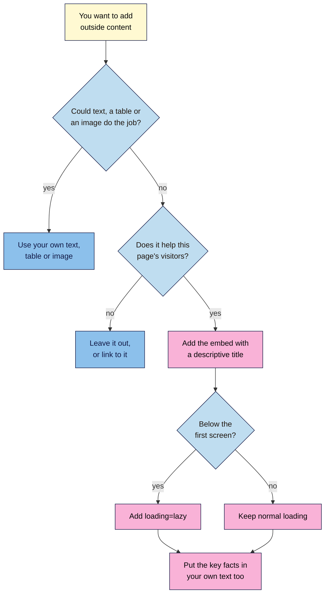

# M02.L07 — Tables, Blockquotes & Embeds
> After this lesson you can build an accessible data table, quote a source properly, and decide whether an embed is worth what it costs in speed, privacy and readable text.

**Time:** ~15 min reading + ~30 min hands-on + ~10 min exercise · **Level:** L1 Foundation (beginner) · **Prereqs:** M02.L06 · **Remediate to:** M02.L05; Web Development 101 M02.L02 (text, links, images and media)
**Verified against:** MDN pages for `<table>`, `<caption>`, `<th>`, `<thead>`, `<tbody>`, `<blockquote>`, `<q>`, `<cite>` and `<iframe>`; W3C WAI "Tables" tutorials; the WHATWG HTML Standard (`blockquote`, `cite`); Google Search Central "Video SEO best practices", "Spam policies" and "Creating helpful, reliable, people-first content"; web.dev "Best practices for using third-party embeds" and "It's time to lazy-load offscreen iframes!"; YouTube Help "Embed videos & playlists"; YouTube API Services "Required Minimum Functionality"; the W3C Nu HTML Checker (this lesson's code examples were run through it) on 2026-11-06. Embeds weren't tested in a live browser for this draft.

> ⚠️ **Freshness flag:** embed codes, privacy options and size figures change often. YouTube's embed rules and web.dev's numbers are the first things to re-check before publishing.

## Learning objectives
1. **Build** a data table with a caption and header cells. *(O1)*
2. **Mark up** quotations with `<blockquote>` and a visible source. *(O2)*
3. **Embed** a YouTube video or social post, and weigh what an embed adds against its cost in speed, privacy and text that search engines can read. *(O3)*

## Why it matters
Kavya posts her class timetable as a screenshot of a spreadsheet, her reviews as pasted Instagram posts, and a YouTube video at the top of every page. It looks lively. But a student on a phone has to pinch and zoom to read the timetable, a screen reader can't read it at all, and every page now loads code from other companies before anyone presses play. Tables, quotes and embeds are where a page's most useful content often sits, and they're easy to get wrong. With a few small habits, the content becomes real text that everyone can read, and each embed earns its place.

## Core concept
**Plain version:** use a **table** for data that has rows and columns. Use a **blockquote** for someone else's words, and show who said them. An **embed** is a window in your page showing content that lives on another site.

**Analogy:** a table is a train timetable: you find a time by reading across a row and down a column. A quotation is a quote in a newspaper, always with a name beside it. An embed is a TV on the wall of your shop: it's useful, but you don't own the channel, and it isn't part of your shop's own signs.

### Tables
A table "represents tabular data", meaning information in rows and columns (MDN). Use one when both directions matter, as in "the price of the Regular plan". A simple list of items is still a list.

```html
<table>
  <caption>Cold brew ratios for 1 litre of water</caption>
  <thead>
    <tr>
      <th scope="col">Strength</th>
      <th scope="col">Coffee</th>
      <th scope="col">Best for</th>
    </tr>
  </thead>
  <tbody>
    <tr>
      <th scope="row">Light</th>
      <td>80 g</td>
      <td>Drinking over ice</td>
    </tr>
    <tr>
      <th scope="row">Regular</th>
      <td>100 g</td>
      <td>Everyday cups</td>
    </tr>
    <tr>
      <th scope="row">Strong</th>
      <td>150 g</td>
      <td>Mixing with milk</td>
    </tr>
  </tbody>
</table>
```

| Element | What it does |
|---|---|
| `<table>` | Wraps the whole table |
| `<caption>` | "Functions like a heading for a table" (W3C). It must come first inside `<table>` |
| `<thead>`, `<tbody>` | Group the header rows and the data rows |
| `<tr>` | One table row |
| `<th>` | A header cell. `scope="col"` means it heads a column, and `scope="row"` means it heads a row |
| `<td>` | One data cell |

Why bother? "Header cells must be marked up with `<th>`, and data cells with `<td>` to make tables accessible" (W3C). A screen reader can then say which row and column a cell belongs to. W3C says to use `scope` when a table "has both column and row headings", as this one does.

**Don't use tables for layout.** "As a general rule, tables aren't meant to be used for layout purposes" (W3C). CSS handles layout. **Don't use a picture of a table either.** Its data can't be selected, searched or read by a screen reader.

### Quotations

```html
<blockquote cite="https://developers.google.com/search/docs/fundamentals/seo-starter-guide">
  <p>Break up long content into paragraphs and sections, and provide headings to help users navigate your pages.</p>
</blockquote>
<p>From the <a href="https://developers.google.com/search/docs/fundamentals/seo-starter-guide"><cite>SEO Starter Guide</cite></a>, Google Search Central.</p>
```

| Element | What it's for | Watch out for |
|---|---|---|
| `<blockquote>` | "An extended quotation" | Don't use it just to indent your own text. CSS does that |
| `<q>` | "A short inline quotation". Browsers add the quote marks | Don't type your own marks as well |
| `cite` attribute | The source's URL | It's "not for readers" (WHATWG), so you still need a visible source |
| `<cite>` element | "The title of a creative work" | It "must … not be used to mark up people's names" (WHATWG) |

Put the credit outside: "Attribution for the quotation, if any, must be placed outside the `blockquote` element" (WHATWG).

### Embeds
Most embeds use an `<iframe>`, which puts "another document into the current one" (MDN). A YouTube embed is one `<iframe>`. Some social platforms use a different pattern: a block of HTML plus a script that builds the post (observed practice, and it varies by platform). You'll see what yours does in Part D.

| Cost | What the source says | What to do |
|---|---|---|
| **Speed** | "Many popular embeds include over 100 KB of JavaScript, sometimes even going up to 2 MB" (web.dev). Every `<iframe>` "requires increased memory and other computing resources" (MDN) | Use few embeds. Add `loading="lazy"` to any that start below the first screen. On YouTube, web.dev says this saves around 500 KB on first load |
| **Privacy** | Embedded content comes from another company's servers. YouTube's Privacy Enhanced Mode "prevents the use of views of embedded YouTube content from influencing the viewer's browsing experience on YouTube" | Use `youtube-nocookie.com`, but don't call it tracking-free: YouTube Help doesn't say that. Mention embeds in your privacy policy |
| **Readable text** | What's said in a video isn't in your HTML | Put the key information in your own text |
| **Accessibility** | Without a `title`, people using screen readers "have to navigate into the `<iframe>` to determine what its embedded content is" (MDN) | Give each `<iframe>` a `title` that describes it |
| **Control** | The content lives on someone else's site | Accept that it can change or disappear, and keep key facts in your text |

### What this does for search

| Claim | Verdict | What the source says |
|---|---|---|
| Google can find embedded videos | **Documented** | "Google can find videos referenced by a `<video>`, `<embed>`, `<iframe>`, or `<object>` element." |
| Embedding a video gets your page into video results | **Not usually** | "The video must be embedded on a watch page", meaning a page whose "main purpose is to show users a single video". A blog post with a video isn't one, though it "can still be eligible to appear as a text result" |
| Google may show the YouTube page and not yours | **Documented** | "Google may index the video both on your web page and on the third-party platform's equivalent page." |
| Embedded text counts as your page's content | **Not in Google's docs** | We found no page that says how text inside an `<iframe>` is credited. Don't rely on it: write the important words on your own page |
| Tables win featured snippets | **Not in Google's docs** | Google's featured snippet page doesn't mention tables, and you can't mark a page for one. Use a table when the content is a table |
| Quoting a source is enough | **False** | "Attribution or giving credit to other sources doesn't replace the need for original effort." |
| A site made of embeds is fine | **Spam risk** | Google lists "Creating sites dedicated to embedding or compiling content … without substantial added value to the user" as abusive scraping |

## How it works
Use this flow before you add any embed.


**In words:** first ask whether your own text, table or image could do the job. If so, use that. If not, ask whether the embed really helps this page's visitors. If it doesn't, leave it out or just link to it. If it does, add it with a descriptive `title`. Add `loading="lazy"` if it sits below the first screen, and keep normal loading if it's near the top. Either way, put the key facts in your own text as well.

> **Under the hood: why an embed isn't in your source.** The `<iframe>` in your HTML is only an address. When the page loads, the browser fetches a second, separate document from that address and shows it in the frame. So View Source shows your `<iframe>` line, its `title` and its `src`, but not what's in the frame. That's why the embed's own words aren't part of your page's code.

## Hands-on walkthrough
You'll add a table, a quotation and a video to your article, then see which text is really in your page. Nila Coffee's values are illustrative.

**Before you start: which steps apply to you?**
- **All paths:** do Parts A, B and C. They use `article.html` and don't touch any website.
- **All paths:** do Part D too. It only reads public pages, so path C needs no logins. If your project site has no embeds, use any public page that has one.

**Part A — Add a table (10 min)**
1. Open `article.html`. Inside `<article>`, after the "How to make it" section, add a new section:
   ```html
   <section>
     <h2>Stronger or lighter?</h2>
     <p>Keep the same 12 hours and 1 litre of water, and change the amount of coffee.</p>
     <!-- the table goes here -->
   </section>
   ```
2. Type in the table from this lesson, replacing the comment.
3. Save, reload and check the code at `https://validator.w3.org/nu/#textarea`.
   **Expected:** a small table with its caption above it, header cells in bold, and "Document checking completed. No errors or warnings to show."
   > 🖼️ **Image prompt:** A browser window (1280×720) showing the "Stronger or lighter?" section with the plain, unstyled cold brew ratio table and its caption. Highlight the caption and header row with a 3px #F9B2D7 outline; blur any personal details.
   > **Alt text:** An unstyled data table of cold brew ratios with its caption and header row highlighted.
4. Break it: add an extra `<td>Test</td>` to the "Light" row, and check again.
   **Expected:** a warning: *A table row was 4 columns wide and exceeded the column count established by the first row (3).* Delete the extra cell.

**Part B — Add a quotation (5 min)**
1. Below the table, inside the same section, add:
   ```html
   <blockquote>
     <p>Cold brew is forgiving. If it tastes too strong, add water. If it's too weak, use more coffee next time.</p>
   </blockquote>
   <p>Priya Raman, head roaster at Nila Coffee</p>
   ```
2. Save and reload.
   **Expected:** the quotation appears indented, with the name below it. The indent is just the browser's default style.

**Part C — Add a video (8 min)**
1. On YouTube, find a video on your topic. Click **Share**, then **Embed**, and copy the code. Only use videos that allow embedding, and don't use one that misleads your readers.
2. Add a new section after "How to make it", and paste the code into it. Then make four changes:
   - Change `www.youtube.com` to `www.youtube-nocookie.com` in the `src`.
   - Replace `title="YouTube video player"` with a title that describes this video.
   - Add `loading="lazy"`.
   - Delete `frameborder="0"`. The checker warns that it's obsolete.

   ```html
   <section>
     <h2>Watch it being made</h2>
     <p>This video shows the same four steps, from jar to bottle.</p>
     <iframe width="560" height="315" src="https://www.youtube-nocookie.com/embed/VIDEO_ID" title="How to make cold brew coffee at home" loading="lazy" allow="accelerometer; autoplay; clipboard-write; encrypted-media; gyroscope; picture-in-picture; web-share" referrerpolicy="strict-origin-when-cross-origin" allowfullscreen></iframe>
   </section>
   ```

   Replace `VIDEO_ID` with your video's own code, as YouTube gave it to you.
3. Save, reload and check the code.
   **Expected:** no errors or warnings from the checker. The player appears, but **it may show an error such as "Error 153" instead of playing.** That's likely here, and it isn't your fault. YouTube says embedded players "must provide identification through the `HTTP Referer` request header", and a file opened from your computer may not send one. Your code is fine, and it should play on a real website.

**Part D — See what's really in your page (7 min)**
1. Open View Source for `article.html` (**Ctrl+U**, Mac: **Cmd+Option+U**).
2. Press **Ctrl+F** (Mac: **Cmd+F**) and search for each of these:
   - `Mixing with milk`
   - `forgiving`
   - Your video's `title` text
   - A phrase that's spoken in the video

   **Expected:** the table text, the quotation and the `title` are all found. The spoken phrase isn't, because it's in the video and not in your page.
3. Open a page with an embed on your project site, or any public page with a video or social post. Use **View Source** to look for `<iframe`, then `blockquote`. Then pick a phrase you can see inside the embed, and search for it.
   **Expected:** a YouTube embed shows only an `<iframe>` line. A social post may show its text in a `<blockquote>`, or may show almost nothing. Either way, you've seen for yourself what's in the code.
4. Add a tab called **Embed check** to your "SEO 101 project" sheet and fill it in.

   | Check | Nila Coffee cold brew guide (illustrative) |
   |---|---|
   | Embed | YouTube video, "How we roast" |
   | Type | `<iframe>` |
   | Has a clear `title`? | No: "YouTube video player" |
   | Below the first screen? Lazy-loaded? | Yes, and not lazy-loaded |
   | Privacy-enhanced address? | No |
   | Visible text in View Source? | No |
   | Key facts also in the page's own text? | No |
   | Does it earn its place? | Yes, but add a summary |

5. Also note any picture of a table or of text on the page that should be real text.

**Expected output:** an `article.html` with a table, a quotation and a video that passes the checker, and an **Embed check** tab.

## When to use / when not to
**Use a table when** readers need to compare across rows and columns. **Use a list when** items only run in one direction.

**Use `<blockquote>` when** you're quoting someone at length and you can show who said it. **Use `<q>` for** a short quote inside a sentence.

**Embed when** the original really adds something, such as a demonstration that's hard to describe. **Link instead when** it's only "for more information". Tomás's page on fitting a door hinge earns a video. A "follow us" feed on every page probably doesn't.

**On a platform,** you usually don't paste code. WordPress has a Table block, a Quote block and embed blocks, so check the result in View Source.

**The trade-off:** an embed can make a page more useful, but it adds weight and hands part of your page to another company. There's a catch with speed tricks too. web.dev suggests a "facade", a static picture that loads the real player on a click, which saves the most. But Google says "Don't rely on user actions (such as swiping, clicking, or typing) to load the video". So if a video matters for search, use `loading="lazy"` and not a click to load.

## Use AI for this
**Example prompt:**
> "Turn this data into an accessible HTML table: [paste]. Use a `<caption>`, `<thead>`, `<tbody>`, and `<th>` with `scope`. Don't change any values, don't add columns, and don't add any CSS."

**What AI does well here:** turning messy data into correct table code quickly.
**Where it gets it wrong:** it may change numbers, skip `scope`, or add styling. It can also invent quotations and sources, or claim that a video embed will win video results.
**How to check:** compare every value with your original, and run the code through the checker. Never publish a quotation until you've found it in the original source.

## Common mistakes
- **Posting a screenshot of a table.** Use a real table, so people can read and search it.
- **Using `<td>` with bold for headers.** Use `<th>` with `scope`.
- **Leaving out the `<caption>`.** It tells readers what the table is about.
- **Using tables for layout.** That's a job for CSS.
- **Using `<blockquote>` for indenting.** It means "this is a quotation".
- **Quoting with no visible source.** The `cite` attribute isn't for readers.
- **Wrapping a person's name in `<cite>`.** It's for titles of works.
- **Keeping `title="YouTube video player"`.** Say what this video is.
- **Adding `loading="lazy"` to an embed at the top.** web.dev advises using it for "offscreen or non-primary page content".
- **Letting a video replace your text.** Write the key points on the page too.

## Troubleshooting
| Symptom | Likely cause | Fix |
|---|---|---|
| The video shows "Error 153" | YouTube got no `Referer`. Likely on a local file. On a live site, a referrer setting may block it | On a local file, ignore it. On a live site, keep `referrerpolicy="strict-origin-when-cross-origin"` |
| The video says it's unavailable | Its owner doesn't allow embedding, or the ID is wrong | Choose another video, or check the ID |
| Cells appear in the wrong columns | A row has too many or too few cells | Count the cells in each row, and check for the checker's warning |
| The caption appears below or the checker complains | `<caption>` isn't the first thing in `<table>` | Move it directly after `<table>` |
| A table spills off a phone screen | It's too wide for the screen | Lesson 2.10 covers phones. Fewer columns help too |
| A social post shows only plain text | The platform's script didn't load | Check that its `<script>` line was pasted too. Some browsers and blockers stop these scripts |
| The page feels slow | Too many embeds | Remove what doesn't earn its place, and lazy-load the rest. Module 12 covers speed |

## Exercise
**Task:** complete your **Embed check** tab (Part D). Then fix this planted page. Find all eight problems and get it through the checker with no errors or warnings. For number 4, write a sentence of your own.

```html
<!DOCTYPE html>
<html lang="en">
  <head>
    <meta charset="utf-8">
    <title>Coffee Subscriptions | Nila Coffee</title>
  </head>
  <body>
    <h1>Coffee Subscriptions</h1>
    <blockquote><p>Choose the plan that suits you.</p></blockquote>
    <table>
      <tr><td><b>Plan</b></td><td><b>Bags a month</b></td><td><b>Price</b></td></tr>
      <tr><td>Starter</td><td>1</td><td>₹499 / $6</td></tr>
      <tr><td>Regular</td><td>2</td><td>₹899 / $11</td></tr>
    </table>
    
    <blockquote>
      <p>The freshest beans I've ever tried.</p>
      <cite>Meera Nair, Kochi</cite>
    </blockquote>
    <h2>See how we roast</h2>
    <iframe width="560" height="315" src="https://www.youtube-nocookie.com/embed/VIDEO_ID" frameborder="0" allowfullscreen></iframe>
  </body>
</html>
```

**Expected outcome:** a complete tab, and these eight fixes:
1. Change the first `<blockquote>` to a `<p>`. It's your own text, not a quotation.
2. Add a `<caption>`, such as "Monthly subscription plans and prices".
3. Change the header row to `<th scope="col">`, add `<thead>` and `<tbody>`, and make each plan name a `<th scope="row">`.
4. Replace the picture of delivery times with real text, such as "Orders ship every Friday and arrive within 3 to 5 days in India."
5. Move the credit out of the `<blockquote>`, into a `<p>` below it.
6. Remove `<cite>` from the name, because a person isn't a title of a work.
7. Add a `title` to the `<iframe>`, such as "How Nila Coffee roasts each batch".
8. Add `loading="lazy"`, and delete `frameborder="0"`.

The checker reports only `frameborder`, as a warning. The other problems are all valid HTML, so you have to catch them yourself.

**Stretch goal:** take one embed on your project site. Write the two or three sentences that would keep the page useful if that embed disappeared.

## Key takeaways
- A data table needs a `<caption>` and `<th>` header cells, and tables aren't for layout.
- Real text beats a picture of text, because everyone can read and search it.
- `<blockquote>` is for quotations, with a visible credit outside it. `<cite>` is for titles of works.
- An embed's words usually aren't in your page's code, so put the key facts in your own text.
- Every embed costs speed and privacy, so give it a `title`, lazy-load it when it's lower down, and keep only those that earn their place.

## Teach it back
Explain to a friend in 3 sentences why a YouTube video on a blog post doesn't add its spoken words to the page, and what you'd do about it.

## Glossary terms added
- `<blockquote>` — added to `seo-101/glossary.md`
- `<caption>` and `<th>` — added to `seo-101/glossary.md`
- `<cite>` — added to `seo-101/glossary.md`
- Embed — added to `seo-101/glossary.md`
- `<iframe>` — added to `seo-101/glossary.md`
- Lazy loading — added to `seo-101/glossary.md`
- Watch page — added to `seo-101/glossary.md`

## Further reading
*All checked 2026-11-06.*
- MDN — `<table>`: https://developer.mozilla.org/en-US/docs/Web/HTML/Reference/Elements/table
- MDN — `<caption>`: https://developer.mozilla.org/en-US/docs/Web/HTML/Reference/Elements/caption
- MDN — `<th>`: https://developer.mozilla.org/en-US/docs/Web/HTML/Reference/Elements/th
- MDN — `<blockquote>`: https://developer.mozilla.org/en-US/docs/Web/HTML/Reference/Elements/blockquote
- MDN — `<q>`: https://developer.mozilla.org/en-US/docs/Web/HTML/Reference/Elements/q
- MDN — `<cite>`: https://developer.mozilla.org/en-US/docs/Web/HTML/Reference/Elements/cite
- MDN — `<iframe>`: https://developer.mozilla.org/en-US/docs/Web/HTML/Reference/Elements/iframe
- W3C WAI — Tables tutorial: https://www.w3.org/WAI/tutorials/tables/
- W3C WAI — Tables with one header: https://www.w3.org/WAI/tutorials/tables/one-header/
- W3C WAI — Caption and summary: https://www.w3.org/WAI/tutorials/tables/caption-summary/
- WHATWG — HTML Standard, `blockquote`: https://html.spec.whatwg.org/multipage/grouping-content.html#the-blockquote-element
- WHATWG — HTML Standard, `cite`: https://html.spec.whatwg.org/multipage/text-level-semantics.html#the-cite-element
- Google Search Central — Video SEO best practices: https://developers.google.com/search/docs/appearance/video
- Google Search Central — Spam policies (scraping): https://developers.google.com/search/docs/essentials/spam-policies
- Google Search Central — Creating helpful, reliable, people-first content: https://developers.google.com/search/docs/fundamentals/creating-helpful-content
- Google Search Central — Featured snippets: https://developers.google.com/search/docs/appearance/featured-snippets
- web.dev — Best practices for using third-party embeds: https://web.dev/articles/embed-best-practices
- web.dev — Lazy-loading iframes: https://web.dev/articles/iframe-lazy-loading
- YouTube Help — Embed videos & playlists: https://support.google.com/youtube/answer/171780
- YouTube API Services — Required Minimum Functionality: https://developers.google.com/youtube/terms/required-minimum-functionality
- W3C Nu HTML Checker: https://validator.w3.org/nu/

> ⚠️ **May change:** YouTube's embed code and rules; web.dev's size figures, which show no date; Google's video indexing criteria; social platforms' embed codes. We couldn't read X's help pages, so nothing here is specific to X.

## Refresher card
*Used by remediation when a learner fails a quiz twice on a later lesson that points back here.*
**Table:** for data in rows and columns, not layout. `<caption>` first, `<th scope="col">` and `<th scope="row">` for headers, `<td>` for data. Never use a picture of a table. **Quotes:** `<blockquote>` for long ones, `<q>` for short ones, with a visible credit outside the blockquote. `cite` attribute = URL, not for readers. `<cite>` = titles of works, not people's names. **Embeds:** an `<iframe>` shows another document, so its words aren't in your page's code. Each one costs speed and privacy. Give it a `title`, add `loading="lazy"` if it's below the first screen, use `youtube-nocookie.com`, and put key facts in your own text. **Google:** finds videos in `<iframe>`s, but video results need a watch page. Quoting doesn't replace original effort, and sites built only from embeds risk the scraping policy.
