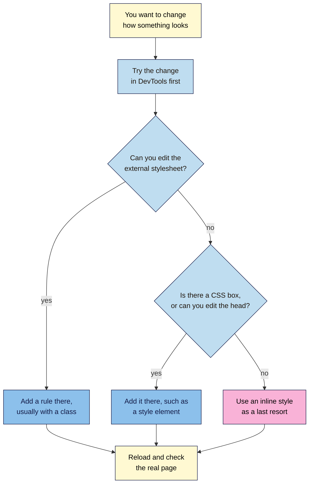

# M02.L08 — CSS Fundamentals: Selectors, Properties & Ways to Add CSS
> After this lesson you can write simple CSS rules, choose where they should live, and use DevTools to find out why a page looks the way it does.

**Time:** ~15 min reading + ~30 min hands-on + ~10 min exercise · **Level:** L1 Foundation (beginner) · **Prereqs:** M02.L03 · **Remediate to:** Web Development 101 M03.L01 (selectors, cascade, box model)
**Verified against:** MDN pages on CSS selectors, specificity, handling conflicts, CSS error handling, `<link>` and `<style>`, and its "What is CSS?" and "Getting started with CSS" guides; Chrome for Developers DevTools docs (CSS tutorial and reference, opening DevTools, CSS issues, local overrides); the WHATWG HTML Standard (`id`); Google Search Central "SEO Starter Guide", "Introduction to robots.txt", "Spam policies" and "Googlebot"; web.dev's article on render-blocking CSS; Gutenberg and WordPress source code (labels and stylesheet output), all on 2026-11-06. The planted CSS and Part A's stylesheet were run through the W3C CSS Validator, and the exercise's fixed result was confirmed with computed styles in jsdom. The W3C Nu HTML Checker was rate-limiting requests, so **this lesson's HTML hasn't been through it yet**. DevTools steps weren't run in a live browser for this draft. Chrome's docs don't state that a reload clears ordinary edits: that's everyday behaviour, so check it at screenshot time.

> ⚠️ **Freshness flag:** DevTools labels and WordPress menus move between versions. Google's file size limits can change, and web.dev's render-blocking article dates from 2014, though the behaviour it describes still applies.

## Learning objectives
1. **Write** CSS rules using element, class and ID selectors. *(O1)*
2. **Compare** inline, internal and external CSS, and choose one for a given job. *(O2)*
3. **Inspect** and temporarily change a live page's CSS in DevTools. *(O3)*

## Why it matters
Tomás's new site looks wrong on one page: the prices are tiny and grey. His agency says it's "a CSS thing" and quotes him for two hours. With DevTools, he can click the price and see the exact rule and file that causes it, then try a fix in his own browser, without touching the site. CSS matters for SEO in two more ways. Google needs access to it to see your page the way a visitor does, and you'll soon need to tell the difference between CSS that styles content and CSS that hides it.

## Core concept
**Plain version:** HTML says what things *are*. **CSS** (Cascading Style Sheets) says how they *look*. A CSS rule picks some elements and sets how they appear.

**Analogy:** HTML is the words and structure of a printed menu. CSS is the design brief for the printer: "all dish names in bold, all prices in brown". Change the brief, and the menu looks different, but the dishes stay the same.

### Anatomy of a rule

```css
h1 {
  color: brown;
  font-size: 32px;
}
```

| Part | In this example | What it does |
|---|---|---|
| **Selector** | `h1` | A pattern "used to match, or select, the elements you want to style" (MDN) |
| **Declaration block** | Everything in `{ }` | Holds the declarations |
| **Declaration** | `color: brown;` | One instruction, made of a property and a value |
| **Property** | `color` | What you're changing. It comes before the colon |
| **Value** | `brown` | What you're changing it to. It comes after the colon |

CSS uses American spelling, so it's `color`, not `colour`. End each declaration with a semicolon.

### Three selectors

| Selector | Looks like | Matches | Use it for |
|---|---|---|---|
| **Element** (MDN: "type selector") | `p` | Every `<p>` on the page | Site-wide defaults |
| **Class** | `.tip` | Every element with `class="tip"` | Most of your styling, because you can reuse it |
| **ID** | `#how-to-make-it` | The one element with `id="how-to-make-it"` | Rarely for styling |

The dot and the hash only appear in the CSS. In the HTML, you write `class="tip"`, with no dot.

MDN's advice: "Because an ID can only occur once on a page and because of the high specificity of ID selectors, it is preferable to add a class to an element instead of an ID." IDs still have their own job, as targets for links that jump to part of a page.

### Which rule wins?
When two rules set the same property on the same element, the browser picks one. That's the "cascading" in the name. For now, you only need this order, strongest first:

1. **Inline style** (`style="…"` on the element)
2. **ID selector**
3. **Class selector**
4. **Element selector**
5. **A tie?** Then "the one that is defined last in the stylesheet is the one that will be used" (MDN).

You'll meet `!important`, which overrides all of these. MDN calls using it this way "a **bad practice**", so treat it as a warning sign when you find it.

### Three ways to add CSS

| Method | Where it lives | Good for | Weakness |
|---|---|---|---|
| **External** | A `.css` file, linked with `<link rel="stylesheet" href="style.css">` in the `<head>` | Nearly everything. MDN calls it "the most common and useful method" | One more file to load |
| **Internal** | A `<style>` element in the `<head>` | One page, or when you can't edit the external file | Each page needs its own copy: "for sites with more than one page, internal stylesheets are less efficient than external stylesheets" (MDN) |
| **Inline** | A `style` attribute on one element | A last resort in a "very restrictive" tool | "**Avoid using CSS in this way if possible**" (MDN). Each change needs many edits, and it mixes style with content |

The big gain from an external file is that you can "link a single CSS file to multiple web pages" (MDN). Change one file, and every page follows.

### What this does for search

| Claim | Verdict | What the source says |
|---|---|---|
| Hiding CSS from Google can stop it understanding a page | **Documented** | "If your site is hiding important components that make up your website (like CSS and JavaScript), Google might not be able to understand your pages" |
| Blocking CSS in robots.txt is always safe | **False** | Google says if losing these files makes a page "harder for Google's crawler to understand", then "don't block them" |
| Moving CSS to an external file improves rankings | **Not in Google's docs** | We found no such statement. The clear benefit is easier upkeep |
| Class names with keywords help you rank | **Not in Google's docs** | We found no such statement. Name classes for people who maintain the site |
| CSS can delay what visitors see | **Documented** | "CSS is treated as a render-blocking resource", so the browser waits for it before showing the page (web.dev). Module 12 covers speed |
| CSS files have a size limit for Googlebot | **Documented** | Each CSS file is "fetched separately", with the same limit as other files: "the first 2MB". Most stylesheets are far smaller |
| CSS can break spam policies | **Documented** | Google lists "Using CSS to position text off-screen" under hidden text abuse. Lesson 2.9 covers this |

## How it works
Use this flow when you want to change how something looks.


**In words:** try the change in DevTools first, because it's safe and quick. If you can edit the external stylesheet, add a rule there, usually with a class. If you can't, use your platform's CSS box or a `<style>` element. Only use an inline style if neither is possible. Whichever you choose, reload and check the real page.

> **Under the hood: why a typo only breaks one line.** MDN says browsers "discard invalid content and parse subsequent valid styles". If you write `colour: navy;`, the browser drops that declaration and shows no error on the page. A missing semicolon costs more, because the browser only recovers at the next semicolon or closing bracket, so two declarations are lost. That's why CSS mistakes are quiet: nothing crashes, and the style just doesn't appear. DevTools helps by crossing out invalid declarations and adding a warning icon.

## Hands-on walkthrough
You'll link a stylesheet to your article, test which rule wins, break the link, then inspect a live page. Nila Coffee's values are illustrative.

**Before you start: which steps apply to you?**
- **All paths:** do Parts A, B and C. They use files in your `seo-101-html` folder and don't touch any website.
- **Path A or C:** in Part D, use your project site. DevTools changes stay in your own browser, so path C needs no logins and changes nothing for the client.
- **Path B on Blogger:** in Part D, use one of your blog posts.

**Part A — Link an external stylesheet (10 min)**
1. In your `seo-101-html` folder, create a file called `style.css`:
   ```css
   /* Nila Coffee article styles */
   body {
     font-family: Georgia, serif;
     color: #222222;
   }

   h1 {
     color: #6b3e26;
   }

   .tip {
     background-color: #fff9d2;
   }

   #how-to-make-it {
     border-left: 4px solid #6b3e26;
   }
   ```
2. Open `article.html`. In the `<head>`, below the `<title>`, add:
   ```html
   <link rel="stylesheet" href="style.css">
   ```
3. Now give the rules something to match:
   - Change the "Keep the same 12 hours…" paragraph to `<p class="tip">`. If you skipped Lesson 2.7, use any paragraph.
   - Change the "How to make it" section to `<section id="how-to-make-it">`.
4. Save both files, and reload.

   **Expected:** the text changes to a serif font, the `<h1>` turns brown, the tip has a pale yellow background, and "How to make it" has a brown line down its left side.
   > 🖼️ **Image prompt:** A browser window (1280×800) showing `article.html` with the stylesheet applied: serif text, brown heading, pale yellow tip paragraph and a brown line beside "How to make it". Highlight the tip paragraph with a 3px #F9B2D7 outline; blur any personal details.
   > **Alt text:** The cold brew article styled with a serif font, brown heading, pale yellow tip and a brown section line.

**Part B — See which rule wins (8 min)**
1. Add these two rules to the end of `style.css`, then save and reload:
   ```css
   p {
     color: blue;
   }

   .tip {
     color: green;
   }
   ```
   **Expected:** paragraphs are blue, and the tip is green. A class beats an element selector.
2. Move the `p` rule below the `.tip` rule, and reload.

   **Expected:** no change. Order only matters in a tie, and this isn't one.
3. Add `p { color: purple; }` at the very end, and reload.

   **Expected:** other paragraphs turn purple, and the tip stays green. The two `p` rules tie, so the last one wins.
4. In `article.html`, change the tip to `<p class="tip" style="color: red">`, and reload.

   **Expected:** the tip turns red. Inline beats a class.
5. In the `<head>`, below your `<link>`, add `<style>h1 { color: teal; }</style>`, and reload.

   **Expected:** the `<h1>` turns teal. It's a tie with the `h1` rule in `style.css`, and the `<style>` comes later. Move it above the `<link>`, and the heading goes back to brown.
6. Clean up: delete the `<style>` line, the inline `style`, and every rule you added in this part. Keep `class="tip"`.

**Part C — Break the link (4 min)**
1. Change the link to `href="styles.css"`, with an extra "s". Save and reload.

   **Expected:** all your styling disappears, but every word is still there. The browser couldn't find the file, and it shows no error on the page.
2. Open View Source (**Ctrl+U**, Mac: **Cmd+Option+U**).

   **Expected:** your headings and text are all in the code. CSS changes how they look, not what they are.
3. Fix the link, and reload.

**Part D — Inspect a live page (8 min)**
1. Open a page on your project site. Right-click its main heading and choose **Inspect**.

   **Expected:** DevTools opens on the **Elements** panel, with the heading selected and its rules listed in the **Styles** tab.
2. In **Styles**, find the rule that sets the heading's `color` or `font-size`. Note the file name shown beside it, and any crossed-out lines nearby. A crossed-out line lost to another rule, unless it has a warning icon, which means it's invalid.
   > 🖼️ **Image prompt:** Chrome DevTools (1280×800) docked beside a blog post, with the `<h1>` selected and the Styles tab showing a rule, its stylesheet name and one crossed-out declaration. Highlight the crossed-out declaration with a 3px #F9B2D7 outline; blur any personal details.
   > **Alt text:** DevTools Styles tab showing a heading's CSS rules, its stylesheet name and a crossed-out declaration.
3. Double-click the value of `color` (or add one) and type `red`, then press **Enter**.

   **Expected:** the heading turns red straight away.
4. Hover over the rule, and untick the checkbox beside a declaration.

   **Expected:** that style switches off. Tick it again.
5. Click between the brackets of **element.style** at the top of **Styles**, and add `background-color: yellow`.

   **Expected:** the heading gets a yellow background. Notice that this is the same as an inline style.
6. Open the **Computed** tab. It lists "only the CSS that's actually being applied to an element" (Chrome docs).
7. Reload the page.

   **Expected:** all your changes are gone. They only existed in your browser, so no visitor or search engine ever saw them. (Chrome's Local Overrides feature can keep edits across reloads, but only on your own computer.)
8. In View Source, use **Ctrl+F** (Mac: **Cmd+F**) to count `stylesheet`, `<style` and `style=`. Your browser's find bar shows the number of matches. Leave out the quote marks, because sites differ: WordPress writes `rel='stylesheet'` with single quotes. These are rough counts, which is all you need.
9. Open `/robots.txt` on the site's domain, such as `https://www.example.com/robots.txt`. Look for `Disallow` lines that mention `css`, `theme` or `assets`. You're only looking for now: a later module covers robots.txt.
10. Add a tab called **Style check** to your "SEO 101 project" sheet and fill it in.

    | Check | Nila Coffee shop page (illustrative) |
    |---|---|
    | External stylesheets | 3 |
    | `<style>` blocks | 2 |
    | Inline `style=` attributes | 14 |
    | File that sets the `<h1>` colour | `theme.css` |
    | A crossed-out declaration | `font-size: 28px` in `base.css` |
    | robots.txt blocks CSS? | No |
    | Worth raising? | Move the 14 inline styles to classes |

**Expected output:** an `article.html` linked to a working `style.css`, and a **Style check** tab.

## When to use / when not to
**Use an external stylesheet** by default. **Use a class** when you're styling something that could appear more than once. **Use an ID** as a jump link target, and rarely for styling.

**Use internal CSS when** one page needs something special, or you can't reach the external file. **Use inline CSS when** nothing else works, as in some restricted editors.

**On a platform,** you usually don't edit the theme's files, because a theme update can overwrite them. In the WordPress Site Editor, the Styles area has an **Additional CSS** box, and most blocks have an **Additional CSS class(es)** field in their settings. The exact route depends on your theme, and Module 5 covers WordPress. Other platforms have similar boxes.

**The trade-off:** a platform's CSS box is quick and safe, but it splits your styling between two places. Keep a short note of what you've added, so that the next person can find it.

**For SEO work,** you rarely need to write CSS. You need to read it well enough to brief a developer, for example: "The `.price` rule in `theme.css` sets 11px grey text. Can we make it 16px and darker?"

## Use AI for this
**Example prompt:**
> "Here's a CSS rule and the HTML it applies to: [paste]. The price still looks grey after my change. Explain which rule wins and why, in plain language. Don't rewrite my code, and don't use `!important`."

**What AI does well here:** explaining a rule you've pasted, and spotting typos.
**Where it gets it wrong:** it can't see your real page, so it guesses about other rules. It often reaches for `!important`, and it may claim that a CSS change improves rankings.
**How to check:** try the change in DevTools first, and confirm the winning rule in the **Styles** tab.

## Common mistakes
- **Writing the dot in the HTML.** It's `class="tip"` in HTML and `.tip` in CSS.
- **Using British spelling.** `colour` does nothing. CSS uses `color`.
- **Forgetting a semicolon.** That declaration and the next one are both lost.
- **Using `rel="style"`.** The value is `stylesheet`.
- **Reusing an ID.** An ID should only appear once on a page. Use a class.
- **Reaching for `!important`.** Find out which rule is winning, and why.
- **Leaving inline styles everywhere.** Each one has to be changed by hand.
- **Thinking a DevTools edit is saved.** A reload wipes it.
- **Editing theme files directly.** A theme update can overwrite your work, so use your platform's CSS box.

## Troubleshooting
| Symptom | Likely cause | Fix |
|---|---|---|
| No styling at all | The `href` file name or folder is wrong | Check the spelling, and that `style.css` sits beside `article.html` |
| One rule has no effect | A typo, or the selector doesn't match | Inspect the element. If the rule isn't listed, check the selector |
| A line is crossed out, with no warning icon | Another rule beat it | Look above it in **Styles** for the winner |
| A line is crossed out, with a warning icon | The property or value is invalid | Check the spelling |
| Several lines stop working together | A missing `}` or semicolon | Check the lines just above the first one that fails |
| Your change works locally but not on the live site | Your browser or site is showing a saved old copy | Force a fresh load with **Ctrl+Shift+R** (Mac: **Cmd+Shift+R**), and clear any caching plugin |
| Your DevTools change disappeared | You reloaded | Copy it into the real stylesheet |

## Exercise
**Task:** complete your **Style check** tab (Part D). Then fix this planted page. Your stylesheet is called `style.css`. Find all eight problems. The fixed page should show a navy `<h1>`, grey paragraphs and two pale yellow tips.

`index.html`:
```html
<!DOCTYPE html>
<html lang="en">
  <head>
    <meta charset="utf-8">
    <title>Brewing Tips | Nila Coffee</title>
    <link rel="style" href="styles.css">
  </head>
  <body>
    <h1>Brewing Tips</h1>
    <p>Good coffee starts with fresh beans.</p>
    <p id="tip" class=".highlight">Grind just before you brew.</p>
    <p id="tip" class=".highlight">Use filtered water.</p>
    <p style="color: red">Store beans away from sunlight.</p>
  </body>
</html>
```

`style.css`:
```css
h1 {
  colour: navy;
}

p {
  color: #555555 !important;
  font-size: 18px
  line-height: 1.5;
}

.highlight {
  background-color: #fff9d2;
}
```

**Expected outcome:** a complete tab, and these eight fixes:
1. Change `rel="style"` to `rel="stylesheet"`.
2. Change `styles.css` to `style.css`.
3. Remove the dots: `class="highlight"`.
4. Remove the repeated `id="tip"`, because an ID can only occur once. The class already does the job.
5. Remove the inline `style`, so the paragraph follows the stylesheet.
6. Change `colour` to `color`.
7. Add the missing semicolon after `18px`.
8. Remove `!important`. Did you notice it even beat the inline red? That's why it's so hard to work around.

The W3C CSS Validator (`https://jigsaw.w3.org/css-validator/`) reports only two of these: *Property "colour" doesn't exist. The closest matching property name is "color"* and *Missing a semicolon before the property name "line-height"*. `!important` is valid CSS, so it passes. A validator checks rules, not quality.

**Then choose:** where would you put the CSS in each case, and why?
1. A new button style for all 40 pages of a site you can edit.
2. A one-off campaign page on a platform that has a CSS box but no access to its stylesheet files.
3. A short note in an editor that strips out `<style>` and has no CSS box.

**Answers:** (1) An external stylesheet, with a class. (2) The CSS box. (3) An inline style, because nothing else is possible.

**Stretch goal:** in DevTools, find one crossed-out declaration on your project site and name the rule that beat it. Say why it won, using the order from this lesson.

## Key takeaways
- HTML says what things are, and CSS says how they look.
- A rule is a selector plus declarations, and each declaration is a property and a value.
- Prefer classes for styling. Inline beats ID, ID beats class, class beats element, and in a tie, the last rule wins.
- Default to an external stylesheet, and use inline CSS only as a last resort.
- DevTools shows which rule applies and lets you test a fix, but a reload wipes your changes.
- Google needs access to your CSS, so don't block it.

## Teach it back
Explain to a friend in 3 sentences why editing a page in DevTools doesn't change the website, and why it's still useful.

## Glossary terms added
- Cascade — added to `seo-101/glossary.md`
- Class selector — added to `seo-101/glossary.md`
- CSS — added to `seo-101/glossary.md`
- Declaration (CSS) — added to `seo-101/glossary.md`
- External stylesheet — added to `seo-101/glossary.md`
- ID selector — added to `seo-101/glossary.md`
- Inline style — added to `seo-101/glossary.md`
- Internal stylesheet — added to `seo-101/glossary.md`
- Selector — added to `seo-101/glossary.md`
- Specificity — added to `seo-101/glossary.md`

## Further reading
*All checked 2026-11-06.*
- MDN — What is CSS?: https://developer.mozilla.org/en-US/docs/Learn_web_development/Core/Styling_basics/What_is_CSS
- MDN — Getting started with CSS: https://developer.mozilla.org/en-US/docs/Learn_web_development/Core/Styling_basics/Getting_started
- MDN — Handling conflicts: https://developer.mozilla.org/en-US/docs/Learn_web_development/Core/Styling_basics/Handling_conflicts
- MDN — CSS selectors: https://developer.mozilla.org/en-US/docs/Web/CSS/Guides/Selectors
- MDN — Specificity: https://developer.mozilla.org/en-US/docs/Web/CSS/Guides/Cascade/Specificity
- MDN — CSS error handling: https://developer.mozilla.org/en-US/docs/Web/CSS/Guides/Syntax/Error_handling
- MDN — `<link>`: https://developer.mozilla.org/en-US/docs/Web/HTML/Reference/Elements/link
- MDN — `<style>`: https://developer.mozilla.org/en-US/docs/Web/HTML/Reference/Elements/style
- Chrome for Developers — DevTools CSS tutorial: https://developer.chrome.com/docs/devtools/css
- Chrome for Developers — DevTools CSS reference: https://developer.chrome.com/docs/devtools/css/reference
- Chrome for Developers — Opening DevTools: https://developer.chrome.com/docs/devtools/open
- Chrome for Developers — DevTools CSS issues: https://developer.chrome.com/docs/devtools/css/issues
- Chrome for Developers — Local overrides: https://developer.chrome.com/docs/devtools/overrides
- WHATWG — HTML Standard, `id`: https://html.spec.whatwg.org/multipage/dom.html#the-id-attribute
- Google Search Central — SEO Starter Guide: https://developers.google.com/search/docs/fundamentals/seo-starter-guide
- Google Search Central — Introduction to robots.txt: https://developers.google.com/search/docs/crawling-indexing/robots/intro
- Google Search Central — Googlebot: https://developers.google.com/search/docs/crawling-indexing/googlebot
- Google Search Central — Spam policies: https://developers.google.com/search/docs/essentials/spam-policies
- W3C CSS Validator: https://jigsaw.w3.org/css-validator/
- web.dev — Render-blocking CSS article (2014): https://web.dev/articles/critical-rendering-path/render-blocking-css

> ⚠️ **May change:** DevTools labels and layout; WordPress menu routes; Googlebot's file size limit.

## Refresher card
*Used by remediation when a learner fails a quiz twice on a later lesson that points back here.*
**Rule:** `selector { property: value; }`. **Selectors:** `p` (element), `.tip` (class, reusable, your default), `#id` (once per page, rarely for styling). In HTML, write `class="tip"` with no dot. **Which wins:** inline, then ID, then class, then element. In a tie, the last rule wins. Avoid `!important`. **Where CSS lives:** external file with `<link rel="stylesheet" href="style.css">` (default), internal `<style>` (one page, or no file access), inline `style=` (last resort). **DevTools:** right-click, **Inspect**, then **Styles** shows the rules and crossed-out losers, and **Computed** shows what applied. A warning icon on a crossed-out line means it's invalid. Edits only exist in your browser, and a reload wipes them. **SEO:** CSS changes how text looks, not what it is. Google needs access to it, so don't block it in robots.txt.
