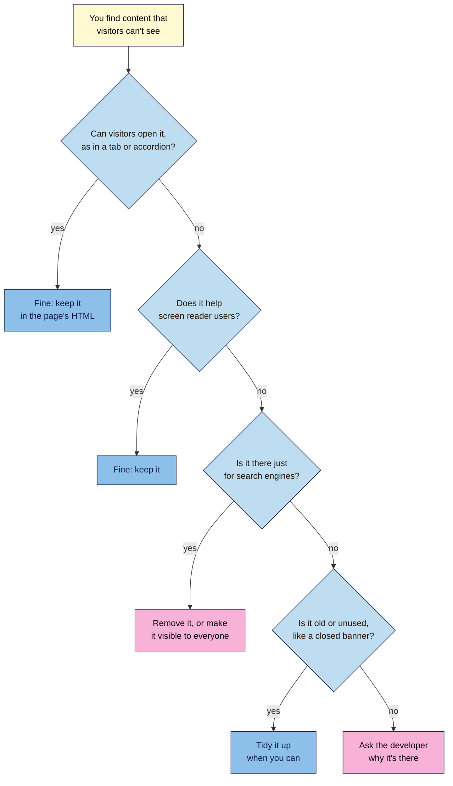

# M02.L09 — Styling Text & Layout: Fonts, Colours, Spacing and the Box Model
> After this lesson you can make a page comfortable to read, fix spacing with the box model, and tell hidden content that's fine from hidden text that breaks Google's spam policies.

**Time:** ~15 min reading + ~35 min hands-on + ~10 min exercise · **Level:** L1 Foundation (beginner) · **Prereqs:** M02.L08 · **Remediate to:** M02.L08; Web Development 101 M03.L01 and M03.L02 (typography and colour)
**Verified against:** MDN pages for `font-family`, `font-size`, `line-height`, `color`, `display` and `visibility`, plus "The box model" and "Color contrast"; W3C "Understanding SC 1.4.3 Contrast (Minimum)" and "Understanding SC 1.4.12 Text Spacing" (WCAG 2.2); WebAIM Contrast Checker, "The WebAIM Million" (2026) and "Invisible Content Just for Screen Reader Users" (2020); Chrome for Developers docs on contrast and CSS; W3C "Understanding SC 1.4.8 Visual Presentation"; MDN "Mastering margin collapsing"; Google Search Central "Spam policies for Google web search", "Understanding page experience in Google Search results", "Creating helpful, reliable, people-first content" and "Mobile site and mobile-first indexing best practices"; Search Console Help "Manual actions report", all on 2026-11-06. The contrast ratios here were calculated with the WCAG formula and spot-checked with WebAIM's tool. The CSS samples and the planted page's CSS passed the W3C CSS Validator. Part E's Console line was tested in jsdom, with off-screen positions simulated, not in a real browser. The W3C Nu HTML Checker was rate-limiting requests, so **this lesson's HTML hasn't been through it yet**. DevTools steps weren't run in a live browser for this draft. Chrome's docs place the box model diagram behind **Show sidebar**. That it also appears in **Computed**, and that hovering tints the page, are everyday behaviour, so check both at screenshot time.

> ⚠️ **Freshness flag:** Google's list of hidden text examples and the WebAIM Million figures can change. WebAIM publishes a new Million report each year, and its screen reader article dates from 2020.

## Learning objectives
1. **Style** readable text with font, size, line height and colour contrast. *(O1)*
2. **Use** the box model (content, padding, border, margin) to control spacing. *(O2)*
3. **Spot** CSS that hides content from people, and explain how hidden text can break spam policies. *(O3)*

## Why it matters
Amara writes a strong guide for a client, but the site shows it in pale grey 13px text, with lines running the full width of the screen. Readers give up, however good the writing is. Low contrast is the most common accessibility problem on the web: WebAIM found it on 83.9% of the top million home pages in 2026. On the same site, Amara's audit finds a block of keywords in white text on a white background, added years ago by a former agency. That's a spam risk the client doesn't know about. This lesson gives you both skills: making text easy to read, and knowing what hidden content means.

## Core concept
**Plain version:** good styling makes content easy to read. Every element is a box with layers of space around it. And CSS can hide things, which is sometimes helpful and sometimes spam.

**Analogy:** think of a framed photo. The photo is the **content**. The card mount around it is the **padding**. The frame is the **border**. The gap between this frame and the next one on the wall is the **margin**.

### Readable text

| Property | Example | Good practice |
|---|---|---|
| `font-family` | `font-family: Georgia, serif;` | List fallbacks, and end with a generic family: "there's no guarantee that any given font is available" (MDN) |
| `font-size` | `font-size: 1.125rem;` | Use `rem`, not `px`. `1rem` is usually 16px. MDN says `px` sizes are "not accessible, because the user cannot change the font size in some browsers" |
| `line-height` | `line-height: 1.6;` | "Use a minimum value of `1.5` for `line-height` for main paragraph content" (MDN). Leave off the unit |
| `color` | `color: #222222;` | Keep enough contrast with the background |
| `max-width` | `max-width: 40rem;` | Keeps lines a comfortable length. W3C's strictest guidance is "no more than 80 characters or glyphs", because people can have "trouble keeping their place" in long lines |

Lesson 2.8 used `px` to keep things simple. From here on, use `rem` for text.

### Colour contrast
**Contrast ratio** compares how light the text is with how light its background is. It runs from 1:1 (the same colour) to 21:1 (black on white). WCAG, the W3C's accessibility guidelines, sets these minimums at level AA:

| Text | Minimum ratio |
|---|---|
| Normal text | **4.5:1** |
| Large text (about 24px, or about 18.5px and bold) | **3:1** |
| Logos and purely decorative text | No requirement |

There's no rounding up. W3C says "4.499:1 would not meet the 4.5:1 threshold". For example, `#767676` on white is about 4.54:1 and passes, while `#999999` on white is about 2.85:1 and fails.

### The box model

| Layer | What it is | Property |
|---|---|---|
| **Content** | The text or image itself | `width`, `height` |
| **Padding** | Space inside the border. The background colour shows through it | `padding` |
| **Border** | The line around the padding | `border` |
| **Margin** | The "whitespace between this box and other elements" (MDN) | `margin` |

```css
.tip {
  padding: 1rem;
  border: 1px solid #6b3e26;
  margin: 1.5rem 0;
}
```

The rule of thumb: use **padding** for space inside a box, and **margin** for space between boxes. In `margin: 1.5rem 0`, the first value sets the top and bottom, and the second sets the left and right. `margin: 0 auto` centres a box that has a width.

One trap: "By default, browsers use the standard box model" (MDN). In that model, padding and border are added to any `width` you set, so a box can end up wider than you expected. `box-sizing: border-box` makes `width` mean the whole visible box.

### Hiding content with CSS

| Method | What it does | Screen readers |
|---|---|---|
| `display: none` | Removes the element from the layout | Not announced |
| `visibility: hidden` | Keeps its space, but doesn't draw it | Not announced |
| "Screen reader only" class | Moves it off-screen, on purpose | Read out |
| `<details>` or a tab | Hides it until someone opens it | Reachable by opening it |

None of these is bad in itself. What matters is **why** the content is hidden.

Google defines hidden text abuse as "placing content on a page in a way solely to manipulate search engines and not to be easily viewable by human visitors". Its examples include:
- "Using white text on a white background"
- "Hiding text behind an image"
- "Using CSS to position text off-screen"
- "Setting the font size or opacity to 0"

Google also lists what's fine, saying these elements "don't violate our policies":
- "Accordion or tabbed content that toggle between hiding and showing additional content"
- "Slideshow or slider that cycles between several images or text paragraphs"
- "Tooltip or similar text that displays additional content when users interact with over an element"
- "Text that's only accessible to screen readers and is intended to improve the experience for those using screen readers"

Notice that "position text off-screen" appears on the bad list, and off-screen is also how screen reader text works. The same CSS can be fine or spam, depending on its purpose.

### What this does for search

| Claim | Verdict | What the source says |
|---|---|---|
| Google ranks pages on font size or contrast | **Not in Google's docs** | Its page experience page names neither. It does ask if visitors "can easily distinguish the main content from other content" |
| Readability affects your search results | **Not stated directly** | Google doesn't name it. The nearest line is about content quality in general: "Is the content produced well, or does it appear sloppy or hastily produced?" The clear benefit is for readers |
| White text on a white background is spam | **Documented** | It's in Google's list of hidden text abuse |
| All hidden content breaks the policy | **False** | Accordions, tabs, sliders, tooltips and screen reader text "don't violate our policies" |
| Content in tabs counts as main content | **Documented** | Google's main content list includes "Tabbed or expanded sections" |
| Content loaded only after a click is safe | **False** | "Google won't load content that requires user interactions (for example, swiping, clicking, or typing) to load." Keep it in the page's HTML, even while it's closed |
| Hidden text can lead to a manual action | **Documented** | Search Console has a manual action for "hidden text or keyword stuffing" |

## How it works
Use this flow when you find content that people can't see.


**In words:** if visitors can open the content, as in a tab or accordion, it's fine, so long as it's in the page's HTML. If it helps screen reader users, keep it. If it's there just for search engines, remove it or make it visible to everyone, however old it is. If it's simply old or unused, tidy it up when you can. If you can't tell, ask the developer.

> **Under the hood: how contrast is measured.** The ratio doesn't compare colours as you see them. It compares "relative luminance", a calculated value for how bright a colour is, and it gives green far more weight than blue, because our eyes are most sensitive to green. That's why two colours that look clearly different can still fail. Don't judge by eye: measure it.

## Hands-on walkthrough
You'll style your article for reading, fix low contrast, fix a spacing bug and sort hidden content into fine and not fine. Nila Coffee's values are illustrative.

**Before you start: which steps apply to you?**
- **All paths:** do Parts A, B, C and D. They use files in your `seo-101-html` folder and don't touch any website.
- **Path A or C:** in Part E, use your project site. It only reads the page, so path C needs no logins. If you find hidden keywords on a client's site, report them, don't fix them yourself.
- **Path B on Blogger:** in Part E, use one of your blog posts.

**Part A — Style the text (8 min)**
1. Open `style.css`, and change the `body` rule to:
   ```css
   body {
     font-family: Georgia, serif;
     font-size: 1.125rem;
     line-height: 1.6;
     color: #222222;
     max-width: 40rem;
     margin: 0 auto;
     padding: 0 1rem;
   }
   ```
2. Save and reload `article.html`. Make the window wide.

   **Expected:** the text is larger, with more space between lines, in a centred column that stops growing as the window widens.
3. Press **Ctrl** and **+** (Mac: **Cmd** and **+**) a few times to zoom in, then **Ctrl+0** (Mac: **Cmd+0**) to reset.

   **Expected:** the text and line spacing grow together. Zoom scales `px` too. The gain from `rem` comes when readers raise the default font size in their browser settings.

**Part B — Find and fix low contrast (8 min)**
1. Add a colour to the `.tip` rule: `color: #b8a98f;`. Save and reload.

   **Expected:** the tip is pale and hard to read.
2. Open **https://webaim.org/resources/contrastchecker/**. Enter `#b8a98f` as the foreground and `#fff9d2` as the background.

   **Expected:** a ratio of about 2.2:1, and a fail for normal text.
3. In your page, right-click the tip and choose **Inspect**. In **Styles**, click the small colour square beside the `color` value to open the **Color Picker**, and expand **Contrast ratio**.

   **Expected:** the same kind of result, with AA and AAA marked as failing.
   > 🖼️ **Image prompt:** Chrome DevTools Color Picker (1280×800) open on the `.tip` rule, with the Contrast ratio section expanded and showing a failing ratio. Highlight the Contrast ratio section with a 3px #F9B2D7 outline; blur any personal details.
   > **Alt text:** DevTools Color Picker with its Contrast ratio section showing a failing score for pale text.
4. Change the colour in `style.css` to `#5c4a1f`, then save and reload.

   **Expected:** the tip is easy to read, and the checker shows about 8:1, a pass at AA and AAA.

**Part C — Fix a spacing bug with the box model (9 min)**
1. Add the box styling to `.tip`: `padding: 1rem;`, `border: 1px solid #6b3e26;` and `margin: 1.5rem 0;`. Save and reload.

   **Expected:** the tip becomes a neat box, with space inside its border and space around it.
2. Plant a bug. Add this to the end of `style.css`:
   ```css
   h2 {
     margin-bottom: 5rem;
   }
   ```
   **Expected:** a large gap appears under every `<h2>`.
3. Right-click one of those headings and choose **Inspect**. In **Styles**, click **Show sidebar** in the action bar (or open the **Computed** tab) to see the box model diagram.
   > 🖼️ **Image prompt:** Chrome DevTools (1280×800) with an `<h2>` selected and the box model diagram showing a large bottom margin. Highlight the margin value in the diagram with a 3px #F9B2D7 outline; blur any personal details.
   > **Alt text:** DevTools box model diagram for a heading, with its large bottom margin value highlighted.
4. Hover over each layer of the diagram, and watch the page.

   **Expected:** the browser tints that layer on the page, and the bottom margin takes up the gap.
5. Double-click the bottom margin value in the diagram, and type `8`.

   **Expected:** the gap shrinks at once. That's a test, not a fix.
6. Now make the real fix: delete the `h2` rule from `style.css`, then save and reload.

**Part D — Sort hidden content (5 min)**
1. Save this as `hidden-test.html` in your `seo-101-html` folder:
   ```html
   <!DOCTYPE html>
   <html lang="en">
     <head>
       <meta charset="utf-8">
       <title>Hidden Content Test | Nila Coffee</title>
       <style>
         .sr-only { position: absolute; left: -10000px; top: auto; width: 1px; height: 1px; overflow: hidden; }
         .white { color: #ffffff; }
         .tiny { font-size: 0; }
       </style>
     </head>
     <body>
       <h1>Our Beans</h1>
       <p>Fresh coffee, roasted every week.</p>
       <details>
         <summary>Shipping details</summary>
         <p>Orders ship every Friday.</p>
       </details>
       <p class="white">best coffee cheap coffee buy coffee online coffee beans india</p>
       <p class="tiny">coffee shop coffee near me coffee delivery</p>
       <p><a href="basket.html">Basket <span class="sr-only">(2 items)</span></a></p>
     </body>
   </html>
   ```
2. Open it, then press **Ctrl+A** (Mac: **Cmd+A**) to select everything. Google suggests this trick for finding text that matches its background.

   **Expected:** the white keywords appear as highlighted text. The `font-size: 0` keywords don't show, and you need View Source for those.
3. Open View Source, and sort the four hidden items, using the flowchart.

   **Expected:** the shipping details and "(2 items)" are fine. The white text and the `font-size: 0` text are hidden text abuse.

**Part E — Audit a live page (5 min)**
1. Open a page on your project site, and use **Inspect** on a main paragraph.
2. In **Styles** or **Computed**, note its `font-size`, `line-height` and `color`. Use the **Color Picker** to read its contrast ratio.
3. Press **Ctrl+A** (Mac: **Cmd+A**), and look for text that appears only when selected.
4. Most CSS lives in stylesheets, so View Source won't show it. Instead, ask the browser. Press **Ctrl+Shift+J** (Mac: **Cmd+Option+J**) to open the **Console**, then enter this line. As in Lesson 2.4, Chrome may ask you to type `allow pasting` first. If you'd rather not use the Console, skip this step.
   ```js
   document.querySelectorAll('body *').forEach(e => { const s = getComputedStyle(e), r = e.getBoundingClientRect(); if (!e.children.length && e.textContent.trim() && (parseFloat(s.fontSize) === 0 || s.opacity === '0' || r.right < 0)) console.log(e.textContent.trim().slice(0, 60)); });
   ```
   **Expected:** a list of any text with a font size of 0, an opacity of 0, or a position off the left of the screen, or nothing at all. It won't catch every method, and **Ctrl+A** covers white text. A match isn't proof of anything: read the content, and use the flowchart.
5. Add a tab called **Readability check** to your "SEO 101 project" sheet and fill it in.

   | Check | Nila Coffee cold brew guide (illustrative) |
   |---|---|
   | Body text size | 18px |
   | Line height | 1.6 |
   | Body text contrast | 14.9:1, pass |
   | Lowest contrast found | Footer links, 2.9:1, fail |
   | Hidden content found | Accordion on shipping (fine) |
   | Anything to report? | Darken the footer links |

**Expected output:** an `article.html` and `style.css` that read well and pass the contrast check, a sorted `hidden-test.html`, and a **Readability check** tab.

## When to use / when not to
**Use `rem` for text sizes** and spacing, and **a thin `px` value for borders**.

**Use padding when** you want more room inside a box, such as around text in a coloured panel. **Use margin when** you want more room between boxes.

**Use accordions and tabs when** a page has long supporting detail, such as shipping terms or specifications. **Don't use them for** your page's main point. Google's "Read more" link advice says to keep content "immediately visible" and not "hidden behind an expandable section or tabbed interface", and people may never open them either.

**Hide content with `display: none` when** it's hidden from everyone, such as a closed menu. **Use a screen reader only class when** it adds context for screen reader users. Don't hide links this way: WebAIM warns that they "should not be hidden off-screen".

**On a platform,** your theme sets most of these. Check its typography and colour settings before adding CSS. Lesson 2.8 covered where custom CSS goes.

**The trade-off:** brand colours and light grey text can look elegant, but they often fail contrast. If a brand colour fails, keep it for large headings or decoration, where the minimum is lower or doesn't apply, and use a darker shade for body text.

## Use AI for this
**Example prompt:**
> "Here are my text and background colours: [paste hex codes]. Suggest the closest darker shades that reach at least 4.5:1, and keep the same hue. List the ratio for each one. I'll check them myself."

**What AI does well here:** suggesting colour options, and explaining spacing problems when you paste the CSS.
**Where it gets it wrong:** it often reports contrast ratios that are wrong. It may also call all hidden content spam, or suggest hiding keywords "for SEO".
**How to check:** run every colour through WebAIM's checker, and use Google's own list for anything about hidden text.

## Common mistakes
- **Trusting your eyes on contrast.** Measure it.
- **Using `px` for text.** Use `rem`, so that readers' font settings still work.
- **Setting a tight `line-height`.** Aim for at least 1.5 for main paragraphs.
- **Listing a font with no fallback.** End with `serif` or `sans-serif`.
- **Using margin for space inside a coloured box.** That's padding.
- **Adding `<br>` tags for spacing.** Use margin.
- **Calling all hidden content spam.** Check its purpose first.
- **Hiding keywords "for SEO".** It's a spam risk, and it won't help anyone.
- **Loading tab content only on click.** Keep it in the HTML.
- **Deleting a client's hidden text yourself.** Report it first, unless that's your job.

## Troubleshooting
| Symptom | Likely cause | Fix |
|---|---|---|
| The font doesn't change | The font isn't installed or loaded, or a name is misspelled | Check the name, and that a fallback is listed |
| Text looks huge inside other elements | `em` sizes multiply as they nest | Use `rem` |
| A box is wider than you set | Padding and border are added to `width` | Add `box-sizing: border-box` |
| A gap won't go away | A margin on the element above or below | Check both in the box model diagram |
| Two vertical margins don't add up | "Margin collapsing": stacked margins combine into one "whose size is the largest of the individual margins" (MDN) | Expect the larger one, not the total |
| `margin: 0 auto` doesn't centre a box | The box has no `width` or `max-width` | Add one |
| Text fails contrast only on an image | The image's colours vary | Add a solid or semi-solid background behind the text |
| You find keywords hidden for search engines on a live site | Old spam tactics, or a hacked site | Report it, and ask the owner to check **Manual actions** in Search Console. Google's steps: "Remove or re-style any hidden text" |
| **Ctrl+A** shows nothing, but View Source shows odd keywords | They're hidden another way, such as `font-size: 0` | Find the element in **Elements**, and read its styles |

## Exercise
**Task:** complete your **Readability check** tab (Part E). Then review this planted page. Seven things need fixing, and two must be left alone. Find them all. It's on a white background.

```html
<!DOCTYPE html>
<html lang="en">
  <head>
    <meta charset="utf-8">
    <title>Wholesale Beans | Nila Coffee</title>
    <style>
      body { font-family: "Nila Sans"; font-size: 11px; line-height: 1; }
      p { color: #aaaaaa; }
      .card { background-color: #fff9d2; margin: 2rem; }
      .seo { position: absolute; left: -9999px; }
      .tags { color: #ffffff; }
      .sr-only { position: absolute; left: -10000px; top: auto; width: 1px; height: 1px; overflow: hidden; }
    </style>
  </head>
  <body>
    <h1>Wholesale Beans</h1>
    <div class="card">
      <p>Fresh beans for cafés, delivered weekly.</p>
    </div>
    <details>
      <summary>Delivery areas</summary>
      <p>We deliver across Tamil Nadu and Kerala.</p>
    </details>
    <p class="seo">wholesale coffee beans bulk coffee supplier cheap coffee chennai</p>
    <p class="tags">coffee beans coffee wholesale coffee india</p>
    <p><a href="order.html">Order <span class="sr-only">(opens our order form)</span></a></p>
  </body>
</html>
```

**Expected outcome:** a complete tab, and these answers:

*Fix:*
1. Add a generic fallback: `font-family: "Nila Sans", sans-serif;`.
2. Change the text size to `rem`, such as `font-size: 1.125rem;`.
3. Raise the line height, such as `line-height: 1.6;`.
4. Darken the text. `#aaaaaa` on white is about 2.3:1. `#595959` is about 7:1.
5. Give `.card` padding, such as `padding: 1rem;`, as the text is touching the edges of its panel.
6. Remove the `.seo` paragraph and its CSS. It's keywords moved off-screen, with no value to anyone.
7. Remove the `.tags` paragraph and its CSS. It's white keywords on a white background.

*Leave alone:*
1. The `<details>` block. It's an accordion, and its text is in the HTML.
2. The `.sr-only` text. It tells screen reader users where the link goes.

The W3C CSS Validator reports no errors for this CSS, because it's all valid. Checkers test rules, not quality or purpose.

**Stretch goal:** find the lowest-contrast text on your project site. Suggest a darker shade that passes, and test it in the **Color Picker**.

## Key takeaways
- Use `rem` for text, a `line-height` of at least 1.5, and font lists that end with a generic family.
- Normal text needs at least 4.5:1 contrast, and large text 3:1. Measure it, don't guess.
- Padding is space inside a box, and margin is space between boxes.
- Hidden isn't the same as spam. Accordions, tabs and screen reader text are fine.
- Text hidden just to manipulate search engines breaks Google's spam policies, and can lead to a manual action.
- Keep content in the HTML, because Google won't click to load it.

## Teach it back
Explain to a friend in 3 sentences why two pieces of off-screen text can be treated differently by Google.

## Glossary terms added
- Accordion — added to `seo-101/glossary.md`
- Border (CSS) — added to `seo-101/glossary.md`
- Box model — added to `seo-101/glossary.md`
- Contrast ratio — added to `seo-101/glossary.md`
- Hidden text abuse — added to `seo-101/glossary.md`
- Margin — added to `seo-101/glossary.md`
- Padding — added to `seo-101/glossary.md`
- `rem` — added to `seo-101/glossary.md`
- WCAG — added to `seo-101/glossary.md`

## Further reading
*All checked 2026-11-06.*
- MDN — `font-family`: https://developer.mozilla.org/en-US/docs/Web/CSS/Reference/Properties/font-family
- MDN — `font-size`: https://developer.mozilla.org/en-US/docs/Web/CSS/Reference/Properties/font-size
- MDN — `line-height`: https://developer.mozilla.org/en-US/docs/Web/CSS/Reference/Properties/line-height
- MDN — Color contrast: https://developer.mozilla.org/en-US/docs/Web/Accessibility/Guides/Understanding_WCAG/Perceivable/Color_contrast
- MDN — The box model: https://developer.mozilla.org/en-US/docs/Learn_web_development/Core/Styling_basics/Box_model
- MDN — Mastering margin collapsing: https://developer.mozilla.org/en-US/docs/Web/CSS/Guides/Box_model/Margin_collapsing
- MDN — `display`: https://developer.mozilla.org/en-US/docs/Web/CSS/Reference/Properties/display
- MDN — `visibility`: https://developer.mozilla.org/en-US/docs/Web/CSS/Reference/Properties/visibility
- W3C — Understanding SC 1.4.3 Contrast (Minimum): https://www.w3.org/WAI/WCAG22/Understanding/contrast-minimum.html
- W3C — Understanding SC 1.4.12 Text Spacing: https://www.w3.org/WAI/WCAG22/Understanding/text-spacing.html
- W3C — Understanding SC 1.4.8 Visual Presentation: https://www.w3.org/WAI/WCAG22/Understanding/visual-presentation.html
- WebAIM — Contrast Checker: https://webaim.org/resources/contrastchecker/
- WebAIM — The WebAIM Million (2026): https://webaim.org/projects/million/
- WebAIM — Invisible Content Just for Screen Reader Users: https://webaim.org/techniques/css/invisiblecontent/
- Chrome for Developers — DevTools contrast guide: https://developer.chrome.com/docs/devtools/accessibility/contrast
- Chrome for Developers — DevTools CSS reference: https://developer.chrome.com/docs/devtools/css/reference
- Google Search Central — Spam policies for Google web search: https://developers.google.com/search/docs/essentials/spam-policies
- Google Search Central — Understanding page experience in Google Search results: https://developers.google.com/search/docs/appearance/page-experience
- Google Search Central — Creating helpful, reliable, people-first content: https://developers.google.com/search/docs/fundamentals/creating-helpful-content
- Google Search Central — Mobile site and mobile-first indexing best practices: https://developers.google.com/search/docs/crawling-indexing/mobile/mobile-sites-mobile-first-indexing
- Google Search Central — Control your snippets in search results: https://developers.google.com/search/docs/appearance/snippet
- Search Console Help — Manual actions report: https://support.google.com/webmasters/answer/9044175

> ⚠️ **May change:** Google's hidden text examples; the WebAIM Million figures (updated yearly); WCAG versions; DevTools labels and the location of the box model diagram.

## Refresher card
*Used by remediation when a learner fails a quiz twice on a later lesson that points back here.*
**Text:** font lists end with a generic family, `rem` for sizes, `line-height` of at least 1.5 with no unit. **Contrast:** 4.5:1 for normal text, 3:1 for large text, no rounding up. Measure with WebAIM's checker or the DevTools **Color Picker**. **Box model:** content, padding (inside the border), border, margin (between boxes). Padding and border add to `width` unless you use `box-sizing: border-box`. **Hidden content:** Google's abuse list includes white text on white, text behind an image, CSS off-screen text, and font size or opacity of 0, when done "solely to manipulate search engines". Accordions, tabs, sliders, tooltips and screen reader text are fine. Keep tab content in the HTML, because Google won't click to load it. Hidden text can lead to a manual action.
