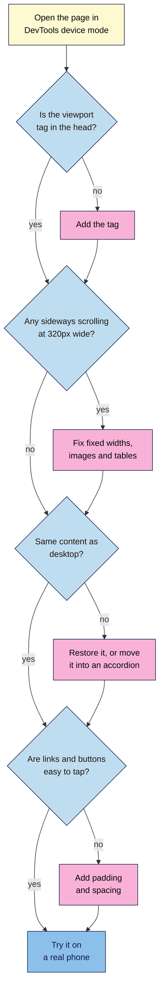

# M02.L10 — Responsive Design Basics: Viewport Meta Tag & Mobile-Friendly Layouts
> After this lesson you can make a page work on a phone, test it at phone widths, and check that mobile visitors and Google get the same content as desktop visitors.

**Time:** ~15 min reading + ~35 min hands-on + ~10 min exercise · **Level:** L1 Foundation (beginner) · **Prereqs:** M02.L08, M02.L09 · **Remediate to:** M02.L09; Web Development 101 M03.L04 (responsive, mobile-first design)
**Verified against:** Google Search Central "Mobile site and mobile-first indexing best practices", "Mobile-first indexing has landed" (2023), "Understanding page experience in Google Search results" and "Avoid intrusive interstitials and dialogs"; Search Console Help "URL Inspection tool"; MDN pages on the viewport meta tag, responsive web design, media queries, `max-width` and `overflow-x`; web.dev articles on responsive basics, tap targets and layout shift (CLS); W3C "Understanding" pages for SC 1.4.10 Reflow and 2.5.8 Target Size (Minimum); Chrome for Developers device mode docs, all on 2026-11-06. CSS samples passed the W3C CSS Validator, and Part D's Console line ran in jsdom, with `innerText` simulated. The Mobile-Friendly Test's retirement comes from third-party reports, which fit Google pointing to Lighthouse. The W3C Nu HTML Checker was rate-limiting requests, so **this lesson's HTML hasn't been through it yet**. DevTools steps and page layouts weren't run in a live browser for this draft.

> ⚠️ **Freshness flag:** Google's mobile tools have changed before. Its Mobile-Friendly Test and Mobile Usability report were retired in December 2023, so old tutorials that send you there are out of date. DevTools labels also move.

## Learning objectives
1. **Add** the viewport meta tag and explain what breaks without it. *(O1)*
2. **Build** a simple mobile-friendly layout with flexible widths and one media query. *(O2)*
3. **Test** a page at phone widths in DevTools and check that mobile shows the same content as desktop. *(O3)*

## Why it matters
Tomás checks his shop's site on his laptop, and it looks fine. Then a customer shows him the same page on a phone. The text is tiny, the price table runs off the screen, and the "Delivery" section has gone, because the theme hides it to save space. That last problem matters most. Phone visitors can't read the section, and Google uses the mobile version of a page for indexing and ranking. Being able to spot this on a phone-sized screen is a basic SEO skill.

## Core concept
**Plain version:** a responsive page uses the same HTML on every device, and CSS adjusts the layout to fit the screen.

**Analogy:** water takes the shape of whatever glass you pour it into. A responsive page is the same water. A fixed-width page is an ice block that only fits one glass.

### The viewport tag
The **viewport** is the visible area of a page in the browser. Without any instructions, a phone browser assumes a desktop page. MDN gives an example where "pages might be rendered with a virtual viewport of 980px, and then it will be shrunk down to fit". That's why old sites look tiny on phones.

This line goes in the `<head>`, and it's the one Lesson 2.3 promised:

```html
<meta name="viewport" content="width=device-width, initial-scale=1">
```

`width=device-width` makes the page match the screen's width. `initial-scale=1` sets the starting zoom. MDN says the second part is "usually unnecessary", but it's still common, and web.dev includes it. Never add `user-scalable=no`: MDN warns that it "prevents people experiencing low vision conditions from being able to read and understand page content".

### Flexible widths
Avoid fixed widths. web.dev warns: "Using pixel measurements requires the user to scroll horizontally on small screens." People expect to scroll down, not sideways.

| Instead of | Use | Why |
|---|---|---|
| `width: 1100px;` | `max-width: 60rem;` | The box can shrink on small screens |
| `` on its own | `img { max-width: 100%; height: auto; }` | The image fits its container, and it keeps its shape. Keep the `width` and `height` attributes from Lesson 2.5: web.dev says that with them, browsers can reserve the image's space while it loads |
| A wide table spilling off the screen | A wrapper with `overflow-x: auto` | W3C says a data table can sit in "its own scrollable container", so the rest of the page still fits |

W3C's reflow rule gives a useful test width: content should work "without requiring scrolling in two dimensions" at 320 CSS pixels wide (see "Under the hood" below), except for parts such as data tables that need the two dimensions.

### Media queries
A **media query** applies CSS only when a condition is true, such as a minimum screen width. The width where the layout changes is a **breakpoint**.

```css
/* Base styles: one column, for every screen */

@media (min-width: 60rem) {
  /* Extra styles for wider screens only */
}
```

This is **mobile-first design**: write the simple layout first, then add to it for wider screens. Choose breakpoints by watching your content. web.dev says: "Don't define breakpoints based on device classes, or any product, brand name, or operating system."

Don't confuse this with **mobile-first indexing**, which is what Google does. They share a name, and that's all.

### Tap targets
Fingers are bigger than mouse pointers. W3C's minimum is "at least 24 by 24 CSS pixels", with some exceptions. web.dev recommends "around 48 device independent pixels" and spacing of "about 8 pixels". Padding is the easy way to make a link or button bigger.

### What this does for search

| Claim | Verdict | What the source says |
|---|---|---|
| Google uses the mobile version for indexing | **Documented** | "Google uses the mobile version of a site's content, crawled with the smartphone agent, for indexing and ranking." The rollout finished in 2023 |
| You must have a mobile version to be indexed | **False** | Google says "it's not required", but "it is very strongly recommended" |
| Google recommends responsive design | **Documented** | "Google recommends Responsive Web Design because it's the easiest design pattern to implement and maintain." |
| Separate mobile pages can have less content | **Risky** | Google says that if a mobile page has less content on purpose, "you can expect some traffic loss". This advice is for sites with separate mobile versions |
| Text hidden with CSS on phones is safe | **Not in Google's docs** | Its mobile-first guide doesn't mention it. Either way, phone visitors lose that content, so show it or use an accordion |
| Accordions on mobile are fine | **Documented** | "Instead of removing content, consider moving content into accordions or tabs to save space." |
| Metadata can differ on mobile | **False** | Keep the `title` element and meta description "equivalent", and the same alt text, structured data and robots tags. A responsive page gets this automatically, because the HTML is the same |
| Good mobile display directly boosts rankings | **Not directly** | Google says Core Web Vitals "are used by our ranking systems", and other page experience aspects "don't directly help your website rank higher". But they're "generally aligned with what our ranking systems seek to reward", and it lists "Does your content display well on mobile devices?" among its questions. Lesson 1.7 covers usability |
| Full-page pop-ups are fine | **Avoid** | "Don't obscure the entire page with interstitials." Google suggests banners "that take up only a small fraction of the screen". Legal ones, such as age gates, are an exception |
| Use the Mobile-Friendly Test | **Out of date** | Reported as retired in December 2023 (Search Engine Land). Google's page experience page points to Lighthouse for "mobile usability" |

## How it works
Use this flow to check any page for mobile.


**In words:** open the page in device mode. Add the viewport tag if it's missing. At 320px wide, fix anything that makes the page scroll sideways, such as fixed widths, images and tables. Compare the content with desktop, and restore anything missing or move it into an accordion. Check that links and buttons are easy to tap. Finally, try it on a real phone.

> **Under the hood: a CSS pixel isn't a screen pixel.** A phone may have over 1,000 physical pixels across its screen, but it reports a much smaller width to the browser, such as 390 CSS pixels. Otherwise, text would be microscopic. `device-width` uses this smaller number, which web.dev calls "device-independent pixels". That's why a phone with a very sharp screen still gets the phone layout.

## Hands-on walkthrough
You'll see what breaks without the viewport tag, fix the wide parts of your article, add a two-column layout for wide screens, then compare a live page on phone and desktop. Nila Coffee's values are illustrative.

**Before you start: which steps apply to you?**
- **All paths:** do Parts A, B and C. They use files in your `seo-101-html` folder and don't touch any website.
- **Path A or C:** in Part D, use your project site. It only reads public pages, so path C needs no logins.
- **Path B on Blogger:** in Part D, use one of your blog posts.

**Part A — See what the viewport tag does (7 min)**
1. Open `article.html`, press **F12** (Mac: **Cmd+Option+I**) to open DevTools, and click **Toggle device toolbar** at the top.
2. Open the **Dimensions** list, and pick any phone. Reload the page.

   **Expected:** a shrunken, desktop-style page with tiny text.
   > 🖼️ **Image prompt:** Chrome DevTools device mode (1280×800) with a phone selected, showing `article.html` with tiny text and no viewport tag. Highlight the Dimensions list in the device toolbar with a 3px #F9B2D7 outline; blur any personal details.
   > **Alt text:** Device mode with a phone selected, showing an article shrunk to tiny text because it has no viewport tag.
3. In the `<head>`, below `<meta charset="utf-8">`, add the viewport tag from this lesson. Save and reload.

   **Expected:** the text is a readable size, and it fills the narrow screen. Wider parts may now run off the edge. That's Part B.

**Part B — Fix what's too wide (10 min)**
1. Set **Dimensions** to **Responsive**, type `320` in the width box, and scroll through the page. Note anything that runs off the side.

   **Expected:** your image and video run off the side, and the table may too.
2. Add this to `style.css`:
   ```css
   img {
     max-width: 100%;
     height: auto;
   }

   iframe {
     max-width: 100%;
   }

   .table-wrap {
     overflow-x: auto;
   }
   ```
3. In `article.html`, wrap your ratio table in a `<div>`:
   ```html
   <div class="table-wrap">
     <table>
       <!-- your existing table -->
     </table>
   </div>
   ```
4. Save and reload.

   **Expected:** the image and video fit the screen. If the table is wider than the screen, it scrolls on its own, and the rest of the page stays still.

**Part C — Add one media query (8 min)**
1. Add this to the end of `style.css`:
   ```css
   @media (min-width: 60rem) {
     body {
       max-width: 60rem;
       display: grid;
       grid-template-columns: 2fr 1fr;
       gap: 2rem;
     }

     header,
     footer {
       grid-column: 1 / -1;
     }
   }
   ```
   `display: grid` makes columns, and `2fr 1fr` makes the first one twice as wide as the second. The `header` and `footer` span both columns.
2. Save and reload. Drag the width handle slowly from narrow to wide, past 960px.

   **Expected:** one column on narrow screens. At 960px, your "Prefer it hot?" `<aside>` jumps beside the article. It's the same HTML, in a different layout.
   > 🖼️ **Image prompt:** Two browser views side by side (each 640×800) of `article.html`: one column at 375px, and two columns at 1024px with the "Prefer it hot?" aside on the right. Highlight the aside in both views with a 3px #F9B2D7 outline; blur any personal details.
   > **Alt text:** The same article as one column on a phone and two columns on a laptop, with its aside highlighted in both.
3. Open View Source, and confirm that nothing in your HTML changed between the two layouts.

**Part D — Compare phone and desktop on a live page (10 min)**
1. Open a page on your project site, with device mode off, on a normal laptop-sized window.
2. Open the **Console** (**Ctrl+Shift+J**, Mac: **Cmd+Option+J**), and run this line. Chrome may ask you to type `allow pasting` first.
   ```js
   console.log(document.title, '| headings', document.querySelectorAll('h1,h2,h3').length, '| links', document.querySelectorAll('a[href]').length, '| images', document.images.length, '| words', document.body.innerText.split(/\s+/).length);
   ```
   **Expected:** one line with the page's title and four counts. Note them.
3. Turn on device mode, pick a phone from **Dimensions**, reload, and run the line again.

   **Expected:** the same title and very similar counts. A lower word count is a clue, not proof. `innerText` skips closed accordions and hidden menus, so scroll through the phone view to see whether the content has moved or gone. If a section has gone from view, open **Elements**, press **Ctrl+F** (Mac: **Cmd+F**) and search for a phrase from it. If it's found, it's hidden. If it isn't, it's been removed.
4. Scroll through at phone width, and look for sideways scrolling, tiny links and pop-ups that cover the page.
5. Open View Source, and search for `viewport` to check the tag.
6. **Path A, if your site is in Search Console:** run **URL Inspection** on the page, and find **Crawled as** under **Page availability**. The Help page says it shows "desktop or mobile".
7. Add a tab called **Mobile check** to your "SEO 101 project" sheet and fill it in.

   | Check | Desktop | Phone (illustrative) |
   |---|---|---|
   | Title | Cold Brew at Home | Same |
   | Headings / links / images | 7 / 12 / 1 | 7 / 12 / 1 |
   | Visible words | 640 | 610 |
   | Viewport tag present? | — | Yes |
   | Sideways scrolling? | — | No |
   | Content missing on phone? | — | No: the menu is closed |
   | Easy to tap? | — | Footer links are too close |
   | Covers the page with a pop-up? | — | No |

8. Open the page on a real phone if you have one. DevTools calls device mode "a first-order approximation".

**Expected output:** an `article.html` and `style.css` that work from 320px to desktop, and a **Mobile check** tab.

## When to use / when not to
**Use one responsive page** by default. It's what Google recommends, and there's only one version to maintain.

**Use a media query when** the layout stops working at some width. **Don't use one to hide** content from phones.

**Use an accordion when** a section is long and secondary on phones. **Don't remove it** from the HTML.

**On a platform,** most modern themes are responsive already, and you rarely write media queries. Your job is to check the result. Page builders often let you hide a block on mobile, so look out for that setting.

**The trade-off:** a long desktop page can feel endless on a phone. Accordions fix that, but content that matters most should stay visible. Keep your main point open, and fold away the supporting detail.

## Use AI for this
**Example prompt:**
> "Here's my CSS: [paste]. At 320px wide, this element runs off the screen: [describe]. Find the cause, and suggest the smallest fix. Don't use `display: none`, and don't remove any content."

**What AI does well here:** finding fixed widths, and writing a first media query.
**Where it gets it wrong:** it may suggest `user-scalable=no`, or hide content on phones. It may also point you to Google's retired Mobile-Friendly Test, or use breakpoints named after devices.
**How to check:** test the result in device mode at 320px, and compare the content with desktop.

## Common mistakes
- **Leaving out the viewport tag.** Phones then show a shrunken desktop page.
- **Disabling zoom with `user-scalable=no`.** It blocks people who need to zoom in.
- **Using fixed pixel widths on layouts.** Use `max-width`.
- **Hiding content on phones.** Phone visitors lose it, and Google uses the mobile version for indexing.
- **Removing `width` and `height` from images.** Keep them, and use `height: auto`.
- **Naming breakpoints after devices.** Let your content decide.
- **Testing only on your laptop.** Most of the problems here don't show up there.
- **Confusing mobile-first design with mobile-first indexing.** One's how you write CSS, and the other's what Google does.
- **Following old guides to the Mobile-Friendly Test.** It's gone.

## Troubleshooting
| Symptom | Likely cause | Fix |
|---|---|---|
| The page looks tiny on phones | No viewport tag, or it's misspelled | Check the tag in the `<head>` |
| The page scrolls sideways | One element is too wide | At 320px, inspect anything that sticks out |
| An image looks stretched | `max-width` without `height: auto` | Add `height: auto` |
| A media query does nothing | A typo, a missing `}`, or a rule later in the file overrides it | Check the braces, and look in **Styles** |
| Styles only work in device mode | The width is below your breakpoint | Check the width shown in the toolbar |
| The video is narrow but very tall | Its `height` attribute stays at 315 | Fine for now. `aspect-ratio` can fix it, if you want to explore |
| Word counts differ a lot | Closed menus, accordions, or content really removed | Scroll through and compare by eye |
| **Toggle device toolbar** isn't where the steps say | Labels move between versions | Search for it in the Command Menu (**Ctrl+Shift+P**, Mac: **Cmd+Shift+P**) |

## Exercise
**Task:** complete your **Mobile check** tab (Part D). Then review this planted page. Seven things need fixing, and one must be left alone. Find them all, and test your fixed version at 320px.

```html
<!DOCTYPE html>
<html lang="en">
  <head>
    <meta charset="utf-8">
    <meta name="viewport" content="width=1024, user-scalable=no">
    <title>Coffee Gift Boxes | Nila Coffee</title>
    <style>
      .page { width: 1100px; margin: 0 auto; }
      .photo { width: 900px; }
      .buy { font-size: 0.7rem; padding: 1px; }
      .offer { position: fixed; top: 0; left: 0; width: 100%; height: 100%; background-color: #ffffff; }
      @media (max-width: 600px) {
        .delivery { display: none; }
      }
    </style>
  </head>
  <body>
    <div class="offer">
      <p>Join our list for 10% off!</p>
    </div>
    <div class="page">
      <h1>Coffee Gift Boxes</h1>
      
      <a class="buy" href="order.html">Buy now</a>
      <section class="delivery">
        <h2>Delivery</h2>
        <p>Gift boxes arrive within 5 days across India.</p>
      </section>
      <details>
        <summary>What's in the box?</summary>
        <p>Two 250 g bags of House Blend and a brewing guide.</p>
      </details>
    </div>
  </body>
</html>
```

**Expected outcome:** a complete tab, and these answers:

*Fix:*
1. Change the viewport's width to `width=device-width`.
2. Remove `user-scalable=no`.
3. Change `.page` to `max-width: 60rem;`, and add some side padding.
4. Change `.photo` to `max-width: 100%; height: auto;`.
5. Make `.buy` easier to tap, with a larger `font-size` and more padding, such as `padding: 0.75rem 1.5rem; display: inline-block;`.
6. Replace the full-page `.offer` with a small banner, or remove it.
7. Delete the media query that hides `.delivery`. If you need to save space, use an accordion.

*Leave alone:* the `<details>` block. It's an accordion, and its text is in the HTML.

The W3C CSS Validator reports no errors here, because this CSS is all valid. Checkers test rules, not whether a page works on a phone.

**Stretch goal:** find a block on your project site that's hidden on phones. Write a one-line brief that asks for it to be restored or moved into an accordion.

## Key takeaways
- Every page needs the viewport tag, and it should never disable zoom.
- Responsive design means the same HTML on every device, with CSS adjusting the layout.
- Use flexible widths, `max-width: 100%` on images, and a scroll wrapper for wide tables.
- Mobile-first design starts simple, then adds styles with `min-width` media queries.
- Google uses the mobile version for indexing and ranking, so mobile needs the same content and metadata as desktop.
- Test at 320px in device mode, compare with desktop, then try a real phone.

## Teach it back
Explain to a friend in 3 sentences why hiding a section on phones can hurt a page, even when the desktop version still shows it.

## Glossary terms added
- Breakpoint — added to `seo-101/glossary.md`
- Device mode — added to `seo-101/glossary.md`
- Media query — added to `seo-101/glossary.md`
- Mobile-first design — added to `seo-101/glossary.md`
- Mobile-first indexing — added to `seo-101/glossary.md`
- Responsive design — added to `seo-101/glossary.md`
- Tap target — added to `seo-101/glossary.md`
- Viewport — added to `seo-101/glossary.md`

## Further reading
*All checked 2026-11-06.*
- Google Search Central — Mobile site and mobile-first indexing best practices: https://developers.google.com/search/docs/crawling-indexing/mobile/mobile-sites-mobile-first-indexing
- Google Search Central — Mobile-first indexing has landed (2023): https://developers.google.com/search/blog/2023/10/mobile-first-is-here
- Google Search Central — Understanding page experience in Google Search results: https://developers.google.com/search/docs/appearance/page-experience
- Google Search Central — Avoid intrusive interstitials and dialogs: https://developers.google.com/search/docs/appearance/avoid-intrusive-interstitials
- Search Console Help — URL Inspection tool: https://support.google.com/webmasters/answer/9012289
- MDN — `<meta name="viewport">`: https://developer.mozilla.org/en-US/docs/Web/HTML/Reference/Elements/meta/name/viewport
- MDN — Responsive web design: https://developer.mozilla.org/en-US/docs/Learn_web_development/Core/CSS_layout/Responsive_Design
- MDN — Using media queries: https://developer.mozilla.org/en-US/docs/Web/CSS/Guides/Media_queries/Using
- MDN — `overflow-x`: https://developer.mozilla.org/en-US/docs/Web/CSS/Reference/Properties/overflow-x
- web.dev — Responsive web design basics: https://web.dev/articles/responsive-web-design-basics
- web.dev — Accessible tap targets: https://web.dev/articles/accessible-tap-targets
- web.dev — Guide to layout shift (CLS): https://web.dev/articles/optimize-cls
- W3C — Understanding SC 1.4.10 Reflow: https://www.w3.org/WAI/WCAG22/Understanding/reflow.html
- W3C — Understanding SC 2.5.8 Target Size (Minimum): https://www.w3.org/WAI/WCAG22/Understanding/target-size-minimum.html
- Chrome for Developers — DevTools device mode: https://developer.chrome.com/docs/devtools/device-mode

**Reported by third parties, not Google documentation:**
- Search Engine Land — Google officially drops Mobile Usability report, Mobile-Friendly Test tool and Mobile-Friendly Test API: https://searchengineland.com/google-officially-drops-mobile-usability-report-mobile-friendly-test-tool-and-mobile-friendly-test-api-435377

> ⚠️ **May change:** Google's mobile testing tools and advice; DevTools labels; web.dev's tap target figures, which show no date.

## Refresher card
*Used by remediation when a learner fails a quiz twice on a later lesson that points back here.*
**Viewport tag:** `<meta name="viewport" content="width=device-width, initial-scale=1">` in the `<head>`. Without it, phones show a shrunken desktop page. Never use `user-scalable=no`. **Responsive design:** same HTML on every device, and Google's recommended pattern. **Flexible widths:** `max-width` not fixed `width`, `img { max-width: 100%; height: auto; }`, and `overflow-x: auto` on a wrapper for wide tables. **Media query:** `@media (min-width: 60rem) { … }`. Mobile-first design adds to a simple base. Let content choose breakpoints. **Tap targets:** at least 24×24 CSS pixels, ideally around 48. **Google:** uses the mobile version for indexing and ranking, so keep content, titles, meta descriptions, alt text and structured data the same. Accordions are fine. Removing content is risky, and hiding it with CSS still loses phone visitors. **Test:** device mode at 320px, compare with desktop, then a real phone. The Mobile-Friendly Test is gone.
