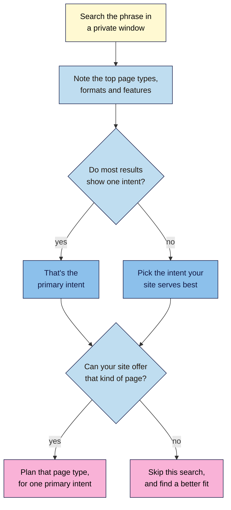

# M03.L01 — Search Intent: Reading the Results Page Before You Write
> After this lesson you can work out what a search really wants, read that from the results page, and choose the type of page that fits.

**Time:** ~15 min reading + ~30 min hands-on + ~10 min exercise · **Level:** L1 Foundation (beginner) · **Prereqs:** M01.L05, M01.L07 · **Remediate to:** M01.L05
**Verified against:** Google "How Search Works" (ranking results); Google Search Quality Rater Guidelines (version dated September 11, 2025, sections 12.5 and 12.7); Google Search Central "SEO Starter Guide", "Creating helpful, reliable, people-first content" and "AI features and your website"; Google Search Help "Why your Google Search results differ from others"; Broder, "A taxonomy of web search" (2002), all on 2026-11-06. Bing's guidelines page returned no readable text, so nothing here is specific to Bing. Word clues and results-page signals are observed practice, labelled as such.

> ⚠️ **Freshness flag:** results pages change all the time, and AI features change fastest. Intent is a way of thinking, so it ages well. What a given search shows today doesn't, so date every check.

## Learning objectives
1. **Classify** searches as informational, navigational, commercial or transactional. *(O1)*
2. **Read** a results page for intent signals: page types, formats and SERP features. *(O2)*
3. **Choose** the page type that fits a search's one primary intent. *(O3)*

## Why it matters
Kavya writes a careful 2,000-word article called "Yoga Classes in Chennai", about the history of yoga in the city. It never gets near the first page. When she finally searches that phrase, she sees a map of studios, directories and class timetables. People searching it want to find a class, not read history. Her article is good, but it answers a different question. This is why the course's rule is **read the results page before you write**: content that doesn't match what people want rarely ranks, however good it is *(observed practice)*.

## Core concept
**Plain version:** **search intent** is what someone is trying to get done when they search. Google's rater guidelines put it this way: "What the user is trying to accomplish when they search."

**Analogy:** two people walk into Tomás's shop. One asks, "How do I fix a dripping tap?" The other asks, "Do you have a 15mm washer?" Both are talking about taps, but one needs advice and the other needs a product. A good shopkeeper hears the difference. So does a good results page.

### The four types
These are the four types SEOs use. The first three go back to a 2002 paper by Andrei Broder, and "commercial" is an SEO addition. Google's raters use their own terms, and the last column shows the closest match *(our mapping, not Google's)*.

| Intent | They want to… | Nila Coffee example | Word clues *(observed)* | Closest rater term |
|---|---|---|---|---|
| **Informational** | Learn something | "how long does cold brew last" | how, why, what, guide, ideas | Know, Know Simple |
| **Navigational** | Reach a specific site or page | "nila coffee contact" | A brand or site name | Website |
| **Commercial** | Compare before they decide | "best coffee subscription india" | best, review, vs, top | No direct match |
| **Transactional** | Do something now, such as buy or book | "buy cold brew concentrate" | buy, order, price, book | Do |

Broder's definitions are short: for navigational, "The immediate intent is to reach a particular site". For transactional, "The intent is to perform some web-mediated activity".

**Local searches** sit across these types. Google says it can "recognise many queries have a local intent", so "coffee roasters in kochi" may show a map, even though the person could be comparing or ready to visit. Raters call this a Visit-in-person query. Module 11 covers local SEO.

### Reading the results page
Word clues are only a hint. The results page is better evidence, because it shows what Google currently thinks fits. Look at three things *(observed practice)*:

| What to look at | What it suggests |
|---|---|
| **Page types** in the top results | Blog posts and guides suggest informational. Comparison lists suggest commercial. Product and category pages suggest transactional. One brand filling the page suggests navigational |
| **Formats** | Numbered steps, videos, tables, images or forums show how people like the answer |
| **SERP features** (Lesson 1.5) | A map suggests local. Shopping results suggest buying. People Also Ask suggests questions. An AI Overview suggests people want the gist of a topic |

### When a search has more than one meaning
Raters are told: "Many queries have more than one likely user intent." Their guidelines separate:
- The **dominant interpretation**: "what most users mean when they type the query". They add: "Not all queries have a dominant interpretation."
- **Common interpretations**, which "many or some users" mean.
- **Minor interpretations**, which fewer people have in mind.

So "cold brew" could mean a recipe, a shop product or a definition. If the results are mixed, pick the intent your site can serve best, and write for that. A page that tries to serve every intent usually serves none of them well *(observed practice)*. That's this course's rule: **one primary intent per page**.

### What this does for search

| Claim | Verdict | What the source says |
|---|---|---|
| Google tries to work out intent | **Documented** | "To return relevant results, we first need to establish what you're looking for—the intent behind your query." |
| Google uses these four labels | **Not in Google's docs** | They're an SEO convention. Raters use Know, Do, Website and Visit-in-person |
| Rater guidelines are Google's ranking rules | **False** | "No single rating can directly impact how a particular webpage, website, or result appears in Google Search". And: "Rater data is not used directly in our ranking algorithms." They still show how Google thinks about quality |
| Your page must use the exact search words | **False** | "Google's language matching systems are sophisticated and can understand how your page relates to many queries, even if you don't explicitly use the exact terms in them." |
| Everyone sees the same results | **False** | "Time may be one of the biggest reasons why results vary between people." Google also uses "your location, past Search history, and Search settings" |
| Every search gets an AI Overview | **False** | Google says they're shown only when "additive to classic Search, and as such, often don't trigger" |
| You need special work for AI Overviews | **False** | "There are no additional requirements to appear in AI Overviews or AI Mode". Our follow-on course, Modern SEO 101, covers AI search |
| Write for any intent that gets traffic | **Risky** | Google asks: "Is the content primarily made to attract visits from search engines?" Stay with what your audience needs |

## How it works
Use this flow before you write or change a page.

**In words:** search the phrase in a private window, and note the top page types, formats and features. If most results show one intent, that's your primary intent. If they're mixed, pick the one your site serves best. If your site can offer that kind of page, plan it, with one primary intent. If it can't, skip the search and find a better fit.

> **Under the hood: why the page can change.** Google's systems don't apply one fixed weighting. Google says: "The weight applied to each factor varies depending on the nature of your query." Fresh content matters more for current news than for dictionary definitions. So intent can shift too: "coffee festival" may want dates near the event, and history the rest of the year *(illustrative)*. That's why you record the date of each check.

## Hands-on walkthrough
You'll sort example searches, read one results page closely, then check ten searches for your project site. You need a browser and your "SEO 101 project" sheet. Nila Coffee's values are illustrative.

**Before you start: which steps apply to you?**
- **All paths:** do all four parts. They only use public search results, so path C needs no logins. For a practice site, use the topic of your blog.

**Part A — Sort by word clues (5 min)**
1. Without searching, label each of these by intent: "what is cold brew", "nila coffee login", "cold brew vs iced coffee", "order coffee beans online", "best burr grinder under 5000", "how to descale a kettle".

   **Expected:** informational, navigational, commercial (or informational), transactional, commercial, informational.
2. Note that "cold brew vs iced coffee" could go either way. That's why Part B matters.

**Part B — Read one results page (8 min)**
1. Open a private window, and search **cold brew vs iced coffee**.
2. Go through the top five organic results, ignoring ads. For each one, note the page type and format.

   **Expected:** mostly articles explaining the difference. Your results may vary, so trust what you see over this lesson.
3. Note the features, from top to bottom, as you did in Lesson 1.5.
   > 🖼️ **Image prompt:** Desktop Google results page (1280×900) for a comparison search such as "cold brew vs iced coffee", showing the first few organic results and a People Also Ask box. Highlight the People Also Ask box with a 3px #F9B2D7 outline; blur any personal details.
   > **Alt text:** A results page for a comparison search, with its People Also Ask box highlighted.
4. Decide: is this informational or commercial? Write one sentence of evidence.

   **Expected:** something like "Informational: the top results explain the difference, and none sell anything."

**Part C — Check ten searches for your site (12 min)**
1. List ten searches that your audience might use. Use your marketing snapshot from Lesson 1.1, and aim for a mix of types. Lesson 3.2 will find many more.
2. Add a tab called **Intent check** to your "SEO 101 project" sheet. Write your location and device at the top, because results vary with both.
3. Search each one in a private window, and fill in a row.

   | Search | Date | Word-clue guess | Top page types | Features | Primary intent | Best page type |
   |---|---|---|---|---|---|---|
   | best coffee subscription india | 2026-11-06 | Commercial | Lists, reviews, 1 brand page | People Also Ask | Commercial | Comparison article |
   | cold brew ratio | 2026-11-06 | Informational | Guides, recipes, video | AI Overview, People Also Ask | Informational | Guide with a table |

   **Expected:** ten dated rows. In at least one, your word-clue guess may turn out wrong. Mark any with mixed results as "Mixed", and name the intent you'd pick.
   > 🖼️ **Image prompt:** A Google Sheets tab called Intent check (1200×500) with ten dated rows, and columns for search, page types, features and primary intent. Highlight the Primary intent column with a 3px #F9B2D7 outline; blur any personal details.
   > **Alt text:** A spreadsheet tab of ten dated searches, with the primary intent column highlighted.

**Part D — Compare with what you already have (5 min)**
1. Pick three searches from your tab that matter to the business.
2. For each one, find the page on your project site that comes closest. Note its page type.
3. Add two columns: **Our page** and **Match?**. Use "Yes", "Wrong type" or "No page".

   **Expected:** at least one "Wrong type" or "No page". Those are your first real opportunities, and you'll use them in Lessons 3.4 and 3.5.

**Expected output:** an **Intent check** tab with ten dated searches and three comparisons.

## When to use / when not to
**Use this check** before you write any new page, and before you rewrite a page that isn't performing.

**Trust the results page over the word clues,** and over any tool's intent label. Tools guess from patterns, and they can be wrong *(observed practice)*.

**Don't chase an intent your business can't serve.** If a search only shows big retailers' product pages and you sell nothing, it isn't for you.

**Don't reshape your site for one search.** If the top results for a phrase don't suit your audience, leave it.

**The trade-off:** matching the page type gives you a realistic chance, but copying what ranks gives nobody a reason to choose you. Match the *type* of page, then be more useful than what's there. Google asks: "Does the content provide original information, reporting, research, or analysis?"

## Use AI for this
**Example prompt:**
> "Here are the page types and features I recorded from a results page for the search [phrase]: [paste notes]. Which intent do they suggest, and what page type fits? Say if the evidence is mixed. Use only my notes."

**What AI does well here:** sorting long lists into likely intents, and spotting patterns in your notes.
**Where it gets it wrong:** it can't see today's results for your location, so it guesses. It'll sound confident about searches it never ran.
**How to check:** search the phrase yourself, and treat AI's label as a first guess.

## Common mistakes
- **Writing first and checking later.** Read the results page before you plan the page.
- **Trusting word clues alone.** "Best" often means commercial, but not always.
- **Treating one person's results as the truth.** Use a private window, and date your checks.
- **Blending intents on one page.** Pick one primary intent.
- **Fighting the page type.** A blog post rarely breaks into results full of product pages *(observed practice)*.
- **Copying the top result.** Match the type, then add something new.
- **Calling rater guidelines ranking rules.** Raters don't control rankings.
- **Forgetting local searches.** A map changes what kind of page can appear.

## Troubleshooting
| Symptom | Likely cause | Fix |
|---|---|---|
| The results are a mix of types | The search has several intents | Note the mix, and pick the one you can serve best |
| Results look very different from a colleague's | Location, language, device or timing | Note your location and device, and use a private window |
| Everything is from one brand | It's a navigational search | Leave it unless that's your brand |
| Ads fill the top of the page | Common on buying searches | Ignore ads when reading page types, and note that businesses pay to appear here |
| An AI Overview covers the answer | The topic suits a short summary | Record it, and read the organic results underneath |
| You land in AI Mode, not the usual results | It's a separate AI view | Go back to the main results, because this check reads those |
| You can't tell page types apart | The title isn't enough | Open the result, and look at what the page does |

## Exercise
**Task:** complete your **Intent check** tab (Parts C and D). Then review these page plans for Nila Coffee. The results are illustrative. Say which plans fit, and fix those that don't. Four need changing, and two are fine.

| # | Search | Top results show | Planned page |
|---|---|---|---|
| 1 | how to clean a french press | Step-by-step guides, videos | A French press product page |
| 2 | buy coffee grinder | Product pages, shopping results | A 2,000-word history of coffee grinders |
| 3 | best coffee subscription india | Comparison lists, reviews | The Nila Coffee sign-up page, with no comparison |
| 4 | nila coffee contact | Nila's contact page, a map | A new blog post called "How to Contact Us" |
| 5 | cold brew ratio | Short guides, tables, recipes | A guide with a ratio table |
| 6 | coffee roasters in kochi | Map, directories, roasters' pages | A Kochi location page with address and hours |

**Expected outcome:** a complete tab, and these answers:
1. **Change:** informational. Write a step-by-step guide, and link to the product from it.
2. **Change:** transactional. Use a product or category page.
3. **Change:** commercial. Write an honest comparison, with a link to your sign-up page.
4. **Change:** navigational. You already have the right page, so make sure it's clear and easy to find.
5. **Fine:** the guide fits, and a table suits the format.
6. **Fine:** a location page suits a local search. Module 11 covers the rest.

**Stretch goal:** find a search in your tab where the results are clearly mixed. Write down the dominant interpretation, if there is one, and the intent you'd choose.

## Key takeaways
- Search intent is what someone wants to get done: informational, navigational, commercial or transactional, with local searches across them.
- The results page is better evidence than word clues or a tool's label.
- Read page types, formats and features, and date every check.
- Give each page one primary intent, and match the page type.
- Rater guidelines show how Google thinks, but they aren't ranking rules.

## Teach it back
Explain to a friend in 3 sentences why a brilliant article can fail to rank for a search that shows only product pages.

## Glossary terms added
- Commercial intent — added to `seo-101/glossary.md`
- Dominant interpretation — added to `seo-101/glossary.md`
- Informational intent — added to `seo-101/glossary.md`
- Navigational intent — added to `seo-101/glossary.md`
- Page type — added to `seo-101/glossary.md`
- Primary intent — added to `seo-101/glossary.md`
- Search intent — added to `seo-101/glossary.md`
- Transactional intent — added to `seo-101/glossary.md`

## Further reading
*All checked 2026-11-06.*
- Google — How Search Works, ranking results: https://www.google.com/search/howsearchworks/how-search-works/ranking-results/
- Google — Search Quality Rater Guidelines (PDF, version dated September 11, 2025): https://guidelines.raterhub.com/searchqualityevaluatorguidelines.pdf
- Google Search Central — SEO Starter Guide: https://developers.google.com/search/docs/fundamentals/seo-starter-guide
- Google Search Central — Creating helpful, reliable, people-first content: https://developers.google.com/search/docs/fundamentals/creating-helpful-content
- Google Search Central — AI features and your website: https://developers.google.com/search/docs/appearance/ai-features
- Google Search Help — Why your Google Search results differ from others: https://support.google.com/websearch/answer/12412910
- Andrei Broder — A taxonomy of web search (PDF, 2002): https://www.sigir.org/files/forum/F2002/broder.pdf

> ⚠️ **May change:** results-page layouts and features; AI Overviews and AI Mode; the rater guidelines, which Google updates from time to time.

## Refresher card
*Used by remediation when a learner fails a quiz twice on a later lesson that points back here.*
**Search intent** is what someone wants to get done. **Informational:** learn. **Navigational:** reach a site. **Commercial:** compare. **Transactional:** act now. Local searches sit across these. The four labels are an SEO convention, and Google's raters say Know, Do, Website and Visit-in-person. **Read the results page:** in a private window, note the top page types, formats and features, and date it. Results vary by time, location and device. **Mixed results:** pick the intent your site serves best. **Rule:** one primary intent per page, and match the page type, then be more useful than what's there. Rater guidelines aren't ranking rules.
