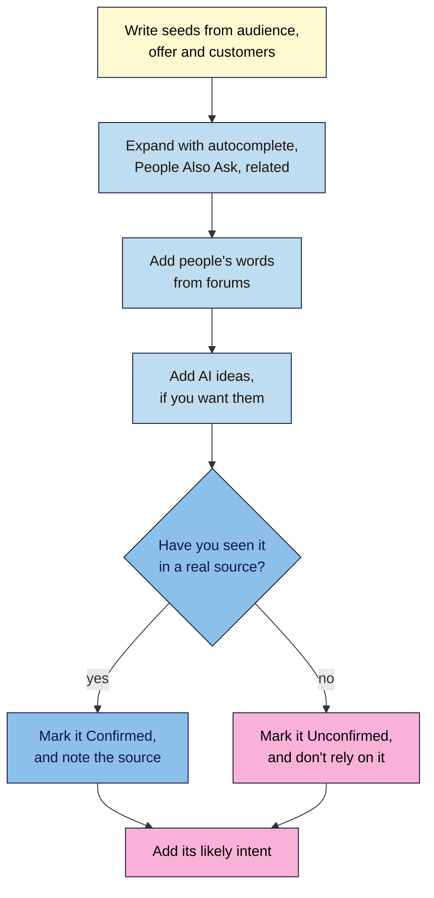

# M03.L02 — Finding Keywords: Seed Terms, Long-Tail Phrases and Real Questions
> After this lesson you can start from what you know about your audience, grow it into a list of real phrases, and tell those apart from phrases an AI tool made up.

**Time:** ~15 min reading + ~35 min hands-on + ~10 min exercise · **Level:** L1 Foundation (beginner) · **Prereqs:** M03.L01, M01.L01 · **Remediate to:** M03.L01
**Verified against:** Google Search Help "How Google autocomplete predictions work" and "Performance report (Search results)"; Google Search Central "Visual Elements gallery of Google Search", "SEO Starter Guide" and "Spam policies for Google web search", all on 2026-11-06. "Seed term" and "long-tail" are SEO terms, not Google's. Search techniques here are observed practice, labelled as such.

> ⚠️ **Freshness flag:** what autocomplete, People Also Ask and related searches show changes all the time. Date your list, and expect different phrases from the examples here.

## Learning objectives
1. **Build** a seed list from your audience, offer and customers' own words. *(O1)*
2. **Expand** it with autocomplete, People Also Ask, related searches and forums. *(O2)*
3. **Separate** real phrases people use from AI-suggested ones you can't confirm. *(O3)*

## Why it matters
Tomás's shop site calls a part a "ceramic disc cartridge". That's the right name, and it's what his suppliers say. His customers walk in and ask for help with a "tap that won't stop dripping". If his pages only use the trade name, he's writing for suppliers. Google's starter guide makes the same point: "Users who know a lot about the topic might use different keywords in their search queries than someone who is new to the topic." Keyword research is how you find out what your audience really says, so that you stop guessing.

## Core concept
**Plain version:** a **keyword** is a word or phrase that people search for. You start with a few broad terms from your own knowledge, then look for the longer phrases and questions that real people use.

**Analogy:** think of it as listening in Tomás's shop for a week and writing down how people ask for things. You aren't making up what they might say. You're noting what they do say.

### The building blocks

| Term | What it means | Nila Coffee example |
|---|---|---|
| **Seed term** | A short, broad starting point | "cold brew" |
| **Long-tail phrase** | A longer, more specific search. Each one gets fewer searches, but the need is clearer | "cold brew ratio for a 1 litre jar" |
| **Question** | A phrase that asks something directly | "why is my cold brew bitter" |

"Long-tail" is really about how few people search a phrase, not how many words it has. Long phrases are usually long-tail, though, so length is a handy clue *(observed practice)*. You'll check real numbers in Lesson 3.3.

### Where seeds come from
Start with what you know, before you open any tool.
- **Your audience:** the snapshot from Lesson 1.1, and the problems those people have.
- **Your offer:** what you sell, teach or write about, in plain words.
- **Customers' own words:** emails, reviews, phone calls, questions in class or at the counter. This is the best source *(observed practice)*, because no tool can give it to you. Copy the words, and leave out names and personal details.

### Where to expand them

| Source | What it gives you | What Google says |
|---|---|---|
| **Autocomplete** | Common endings for what you've started to type | Predictions "reflect real searches that have been done on Google" |
| **People Also Ask** | Questions on the same topic | It's "a cluster of questions that are related to what the user initially searched for" |
| **Related searches** | Other ways of searching the topic | It's "a cluster of related searches that other people have done" |
| **Forums and communities** | Whole questions in people's own words | Not a Google source. It's evidence of how people talk, not proof of what they search *(observed practice)* |
| **Search Console** | Searches that already bring your site visits | The Queries view groups "your data by the search query users typed". Lesson 3.3 covers this |

Google suggests this habit too: "it can be helpful to pay attention to the related search queries when you're thinking about topics you could write about for your site."

### Real phrases and AI phrases
AI tools are great at producing plausible phrases. Plausible isn't the same as real. So every phrase in your list gets a status:
- **Confirmed:** you've seen it in one of the sources above, and you know which one.
- **Unconfirmed:** it came from AI or your own guess, and you haven't seen it anywhere yet.

Unconfirmed doesn't mean wrong. Plenty of real searches are too rare to show up in autocomplete. It means you've no evidence yet, so it shouldn't drive a decision.

### What this does for search

| Claim | Verdict | What the source says |
|---|---|---|
| Autocomplete is based on real searches | **Documented** | Predictions "reflect real searches that have been done on Google" |
| Everyone sees the same predictions | **False** | Google also considers "The location a query is coming from", "Trending interest in a query" and "Your past searches" |
| Autocomplete shows everything people search | **False** | Some are removed: "our enforcement teams remove those that violate our policies" |
| Your page needs every variation of a phrase | **False** | "don't worry if you don't anticipate every variation of how someone might seek your content" |
| Repeating keywords helps | **False** | "Keyword stuffing refers to the practice of filling a web page with keywords or numbers in an attempt to manipulate rankings in Google Search results." |
| Every phrase deserves its own page | **Risky** | "Scaled content abuse is when many pages are generated for the primary purpose of manipulating search rankings and not helping users." A list of 40 phrases isn't a plan for 40 pages |
| AI tools know search volumes | **Unsupported** | Unless it's reading a real data source, a number from AI has nothing behind it *(observed practice)*. Lesson 3.3 shows where real data comes from |

## How it works
Use this flow each time you research a topic.

**In words:** write seeds from your audience, offer and customers. Expand them with autocomplete, People Also Ask and related searches, then add people's words from forums. Add AI ideas if you want them. If you've seen a phrase in a real source, mark it Confirmed and note where. If you haven't, mark it Unconfirmed and don't rely on it. Then add each phrase's likely intent.

> **Under the hood: why you use a private window.** Google says that predictions consider "The location a query is coming from" and "Your past searches". A private window keeps your past searches out of it, but your rough location still counts *(observed practice)*, so your list will suit your area. That's useful for a local business. If your audience lives elsewhere, ask someone there to check a few phrases.

## Hands-on walkthrough
You'll turn five seed terms into at least 40 phrases, and record where each one came from. You need a browser and your "SEO 101 project" sheet. Nila Coffee's values are illustrative.

**Before you start: which steps apply to you?**
- **Path A (your own site):** do every part, and use your real customers' words.
- **Path B (Blogger practice site):** you won't have customers yet, so in Part A use forums and your own questions.
- **Path C (client site):** ask the client for common customer questions. Don't use their accounts, so skip step 4 of Part D, and keep any customer details out of your sheet.

**Part A — Write five seeds (6 min)**
1. Add a tab called **Keyword ideas** to your "SEO 101 project" sheet, with these columns:

   | Phrase | Seed | Source | Date | Status | Likely intent |
   |---|---|---|---|---|---|
   | why is my cold brew bitter | cold brew | Customer email | 2026-11-06 | Confirmed | Informational |

2. Write five seeds, using your Lesson 1.1 snapshot and your **Intent check** tab. Aim for two from your offer, two from your audience's problems, and one in customers' words.

   **Expected:** Nila Coffee's five might be "cold brew", "coffee beans", "french press", "coffee subscription" and "bitter coffee". Keep them short: one to three words.

**Part B — Autocomplete (7 min)**
1. Open a private window, and go to Google. Type your first seed, and stop before you press Enter.
2. Add each prediction that fits your audience to your tab, with "Autocomplete" as the source.
   > 🖼️ **Image prompt:** Google's search box (900×500) with "cold brew" typed in and the list of predictions open underneath. Highlight the list of predictions with a 3px #F9B2D7 outline; blur any personal details.
   > **Alt text:** Google's search box with a partly typed search, and its list of predictions highlighted.
3. Now add words after the seed, one at a time: "how", "why", "best", "for", "vs", and then a few letters of the alphabet *(observed practice)*.

   **Expected:** different predictions each time, such as "cold brew vs iced coffee". Skip anything that isn't for your audience, such as a brand you don't sell.
4. Repeat with your other seeds, until you have about 20 phrases.

**Part C — People Also Ask and related searches (7 min)**
1. Search your first seed. Find **People Also Ask**, and open two or three questions. Opening one often adds more questions below *(observed)*.
2. Add the useful questions, with "People Also Ask" as the source.
3. Scroll to the related searches near the bottom of the page, and add what fits.

   **Expected:** not every search shows both. Move on if yours doesn't.
4. Repeat with two more seeds.

**Part D — People's own words (5 min)**
1. Find where your audience asks questions in public: Reddit, Quora, a public Facebook group, or the comments on a YouTube video.
2. To search one site, use the `site:` operator from Lesson 1.5, such as `site:reddit.com cold brew bitter`.
3. Read a few post titles. Add any wording you hadn't found, with the site as the source. Read only: don't post, and leave out people's names.

   **Expected:** longer, messier phrases, such as "cold brew tastes like nothing". Keep them as people wrote them.
4. If you have Search Console access to your project site, open **Performance**, and glance at the queries for phrases you've missed. Otherwise skip this step, and Lesson 3.3 will come back to it.

**Part E — Test some AI ideas (8 min)**
1. Ask an AI tool for ten more phrases, using the prompt in "Use AI for this" below. Add them with "AI" as the source, and "Unconfirmed" as the status.
2. Test each one. Type it into Google in your private window, and see if autocomplete predicts it. Then search it in quotes, as you did in Lesson 1.5, to find those exact words on public pages. A forum post or a question on a real page counts. An SEO article that lists keywords doesn't.
3. If you find it, change the status to Confirmed, and change the source to where you saw it. If you don't, leave it Unconfirmed.

   **Expected:** some will be confirmed, and some won't. Note how many of each, because it's a useful warning about how far to trust AI's lists.

**Part F — Add intent (2 min)**
1. Fill in **Likely intent** for every phrase, using word clues from Lesson 3.1. It's only a first guess for now.
   > 🖼️ **Image prompt:** A Google Sheets tab called Keyword ideas (1200×500) with columns for phrase, seed, source, date, status and likely intent, and a mix of Confirmed and Unconfirmed rows. Highlight the Status column with a 3px #F9B2D7 outline; blur any personal details.
   > **Alt text:** A spreadsheet of keyword phrases with their sources, with the Status column highlighted.

**Expected output:** a **Keyword ideas** tab with at least 40 phrases from at least three sources, each with a source, a date, a status and a likely intent.

## When to use / when not to
**Use this process** when you start a new site or topic, and whenever your offer or audience changes.

**Use customers' words first.** Where they disagree with a tool, trust the customer, then check the phrase.

**Don't collect for the sake of it.** Once new searches give you the same phrases again, stop and move on.

**Don't drop a phrase because it's rare.** A very specific question can come from the person most ready to act *(observed practice)*.

**The trade-off:** doing this by hand is slower than a tool, but you see the results as you go, and you learn how your audience talks. Free keyword tools are in Lesson 3.3.

## Use AI for this
**Example prompt:**
> "I run [site] for [audience]. Here are real phrases from my research: [paste 10]. Suggest ten more phrases this audience might search, in the same style. Don't give search volumes or any other numbers. I'll check each one myself."

**What AI does well here:** suggesting angles you hadn't thought of, and rewording a phrase the way a beginner might say it.
**Where it gets it wrong:** it writes phrases that sound right but that nobody uses, and it can produce exact-looking search volumes with nothing behind them.
**How to check:** run Part E on every phrase. Ignore any number that doesn't come from a named data source.

## Common mistakes
- **Starting with a tool.** Start with your audience and their words.
- **Using only trade terms.** Your audience may not know them.
- **Researching in the wrong language or place.** Tomás's customers in Lisbon search in Portuguese, so that's where he should look.
- **Forgetting the source.** A phrase with no source can't be trusted later.
- **Treating AI's list as research.** It's a list of ideas until you confirm it.
- **Copying AI's numbers into your sheet.** Leave the number out.
- **Planning one page per phrase.** Lesson 3.5 groups phrases into topics.
- **Taking people's names or private details.** Keep only the words.

## Troubleshooting
| Symptom | Likely cause | Fix |
|---|---|---|
| Autocomplete shows very little | The phrase is rare, or it's too long | Use a shorter seed, or try another word order |
| Predictions look personal | You're signed in, or your history is on | Use a private window |
| Results are in the wrong language or country | Your location or language settings | Check your Search settings, and note where you searched |
| No People Also Ask box | Not every search has one | Try the seed as a question, or use another source |
| A forum needs a login | The group is private | Use public pages, and don't sign up just to copy posts |
| Every phrase is about one thing | Your seeds are too alike | Write a seed from a different customer problem |
| The list has phrases you can't serve | The seed is too broad | Delete them, or mark them "Not for us" |

## Exercise
**Task:** complete your **Keyword ideas** tab (Parts A–F). Then review this list from Nila Coffee's intern. For each row, say Keep, Check first or Fix, and give a reason. The rows are illustrative.

| # | Phrase | Source | Status given | Note |
|---|---|---|---|---|
| 1 | how long does cold brew last | Autocomplete, 2026-11-06 | Confirmed | — |
| 2 | artisanal cold extraction methodology | AI | Confirmed | "It sounds right" |
| 3 | cold brew recipe | AI | Confirmed | "40,500 searches a month, AI said" |
| 4 | cold brew tastes like nothing | Reddit post title, 2026-11-06 | Confirmed | — |
| 5 | best cold brew maker for small kitchen | AI | Unconfirmed | — |
| 6 | why is my coffee so sour | — | Confirmed | No source noted |

**Expected outcome:** a complete tab, and these answers:
1. **Keep:** a dated, named source.
2. **Fix:** "sounds right" isn't evidence. Change it to Unconfirmed, and test it. It's also unlikely wording for this audience.
3. **Fix:** delete the number and change it to Unconfirmed, then test the phrase. It may well be real, but AI's figure doesn't show that.
4. **Keep:** real wording from a real person. It shows how people talk, even if nobody types exactly that into Google.
5. **Check first:** the status is honest. Run the Part E test before relying on it.
6. **Fix:** it can't be Confirmed with no source. Find where it came from, or change it to Unconfirmed.

**Stretch goal:** ask two customers or friends how they'd search for your main offer, without prompting them. Add any wording that's new to you.

## Key takeaways
- Start with your audience, your offer and customers' own words, not a tool.
- Seeds are short and broad. Long-tail phrases are specific, and they show a clearer need.
- Autocomplete, People Also Ask and related searches come from Google, and forums show how people talk.
- Record the source and date of every phrase, and mark it Confirmed or Unconfirmed.
- AI gives ideas, not evidence, so test its phrases and ignore its numbers.

## Teach it back
Explain to a friend in 3 sentences why a phrase from an AI tool isn't the same as a phrase from autocomplete.

## Glossary terms added
- Autocomplete prediction — added to `seo-101/glossary.md`
- Keyword — added to `seo-101/glossary.md`
- Long-tail phrase — added to `seo-101/glossary.md`
- Seed term — added to `seo-101/glossary.md`

## Further reading
*All checked 2026-11-06.*
- Google Search Help — How Google autocomplete predictions work: https://support.google.com/websearch/answer/7368877
- Google Search Central — Visual Elements gallery of Google Search: https://developers.google.com/search/docs/appearance/visual-elements-gallery
- Google Search Central — SEO Starter Guide: https://developers.google.com/search/docs/fundamentals/seo-starter-guide
- Google Search Central — Spam policies for Google web search: https://developers.google.com/search/docs/essentials/spam-policies
- Google Search Console Help — Performance report (Search results): https://support.google.com/webmasters/answer/7576553

> ⚠️ **May change:** how autocomplete, People Also Ask and related searches appear; which forums allow public reading.

## Refresher card
*Used by remediation when a learner fails a quiz twice on a later lesson that points back here.*
A **keyword** is a word or phrase people search for. **Seed terms** are short and broad, and they come from your audience, your offer and customers' own words. **Long-tail phrases** are specific, with fewer searches each and a clearer need. **Expand** seeds with autocomplete (real searches, shaped by location, trends and your past searches), People Also Ask, related searches and forums, using a private window. **Record** each phrase's source and date, and mark it **Confirmed** (seen in a real source) or **Unconfirmed** (from AI or a guess). AI gives ideas, not evidence: test its phrases, and ignore its volumes. A list of phrases isn't a plan for one page each.
