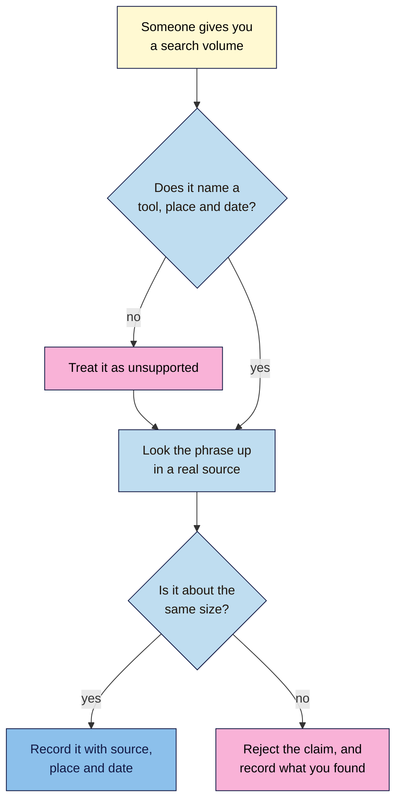

# M03.L03 — Free Keyword Data: Volume, Difficulty and Seasonality
> After this lesson you can look up a phrase in free tools, say what each number really measures, and spot a search volume that nobody can back up.

**Time:** ~15 min reading + ~40 min hands-on + ~10 min exercise · **Level:** L1 Foundation (beginner) · **Prereqs:** M03.L02, M01.L08 · **Remediate to:** M03.L02, M01.L08
**Verified against:** Google Ads Help "Use Keyword Planner" and "About Keyword Planner forecasts"; Google Trends Help "FAQ about Google Trends data" and "Compare Trends search terms"; Search Console Help "Performance report (Search results)" and "What are impressions, position, and clicks?"; Google Search Central's 2022 post on performance data; the Bing Webmaster blog (June 2025); Ahrefs and Semrush's own pages, all on 2026-11-06. **Not confirmed:** Microsoft's Keyword Research help pages couldn't be read, so what that tool shows comes from third-party reports. Google's docs don't cover Keyword Planner's ranges for accounts with no ad spend, so that's third-party too. Tool screens weren't run live for this draft.

> ⚠️ **Freshness flag:** free limits, labels and sign-up steps in these tools change often. Treat them as a guide, and trust the screen in front of you.

## Learning objectives
1. **Use** free sources: Keyword Planner, Google Trends, Bing keyword research, Search Console queries and Ahrefs Webmaster Tools. *(O1)*
2. **Explain** what volume, difficulty and seasonality really measure, and why tools disagree. *(O2)*
3. **Check** a claimed search volume against a real source, and reject figures AI has invented. *(O3)*

## Why it matters
Amara's client forwards a report: "cold brew recipe gets 40,500 searches a month, and it's low competition." It looks exact, so it looks true. But the number came from an AI chat, and "low competition" came from a column about advertisers. If she builds a plan on that, she's spending the client's money on a guess. Keyword data is useful, but only if you know where each number comes from and what it's really counting.

## Core concept
**Plain version:** no free tool gives you one true number. Each one measures something different, from its own data. So you use them to compare phrases and spot patterns, not to get exact counts.

**Analogy:** think of guessing how busy a street is. One person counts cars for an hour, another reads a bus company's report, and a shop counts who walks in. They'll all give different numbers, and all of them help, as long as you know who counted what.

### The three measures

| Measure | What it really means | What it doesn't mean |
|---|---|---|
| **Search volume** | Roughly how often a phrase is searched each month | How many people would visit you. Many searches never lead to a click on any site *(observed practice)* |
| **Keyword difficulty** | One tool's estimate of how hard it is to rank | A Google score. Google doesn't publish one |
| **Seasonality** | A pattern that repeats at the same time each year | A one-off spike from a news story |

### The free sources

| Source | What it gives you | Whose data | What to watch for |
|---|---|---|---|
| **Keyword Planner** (Google Ads) | Average monthly searches, ad competition, bids | Google | Built for advertisers. Needs account setup with billing details |
| **Google Trends** | Interest over time, by place | Google | Relative, not a count of searches |
| **Search Console** | Searches where your site appeared | Google, your site only | Only shows your site's own appearances |
| **Bing Webmaster Tools** | Keyword research and your site's performance | Bing | Bing's searches only, and you must sign in |
| **Ahrefs Webmaster Tools** | SEO data on sites you've verified | Ahrefs | Competitors' sites need a paid plan |
| **Ahrefs free keyword tools** | Volume estimates and a difficulty score | Ahrefs | Estimates, "powered by clickstream data" |

### What each number says
**Keyword Planner volume.** Google defines it as "The average number of times people have searched for a keyword and its close variants based on the month range as well as the location and Search Network settings you selected." **Close variants** are near-identical phrases, so similar phrases can share one number. Google adds: "Your search volume statistics are rounded."

**Ranges.** With little or no ad spend, you may see a broad range such as 1K–10K. SEO sites report this, though Google's help pages that we checked don't explain it. A range is still enough to compare phrases.

**The Competition trap.** In Keyword Planner, Competition is "The number of advertisers that showed on each keyword relative to all keywords across Google." It's about **ads**, not about how hard it is to rank.

**Google Trends.** Trends doesn't count searches. Google says: "Each data point is divided by the total searches of the geography and time range it represents to compare relative popularity." The results are then "scaled on a range of 0 to 100". On your chart, 100 marks the peak *(observed)*, not 100 searches. Also, "Trends only shows data for popular terms", so a long-tail phrase may show nothing. That doesn't prove nobody searches it.

**Search Console.** **Impressions** means "How many times your site appeared in Search results." So it's not the total demand for a phrase. It's also missing some rare searches: "Some queries (called anonymized queries) are not included in Search Console data to protect the privacy of the user making the query." It's the only source here that shows what really happened for your site, which is why it matters so much once you have data.

**Difficulty.** Each tool has its own method, so these scores aren't comparable:
- **Ahrefs:** it looks at "the number of referring domains the top 10 ranking pages have", and says: "Keyword Difficulty doesn't take into account any on-page factors."
- **Semrush:** its score is "based on a variety of factors", including links and "the SERP-related qualities of the keyword itself".

Ahrefs itself says: "These tools all use the same 0-100 scale, but each one calculates it differently." Compare phrases inside one tool, and never across two.

### What this does for search

| Claim | Verdict | What the source says |
|---|---|---|
| Keyword Planner's volumes are exact | **False** | "Your search volume statistics are rounded." |
| Competition shows how hard it is to rank | **False** | It's "The number of advertisers that showed on each keyword" |
| A Trends score of 100 means 100 searches | **False** | Scores are relative, and Google says it's "not a perfect mirror of search activity" |
| Google publishes a keyword difficulty score | **Not in Google's docs** | Difficulty scores come from SEO tools, and they differ |
| A phrase with no volume has no searches | **False** | "Keywords with very low search volumes, or keywords that are considered sensitive aren't discoverable or forecastable." |
| Search Console shows every search | **False** | "Anonymized queries are those that aren't issued by more than a few dozen users over a two-to-three month period." Google's post is from 2022 |
| An exact-looking number is a reliable number | **False** | Check who measured it, where and when *(observed practice)* |

## How it works
Use this flow whenever someone gives you a search volume.

**In words:** when someone gives you a search volume, check if it names a tool, a place and a date. If it doesn't, treat it as unsupported. Either way, look the phrase up in a real source. If the numbers are about the same size, record it with its source, place and date. If they aren't, reject the claim and record what you found.

> **Under the hood: why estimates disagree.** Google's tools see Google's searches. Bing sees Bing's. Third-party tools can't see inside Google, so they estimate. Ahrefs says its estimates are "powered by clickstream data". Each tool also picks its own place, period, rounding and grouping of similar phrases. So a gap between two tools isn't a mistake. It's a reminder that you're comparing estimates. In this course, "about the same size" means within roughly the same power of ten, such as hundreds or thousands *(course rule of thumb)*.

## Hands-on walkthrough
You'll look up ten phrases in at least two sources, compare a seasonal phrase, and test a claimed number. You need a browser and your "SEO 101 project" sheet. Nila Coffee's values are illustrative.

**Before you start: which steps apply to you?**
- **Path A (your own site):** do every part.
- **Path B (Blogger practice site):** your Search Console may have little or no data. In Part D, use the Ahrefs free tools, and note "No data yet".
- **Path C (client site):** use your own Keyword Planner and the public tools. Use the client's Search Console or Bing account only if they've given you access.
- **Keyword Planner:** Google says you must complete account setup "by entering your billing information to access basic features". **You don't need to run or pay for an ad for this lesson.** If setup won't let you reach Keyword Planner without launching a campaign, or you'd rather not enter billing details, skip Part B, and use Parts C and D for your two sources.

**Part A — Set up (4 min)**
1. Add a tab called **Keyword data** to your "SEO 101 project" sheet, with these columns:

   | Phrase | Planner volume | Second source | Its value | Trends pattern | Difficulty (tool) | Place | Date |
   |---|---|---|---|---|---|---|---|
   | cold brew ratio | 1K–10K | Ahrefs | 900 | Steady | 12 (Ahrefs) | India | 2026-11-06 |

2. Choose ten Confirmed phrases from your **Keyword ideas** tab: a mix of short and long, and of intents.

**Part B — Keyword Planner (10 min)**
1. Go to Google Ads, open the **Tools** menu, and choose **Keyword Planner**.
2. Choose **Get search volume and forecasts**, and paste in your ten phrases.
3. Set your audience's country and language.
4. Copy **Avg. monthly searches** into your tab, as you see it.
   > 🖼️ **Image prompt:** Keyword Planner results table (1200×500) for a few coffee phrases, showing the Keyword, Avg. monthly searches and Competition columns. Highlight the Avg. monthly searches column with a 3px #F9B2D7 outline; blur any personal details and account numbers.
   > **Alt text:** A Keyword Planner table of coffee phrases, with the monthly searches column highlighted.

   **Expected:** ranges or rounded numbers, and blanks or very low figures for some long phrases. Leave Competition out of your tab, because it's about ads.

**Part C — Google Trends (8 min)**
1. Go to `https://trends.google.com`, and search a phrase that you suspect is seasonal, such as "iced coffee".
2. Set the country to your audience's, and the time range to the past five years.
3. Look for peaks at the same time each year.
   > 🖼️ **Image prompt:** Google Trends line chart (1200×500) showing five years of interest in a seasonal search such as "iced coffee", with clear yearly peaks. Highlight one yearly peak with a 3px #F9B2D7 outline; blur any personal details.
   > **Alt text:** A Google Trends line chart with repeating yearly peaks, and one peak highlighted.
4. Add a second phrase to compare, such as "cold brew". Then compare a few of your shorter phrases.

   **Expected:** one line sits above the other, and that shows relative interest. Long phrases may show too little data. Note that, and move on.
5. In **Trends pattern**, write Seasonal (and the peak month), Steady, Rising, Falling or Too little data.

**Part D — A second source (10 min)**
Use at least one of these.
1. **Search Console** (if you have data): open **Performance**, then **Queries**, and search your phrases. Record impressions and average position.
2. **Bing Webmaster Tools:** sign in at `https://www.bing.com/webmasters`, and open **Keyword Research**. Third-party reports say it shows impressions for each keyword, so note what you really see. Label it as Bing data.
3. **Ahrefs free tools:** enter a phrase in the free Keyword Generator at `https://ahrefs.com/keyword-generator`, and the Keyword Difficulty Checker at `https://ahrefs.com/keyword-difficulty`. Record the estimate, and the difficulty as "(Ahrefs)". If you've verified your site in Ahrefs Webmaster Tools, look at the keywords it already ranks for, too.

**Expected:** the sources won't match. That's normal. Look at whether they agree on which phrases are bigger.

**Part E — Test a claimed number (8 min)**
1. Ask an AI tool: "How many monthly searches does [one of your phrases] get in [your country]?"
2. Follow the flowchart. Did it name a tool, a place and a date? Can you find that source?
3. Compare it with your own figures, and write a one-line verdict in a note on that row.

   **Expected:** something like "AI said 12,000. Planner shows 100–1K, and Ahrefs shows 300. Rejected."

**Expected output:** a **Keyword data** tab with ten phrases, each with values from at least two sources, plus a place and a date, at least one seasonal check, and one verdict on a claimed number.

## When to use / when not to
**Use volume** to compare phrases, not to predict traffic.

**Use difficulty** as a first filter, inside one tool. Lesson 3.4 shows you how to judge it from the results page.

**Use Trends** to plan timing. For a seasonal topic, publish well before the peak *(observed practice)*.

**Don't throw out low-volume phrases.** Tools often can't see them, and they may be the ones your customers really use.

**The trade-off:** checking two sources takes longer, but it stops a confident wrong number from driving your plan. For a small site, ten well-checked phrases beat 500 unchecked ones.

## Use AI for this
**Example prompt:**
> "Here's a table of phrases with volumes from Keyword Planner and Ahrefs: [paste]. Group them by topic, and point out where the two sources differ most. Use only my numbers. Don't add new figures."

**What AI does well here:** sorting and comparing data you've given it, and spotting patterns in a table.
**Where it gets it wrong:** asked for a volume, it can answer with an exact-looking figure that has no source. A chat tool that's searching the web may also repeat an old number from a blog.
**How to check:** ask where the number came from, then look it up yourself. If you can't trace it to a tool, a place and a date, reject it.

## Common mistakes
- **Reading Competition as SEO difficulty.** It's about advertisers.
- **Treating Trends as a count.** It's relative.
- **Comparing difficulty across tools.** Each has its own method.
- **Forgetting the place.** A volume means little without a country.
- **Treating volume as traffic.** It counts searches, not visits to you.
- **Paying to get exact numbers.** You don't need ads for this. Ranges are enough to compare.
- **Dropping a phrase because a tool shows nothing.** Tools miss rare searches.
- **Copying numbers from AI.** Trace them, or reject them.

## Troubleshooting
| Symptom | Likely cause | Fix |
|---|---|---|
| Keyword Planner asks you to create a campaign | Google Ads steers new accounts that way | Don't launch one. If you can't get past it, skip Part B |
| Volumes are wide ranges | Reported for accounts with little or no ad spend | Use the ranges to compare phrases |
| A phrase shows no volume | Very low volume, or a sensitive topic | Keep it if it's Confirmed, and note "No data" |
| Trends shows too little data | Trends "only shows data for popular terms" | Try a shorter phrase, or a wider time range |
| Search Console shows nothing | New site, or no appearances for that phrase | Use another source. Record "No data yet" |
| Bing's numbers are much lower | Bing has its own search data | Don't compare them directly with Google's |
| An Ahrefs free tool hits a limit | Free limits can change | Try later, or use another source |

## Exercise
**Task:** complete your **Keyword data** tab (Parts A–E). Then review these lines from a report on Nila Coffee. For each one, say Keep or Fix, and give a reason. The figures are illustrative.

1. "cold brew ratio: 1K–10K monthly searches (Keyword Planner, India, 2026-11-06)."
2. "Competition is High in Keyword Planner, so this phrase will be hard to rank for."
3. "Trends shows 100 for iced coffee in May, so that's 100 searches."
4. "One tool gives this phrase a difficulty of 12, so we'll rank within a week."
5. "AI says cold brew ratio gets 40,500 searches a month."
6. "Search Console shows 30 impressions for 'coffee roaster kochi', so that's all the demand there is."
7. "Iced coffee peaks each April and May in India (Trends, five years, 2026-11-06), so we'll publish in February."

**Expected outcome:** a complete tab, and these answers:
1. **Keep:** it has a tool, a place and a date.
2. **Fix:** Competition is about advertisers. It says nothing about organic difficulty.
3. **Fix:** 100 marks the peak of a relative scale. It's not a count.
4. **Fix:** difficulty is one tool's estimate, and it says nothing about time.
5. **Fix:** no source, and it's far above line 1's range. Reject it.
6. **Fix:** impressions only count when your site appeared. Real demand may be higher.
7. **Keep:** it's sourced, with a place and a date, and it uses the pattern to plan ahead.

**Stretch goal:** run the same phrase through Trends for two countries, such as India and the UK, and note how the seasonal peak moves.

## Key takeaways
- No free tool gives one true number, so use them to compare, not to count.
- Volume is rounded and estimated, Trends is relative, and Search Console only shows your own site.
- Keyword Planner's Competition is about ads, and difficulty scores only compare inside one tool.
- Record every number with its source, place and date.
- If a figure can't be traced to a real source, reject it, however exact it looks.

## Teach it back
Explain to a friend in 3 sentences why Keyword Planner and Ahrefs can show different numbers for the same phrase, and why that's fine.

## Glossary terms added
- Anonymized query — added to `seo-101/glossary.md`
- Close variants — added to `seo-101/glossary.md`
- Google Trends — added to `seo-101/glossary.md`
- Impression — added to `seo-101/glossary.md`
- Keyword difficulty — added to `seo-101/glossary.md`
- Keyword Planner — added to `seo-101/glossary.md`
- Search volume — added to `seo-101/glossary.md`
- Seasonality — added to `seo-101/glossary.md`

## Further reading
*All checked 2026-11-06. Vendor pages describe their own tools.*
- Google Ads Help — Use Keyword Planner: https://support.google.com/google-ads/answer/7337243
- Google Ads Help — About Keyword Planner forecasts: https://support.google.com/google-ads/answer/3022575
- Google Trends Help — FAQ about Google Trends data: https://support.google.com/trends/answer/4365533
- Google Trends Help — Compare Trends search terms: https://support.google.com/trends/answer/4359550
- Search Console Help — What are impressions, position, and clicks?: https://support.google.com/webmasters/answer/7042828
- Google Search Central — A deep dive into Search Console performance data filtering and limits (2022): https://developers.google.com/search/blog/2022/10/performance-data-deep-dive
- Bing Webmaster blog — Start Using Bing Webmaster Tools to Improve Your Site Visibility (2025): https://blogs.bing.com/webmaster/2025/6/Start-Using-Bing-Webmaster-Tools-to-Improve-Your-Site-Visibility/
- Ahrefs (vendor) — Ahrefs Webmaster Tools: https://ahrefs.com/webmaster-tools
- Ahrefs (vendor) — Keyword Difficulty Checker: https://ahrefs.com/keyword-difficulty
- Semrush (vendor) — What is KD%?: https://www.semrush.com/kb/1158-what-is-kd

> ⚠️ **May change:** Keyword Planner's access rules and ranges; Bing's Keyword Research tool; free limits in Ahrefs' tools.

## Refresher card
*Used by remediation when a learner fails a quiz twice on a later lesson that points back here.*
No free tool gives one true number. **Search volume** (Keyword Planner) is a rounded monthly average that includes close variants, and it may show as a range. Its **Competition** column is about advertisers, not SEO. **Google Trends** is relative, from 0 to 100, and good for spotting **seasonality**. **Search Console** shows only your own site's appearances, without anonymized queries. **Keyword difficulty** is a tool's estimate, so compare only inside one tool. **Check any claimed volume:** does it name a tool, a place and a date? Look it up yourself. If it's not about the same size, reject it. Use numbers to compare phrases, not to predict traffic.
